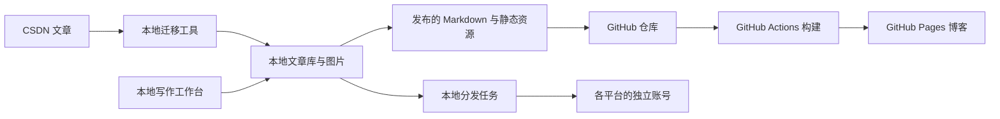

# 个人博客与多平台创作工作台：设计提案

日期：2026-11-14

状态：用户已确认架构与视觉方向；本地实现及验证已完成，实际迁移与上线等待账号主页和仓库信息。

## 1. 已确认的目标

- 博客免费部署在 GitHub Pages，允许使用本地工具或浏览器扩展辅助管理。
- 优先做好博客功能、设计感、艺术感、氛围感和阅读体验。
- 将本人现有 CSDN 文章迁移为独立、可备份的内容。
- 后续在一个系统中编辑文章，并选择多个平台、多个账号进行分发。
- 优先复用已有开源项目中经过验证的能力。

“CASDN”暂按 CSDN 理解。尚未提供 CSDN 主页、目标 GitHub 仓库、正式站名和账号信息；这些信息不妨碍前端开发，但迁移实测与上线分别需要对应资料。

## 2. 方案比较与选择

| 方案 | 优点 | 成本与约束 | 决策 |
| --- | --- | --- | --- |
| Astro 静态博客 + 本地创作工作台 | 适合 GitHub Pages，内容可保存在 Markdown 中，视觉自由度高，本地工具可以管理账号 | 编辑、迁移和自动分发时需要运行本地工具 | 已选择这一架构；建议使用 Astro 实现 |
| Halo / WordPress + 服务端发布任务 | 在线管理方便，服务端可持续执行任务 | 需要服务器及维护，无法只用 GitHub Pages 部署 | 当前不采用 |
| 完全套用博客主题 + 独立同步扩展 | 初始上线快 | 视觉与交互受主题约束，管理和分发体验较割裂 | 作为能力参考与分发备选 |

## 3. 产品结构

公开博客是读者访问的网站。本地工作台是作者运行在自己电脑上的管理界面，二者共用内容格式，但拥有不同的运行环境。

GitHub Pages 提供静态页面，不承担文章抓取、跨站登录、数据库或浏览器自动化。本地工作台启动后才执行这些任务。关闭电脑后，不承诺继续自动分发或定时发布。

## 4. 推荐视觉：纸上山河

整体采用东方杂志与个人随笔集的气质：米白纸面、墨色文字、朱砂点缀、山水或抽象自然图像。首页具有明确的美术构图，正文页以阅读为中心。

### 配色与字体

- 日间：纸白 `#F4F1EA`、墨黑 `#222823`、灰绿 `#717B70`、朱砂 `#AE4D36`。
- 夜间：深墨绿 `#161E1C`、暖灰白 `#E5E2D9`，强调色调整到适合深色背景的明度。
- 标题使用有衬线感的中文字体，正文使用清晰的中文无衬线字体，代码使用等宽字体。外部字体失效时保持可读。
- 首屏标题字号与留白形成层次，正文按约 18px、1.8 倍行高起步，在真实中文长文中调整。

### 构图与氛围

- 顶部用字标、简洁导航、搜索和主题切换组成安静的页眉。
- 首页首屏采用左右错落布局：左侧个人介绍与主标题，右侧横向或纵向山水画面，底部附简短注释。
- 使用细线、期刊编号、日期与分类建立秩序，减少大型圆角面板和装饰性徽章。
- 使用少量纸纹和细微渐变增加质感；装饰图片不影响正文对比度。
- 页面进入与悬停使用短促、轻微的透明度和位移动效，尊重减少动态效果的系统设置。
- 夜间模式保留同一套字体、留白和版式，以墨色山水表达氛围。

### 其他可选方向

1. 极简画廊：黑白灰、超大字体、摄影作品感，适合偏理性与作品展示的内容。
2. 深色星野：深蓝背景、青绿光晕、数字艺术，科技感更强。

默认推荐“纸上山河”。站名暂用 WKN，仅作开发占位，正式名称可以通过配置替换。

## 5. 博客页面与行为

### 首页

- 个人介绍、精选文章、最新文章、分类入口和 RSS 入口。
- 精选文章与普通文章形成清楚的阅读层级。
- 真实内容不足时展示明确标记的示例文章，不虚构作者经历、阅读量或粉丝数。

### 文章列表、分类与归档

- 按发布时间排列，支持分页、分类和标签导航。
- 归档按年/月展示，点击后进入真实文章。
- 搜索使用静态全文索引，覆盖标题、摘要和正文，提供无结果状态。
- 搜索、筛选与分页在 GitHub Pages 仓库子路径下正常工作。

### 文章详情

- 标题、摘要、日期、分类标签、预计阅读时间。
- Markdown 正文、表格、引用、列表、图片、代码高亮与复制。
- 桌面端目录随滚动定位；移动端使用可折叠目录。
- 阅读进度、前后篇导航、相关文章、复制链接。
- 迁移文章保留原文来源链接及原始发布日期。
- 数学公式作为第一阶段阅读能力；Mermaid 如启用需单独验证加载和导出表现。

### 关于与基础页面

- 关于页包含可配置介绍与社交链接。
- 404 页提供回首页和文章列表的入口。
- RSS、站点地图、规范链接、分享元信息和基础结构化数据。
- 评论暂不作为首版上线依赖，后续可配置 Giscus。

## 6. 本地创作工作台

- 提供文章列表、Markdown 编辑与预览、封面和标签编辑、草稿管理。
- 草稿和账号资料保存在不会提交到仓库的本地目录中。
- 作者确认发布到博客后，将文章与图片写入仓库的公开内容目录。
- 使用用户本机既有 Git 登录完成提交与推送；站点中不要求粘贴 GitHub Token。
- 显示保存、提交、推送失败等实际结果。Git 推送成功仅表示源码已推送，Actions 构建是否成功应通过实际状态或明确链接确认。
- 本地 API 只监听回环地址，并校验请求来源和本机会话，防止其他网页调用发布或读取内容。

公开站点不挂一个没有服务支持的“在线后台”。编辑和分发界面在本地工作台使用。

## 7. CSDN 迁移

### 输入

本人 CSDN 主页或文章地址列表；已经导出的 Markdown 文件也可以作为输入。需要登录的内容仅通过本机用户会话处理。

### 流程

1. 列出候选文章，展示标题、日期和来源，允许勾选。
2. 优先使用原始 Markdown；获取不到时，将正文 HTML 转成 Markdown。
3. 提取标题、发布日期、标签、分类、来源地址。
4. 将正文图片下载为本地资源并替换链接，检查防盗链和下载失败项。
5. 以 CSDN 文章 ID 去重；重复迁移显示更新差异，避免直接覆盖作者修改。
6. 生成迁移报告，标出成功、失败、缺图、需要人工处理的文章。
7. 在本地预览检查排版后，由作者选择哪些文章正式进入博客。

不绕过登录、验证码或访问限制。受限制时暂停并提示用户在本机完成操作，或改用已有导出文件。未拿到用户文章前，只能用测试样本验证解析，不能宣称已完成实际迁移。

## 8. 一篇文章、多平台、多账号

### 目标模型

发布目标为“平台 + 账号”的组合。同一个平台上的两个账号是两个独立目标，分别保存会话和结果。

### 发布流程

1. 选择文章版本，选择目标平台与账号。
2. 校验登录状态、平台必填项、封面和格式能力。
3. 为各平台转换内容、上传图片，创建或更新草稿。
4. 支持直接发布的平台可执行发布；只能创建草稿或需要审核的平台显示实际状态及下一步入口。
5. 显示每个目标的结果、文章或草稿地址、错误原因；失败目标可以单独重试。

### 可靠性

- 每个账号使用独立的浏览器会话目录，避免同平台切换账号造成串号。
- 记录文章 ID、内容版本哈希、目标账号、远端文章 ID 和任务状态。
- 超时后先查询远端结果；不能确认时进入“待核验”，避免盲目重试产生重复文章。
- 已创建草稿后重试优先更新远端草稿。
- 账号会话失效时进入“待重新登录”，不显示为发布成功。
- 任务状态包括排队、执行中、草稿已创建、待人工操作、已提交发布、发布成功、失败、待核验。
- 发布成功需要明确的远端响应或可核验结果；点击按钮、复制内容、进入编辑器均不算成功。

### 接入优先级

先完成博客自身发布；CSDN 是首个外部分发适配目标。掘金、知乎、公众号随后按实际接口能力接入。首版不承诺任意平台、任意账号都已可自动发布。

Wechatsync 扩展作为可选分发通道，经过本机兼容性验证后启用。其网页 SDK 可拉起同步任务，但现有文档不足以证明同一平台多账号隔离或可靠的任务完成回调，不把这些能力作为既定前提。

## 9. 开源复用调研

2026-11-14 已读取以下上游公开文档：

| 项目 | 已确认的文档能力 | 建议用途 |
| --- | --- | --- |
| [Fuwari](https://github.com/saicaca/fuwari) | Astro、Pagefind、主题切换、文章目录、RSS、Markdown 扩展，README 标明 MIT | 评估博客基础实现与配置；根据最终设计决定复用程度 |
| [Wechatsync](https://github.com/wechatsync/Wechatsync) | 多平台扩展、平台适配器、图片上传流程、网页调用接口 | 调研分发接口与可选扩展集成 |
| [article-syncjs](https://github.com/wechatsync/article-syncjs) | `window.syncPost` 可接收文章并拉起同步窗口 | 验证从工作台触发同步 |
| [Elog](https://github.com/LetTTGACO/elog) | 文档平台到博客的同步、Front Matter 和图片处理 | 内容导入和资源迁移参考 |
| [csdn2md](https://github.com/secsilm/csdn2md) | CSDN 导出思路，原始 Markdown 与富文本有不同处理条件 | 迁移流程参考，需要真实文章验证 |

Wechatsync 的 README 平台表含 2021 年检查日期，不能据此推断目前全部平台可用。其根目录 LICENSE 为 GPL-3.0，而读取到的 package.json 标识为 ISC，直接复制代码前需要确认对应代码的许可证。通过独立扩展接口集成和直接复制源代码是不同的复用方式。

当前网络访问情况：GitHub API 部分请求限流，Git HTTPS 连接失败，尝试的源码归档地址返回 404；部分 raw 文档可以访问。目前没有成功克隆完整源码，没有安装依赖或运行任何上游代码。

## 10. 分阶段实施

### 阶段一：博客与部署基础（最高优先级）

实现确认后的视觉方向及首页、文章详情、列表、分类标签、归档、关于、搜索、深浅色、RSS、SEO 和 GitHub Pages 工作流。建立内容格式，为本地管理和迁移准备入口。

验收：生产构建成功；首页、长文、搜索和移动端经过浏览器检查；链接与静态资源支持仓库子路径；草稿正文不会进入生成页面、搜索索引、RSS、站点地图或公开仓库。

### 阶段二：本地工作台与 CSDN 迁移

实现本地文章管理、编辑预览、图片保存、迁移报告及发布到博客的完整流程。获取用户主页后验证真实迁移。

验收：重复导入不会增加重复文章；缺图与受限内容有明确报告；代码、表格和原文日期正确；发布的文件可通过阶段一构建。

### 阶段三：多平台与多账号分发

先验证 CSDN 的真实发布流程，再接入其他目标。评估 Wechatsync 扩展通道，同时保留统一的目标模型和任务记录。

验收：同一文章可以选择多个目标；账号会话隔离；失败可恢复；不会将草稿或待人工操作标记为发布成功。至少在用户选择的平台上完成真实账号验证后，才称对应适配器已可用。

## 11. 检查与上线条件

- 静态类型检查、生产构建和内容字段校验。
- 桌面与手机宽度下检查导航、目录、搜索、代码块、图片和溢出。
- 键盘可操作，搜索弹窗焦点正确，主题切换可访问，减少动态效果设置有效。
- 导入测试覆盖重复文章、HTML 正文、图片失败、异常元数据和登录限制。
- 分发测试覆盖部分成功、账号失效、超时待核验、草稿与最终发布状态区分。
- 提供本地启动、GitHub Pages 配置、文章编写、迁移和分发的中文说明。
- 真正上线需要目标 GitHub 用户名/仓库及可用的本机认证；不以本地构建成功代替上线成功。

## 12. 本次待评审内容

用户已确认“纸上山河”视觉方向与免费部署架构。实现结果、验证范围与外部能力限制见 README.md。CSDN 真实文章迁移、实际账号分发与 GitHub Pages 上线仍需对应资料和现场验证。
