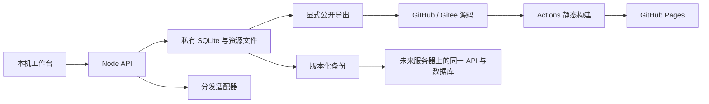

# 砚山 Yanshan：个人写作与科研平台设计

日期：2026-11-15（Asia/Shanghai）。状态：待用户评审；本文描述目标设计，不代表功能已经实现。

## 1. 已确认决策与本次范围

- 工作名使用“砚山 Yanshan”，通过配置管理品牌，保留以后改名的能力。
- 第一阶段交付全量平台骨架：博客、写作、论文、绘图、AI、资源库拥有统一导航、内容关联和持久化数据。
- 本地优先、服务器可选。GitHub Pages 提供公开阅读；完整工作台由本机服务运行，未来服务器使用相同 API 与数据库格式。
- 延续古风、简约、细节点缀的方向，重点提升组件质感、长文呈现和工作台的连续体验。
- 保留 GitHub / Gitee 双推送、CSDN 迁移和现有多账号分发能力。

本次文档评审的对象是首阶段骨架及其扩展边界。论文解析与翻译、交互式 AI 原理图解、科研绘图引擎、LaTeX 编译、真实 AI 供应商调用分成后续独立交付，不能仅因建立入口就标记为已实现。

## 2. 当前基线

基线提交：`d47da61`。现有公开站为 Astro 5，工作台为原生浏览器界面与 Node / Express 5，本地数据保存在 `.local/state.json`。

- GitHub：https://github.com/22935/W_KN
- GitHub Pages：https://22935.github.io/W_KN/
- Gitee：https://gitee.com/mythksw/W_KN
- CSDN：https://blog.csdn.net/Hismybestlove
- 已迁移 23/78 篇正文及 245 张图片。剩余 55 篇受 HTTP 521 验证限制；迁移进度以 `docs/migration/2026-11-15-csdn.md` 为准。

现有可复用模块包括内容校验、HTML 清理、图片本地化、来源去重、Git 双远端推送、多账号浏览器会话、分发交付包和状态记录。重构优先抽取这些模块，避免重新实现已经有验证的行为。

## 3. 架构选择

| 方案 | 优点 | 代价 | 结论 |
| --- | --- | --- | --- |
| Astro 阅读端 + React 工作台 + Node API | 适合 Pages，编辑器生态完整，能够迁移到服务器 | 三个应用需要明确内容契约 | 推荐，符合已确认的数据访问方式 |
| 全栈服务器应用 | 在线任务与多设备访问方便 | 第一版就依赖服务器、认证与运维；Pages 只能展示镜像 | 后续按实际使用需要扩展 |
| 继续扩展原生工作台 | 初始改动小 | 编辑器、论文和绘图交互共享状态较难维护 | 仅作为迁移期间的兼容入口 |

目标结构采用 npm workspaces 和 TypeScript：

```text
apps/site/             Astro：公开博客、图解与资源展示
apps/studio/           React + Vite：作者工作台
apps/api/              Express：会话、内容、资源和任务 API
packages/content/      版本化 schema、校验、导入与导出契约
packages/ui/           工作台组件和设计 token
packages/publishers/   Git、外部平台及分发适配器
packages/storage/      SQLite、文件资源与备份
content/posts/         明确导出的公开文章
content/assets/        明确导出的公开资源
.local/                私有数据库、资源、迁移备份和浏览器会话
```

目录移动与旧脚本调整在实现计划中逐步执行。每一步保持公开站可构建、旧文章 URL 可访问，不能同时留两套可写的主数据。

### 3.1 本地模式

API 服务托管构建后的工作台，同源访问，默认只绑定回环地址。开发时 Vite 将 `/api` 代理到该服务。保留启动时生成的短期会话机制，请求认证失败显示重新进入入口。

SQLite 与资源文件位于 `.local/`。工作台中的保存表示服务端已持久化；浏览器不是唯一存储位置。断开 API 时提供重连和未保存内容导出，不显示保存成功。

### 3.2 GitHub Pages

只构建明确选择公开的文章及其依赖资源，继续支持 `/W_KN/` 子路径、Pagefind、RSS 和站点地图。工作台入口页说明如何启动本机工作台；不在公开页面保存凭据或自动访问本机端口。

公开侧的论文、图解和资源页面只显示作者主动导出的介绍或作品，私有 PDF、批注和 AI 任务不进入公开构建。尚无公开内容时显示真实空状态。

### 3.3 后续服务器模式

同一工作台与 API 部署在 HTTPS 同源地址，默认保持单作者模型，先沿用 SQLite + 文件卷。支持发布静态博客到服务器或继续发布到 Pages，站点域名及基础路径均可配置。

远程启用前必须交付持久化登录会话、密码哈希、CSRF 防护、登录限流、备份和反向代理配置。首阶段不通过简单开放本地端口来提供服务器模式，也不宣称 Docker 文件即代表远程部署已完成验证。

PostgreSQL、对象存储、多用户、自动跨设备同步另行实现。将来从本机迁移到服务器通过版本化备份包完成；不承诺首次服务器版自动合并两地编辑。



## 4. 信息架构与首阶段可用流程

公开侧：主页、文章、论文、图解、资源、关于，移动端用菜单收纳。论文页展示公开读书笔记，保留文章归档、标签和搜索。

工作台使用统一侧栏：总览、写作、内容库、论文、绘图、AI 助手、发布、设置。所有页面具有加载、空、失败和成功状态；统计来自数据库，不生成虚构数据。

| 模块 | 首阶段验收范围 | 后续独立交付 |
| --- | --- | --- |
| 总览 | 最近内容、继续写作、真实内容统计和迁移报告入口 | 跨项目任务视图 |
| 写作 | Markdown 编辑预览、草稿、手动版本快照、标签与资源插入；文档以 schema 封装 | Tiptap 块编辑、拖拽排序、键盘重排、复杂表格 |
| 内容与资源库 | 项目及文档创建、列表、筛选、图片 / PDF / draw.io 文件导入、引用和删除约束 | 全文跨模态检索与引用网络 |
| 论文 | PDF 资源登记、标题 / DOI / 标签、三层笔记（概览 / 结构 / 精读）、浏览器原生 PDF 查看 | PDF.js 页码批注、文本提取、双语对照、引用管理 |
| 绘图 | 模板元数据、Mermaid 源码预览与保存、draw.io 原文件保存及下载 | draw.io 嵌入编辑回传、科研绘图引擎、SVG / PNG 导出 |
| 公式 | 已有 LaTeX / KaTeX 编辑与预览 | 变量注释、参数滑块、计算模型和动态图表 |
| AI 助手 | 可持久化提示模板；润色、翻译、摘要任务表单可以复制上下文和保存手动导入的结果 | 服务端供应商调用、流式结果、段落差异采纳 |
| 发布 | 选定文章版本、公开预检、写入站点、GitHub / Gitee 各自结果；保留现有外部交付流程 | 经真实账号验证的平台图片上传与草稿更新 |
| 设置 | 品牌配置、功能可用状态、备份导出和恢复校验 | AI 密钥设置、服务器登录与运维 |

首阶段是各模块具有基本输入、保存、重开和关联能力的平台骨架。高级编辑器等任务在后续子项目中完成，不以不可点击的导航或永远加载的占位页代替模块。

Tiptap 仅作为后续块编辑器的建议选型，采用开源基础扩展，不依赖付费功能。已有 Markdown 先按原始源码保存，渲染与元数据管理不会强行转换整个文章。

## 5. 统一内容契约

数据库记录使用稳定 ID、`schemaVersion`、UTC 创建与更新时间。页面按用户时区显示，原文发布日期单独保留。

| 实体 | 内容与约束 |
| --- | --- |
| Project | 名称、说明、关联文档；文档允许不属于项目 |
| Document | 类型、标题、摘要、标签、状态、原始来源、公开 slug、当前版本；论文、笔记、文章与图解共用外层记录 |
| DocumentRevision | 不可变版本、格式（Markdown / 结构化块 / Mermaid）、正文、资源引用、内容哈希；保存携带预期版本号 |
| Block | 结构化文档内部带 ID 的节点树及其版本化属性；首阶段只定义契约，不另建一套与正文互相漂移的块表 |
| Asset | 内容哈希、类型、大小、原文件名、私有存储键、引用关系；公开地址由发布导出产生 |
| Annotation | 文档版本、目标类型、定位器、正文；先支持笔记层级，未来 PDF 页码 / 区域 / 文本定位器按类型扩展 |
| Template | 类型、参数 schema、默认内容、来源与许可说明 |
| Task | 类型、输入版本、状态、结果和错误；首阶段 AI 手动流程使用待处理 / 手动完成状态，不标记为模型已执行 |
| Account | 平台、备注、隔离会话引用；不在记录中保存平台密码 |
| PublicationJob | 文档版本、目标账号、幂等键、阶段、错误及远端链接；Git 双远端各自记录结果 |

草稿 / 就绪 / 归档描述内容生命周期，公开记录单独关联已导出的版本。新保存草稿不自动改变线上已发布版本。

格式转换规则：

1. 原始 Markdown 是导入文章的编辑来源，保留代码、公式、来源、日期和资源引用。
2. 后续结构化块树作为块文档来源，Markdown / HTML 是导出物。不同格式之间不承诺任意无损往返。
3. 转换前提供新版本及差异；未知语法保留为原始源码块，不能静默删除。
4. Mermaid、draw.io、公式保留可编辑源文件；需要跨平台时附渲染图片与说明。无法导出的内容显示具体原因。
5. 科研绘图后续保留数据、参数、模板和输出，不只保存截图。任意论文导出为 LaTeX / PDF 不在首阶段范围。

## 6. 服务边界与数据流

API 使用 `/api/v1`，按内容、项目、资源、模板、任务、迁移、发布划分路由。应用服务依赖存储及发布接口，UI 不直接读取 SQLite 或调用 Git。公开构建只依赖已导出的内容。

### 保存与版本

编辑器持有未保存状态，服务校验正文、引用和预期版本后在事务中更新，返回新版本号。版本冲突返回 409 并提供双方内容，不静默覆盖。手动快照与发布生成不可变版本；常规保存不无限增加历史。

### 资源

导入文件校验类型、大小与路径，存储键由服务生成。允许图片、PDF、Markdown、draw.io 文本；单张图片上限 5 MB，PDF 上限 50 MB，文本源文件上限 5 MB。执行文件不作为首阶段资源类型。资源有引用时拒绝物理删除并显示引用位置，上传失败不产生有效引用。SVG 和 HTML 不直接作为可信页面执行；Mermaid 采用严格安全模式，禁止图内执行脚本及任意 HTML。

### 发布

选择版本 → 校验来源与资源 → 生成静态内容 → 预览 → Git 提交 → 分别推送两个远端。源码推送、站点部署、平台交付和作者确认是不同结果，不用一个“成功”状态覆盖。

未支持的交互图解在静态页面使用可访问的客户端组件或预先渲染输出；在实现相应渲染器前阻止其发布并提示降级方式。

### AI 与编译扩展

预留供应商能力接口，后续密钥仅由 API 服务读取，不进入 Vite / Astro 客户端变量或公开 Git。AI 输出以建议保存，显示输入版本与供应商，用户采纳后才创建编辑版本。

LaTeX 写作与编译是后续独立模块，先支持保存和下载 `.tex` 源文档，再加入编译任务。编译需超时、资源限制、日志和隔离环境，默认禁止 shell escape。首阶段不提供编译按钮或不存在的 PDF 编译结果。

## 7. 视觉系统：纸上书斋

### 色彩、字体与细节

- 日间：宣纸 `#F4F1EA`，正文墨色 `#25312B`，青绿 `#566D60`，朱砂 `#A54837`。弱化文字单独选择满足对比度的颜色。
- 夜间：深墨 `#17221E`，文字暖白 `#E9E4D9`；编辑、图表、公式与 PDF 背景独立处理。
- 标题使用宋体气质衬线字，正文使用清晰中文无衬线，代码与公式使用专用字体。提供系统字体回退，不依赖字体 CDN 才能阅读。
- 页眉字标、页脚、栏目编号、细分隔线和小印章提供古风细节。纹理不覆盖编辑正文、图表与 PDF。
- 按钮和输入框使用一致的边框、轻微阴影、小圆角与明确焦点。重要操作、次要操作和危险操作区分，状态配文字而非只用颜色。

### 版式

- 公开首页采用杂志式构图，保留山水意象并压低主视觉高度，让真实文章、图解和论文笔记更早出现。
- 文章正文约 70–76 字符宽，中文正文约 18px，保留目录、图注、公式横向滚动和代码复制；超宽图表有独立展开入口。
- 工作台桌面布局：约 224px 导航、弹性主工作区、按需打开的属性侧栏。编辑时收起无关面板。
- 资源库支持列表 / 网格切换，封面保持统一比例，PDF、公式、图片和图解使用可辨识类型标志。
- 小屏收纳侧栏与属性面板；复杂绘图采用独立全屏工作区，不强行压成窄栏。动效 150–220ms，并响应减少动态效果设置。

### 首批界面验收样本

用真实 CNN、神经网络、Pandas 等文章检查公式、代码、图片和表格。用明确标记的内置绘图模板验证布局，示例不混入个人真实成果或统计。

## 8. 迁移与兼容

1. 写入前备份旧 `.local/state.json` 和资源清单；读取失败则终止，不用空数据覆盖旧库。
2. SQLite 初次导入以旧 ID / 来源 ID 去重，保存迁移版本；重复启动不重复生成草稿、账号或任务。
3. 保留旧文件备份；新库成为唯一可写数据源。恢复须停服校验备份版本、清单和路径后执行。
4. 23 篇公开文章及资源移动时保留文件 ID、来源、日期、标签、公式、链接及公开 slug。移动前后对比渲染及资源清单。
5. 旧浏览器会话路径通过适配器延续，不复制到 Git 或公开备份示例。
6. CSDN 后续迁移仅正常重试；再遇验证即记录并暂停，支持用户已有 HTML / Markdown 文件导入。迁移受限不阻断平台开发。

## 9. 实施分层

首阶段仅对“骨架”编制实施计划，后续模块各自形成设计和验收，不把全平台一次重写作为上线前提。

1. 契约与存储：workspace 结构、SQLite、schema、旧数据迁移、备份和 API 分层。
2. 壳层与基础流程：砚山品牌、设计 token、统一导航、文档 / 项目 / 资源 CRUD 和 Markdown 写作。
3. 模块骨架：论文分层笔记与 PDF、Mermaid 与模板、AI 手动辅助、发布中心接回现有能力。
4. 公开侧适配：品牌、内容栏目、长文阅读、子路径构建与双远端同步。
5. 后续依次扩展：块编辑与拖拽 → draw.io 和公式交互 → 论文深阅读 → AI 调用 → 科研绘图与 LaTeX 编译 → 服务器部署。

高级模块优先级可按真实使用调整，不影响共用契约。后续替换绘图或 AI 服务时，文档、资源和发布流程仍独立工作。

## 10. 首阶段验收与文档

- 现有公开 23 篇文章 URL、日期、图片、公式与代码保持正确；Pages 子路径下导航、搜索、RSS、站点地图和资源无断链。
- 每个工作台模块能完成表中定义的基础流程，刷新和重启后数据仍在；加载、空状态和故障可理解。
- 用旧状态样本验证迁移、幂等、备份恢复和资源引用；数据库异常不会覆盖用户内容。
- 内容版本冲突、输入校验、私有资源鉴权、路径穿越、HTML 清理和草稿公开隔离有针对性检查。
- 验证 GitHub 成功 / Gitee 失败等部分成功，不重复提交，不把推送当作部署或远端平台已发布。
- 用桌面和移动端浏览器检查首页、长文、编辑器、PDF 查看与 Mermaid；键盘可达、焦点清晰、无非预期横向溢出。
- 运行适用的类型检查、单元 / API 测试、生产构建和浏览器流程；无需对纯文案或低影响视觉改动编写镜像测试。
- README 随各阶段维护“已可用 / 基础能力 / 规划中”，提供实际启动、数据位置、公开流程、迁移、备份与部署限制。目标目录和未实现命令不作为当前使用说明。
- 第三方集成记录来源、具体版本与许可；首阶段不声称已经克隆或验证尚未接入的 Tiptap、draw.io 等上游工程。

## 11. 评审结论记录

已确认：工作名、全量骨架优先、本地优先与服务器可选。

本轮待评审：上述骨架的实际功能边界、技术划分、纸上书斋视觉设计，以及后续高级能力的分层交付方式。获批后编写首阶段实施计划并推进重构。
