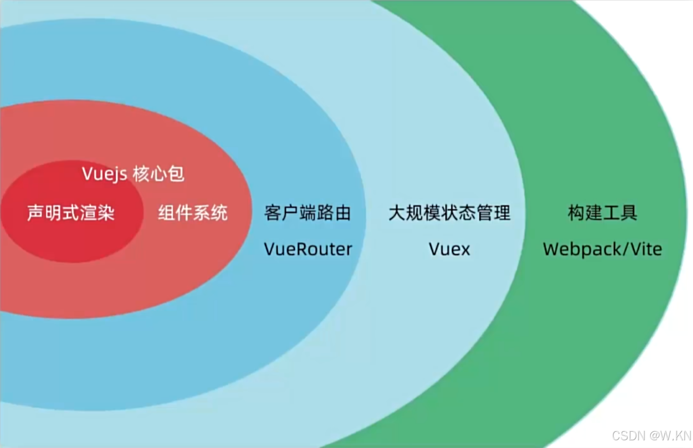
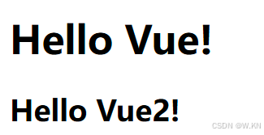
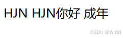
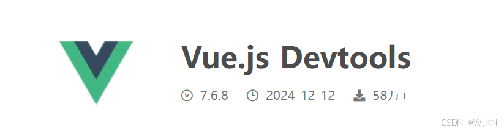
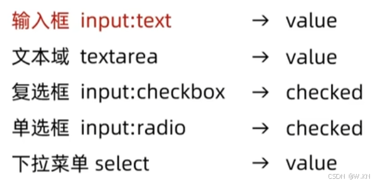

>    作为初学者对于Vue框架的学习笔记 总结了Vue框架的核心知识点，包括：1. 基础概念：渐进式框架、两种使用方式、Vue实例创建流程、模板语法和响应式特性。2. 常用指令：详细介绍了v-html、v-show/v-if、v-for、v-on、v-bind、v-model等10个指令的功能和用法。3. 组件开发：组件结构、注册方式（全局/局部）、数据传递（Props）、组件通信（自定义事件/插槽）、生命周期钩子和动态组件。4. 进阶特性：计算属性、侦听器、依赖注入和异步组件。5. 工程化应用：项目结构、应用实例创建和公共资源管理。文章通过大量代码示例演示了各知识点的实际应用，适合Vue初学者系统学习框架核心概念。 

## 1 快速上手

###   1.1 Vue概念

>  Vue是一个用于构建用户界面的渐进式框架
> 
> 用户界面：基于数据渲染用户看到的界面
> 
> 渐进式：循序渐进  
> 
> 框架：一套完整的项目解决方案 提升开发效率
> 
> 两种使用方式：①Vue核心包 ②Vue核心包加插件 工程化开发

  

* * *

### **1.2 Vue实例 初始化渲染**

> 1.准备容器
> 
> 2.引包（生产环境/开发环境）
> 
> 3\. 创建实例 new Vue()
> 
> 4.指定配置项：
> 
>   ① el 指定挂载点
> 
>   ② data 提供数据



```html
<!DOCTYPE html>
<html lang="en">
<head>
    <meta charset="UTF-8">
    <meta name="viewport" content="width=device-width, initial-scale=1.0">
    <title>Document</title>
</head>
<body>
    <div id ='app'>
        <h1>{{message}}</h1>
        <h2>{{message2}}</h2>
    </div>

    <script src="https://cdn.jsdelivr.net/npm/vue/dist/vue.js"></script>

    <script>
        var app = new Vue({
            el: '#app',
            data: {
                message: 'Hello Vue!',
                message2:'Hello Vue2!'
            }
        })
    </script>
</body>
</html>
```

###  1.3 模板语法 插值表达式

> 插值表达式 {{ }} 是Vue的模板语法

> **作用：**利用表达式（可以被求值的代码）插值 进行数据渲染

>  **注意：**1 数据必须存在 2 支持的是表达式而非语句 3 不能在标签中使用



```html
<!DOCTYPE html>
<html lang="en">
<head>
    <meta charset="UTF-8">
    <meta name="viewport" content="width=device-width, initial-scale=1.0">
    <title>Document</title>
</head>
<body>
    <div id ='app'>
        <!-- {{}} 模板语法 用于表达式插值渲染 -->
       {{ message }}
       {{ message + "你好"}}
       {{ age > 18 ? '成年' : '未成年' }}
    </div>

    <script src="https://cdn.jsdelivr.net/npm/vue/dist/vue.js"></script>

    <script>
        var app = new Vue({
            el: '#app',
            data: {
                message: 'HJN',
                age: 20,
            }
        })
    </script>
</body>
</html>
```

### 1.4 响应式特性 

> 响应式：数据变化 视图自动更新

访问/修改

> 访问：实例名.属性名
> 
> 修改：实例名.属性名 = 值

### 1.5 开发者工具

> 使用官方网站或者极简插件中搜索安装 



安装 解压 打开浏览器拓展程序 拖动 安装 

* * *

## 2 Vue指令

> Vue会根据不同的指令，针对标签实现不同的功能
> 
> 指令：前缀带有v-的特殊标签属性 常用的有10个

### 2.1 指令简介

| 名称 | 绑定值类型 | 作用 | 介绍 |
| --- | --- | --- | --- |
| v - html | 字符串 | 更新元素的 innerHTML。 | 将数据作为 HTML 解析并渲染到指定元素上，使用时需注意安全问题，防止 XSS 攻击。 |
| v - show | 布尔值 | 根据表达式的值显示或隐藏元素。 | 通过修改元素的 CSS 的`display`属性来控制元素的显示和隐藏，元素始终会存在于 DOM 中。 |
| v - if | 布尔值 | 根据表达式的值条件性地渲染元素或组件。 | 当表达式的值为`true`时，元素或组件会被渲染到 DOM 中；为`false`时，对应的元素或组件以及其子元素都会从 DOM 中移除。 |
| v - else | 无 | 与`v - if`配套使用，提供 “else” 分支。 | 必须紧跟在带`v - if`或`v - else - if`的元素之后，当前面的`v - if`或`v - else - if`表达式为`false`时，渲染该元素。 |
| v - else - if | 布尔值 | 与`v - if`配套使用，提供 “else if” 分支。 | 必须紧跟在带`v - if`的元素之后，按顺序判断表达式的值，当表达式为`true`时，渲染该元素。 |
| v - for | 数组、对象、数字等可迭代数据 | 基于源数据多次渲染元素或组件。 | 可以遍历数组、对象等可迭代的数据结构，为每一项渲染对应的元素或组件，例如`v - for="(item, index) in items"`，`items`是数组，`item`是数组元素，`index`是索引。 |
| v - on | 函数名或 JavaScript 表达式 | 监听 DOM 事件。 | 缩写为`@`，例如`v - on:click="handleClick"`或`@click="handleClick"`，当元素触发`click`事件时，会调用`handleClick`方法。 |
| v - bind | 任何类型 | 动态绑定一个或多个特性，或一个组件 prop 到表达式。 | 缩写为`:`，用于将数据绑定到 HTML 元素的属性上，如``，会根据`imageUrl`的值动态设置`img`标签的`src`属性。 |
| v - model | 基本数据类型（如字符串、数字、布尔值）、对象等 | 在表单元素上创建双向数据绑定。 | 语法糖，它会根据不同的表单元素类型，自动处理`input`和`change`等事件以及`value`等属性的绑定，例如`<input v - model="message">`，`message`数据改变会更新输入框的值，输入框的值改变也会更新`message`数据。 |
|  v - slot | 无 | 用于具名插槽或需要接收 prop 的插槽。 | Vue 2 中使用`slot - scope`配合`v - slot`，Vue 3 简化了语法，用于在父组件中向子组件传递内容，指定插槽的名称和数据绑定等，例如`<template v - slot:header>`，定义名为`header`的插槽。 |

* * *

### 2.2 v-html

> 作为 HTML 解析并渲染到指定元素上

```html
<!DOCTYPE html>
<html lang="en">
<head>
    <meta charset="UTF-8">
    <meta name="viewport" content="width=device-width, initial-scale=1.0">
    <title>Document</title>
</head>
<body>
    <div id ='app'>
        <p v-html="message"></p>
    </div>

    <script src="https://cdn.jsdelivr.net/npm/vue/dist/vue.js"></script>

    <script>
        var app = new Vue({
            el: '#app',
            data: {
                message: '<a href="http://www.baidu.com">百度</a>'
            }
        })
    </script>
</body>
</html>
```

* * *

### 2.3 v-show 与 v-if

> v-show ：改元素的 CSS 的`display`属性来控制元素的显示和隐藏
> 
> v-if：当表达式的值为`true`时，元素或组件会被渲染到 DOM 中；为`false`时，对应的元素或组件以及其子元素都会从 DOM 中移除
> 
> \* 两者都是通过布尔值来判断是否显示 但是两者的区别是底层原理不同

```html
<!DOCTYPE html>
<html lang="en">
<head>
    <meta charset="UTF-8">
    <meta name="viewport" content="width=device-width, initial-scale=1.0">
    <title>Document</title>
</head>
<style>
    .box {
        width: 100px;
        height: 100px;
        background-color: blue;
        border: 1px solid #000;
        border-radius: 10px;
    }
</style>
<body>
    <!-- v-show和v-if的区别 -->
    <!-- v-show是通过display属性来控制元素的显示和隐藏，元素始终会被渲染到页面中，只是通过display属性来控制元素的显示和隐藏 -->
    <!-- v-if是通过DOM元素的添加和删除来控制元素的显示和隐藏，元素不会被渲染到页面中 -->
    <div id ='app'>
      <div v-show="flag" class = "box">这是v-show显示的盒子</div>
      <br>
      <div v-if = "flag" class = "box">这是v-if显示的盒子</div>
    </div>

    <script src="https://cdn.jsdelivr.net/npm/vue/dist/vue.js"></script>

    <script>
        var app = new Vue({
            el: '#app',
            data: {
               flag: false
            }
        })
    </script>
</body>
</html>
```

* * *

### 2.4 v-else 与 v-else-if

> 辅助v-if进行判断渲染 语法 ：v-else = “表达式”

```html
<!DOCTYPE html>
<html lang="en">
<head>
    <meta charset="UTF-8">
    <meta name="viewport" content="width=device-width, initial-scale=1.0">
    <title>Document</title>
</head>
<body>
    
    <div id="app">
        <p v-if="sex === 1">性别：男</p>
        <p v-else>性别：女</p>
        <hr>
        <p v-if="score>=90">等级 A</p>
        <p v-else-if="score>=80 && score<90">等级 B</p>
        <p v-else-if="score>=70 && score<80">等级 C</p>
        <p v-else>等级 D</p>
    </div>


    <script src="https://cdn.jsdelivr.net/npm/vue/dist/vue.js"></script>

    <script>
        var app = new Vue({
            el: '#app',
            data: {
                sex:1,
                score: 80
            }
        })
    </script>
</body>
</html>
```

* * *

###  2.5 v-on

> 1 作用：注册事件 = 添加监听 + 提供处理逻辑
> 
> 2 语法：① v-on:事件名=“内联语句”
> 
>               ② v-on:事件名=“methods中的函数名” 
> 
> 3 简写：@事件名

> **4 事件修饰符:**
> 
> Vue为v-on提供了几个常用的事件修饰符

| 修饰符 | 用途说明 | 用法示例 |
| --- | --- | --- |
| ​**​.stop​**​ | 阻止事件冒泡（停止事件向上级元素传播） | `@click.stop="handleClick"`  
点击子元素不会触发父元素的点击事件 |
| ​**​.prevent​**​ | 阻止默认行为（阻止元素原生动作，如表单提交） | `@submit.prevent="onSubmit"`  
提交表单时阻止页面刷新 |
| ​**​.once​**​ | 事件仅触发一次（执行一次后自动解除事件监听） | `@click.once="doSomething"`  
按钮点击仅生效一次 |
| ​**​.enter​**​ | 键盘事件限定键（仅当按下特定键时触发） | `@keyup.enter="submitForm"`  
在input中按回车键时提交表单 |
| ​**​.capture​**​ | 使用捕获模式（事件在捕获阶段触发，而非冒泡阶段） | `@click.capture="captureHandler"`  
从外层元素开始向下触发 |
| ​**​.self​**​ | 仅当事件源是元素自身时触发（忽略内部元素冒泡） | `@click.self="selfClick"`  
只有点击元素本身（非子元素）时触发 |
| ​**​.passive​**​ | 提升滚动性能（告知浏览器不阻止默认行为） | `@scroll.passive="onScroll"`  
优化移动端滚动性能 |

阻止默认事件：

```html
<template>
<div>
    <a @click.prevent="clickHandle" href="https:…………">WKN</a>
    </div>
</template>
<script>
export default{
  data(){
     return{
     }
  },
  methods:{
      clickHandle(e){
          //e.preventDefault();
          console.log(111);
      }
  }
}
</script>
```

阻止事件冒泡：

内联语句

```html
<!DOCTYPE html>
<html lang="en">
<head>
    <meta charset="UTF-8">
    <meta name="viewport" content="width=device-width, initial-scale=1.0">
    <title>Document</title>
</head>
<body>
    
    <div id="app" >
        <button @click = "number--">-</button>
        <span>{{ number }}</span>
        <button v-on:click = "number++">+</button>
    </div>


    <script src="https://cdn.jsdelivr.net/npm/vue/dist/vue.js"></script>

    <script>
        var app = new Vue({
            el: '#app',
            data: {
                number: 100,
            }
        })
    </script>
</body>
</html>
```

 methods的函数名 (methods函数this指向Vue实例)

```html
<!DOCTYPE html>
<html lang="en">
<head>
    <meta charset="UTF-8">
    <meta name="viewport" content="width=device-width, initial-scale=1.0">
    <title>Document</title>
</head>
<body>
    
    <div id="app" >
        <button @click="fn">切换显示与隐藏</button>
        <span v-show="flag">显示样例</span>
    </div>


    <script src="https://cdn.jsdelivr.net/npm/vue/dist/vue.js"></script>

    <script>
        var app = new Vue({
            el: '#app',
            data: {
                number: 100,
                flag: true,
            },
            methods: {
                fn(){
                app.flag = !app.flag
                }
            }
        })
    </script>
</body>
</html>
```

调用传参 

> @click fn(参数1，参数2) 

```html
<!DOCTYPE html>
<html lang="en">
<head>
    <meta charset="UTF-8">
    <meta name="viewport" content="width=device-width, initial-scale=1.0">
    <title>小黑售货机</title>
</head>
<style></style>
<body>
    
    <div id="app" >
        <div v-if="flag">
            <h1>小黑售货机</h1>
            <p>当前商品数量：{{number}}</p>
            <button @click="fn(5)">可乐 （5元）</button>
            <button @click="fn(4)">雪碧 （4元）</button>
    </div>

    <div>余额 ：{{ money}}</div>

    <script src="https://cdn.jsdelivr.net/npm/vue/dist/vue.js"></script>

    <script>
        var app = new Vue({
            el: '#app',
            data: {
                number: 100,
                flag: true,
                money: 100
            },
            methods: {
                fn(price){
                    if(this.number <= 0){
                        alert('商品已售罄')
                        this.flag = false
                        return
                    }

                    if(this.money < price){
                        alert('余额不足')
                        return
                    }

                    this.number = this.number - 1
                    this.money = this.money - price
                    alert('购买成功')
                }
            }
        })
    </script>
</body>
</html>
```

* * *

### 2.6 v-bind

> 1 作用：动态设置html的标签属性 url src title...
> 
> 2 语法：v-bind:属性名=“表达式”
> 
> 3 简写：:src

```html
<!DOCTYPE html>
<html lang="en">
<head>
    <meta charset="UTF-8">
    <meta name="viewport" content="width=device-width, initial-scale=1.0">
    <title>图片切换</title>
</head>

<body>
    <div id="app">
        
        <button @click="imgUrl='https://cdn.pixabay.com/photo/2018/01/14/23/12/nature-3082832_1280.jpg'">切换图片</button>
    </div>
</body>

<script src="https://cdn.jsdelivr.net/npm/vue/dist/vue.js"></script>

<script>

    var app = new Vue({
        el: '#app',
        data: {
            imgUrl: 'img01.png'
            }
        })

</script>
</html>
```

Vue 为样式控制 扩展了语法 针对class类名和style行内样式进行控制

> 语法  :class=“对象/数组”
> 
> ①对象 键是类名 值是布尔值
> 
> ```cs
> <div class="box" claas:"{类名1:布尔值,类名2:布尔值}"></div>
> ```
> 
> 适用场景：一个类型 来回切换
> 
> ②数组 数组中所有的类都会添加到盒子上 本质就是一个class列表
> 
> ```cs
> <div calss:box calss:"[ 类名1,类名2 ]"></div>
> ```
> 
>  适用场景：批量添加和删除类

案列 tab导航栏高亮显示

```html
<!DOCTYPE html>
<html lang="en">
<head>
    <meta charset="UTF-8">
    <meta name="viewport" content="width=device-width, initial-scale=1.0">
    <title>高亮显示</title>
</head>
<body>
    <div id="app" class="box">
        <ul>
            <li v-for="(item,index) in list" :key="item.id" @click="avtiveIndex = index">
                <a href="#" :class="{ active: index === avtiveIndex }">{{item.content}} </a>
            </li>
        </ul>
    </div>
</body>
<style>
    .active{
        color: red;
    }
    li{
        list-style: none;
    }
    a{
        text-decoration: none;
    }
    a:hover{
        color: blue;
    }
    .box{
        width: 200px;
        height: 200px;
        display: flex;
        justify-content: center;
        align-items: center;
    }
</style>
<script src="https://cdn.jsdelivr.net/npm/vue/dist/vue.js"></script>
<script>
    var app = new Vue({
        el : '#app',
        data : {
            avtiveIndex : 0,
            list : [
                {id : 1,content : '第一栏'},
                {id : 2,content : '第二栏'},
                {id : 3,content : '第三栏'},
            ]
        }
    })
</script>
</html>
```

> 语法 :style="样式对象"
> 
> ```cs
> <div class="box" style=" CSS属性名1:CSS属性值 CSS属性名2:CSS属性值"></div>
> ```

案例 进度条展示

```html
<!DOCTYPE html>
<html lang="en">
<head>
    <meta charset="UTF-8">
    <meta name="viewport" content="width=device-width, initial-scale=1.0">
    <title>进度条展示</title>
</head>
<body>
    <div id="app">
        <div class="progress">
            <div class="progress-bar" :style="{width : width + '%'}"></div>
            <span>{{width}}%</span>
        </div>
    </div>
</body>
<style>
    .progress{
        width: 100%;
        height: 20px;
        background-color: #f5f5f5;
        border-radius: 10px;
        margin-top: 20px;
    }
    .progress-bar{
        width: 0%;
        height: 100%;
        background-color: #00ff00;
        border-radius: 10px;
        transition: width 1s;
    }
</style>
<script src="https://cdn.jsdelivr.net/npm/vue/dist/vue.js"></script>
<script>
    var app = new Vue({
        el : '#app',
        data : {
            width : 0
        },
        mounted(){
            this.timer = setInterval(() => {
                this.width += 10
                if(this.width >= 100){
                    clearInterval(this.timer)
                }
            }, 1000)
        }
    })
</script>
</html>
```

* * *

### 2.7 v-for

> 1 作用 基于数据循环 多次渲染整个元素
> 
> 2 遍历数组语法 v-for="(item,index) in 数组"  item 每一项 index 下标

```html
<!DOCTYPE html>
<html lang="en">
<head>
    <meta charset="UTF-8">
    <meta name="viewport" content="width=device-width, initial-scale=1.0">
    <title>水果店</title>
</head>
<body>
    <div id="app" class="box">
        <h1>水果店</h1>
        <p>欢迎来到水果店</p>
        <ul>
            <li v-for="(item, index) in list">
                {{ index }} - {{ item }}
            </li>
        </ul>
    </div>
</body>

<script src="https://cdn.jsdelivr.net/npm/vue/dist/vue.js"></script>

<script>

    var app = new Vue({
        el: '#app',
        data: {
            list: ['苹果', '香蕉', '橘子', '橙子']
        }
    })

</script>
</html>
```

案例：书架 显示与删除功

```html
<!DOCTYPE html>
<html lang="en">
<head>
    <meta charset="UTF-8">
    <meta name="viewport" content="width=device-width, initial-scale=1.0">
    <title>案例书架练习</title>
</head>
<body>
    <div id="app">
        <ul>
            <li v-for="book in books">
                书名：{{book.name}} 价格：{{book.price}}
                <button @click="del(book.name)">删除</button>
            </li>
        </ul>
</body>

<script src="https://cdn.jsdelivr.net/npm/vue/dist/vue.js"></script>

<script>
    var app = new Vue({
        el : '#app',
        data : {
            books : [
                {name : '《JavaScript高级程序设计》',price : 100},
                {name : '《JavaScript权威指南》',price : 200},
                {name : '《JavaScript从入门到入土》',price : 300},
                {name : '《javaScript进阶版秘籍》',price : 400},
            ]
        },
        methods : {
            <!-- 删除书籍 -->
            del : function(name){
                this.books = this.books.filter(function(book){
                    return book.name !== name
                })
            }
        }
    })
</script>
</html>
```

v-for 中的key

> key属性 = “唯一标识”
> 
> 唯一标识 进行列表项的排序复用 有唯一性 在没有key时 会优先考虑原地复用

* * *

### 2.8 v-model

> 1 作用 给表单元素使用 **双向数据绑定**  可以快速获取或设置表单内容
> 
>     **数据变化 --> 视图自动更新                  视图更新 --> 数据自动变化**
> 
> 2 语法 v-model = '变量'

```cs
<!DOCTYPE html>
<html lang="en">
<head>
    <meta charset="UTF-8">
    <meta name="viewport" content="width=device-width, initial-scale=1.0">
    <title>v-model</title>
</head>
<body>
    
    <div id="app">
        <input type="text" v-model="username" placeholder="请输入用户名">
        <input type="password" v-model="password" placeholder="请输入密码">
        <button @click="login">登录</button>
        <button @click="reset">重置</button>
    </div>
</body>

<script src="https://cdn.jsdelivr.net/npm/vue/dist/vue.js"></script>

<script>

    var app = new Vue({
        el : '#app',
        data : {
            username : '',
            password : ''
        },
        methods: {
        login : function(){
            alert('用户名：' + this.username + '密码：' + this.password)
        },
        reset : function(){
            this.username = ''
            this.password = ''
        }
      }
    })
   
    

</script>
</html>
```

> 作用于其他表单元素
> 
> 

```cs
<!DOCTYPE html>
<html lang="en">
<head>
    <meta charset="UTF-8">
    <meta name="viewport" content="width=device-width, initial-scale=1.0">
    <title>表单元素</title>
</head>

<body>

    <div id="#app">

        <span>姓名：</span>
        <input type="text" v-model="msg" placeholder="请输入内容">
        <br><br>

        是否单身：
        <input type="checkbox" v-model="isSingle">
        <br><br>

        性别：
        <input v-model = "gander" type="radio" name = "gander" value="1">男
        <input v-model = "gander" type="radio" name = "gander" value="2">女
        <br><br>

        所在城市：
        <select v-model="city">
            <option value="101">北京</option>
            <option value="102">上海</option>
            <option value="103">广州</option>
            <option value="104">深圳</option>
        </select>

        自我描述：
        <textarea v-model="desc">请输入内容描述</textarea>
        <br><br>

        <button @click="submit">立刻注册</button>

    </div>
    
</body>

<script src="https://cdn.jsdelivr.net/npm/vue/dist/vue.js"></script>

<script>
    var app = new Vue({
        el : '#app',
        data : {
            msg : '',
            isSingle : false,
            gander : '1',
            city : '101',
            desc : ''
        }
    })
</script>
</html>
```

案例 记事本

**功能需求**

> ① 列表渲染 ② 删除功能 ③添加功能 ④底部统计清空功能 

**功能实现**

```cs
<!DOCTYPE html>
<html lang="en">
<head>
    <meta charset="UTF-8">
    <meta name="viewport" content="width=device-width, initial-scale=1.0">
    <title>记事本</title>
</head>
<body>
    <!--  ① 列表渲染 ② 删除功能 ③添加功能 ④底部统计清空功能  -->
    <div id="app">
        <input type="text" v-model="content" placeholder="请输入内容">
        <button @click="add" style="color: aqua;">添加</button>
        <ul>
            <div v-for="(item,index) in list">
                <span>{{ index + 1 }}</span>              
                {{item.content}}
                <button @click="del(item.id)">删除</button>
            </div>
        </ul>
        <div>总数：{{list.length}} <button @click="clear">清空</button></div>
    
</body>

<script src="https://cdn.jsdelivr.net/npm/vue/dist/vue.js"></script>

<script>
    var app = new Vue({
        el : '#app',
        data : {
            content : '',
            list : [
                {id : 1,content : '学习Vue'},
                {id : 2,content : '学习React'},
                {id : 3,content : '学习Angular'},
                {id : 4,content : '学习Node'},
            ]
        },
        methods : {
            add : function(){
                this.list.push({
                    id : this.list.length + 1,
                    content : this.content
                })
                this.content = ''
            },
            del : function(id){
                this.list = this.list.filter(function(item){
                    return item.id !== id
                })
            },
            clear : function(){
                this.list = []
            }
        }
    })
</script>
</html>
```

* * *

### **2.9 computed 计算属性**

> **概念**：基于现在已有的数据 计算新的属性 依赖的数据变化 自动重新计算
> 
> **语法**： ① 声明在computed的配置项中 一个计算属性对应一个函数
> 
>             ② 使用和普通函数一样 使用{{ 计算属性名 }}

```html
<!DOCTYPE html>
<html lang="en">
<head>
    <meta charset="UTF-8">
    <meta name="viewport" content="width=device-width, initial-scale=1.0">
    <title>属性计算</title>
</head>
<body>
    <div id="app">
       
    <table>
            <tr>
                <th>名称</th>
                <th>数量</th>
            </tr>
            <tr v-for="(item,index) in items" :key="index">
                <td>{{ item.name }}</td>
                <td>{{ item.amount}}</td>
            </tr>
                
    </table>
    <p>总数量：{{ total }} 个</p>
    </div>
</body>
<script src="https://cdn.jsdelivr.net/npm/vue/dist/vue.js"></script>
<script>
    var app = new Vue({
        el: '#app',
        data: {
          items : [
              {id: 1, name: '书', amount: 1},
              {id: 2,name: '笔', amount: 4},
              {id: 3,name: '电脑', amount: 3}
          ],
        },
        computed: {
            total () {
                // 求值逻辑 可以使用this直接访问到Vue实例
                let num = this.items.reduce((pre,cur) => {
                    return pre + cur.amount
                },0)
                return num
            }
        }
    })
</script>
</html>
```

 **computed计算属性与methods方法**

 computed计算属性

> 作用：封装了一段对于事件的处理 求得一个结果
> 
> 语法：直接写在computed中 直接使用 this.计算属性 {{ 计算属性 }}

缓存特性：会对计算出来的结果进行缓存 再次使用直接读取缓存 

methods方法

> 作用：给实例一个业务方法 调用处理业务逻辑
> 
> 语法：写在methods配置项中 使用 this.方法名 {{ 方法名 }} @事件名= 方法名

**计算属性的完整写法**

计算属性的默认简写 只能访问不能修改 想要修改就要完整写法

```html
   fun :{
                get(){
                    // 计算逻辑
                    return 1
                },
                set(){ // 修改的值
                    // 设置逻辑
                }
```

* * *

### **2.10 指令修饰符**

> 通过 . 指明了一些指令后缀，不同的后缀封装了不同的处理操作（简化代码）

① 按键修饰符

    @keyup.enter ->键盘回车监听

② v-model修饰符

    v-model.trim -> 去除前后空格

③事件修饰符 

   @事件名.stop -> 阻止事件冒泡

   @事件名.prevent  -> 阻止默认行为

```cs
<!DOCTYPE html>
<html lang="en">
<head>
    <meta charset="UTF-8">
    <meta name="viewport" content="width=device-width, initial-scale=1.0">
    <title>指令修饰符</title>
</head>
<body>
    <div id="app">
    <h3> v-model 修饰符 .trim .number </h3>
    <input type="text" v-model.trim="msg" placeholder="请输入内容"><!-- 去除前后的空格-->
    <input type="text" v-model.number="num" placeholder="请输入数字"><!-- 字符串转换为数字-->

    <h3> @事件名.stop  阻止事件冒泡 </h3>
    <div @click="fatherFn" class="boxF">
        <div @click.stop="sonFn" class="boxS"> 子元素 </div>
    </div>

    <h3> @事件名.prevent 阻止默认行为 </h3>
    </div>
</body>
<style>
    .boxF{
        width: 200px;
        height: 200px;
        background-color: blanchedalmond;
    }
    .boxS{
        width: 100px;
        height: 100px;
        background-color: gold;
    }
</style>
<script src="https://cdn.jsdelivr.net/npm/vue/dist/vue.js"></script>
<script>
    var app = new Vue({
        el : '#app',
        data : {
            msg : '',
            num : 0
        },
        methods : {
            fatherFn(){
               alert('父元素被点击')
            },
            sonFn(){
               alert('子元素被点击')
            }
        }
    })
</script>
</html>
```

* * *

### 2.11 watch

> 侦听器: 可以使用watch选项在每次响应式属性发生变化时触发一个函数

```html
<template>
<h3>侦听器</h3>
<p>{{message}}</p>
<button @click="updateHandle">修改数据</button>
</template>

<Script>
    export default{
        data(){
            return{
                message:"hello"
            }
        },
        methods:{
           updateHandle(){
               this.message="python"
           }
    },
        //侦听器
        watch:{
            //函数名必须与侦听的数据对象保持一致
            message(newValue,oldValue){
                //数据发生变化，自动执行的函数
                console.log(newValue,oldValue);
            }
        }
    }
</Script>
```

* * *

## 3 Vue组件

### 3.1 组件组成

>   组件最大的优势是可复用性。当使用构建步骤时，我们一般会将Vue组件定义在一个单独的vue文件中，这叫做单文件组件（SFC）

####  3.1.1 组件组成结构

>  承载所有的HTML标签：
> 
> <template> <div> 承载系统 </div> </template>
> 
> 承载所有业务逻辑
> 
> <script> export default{} </script>
> 
> 承载所有样式：
> 
> <style scoped>
> 
> </style>

```html
<template>
<div class="container">{{message}}</div> </template>
​
<script>
export default{
    data(){
        return{
            message:"组件基础构成"
        }
    }
}
</script>
​
<!--scoped：生效作用域，让当前样式只在当前组件里生效-->
<style scoped>
.container{
    font-size:30px;
    color:red;
    }
</style>
```

#### 3.1.2 组件引用

```html
<template>
<!--第三步：显示组件-->
<MyComponent/>
</template>
​
<script>
//第一步：引入组件
import MyComponent from "./components/MyComponment.vue"
export default{
    //第二步：注入组件
    components:{
        MyComponent
    }
}
</script>
```

#### 3.1.3 组件嵌套关系

  组件允许我们将UI划分为独立的、可重用的部分，并且可以对每个部分进行独立的思考。在实际应用中，组件常常被组织成层层嵌套的树状结构

  这和我们嵌套HTML元素的方式类似，Vue实现了自己的组件模型，使我们可以在每个组件内封装自定义内容与逻辑

**创建组件及引用关系**

```html
Header
<template>
  <h3>Header</h3>
</template>
<style scoped>
    h3{
        width:100%;
        height:100px;
        border:5px solid #999;
        text-align:center;
        line-height:100px;
        box-sizing:border-box;
    }
​
</style>
Main
<template>
  <div class="main">
    <h3>Main</h3>
     <Article/>
      <Article/>
    </div>
</template>
​
<script>
import Article from "./pages/Article.vue"
export default{
    components:{
        Article
    }
}
</script>
<style scoped>
    .main{
        float:left;
        width:70%;
        height:400px;
        border:5px solid #999;
        box-sizing:border-box;
    }
</style>
Aside
<template>
  <div class="aside">
      <h3>Aside</h3>
      <Item/>
      <Item/>
      <Item/>
    </div>
</template>
​
<script>
import Item from "./pages/Item.vue"
export default{
    components:{
        Item
    }
}
</script>
​
<style scoped>
    .aside{
        float:right;
        width:30%;
        height:600px;
        border:5px solid #999;
        box-sizing:border-box;
    }
</style>
Article
<template>
  <h3>Article</h3>
</template>
<style scoped>
h3{
    width:80%;
    margin:0 auto;
    text-align:center;
    line-height:100px;
    box-sizing:border-box;
    margin-top:50px;
    background:#999;
    }
</style>
Item
<template>
  <h3>Item</h3>
</template>
<style scoped>
    h3{
        width:80%;
        margin:0 auto;
        text-align:center;
        line-height:100px;
        box-sizing:border-box;
        margin-top:10px;
        background:#999;
    }
</style>


App
<template>
  <Header/>
  <Main />
  <Aside/>
</template>
​
<script>
import Header from "./pages/Header.vue"
import Main from "./pages/Main.vue"
import Aside from "./pages/Aside.vue"
export default{
    components:{
        Header,
        Main,
        Aside
    }
}
</script>
```

* * *

### 3.2 组件注册

>   一个vue组件在使用前需要先被注册，这样vue才能在渲染模板时找到其对应的实现。组件注册有两种方式：全局注册和局部注册

#### 3.2.1 全局注册

在main.js里注册

```html
import {createApp} from 'vue'
import App from './App.vue'
import GlobalComponent from "./components/GlobalComponent.vue"
​
const app=createApp(App);
//在这个中间写组件的注册
app.component("GlobalComponent",GlobalComponent)
app.mount('#app');//挂载
```

#### 3.2.2 局部注册

全局注册虽然方便，但可能有以下几个问题：

-   全局注册，但并没有被使用的组件无法在生产打包时被自动移除，如果你全局注册了一个组件，即使它并没有被实际使用，他仍然会出现在打包后的js文件中
    
-   全局注册在大型项目中使项目的依赖关系变得不那么明确。在父组件中使用子组件时，不太容易定位子组件的实现。和使用过多的全局变量一样，这可能会影响应用长期的可维护性。
    

局部注册时需要使用components选项

```html
<template>
  <GlobalComponent />
</template>
<script>
import GlobalComponent from "./components/GlobalComponent.vue"
export default{
  components:{
    GlobalComponent
  }
}
</script>
<style>
</style>
```

* * *

### 3.3 数据传递

#### 3.3.1 Props数据传递

>   组件与组件之间不是完全独立的，而是有交集的，那就是组件与组件之间是可以传递数据的，传递数据的解决方案就是props (传递数据个数无限制 )

```html
child.vue

<template>
  <h3>Child</h3>
  <p>{{title}}</p>
</template>
<script>
export default{
  data(){
    return{
        
    }
  },
  props:["title"]
}
</script>
parent.vue

<template>
  <h3>Child</h3>
  <Child title="parent数据"/>
</template>
<script>
import Child from "/Child.vue "
export default{
  data(){
    return{
        
    }
  },
  components:{
      Child
  }
}
</script>
```

#### 3.3.2 动态传递数据

> 可以动态的传递数据 注意：Props传递数据，只能从父级传递给子级，不能反其道而行。

```html
Parent.vue

<template>
  <h3>Child</h3>
  <Child v-bind:title="message"/>
</template>
<script>
import Child from "/Child.vue "
export default{
  data(){
    return{
        message:"parent数据！"
    }
  },
  components:{
      Child
  }
}
</script>
child.vue

<template>
  <h3>Child</h3>
  <p>{{title}}</p>
</template>
<script>
export default{
  data(){
    return{
        
    }
  },
  props:["title"]
}
</script>
```

#### 3.3.3 多种数据类型传递

>   通过props传递数据，不仅可以传递字符串类型的数据，还可以是其他类型，例如：数字、对象、数组等，但实际上任何类型的值都可以作为props的值被传递

##### 3.3.3.1 Number

```html
parent.vue

<template>
  <h3>Child</h3>
  <Child v-bind:title="message" :age="age"/>
</template>
<script>
import Child from "/Child.vue "
export default{
  data(){
    return{
        message:"parent数据！",
        age:20
    }
  },
  components:{
      Child
  }
}
</script>
child.vue

<template>
  <h3>Child</h3>
  <p>{{title}}</p>
  <p>{{age}}</p>
</template>
<script>
export default{
  data(){
    return{
        
    }
  },
  props:["title","age"]
}
</script>
```

##### 3.3.3.2 Array

```html
parent.vue

<template>
  <h3>Child</h3>
  <Child v-bind:title="message" :age="age" :names="names"/>
</template>
<script>
import Child from "/Child.vue "
export default{
  data(){
    return{
        message:"parent数据！",
        age:20,
        names:["iwen","ime","frank"]
    }
  },
  components:{
      Child
  }
}
</script>
child.vue

<template>
  <h3>Child</h3>
  <p>{{title}}</p>
  <p>{{age}}</p>
  <ul>
      <li v-for="(item,index)of names" :key="index">{{item}}</li>
    </ul>
</template>
<script>
export default{
  data(){
    return{
        
    }
  },
  props:["title","age","names"]
}
</script>
```

##### 3.3.3.3 Object

```html
parent.vue

<template>
  <h3>Child</h3>
  <Child v-bind:title="message" :age="age" :names="names" :userInfo="userInfo"/>
</template>
<script>
import Child from "/Child.vue "
export default{
  data(){
    return{
        message:"parent数据！",
        age:20,
        names:["iwen","ime","frank"],
        userInfo:{
            name:"iwen",
            age:20
        }
    }
  },
  components:{
      Child
  }
}
</script>
child.vue

<template>
  <h3>Child</h3>
  <p>{{title}}</p>
  <p>{{age}}</p>
  <ul>
      <li v-for="(item,index)of names" :key="index">{{item}}</li>
    </ul>
  <p>{{userInfo.name}}</p>
  <p>{{userInfo.age}}</p>
</template>
<script>
export default{
  data(){
    return{
        
    }
  },
  props:["title","age","names","userInfo"]
}
</script>
```

#### 3.3.4 组件传递Props效验

> vue组件可以更细致的声明对传入的props的效验要求

```html
ComponentA.vue

<template>
  <h3>ComponentA</h3>
  <ComponentB :title="title"/>
</template>
<Script>
import ComponentB from "./ComponentB.vue"
export default{
    data(){
        return{
            title:"标题"
        }
    },
    components:{
        ComponentB
    }
}
</Script>
ComponentB.vue

<template>
  <h3>ComponentB</h3>
  <p>{{title}} </p>
  <p>{{age}}</p>
  <p v-for="(item,index) of names" :key="index">{{item}}</p>
</template>
<Script>
export default{
    data(){
        return{
            
        }
    },
    props:{
        title:{
            type:String
            //type:[String,Number,Object,Array]
        },
        age:{
            type:Number,
            default:0//若A给B传了，则显示传递后的值，若未传，则显示默认值0
        },
        //数字和字符串可以直接default，但是如果是数组和对象，必须通过工厂函数返回默认值
        names:{
            type:Array,
            default(){
                return["空"]
            }
        }
    }
}
</Script>
```

**必选项**

```html
componentA.vue

<template>
  <h3>ComponentA</h3>
  <ComponentB :title="title"/>
</template>
<Script>
import ComponentB from "./ComponentB.vue"
export default{
    data(){
        return{
            title:"标题"
        }
    },
    components:{
        ComponentB
    }
}
</Script>
ComponentB.vue

<template>
  <h3>ComponentB</h3>
  <p>{{title}} </p>
  <p>{{age}}</p>
  <p v-for="(item,index) of names" :key="index">{{item}}</p>
</template>
<Script>
export default{
    data(){
        return{
            
        }
    },
    props:{
        title:{
            type:String
            //type:[String,Number,Object,Array]
            required:true//必选项，如果不传递的话，就会报警报
        },
        age:{
            type:Number,
            default:0//若A给B传了，则显示传递后的值，若未传，则显示默认值0
        },
        //数字和字符串可以直接default，但是如果是数组和对象，必须通过工厂函数返回默认值
        names:{
            type:Array,
            default(){
                return["空"]
            }
        }
    }
}
</Script>
```

注意：props是只读的！！

* * *

### 3.4 组件间数据传递

##### 3.4.1 常规组件数据传递

> 组件之间传递数据的方案：父传子：props ； 子传父：自定义事件（this.$emit）

**组件事件配合v-model使用**

如果是用户输入，我们希望在获取数据的同时发送数据配合v-model来使用

```html
searchCom.vue

<template>
  搜索：<input type="text" v-model="search">
</template>
<script>
export default{
    data(){
        return{
            search:""//获取到搜索内容
        }
    },
    //侦听器
    watch:{
        search(newvalue,oldvalue){
            this.$emit("searchEvent",newvalue)
        }
    }
}
</script>
main.vue

<template>
  <h3>Main</h3>
  <p>搜索内容为：{{search}}</p>
  <searchCom  @searchEvent="getSearch"/>
</template>
<script>
import SearchCom from "./SearchCom"
export default{
    data(){
        return{
            search:""
        }
    },
    components:{
        SearchCom
    },
    methods:{
        getSearch(data){
            this.search=data;
        }
    }
}
</script>
```

**组件数据传**

props也可以实现子传父

```html
ComA.vue

<template>
  <h3>ComA</h3>
  <ComB :onEvent="dataFn"/>
  <p>{{message}}</p>
</template>
<script>
import ComB from "./ComB.vue"
export default{
  data(){
      return{
          message:""
      }
  },
  components:{
      ComB
  },
  methods:{
      dataFn(data){
          // console.log(data);
          this.message=data
      }
  }
}
</script>
ComB.vue

<template>
  <h3>ComB</h3>
  <p>{{onEvent("传递数据")}}</p>
</template>
<script>
export default{
  data(){
      return{
          
      }
  },
  props:{
      onEvent:Function
  }
}
</script>
```

##### 3.4.2 Attributes

**透传Attributes**

>   “透传 attribute”指的是传递给一个组件，却没有被该组件声明为props或emits的attribute或者v-on事件监听器。最常见的例子是class、style和id
> 
>   当一个组件以单个元素为根作渲染时，透传的attribute会自动被添加到根元素上

```html
AttrCom.vue

<template>
  <!--必须是唯一根元素-->
  <h3>透传属性</h3>
</template>
<style>
    .attr-container{
        color:red
    }
</style>
App.vue

<template>
  <AttrCom class="attr-container" />
</template>
<script>
import AttrCom from "./AttrCom.vue"
export default{
    components:{
        AttrCom
    }
}
</script>
```

  **Attributes继承**

```html
<template>
  <!--必须是唯一根元素-->
  <h3>透传属性</h3>
</template>
<script>
export default{
    inheritAttrs:false//禁用
}
</script>
<style>
    .attr-container{
        color:red
    }
</style>
```

##### 3.4.4 插槽slots\*

>    我们已经了解到组件能够接受任意类型的JavaScript值作为props，但组件要如何接收模板内容呢？在某些场景中，我们可能想要为子组件传递一些模板片段，让子组件在它们的组件中渲染这些片段。

```html
SlotsBase.vue

<template>
  <h3>插槽</h3>
  <slot></slot>
</template>
App.vue

<template>
  <SlotsBase>
    <div>
        <h3>插槽标签</h3>
        <p>插槽内容</p>
    </div>
    </SlotsBase>
</template>
<script>
import SlotsBase from "./SlotsBase.vue"
export default{
    components:{
        SlotsBase
    }
}
</script>
```

slot元素是一个插槽的出口，标示了父元素提供的插槽内容将在哪里被渲染

###### 3.4.4.1 渲染作用域

插槽内容可以访问到父组件的数据作用域，因为插槽内容本身是在父组件模板中定义的

```html
App.vue

<template>
  <SlotsTwo>
    <div>
        <h3>{{message}}</h3>
    </div>
    </SlotsTwo>
</template>
<script>
import SlotsTwo from "./SlotsTwo.vue"
export default{
    data(){
        return{
            message:"插槽内容续集"
        }
    },
    components:{
        SlotsTwo
    }
}
</script>
SlotsTwo.vue

<template>
  <h3>插槽</h3>
  <slot></slot>
</template>
```

###### 3.4.4.2 默认内容

在外部没有提供任何内容的情况下，可以为插槽指定默认内容

```html
<template>
  <h3>插槽</h3>
  <slot>插槽默认值</slot>
</template>
```

###### 3.4.4.3 具名插槽

v-slot有对应的简写#，因此<template v-slot:header>可简写为<template #header>.其意思就是将这部分模板片段传入子组件的header插槽中

```html
App.vue

<template>
  <SlotsTwo>
    <template v-slot:header>
       <h3>{{message}}</h3>
    </template>
    <template v-slot:main>
      <p>内容</p>
    </template>   
    </SlotsTwo>
</template>
<script>
import SlotsTwo from "./SlotsTwo.vue"
export default{
    data(){
        return{
            message:"插槽内容续集"
        }
    },
    components:{
        SlotsTwo
    }
}
</script>
SlotsTwo.vue

<template>
  <h3>插槽</h3>
  <slot name="header">插槽默认值</slot>
  <hr>
  <slot name="main">插槽默认值</slot>
</template>
```

###### 3.4.4.4 插槽中的数据传递

在某些场景下插槽可能想要同时使用父组件域内和子组件域内的数据。要做到这一点，我们需要一种方法来让子组件在渲染时将一部分数据提供给插槽

可以像对组件传递Props那样，向一个插槽的出口传递attributes

```html
SlotsAttr.vue

<template>
  <h3>插槽续集</h3>
  <slot :msg="childMessage"></slot>
</template>
<script>
export default{
    data(){
        return{
            childMessage:"子元素"//先传递给父元素，接收后，再传递
        }
    }
}
</script>
App.vue

<template>
  <SlotsAttr v-slot="slotProps">
        <h3>{{message}}-{{slotProps.msg}}</h3>  
    </SlotsAttr>
</template>
<script>
import SlotsAttr from "./SlotsAttr.vue"
export default{
    data(){
        return{
            message:"测试内容"
        }
    },
    components:{
        SlotsAttr
    }
}
</script>
```

###### 3.4.4.5 具名插槽传递数据

```html
App.vue

<template>
  <SlotsAttr v-slot="slotProps">
        <template #header="slotProps">
          <h3>{{message}}-{{slotProps.msg}}</h3>  
        </template>
    </SlotsAttr>
</template>
<script>
import SlotsAttr from "./SlotsAttr.vue"
export default{
    data(){
        return{
            message:"测试内容"
        }
    },
    components:{
        SlotsAttr
    }
}
</script>
SlotsAttr.vue

<template>
  <h3>插槽续集</h3>
  <slot name="header" :msg="childMessage"></slot>
</template>
<script>
export default{
    data(){
        return{
            childMessage:"子元素"//先传递给父元素，接收后，再传递
        }
    }
}
</script>
```

#### 3.4.5 组件事件

>   在组件的模板表达式中，可以直接使用$emit方法触发自定义事件，触发自定义事件的目的是组件之间传递数据

```html
App.vue

<template>
  <ComponentEvent />
</template>
<script>
import ComponentEvent from "./ComponentEvent.vue"
export default{
    data(){
        components:{
            ComponentEvent
        }
    }
}
</script>
Component.vue

<template>
  <h3>组件事件</h3>
  <Child @someEvent="getHandle"/ >
  <p>父元素：{{message}}</p>
</template>
<script>
import Child from "./Child.vue"
export default{
    data(){
        return{
            message:""
        }
    }
    Components:{
        components:{
            Child
        }，
        methods:{
          getHandle(data){
            console.log("触发了",data);
            this.message=data;
          }
       }
    }
}
</script>
Child.vue

<template>
  <h3>Child</h3>
  <button @click="clickEventHandle">传递数据</button>
</template>
<script>
export default{
    methods:{
        clickEventHandle(){
            //自定义事件
            this.$emit("someEvent","Child数据")
        }
    }
}
</script>
```

* * *

### 3.5 组件生命周期

>   每个Vue组件实例在创建时都需要经历一系列的初始化步骤，比如：设置好数据监听、编译模板、挂载实例到DOM，以及在数据改变时更新DOM。再此过程中，他也会运行被称为生命周期钩子的函数，让开发者有机会在特定阶段运行自己的代码

App.vue

```html
<template>
  <h3>组件的生命周期</h3>
  <p>{{message}}</p>
  <button @click="updateHandle">更新数据</button>
</template>
<script>
/**
生命周期函数：
  创建期：beforeCreate created
  挂载期：beforeMount mounted
  更新期：beforeUpdate updated
  销毁期：beforeUnmount unmounted
*/
export default{
     data(){
         return{
             message:"更新之前"
         }
     },
    methods:{
        updateHandle(){
            this.message="更新之后"
        }
    },
     beforeCreate(){
         console.log("组件创建之前");
     },
    created(){
        console.log("组件创建之后");
    },
    beforeMount(){
         console.log("组件渲染之前");
    },
    mounted(){
         console.log("组件渲染之后");
    },
    beforeUpdate(){
         console.log("组件更新之前");
    },
    updated(){
         console.log("组件更新之后");
    },
    beforeUnmount(){
         console.log("组件销毁之前");
    },
    unmounted(){
         console.log("组件销毁之后");
    }
}
</script>
```

#### 3.5.1 生命周期应用

组件的生命周期会随着我们对vue的了解越多，也会越来越重要，这里我们先讲两个常用的应用场景：

通过ref获取元素DOM结构

模拟网络请求渲染数据

##### 通过ref获取元素DOM结构

```html
App.vue

<template>
<UserCom />
</template>
<script>
import UserCom from "./UserCom.vue"
export default{
    components:{
        UserCom
    }
}
</script>
UserCom.vue

<template>
  <h3>组件生命周期函数应用</h3>
  <p ref="name">百战程序员</p>
</template>
<script>
export default{
  beforeMount(){
      console.log(this.$refs.name);//undefined
  },
   mounted(){
       console.log(this.$refs.name);
   }
}
</script>
```

##### 模拟网络请求渲染数据

```html
UserCom.Vue

<template>
  <h3>组件生命周期函数应用</h3>
  <p ref="name">百战程序员</p>
  <ul>
      <li v-for="(item,index) of banneer" :key="index">
         <h3>{{item.title}}</h3>
         <p>{{item.content}}</p>
    </li>
    </ul>
</template>
<script>
export default{
  data(){
      return{
          banner:[]
      }
  },
​
  beforeMount(){
      console.log(this.$refs.name);//undefined
  },
   mounted(){
       console.log(this.$refs.name);
         //模拟网络请求
      this.banner=[
          "title":"我在爱尔兰",
          "content":"我在爱尔兰爱你"
      ]
   }
}
</script>
```

#### 3.5.2 动态组件 

> 有些场景会需要在两个组件之间来回切换 需要使用动态组件

```html
ComA.vue

<template>
  <h3>ComA</h3>
</template>
ComB.vue

<template>
  <h3>ComB</h3>
</template>
App.vue

<template>
 <component :is="tabComponent"></component>
 <button @click="changeHandle">切换组件</button>
</template>
<script>
import ComA from "./ComA.vue"
import ComB from "./ComB.vue"
export default{
    data(){
      return{
          tabComponent:"ComA"
      }  
    },
    components:{
        ComA,
        ComB
    },
    methods:{
        changeHandle(){
            this.tabComponent=this.tabComponent=="ComA"?"ComB":"ComA"
        }
    }
}
</script>
```

 **组件保持存活：**

> 当使用<component :is="">来在多个组件之间做切换时，被切换掉的组件会被卸载。我们可以通过<keep alive>组件强制被切换掉的组件仍然保持“存活”的状态

**组件被卸载**

```html
ComA.vue

<template>
  <h3>ComA</h3>
</template>
<script>
export default{
    beforeUnmount(){
        console.log("组件卸载之前");
    },
    unmounted(){
        console.log("组件被卸载之后");
    }
}
</script>
ComB.vue

<template>
  <h3>ComB</h3>
</template>
App.vue

<template>
 <component :is="tabComponent"></component>
 <button @click="changeHandle">切换组件</button>
</template>
<script>
import ComA from "./ComA.vue"
import ComB from "./ComB.vue"
export default{
    data(){
      return{
          tabComponent:"ComA"
      }  
    },
    components:{
        ComA,
        ComB
    },
    methods:{
        changeHandle(){
            this.tabComponent=this.tabComponent=="ComA"?"ComB":"ComA"
        }
    }
}
</script>
```

**保持存活**

```html
ComA.vue

<template>
  <h3>ComA</h3>
  <p>{{message}}</p>
  <button @click="updateHandle">更新数据</button>
</template>
<script>
export default{
    data(){
        return{
            message:"老数据"
        }
    },
     beforeUnmount(){
        console.log("组件卸载之前");
    },
    unmounted(){
        console.log("组件被卸载之后");
    },
    methods:{
        updateHandle(){
            this.message="新数据"
        }
    }
}
</script>
ComB.vue

<template>
  <h3>ComB</h3>
</template>
App.vue

<template>
 <keep-alive>
    <component :is="tabComponent"></component>
  </keep-alive>
 <button @click="changeHandle">切换组件</button>
</template>
<script>
import ComA from "./ComA.vue"
import ComB from "./ComB.vue"
export default{
    data(){
      return{
          tabComponent:"ComA"
      }  
    },
    components:{
        ComA,
        ComB
    },
    methods:{
        changeHandle(){
            this.tabComponent=this.tabComponent=="ComA"?"ComB":"ComA"
        }
    }
}
</script>
```

#### 3.5.3 异步组件

>    在大型项目中，我们可能需要拆分应用炜更小的块，并仅在需要时再从服务器加载相关组件。Vue提供了DefineAsyncComponent方法来实现此功能

```html
ComA.vue

<template>
  <h3>ComA</h3>
  <p>{{message}}</p>
  <button @click="updateHandle">更新数据</button>
</template>
<script>
export default{
    data(){
        return{
            message:"老数据"
        }
    },
     beforeUnmount(){
        console.log("组件卸载之前");
    },
    unmounted(){
        console.log("组件被卸载之后");
    },
    methods:{
        updateHandle(){
            this.message="新数据"
        }
    }
}
</script>
ComB.vue

<template>
  <h3>ComB</h3>
</template>
App.vue

<template>
 <keep-alive>
    <component :is="tabComponent"></component>
  </keep-alive>
 <button @click="changeHandle">切换组件</button>
</template>
<script>
import {defineAsyncComponent} from 'vue'
import ComA from "./ComA.vue"
//import ComB from "./ComB.vue"
//异步加载组件
const ComB=defineAsyncComponent(()=>import("./ComB.vue"))
export default{
    data(){
      return{
          tabComponent:"ComA"
      }  
    },
    components:{
        ComA,
        ComB
    },
    methods:{
        changeHandle(){
            this.tabComponent=this.tabComponent=="ComA"?"ComB":"ComA"
        }
    }
}
</script>
```

#### 3.5.4 依赖注入

>   通常情况下，当我们需要从父组件向子组件传递数据时，会使用props。想象一下这样的结构：有一些多层级嵌套的组件，形成了一颗巨大的组件树，而某个深层的子组件需要一个较远的祖先组件中的部分数据。在这种情况下，如果仅使用props则必须将其沿着组件链逐级传递下去，这会非常麻烦。
> 
>   这一问题被称为“props逐级透传”
> 
>   provide和inject可以帮助我们解决这一问题。一个父组件相对于其所有的后代组件，会作为依赖提供者。任何后代的组件树，无论层级有多深，都可以注入由父组件提供给整条链路的依赖。

```html
parent.vue

<template>
  <h3>Parent</h3>
  <Child />
</template>
<script>
import Child from "./Child.vue"
export default{
    components:{
        Child
    }
}
</script>
child.vue

<template>
  <h3>Child</h3>
  <p>{{message}}</p>
  <p>{{fullMsg}}</p>
</template>
<script>
export default{
    inject["message"]
    data(){
        return{
            fullMsg:this.message
        }
    }
}
</script>
App.vue

<template>
  <h3>祖先</h3>
  <Parent />
</template>
<script>
import Parent from "./Parent.vue"
export default{
    data(){
        return{
            message:"爷爷的财产"
        }
    },
    //provide:{
    //  message:"爷爷的财产"
    //};
    provide(){
       return{
           message:this.message
       }
    },
    components:{
        Parent
    }
    
}
</script>
```

注意：provide和inject只能由上往下传递

Provide除了在一个组件中提供依赖，还可以在整个应用层面提供依赖

```html
main.js

import {createApp} from 'vue'
import App from "./App.vue"
const app=createApp(App)
app.provide("global")
app.mount('#app')
```

* * *

## 4 Vue应用 

### 4.1 工程结构

my-vue-project/  
├── public/                         # 静态资源（不经过 webpack 处理）  
│   ├── favicon.ico                # 网站图标  
│   └── index.html                 # 主入口 HTML 模板  
│  
├── src/                           # 项目核心代码  
│   ├── assets/                    # 静态资源（经过 webpack 处理）  
│   │   ├── images/                # 公共图片  
│   │   ├── fonts/                 # 字体文件  
│   │   └── scss/                  # 全局样式  
│   │       ├── variables.scss     # SCSS 变量  
│   │       └── mixins.scss        # SCSS 混合  
│   │  
│   ├── components/                # 公共组件（全项目通用）  
│   │   ├── UI/                    # 基础 UI 组件  
│   │   │   ├── AppButton.vue      # 按钮组件  
│   │   │   └── AppModal.vue       # 模态框组件  
│   │   └── layout/                # 布局组件  
│   │       ├── AppHeader.vue  
│   │       └── AppFooter.vue  
│   │  
│   ├── views/                     # 页面级组件（路由对应视图）  
│   │   ├── HomeView.vue  
│   │   ├── User/  
│   │   │   ├── ProfileView.vue  
│   │   │   └── SettingsView.vue  
│   │   └── Product/  
│   │       ├── ListView.vue  
│   │       └── DetailView.vue  
│   │  
│   ├── router/                    # 路由配置  
│   │   └── index.js  
│   │  
│   ├── store/                     # Vuex 状态管理（可模块化）  
│   │   ├── modules/               # 状态模块  
│   │   │   ├── user.js  
│   │   │   └── cart.js  
│   │   └── index.js               # 主 store 文件  
│   │  
│   ├── services/                  # API 服务层  
│   │   ├── api.js                 # Axios 实例  
│   │   ├── auth.js                # 认证相关 API  
│   │   └── product.js             # 产品相关 API  
│   │  
│   ├── utils/                     # 工具函数库  
│   │   ├── formValidators.js  
│   │   ├── dateUtils.js  
│   │   └── request.js             # 请求拦截器  
│   │  
│   ├── directives/                # 自定义指令  
│   │   └── focus.js  
│   │  
│   ├── plugins/                   # Vue 插件  
│   │   └── element-ui.js          # UI 框架初始化  
│   │  
│   ├── App.vue                    # 根组件  
│   └── main.js                    # 应用入口（初始化实例）  
│  
├── tests/                         # 测试文件  
│   ├── unit/                      # 单元测试  
│   └── e2e/                       # 端到端测试  
│  
├── .env.development               # 开发环境变量  
├── .env.production                # 生产环境变量  
├── .eslintrc.js                   # ESLint 配置  
├── babel.config.js                # Babel 配置  
├── vue.config.js                  # Vue 专属配置  
└── package.json                   # 项目依赖和脚本

### 4.2 应用实例

每个Vue应用都是通过createApp函数创建一个新的应用实例

```html
import {createApp} from 'vue'
​
//app:vue的实例对象
//在一个vue项目中，有且仅有一个Vue的实例对象
const app=createApp(App)({
    /*根组件选项*/
})
```

### 4.3 根组件

我们传入createApp的对象实际上是一个组件，每个应用都需要一个“根组件”，其他组件讲作为其子组件

```html
import {createApp} from 'vue'
//从一个单文件组件中导入根组件
import App from "./App.vue"
const app=createApp(App)
```

### ​4.4 挂载应用

应用实例必须在调用了.mount()方法后才会渲染出来。该方法接收一个“容器”参数，可以是一个实际的DOM元素，或是一个CSS选择器字符串

`app.mount('#app')`

`<div id="app"></div>`

浏览器可执行文件：HTML 、CSS、JavaScript、Image

构架工具：vite、Webpack

### 4.5 公共资源

在src目录下的assets文件夹的作用就是存放公共资源，例如：图片、公共CSS或者字体图标等

* * *

学习时间 2025.01.24
