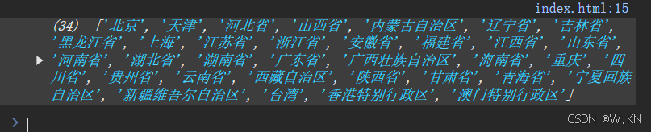
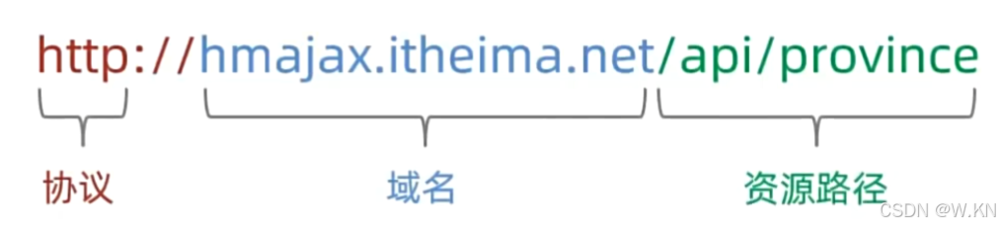

   对于前端框架的补充学习内容 了解学习Ajax入门知识

## 1 AJAX 入门

###  1.1 AJAX 简介

> AJAX（Asynchronous JavaScript and XML）即异步的 JavaScript 和 XML 是一种在无需重新加载整个网页的情况下 与服务器进行异步通信并更新部分网页的技术

**核心原理**

它利用了浏览器内置的 `XMLHttpRequest` 对象（现代也常用 `fetch API`），在不刷新整个页面的前提下，与服务器进行异步数据交换。客户端可以在后台向服务器发送请求并接收响应，然后根据响应内容动态更新网页的部分内容，提升用户体验

* * *

### 1.2 AJAX使用

####     1.2.1 axios 库

#####        1.2.1.1 axios 概念与引入

> 1 引入库 
> 
> ```
> https://unpkg.com/axios/dist/axios.min.js
> ```
> 
>  2 使用axios函数
> 
>    传入配置对象
> 
>    再用.then回调函数接受结果，并作后续处理

案例 ：获取省份



```html
<!DOCTYPE html>
<html lang="en">
<head>
    <meta charset="UTF-8">
    <meta name="viewport" content="width=device-width, initial-scale=1.0">
    <title>AJAX概念与入门</title>
</head>
<!-- 引入axios库 -->
<script src="https://cdn.jsdelivr.net/npm/axios/dist/axios.min.js"></script>

<script>
    axios({
        url:"http://hmajax.itheima.net/api/province",
    }).then(res=>{
        console.log(res.data.list)
        document.querySelector('.mp').innerHTML = res.data.list.join('<br>')
        })
</script>
<body>
    <p class="mp"></p>
</body>
</html>
```

* * *

#####       1.2.1.2 URL

>  URL 统一资源定位符 用于定位互联网上资源的地址 用于访问资源

**组成：**



> 协议：超文本传输协议 规定浏览器与服务器间传输数据的格式
> 
> 域名：标记服务器在互联网中方位
> 
> 资源路径：标记资源在服务器下的具体位置

**查询参数：**

> 1 定义：浏览器提供给服务器的额外信息 让服务器返回浏览器想要的数据
> 
> 2 语法：http://xxxx.com./xxx/xxx?参数名1=值1&参数名2=值2 

axios查询语法:

> 使用axios提供的params选项 运行时会在运行时 会把值拼接到?后面 

```html
<!DOCTYPE html>
<html lang="en">
<head>
    <meta charset="UTF-8">
    <meta name="viewport" content="width=device-width, initial-scale=1.0">
    <title>查询参数</title>
</head>
<!-- 引入axios库 -->
<script src="https://cdn.jsdelivr.net/npm/axios/dist/axios.min.js"></script>

<script>
    axios({
        url:"http://hmajax.itheima.net/api/city",
        params: {
            pname: "山西省"
        }
    }).then(response => {
        document.querySelector(".mp").innerHTML = response.data.list.join("<br>");
        console.log(response.data.list);
    });
</script>

<body>
    <p class="mp"></p>
</body>

</html>
```

案例 ：获取地区

```html
<!DOCTYPE html>
<html lang="en">
<head>
    <meta charset="UTF-8">
    <meta name="viewport" content="width=device-width, initial-scale=1.0">
    <title>获取地区</title>
</head>
<body>
    <div>
        <h2>获取省份</h2>
        <textarea class="pname"></textarea>
    </div>
    <div>
        <h2>获取城市</h2>
        <textarea class="cname"></textarea>
    </div>
    <button type="button" class="btn">获取</button>
    <div>
        <table>
            <thead>
                <tr>
                    <th>区县</th>
                </tr>
            </thead>
            <tbody>
                <tr>
                    <td>区县</td>
                </tr>
            </tbody>
    </div>
</body>
<style>
    .pname,.cname{
        width: 100%;
        height: 100px;
    }
    table{
        width: 100%;
    }
    table,th,td{
        border: 1px solid #000;
        border-collapse: collapse;
    }
    th,td{
        padding: 10px;
    }
    th{
        background-color: #f2f2f2;
    }
    tr:nth-child(odd){
        background-color: #f2f2f2;
    }
    tr:nth-child(even){
        background-color: #fff;
    }
    .btn{
        width: 100px;
        height: 40px;
        background-color: #f2f2f2;
        border: none;
        outline: none;
        cursor: pointer;
    }
    .btn:hover{
        background-color: #e0e0e0;
    }
    .btn:active{
        background-color: #d9d9d9;
    }
</style>

<script src="https://cdn.jsdelivr.net/npm/axios/dist/axios.min.js"></script>

<script>
    document.querySelector('.btn').addEventListener('click', ()=>{
        let pname = document.querySelector('.pname').value
        let cname = document.querySelector('.cname').value
        axios({
            url:"http://hmajax.itheima.net/api/area",
            params:{
                pname:pname,
                cname:cname
            }
        }).then(res => {
            console.log(res.data.list)
            let str = ''
            res.data.list.forEach(item => {
                str += `<tr>
                            <td>${item}</td>
                        </tr>`
            })
            document.querySelector('tbody').innerHTML = str
        })
    })
</script>
</html>
```

* * *

##### 1.2.1.3 请求方法

> 对服务器资源要执行的方法

<table border="1" cellpadding="1" cellspacing="1" style="width:500px"><tbody><tr><td>请求方法</td><td>操作</td></tr><tr><td>GET</td><td>获取数据</td></tr><tr><td>POST</td><td>请求数据</td></tr><tr><td>PUT</td><td>修改数据（全部）</td></tr><tr><td>DELETE</td><td>删除数据</td></tr><tr><td>PATCH</td><td>修改数据（部分）</td></tr></tbody></table>

 **axios请求配置：**

> url:请求数据的URl网址
> 
> method:请求的方法 GET可以省略（不区分大小写）
> 
> data:请求数据

```html
<!DOCTYPE html>
<html lang="en">
<head>
    <meta charset="UTF-8">
    <meta name="viewport" content="width=device-width, initial-scale=1.0">
    <title>请求方法和数据请求</title>
</head>
<body>
    <div class="name">
        <input type="text" placeholder="请输入用户名">
    </div>
    <div class="password">
        <input type="password" placeholder="请输入密码">
    </div>
        <button class="submit">提交</button>
</body>

<style>
    .name{
        margin-top: 20px;
    }
    .password{
        margin-top: 20px;
    }
    .submit{
        margin-top: 20px;
    }
</style>


<script src="https://cdn.jsdelivr.net/npm/axios/dist/axios.min.js"></script>

<script>
    document.querySelector('.submit').addEventListener('click', function(){
        let name = document.querySelector('.name input').value;
        let password = document.querySelector('.password input').value;
        axios({
            method: 'post',
            url: 'http://hmajax.itheima.net/api/register',
            data: {
                name: name,
                password: password
            }
        }).then(res => {
            console.log(res);
        }).catch(err => {
            console.log(err);
        })
    })
</script>
</html>
```

* * *

#### 1.2.2  XMLHttpRequest原理

#### 1.2.3 接口文档

> 接口文档：描述接口的文章  （后端给前端使用的文档）
> 
> 接口：使用的AJAX和服务器通讯时 使用的URL 请求方法以及参数

#### 1.2.4 from-serialize插件 

> 作用：快速获取表单元素的值

* * *

### 1.3 AJAX 错误处理

> 在从服务器中获取信息时会出现报错 将错误数据进行渲染后显示给用户界面
> 
> 语法：在then方法后面 通过点语法调用catch方法 传入回调函数并传入参数

```html
<script>
    document.querySelector('.submit').addEventListener('click', function(){
        let name = document.querySelector('.name input').value;
        let password = document.querySelector('.password input').value;
        axios({
            method: 'post',
            url: 'http://hmajax.itheima.net/api/register',
            data: {
                name: name,
                password: password
            }
        }).then(res => {
            console.log(res);
        }).catch(err => {
            console.log(err);
        })
    })
```

* * *
