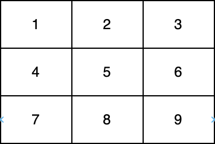
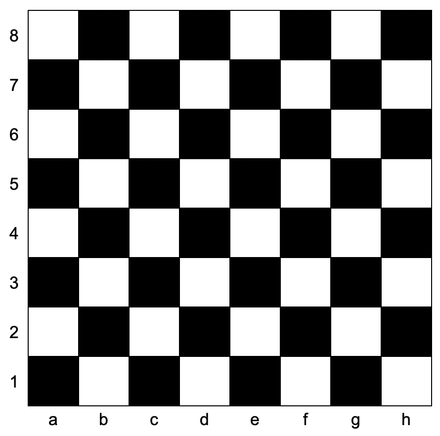

重整旗鼓 第六篇笔记

## 第一天

### 使字符串平衡的最小交换次数

> 给你一个字符串 `s` ，**下标从 0 开始** ，且长度为偶数 `n` 。字符串 **恰好** 由 `n / 2` 个开括号 `'['` 和 `n / 2` 个闭括号 `']'` 组成。
> 
> 只有能满足下述所有条件的字符串才能称为 **平衡字符串** ：
> 
> -   字符串是一个空字符串，或者
> -   字符串可以记作 `AB` ，其中 `A` 和 `B` 都是 **平衡字符串** ，或者
> -   字符串可以写成 `[C]` ，其中 `C` 是一个 **平衡字符串** 。
> 
> 你可以交换 **任意** 两个下标所对应的括号 **任意** 次数。
> 
> 返回使 `s` 变成 **平衡字符串** 所需要的 **最小** 交换次数

```cs
int minSwaps(char* s) {
    int balance = 0;
    int maxUnbalanced = 0;

    for (int i = 0; s[i] != '\0'; i++) {
        if (s[i] == '[') {
            balance++;
        } else {
            balance--;
        }
        if (balance < maxUnbalanced) {
            maxUnbalanced = balance;
        }
    }

    return (1 - maxUnbalanced) / 2;
}
```

* * *

### 超级饮料的最大强化能量

[超级饮料的最大强化能量https://leetcode.cn/problems/maximum-energy-boost-from-two-drinks/](https://leetcode.cn/problems/maximum-energy-boost-from-two-drinks/ "超级饮料的最大强化能量")

> 来自未来的体育科学家给你两个整数数组 `energyDrinkA` 和 `energyDrinkB`，数组长度都等于 `n`。这两个数组分别代表 A、B 两种不同能量饮料每小时所能提供的强化能量。
> 
> 你需要每小时饮用一种能量饮料来 **最大化** 你的总强化能量。然而，如果从一种能量饮料切换到另一种，你需要等待一小时来梳理身体的能量体系（在那个小时里你将不会获得任何强化能量）。
> 
> 返回在接下来的 `n` 小时内你能获得的 **最大** 总强化能量。
> 
> **注意** 你可以选择从饮用任意一种能量饮料开始。

```cs
long long max(long long a,long long b){
    return a > b ? a : b;
}

long long maxEnergyBoost(int* energyDrinkA, int energyDrinkASize, int* energyDrinkB, int energyDrinkBSize) {
    
    int n = energyDrinkASize;
    long long dp[n][2];

    dp[0][0] = energyDrinkA[0];
    dp[0][1] = energyDrinkB[0];

    dp[1][0] = dp[0][0] + energyDrinkA[1];
    dp[1][1] = dp[0][1] + energyDrinkB[1];

    for(int i = 2;i < n;i ++){

        dp[i][0] = max(dp[i - 1][0] + energyDrinkA[i],dp[i - 2][1] + energyDrinkA[i]);
        dp[i][1] = max(dp[i - 1][1] + energyDrinkB[i],dp[i - 2][0] + energyDrinkB[i]); 

    }

    return max(dp[n - 1][0],dp[n - 1][1]);

}
```

* * *

### 使两个整数相等的位更改次数

[使两个整数相等的位更改次数https://leetcode.cn/problems/number-of-bit-changes-to-make-two-integers-equal/](https://leetcode.cn/problems/number-of-bit-changes-to-make-two-integers-equal/ "使两个整数相等的位更改次数")

> 给你两个正整数 `n` 和 `k`。
> 
> 你可以选择 `n` 的 **二进制表示** 中任意一个值为 1 的位，并将其改为 0。
> 
> 返回使得 `n` 等于 `k` 所需要的更改次数。如果无法实现，返回 -1。

```cs
#include <stdio.h>

int minChanges(int n, int k) {
    // 如果 n 小于 k，无法通过将 n 的 1 变为 0 得到 k
    if (n < k) {
        return -1;
    }
    int ans = 0;
    // 遍历 32 位整数的每一位
    for (int i = 0; i < 32; i++) {
        int bitN = (n >> i) & 1;
        int bitK = (k >> i) & 1;
        // 如果 n 的当前位为 1 而 k 的当前位为 0，需要进行一次更改
        if (bitN == 1 && bitK == 0) {
            ans++;
        }
        // 如果 k 的当前位为 1 而 n 的当前位为 0，无法实现，返回 -1
        if (bitN == 0 && bitK == 1) {
            return -1;
        }
    }
    return ans;
}    
```

* * *

## 第二天

### 对角线上的质数

[对角线上的质数https://leetcode.cn/problems/prime-in-diagonal/](https://leetcode.cn/problems/prime-in-diagonal/ "对角线上的质数")

> 给你一个下标从 **0** 开始的二维整数数组 `nums` 。
> 
> 返回位于 `nums` 至少一条 **对角线** 上的最大 **质数** 。如果任一对角线上均不存在质数，返回 _0 。_
> 
> 注意：
> 
> -   如果某个整数大于 `1` ，且不存在除 `1` 和自身之外的正整数因子，则认为该整数是一个质数。
> -   如果存在整数 `i` ，使得 `nums[i][i] = val` 或者 `nums[i][nums.length - i - 1]= val` ，则认为整数 `val` 位于 `nums` 的一条对角线上。
> 
> 
> 
> 在上图中，一条对角线是 **\[1,5,9\]** ，而另一条对角线是 **\[3,5,7\]** 。

```cs
bool fun(int n){

    if(n <= 1){
        return false;
    }

    for(int i = 2;i <= sqrt(n);i++){
        if(n % i == 0){
            return false;
        }
    }
    return true;

}

int diagonalPrime(int** nums, int numsSize, int* numsColSize) {
    
    int ans = 0;

    for(int i = 0;i < numsSize;i++){
        if(fun(nums[i][i]) && nums[i][i] > ans){
            ans = nums[i][i];
        }
        if(fun(nums[i][numsSize - 1 - i]) && nums[i][numsSize - 1 - i] > ans){
            ans = nums[i][numsSize - 1 - i];
        }
    }

    return ans;

}
```

* * *

### 数组大小减半

[数组大小减半https://leetcode.cn/problems/reduce-array-size-to-the-half/](https://leetcode.cn/problems/reduce-array-size-to-the-half/ "数组大小减半")

> 给你一个整数数组 `arr`。你可以从中选出一个整数集合，并删除这些整数在数组中的每次出现。
> 
> 返回 **至少** 能删除数组中的一半整数的整数集合的最小大小。

```cpp
#include <vector>
#include <unordered_map>
#include <algorithm>

class Solution {
public:
    int minSetSize(std::vector<int>& arr) {
        std::unordered_map<int, int> map;
        // 统计每个元素的出现次数
        for (int num : arr) {
            map[num]++;
        }

        std::vector<int> frequencies;
        // 将出现次数存入 vector
        for (const auto& pair : map) {
            frequencies.push_back(pair.second);
        }

        // 按出现次数从大到小排序
        std::sort(frequencies.begin(), frequencies.end(), std::greater<int>());

        int total = 0;
        int count = 0;
        // 计算最小集合大小
        for (int freq : frequencies) {
            total += freq;
            count++;
            if (total >= arr.size() / 2) {
                break;
            }
        }

        return count;
    }
};
```

* * *

### 分割数组的方案数

[分割数组的方案数https://leetcode.cn/problems/number-of-ways-to-split-array/](https://leetcode.cn/problems/number-of-ways-to-split-array/ "分割数组的方案数")

> 给你一个下标从 **0** 开始长度为 `n` 的整数数组 `nums` 。  
> 如果以下描述为真，那么 `nums` 在下标 `i` 处有一个 **合法的分割** ：
> 
> -   前 `i + 1` 个元素的和 **大于等于** 剩下的 `n - i - 1` 个元素的和。
> -   下标 `i` 的右边 **至少有一个** 元素，也就是说下标 `i` 满足 `0 <= i < n - 1` 。
> 
> 请你返回 `nums` 中的 **合法分割** 方案数。

 暴力破解

```cs
// using namespace std;

class Solution {
public:
    int waysToSplitArray(vector<int>& nums) {
        
        std::vector<long long>sum(nums.size());
        int ans = 0;

        sum[0] = nums[0]; // 包括这个数在内的前缀和
        for(int i = 1; i < nums.size();i++){
            sum[i] = sum[i - 1] + nums[i];
        }

        for(int i = 0; i < nums.size() - 1;i++){
            if(sum[i] >= (sum[nums.size() - 1] - sum[i])){
                ans ++;
            }
        }

        return ans;
    }
};
```

优化解答

```cpp
class Solution {
public:
    int waysToSplitArray(vector<int>& nums) 
    {
        long long total = reduce(nums.begin(), nums.end(), 0LL);
        int ans = 0;
        long long s = 0;
        for (int i = 0; i + 1 < nums.size(); i++) {
            s += nums[i];
            if (s * 2 >= total) {
                ans++;
            }
        }
        return ans;

    }
};
```

* * *

## 第三天

### 转换二维数组

[转换二维数组https://leetcode.cn/problems/convert-an-array-into-a-2d-array-with-conditions/](https://leetcode.cn/problems/convert-an-array-into-a-2d-array-with-conditions/ "转换二维数组")

> 给你一个整数数组 `nums` 。请你创建一个满足以下条件的二维数组：
> 
> -   二维数组应该 **只** 包含数组 `nums` 中的元素。
> -   二维数组中的每一行都包含 **不同** 的整数。
> -   二维数组的行数应尽可能 **少** 。
> 
> 返回结果数组。如果存在多种答案，则返回其中任何一种。
> 
> 请注意，二维数组的每一行上可以存在不同数量的元素

```cs
int** findMatrix(int* nums, int numsSize, int* returnSize, int** returnColumnSizes) {
    // 用于统计每个数字出现的次数，由于数字范围是 1 到 200，所以数组大小为 201
    int num[201];
    memset(num, 0, sizeof(int) * 201);
    int max = 0;

    // 统计每个数字出现的次数，并找出最大出现次数
    for (int i = 0; i < numsSize; i++) {
        num[nums[i]]++;
        if (num[nums[i]] > max) {
            max = num[nums[i]];
        }
    }

    // 最大出现次数即为二维数组的行数
    *returnSize = max;
    // 为列大小数组分配内存
    *returnColumnSizes = (int*)malloc(max * sizeof(int));
    // 为二维数组分配内存
    int** result = (int**)malloc(max * sizeof(int*));

    // 初始化每一行的列大小为 0
    for (int i = 0; i < max; i++) {
        (*returnColumnSizes)[i] = 0;
        result[i] = NULL;
    }

    // 遍历每个数字及其出现次数，将数字按顺序填充到二维数组中
    for (int i = 1; i <= 200; i++) {
        for (int j = 0; j < num[i]; j++) {
            if (result[j] == NULL) {
                result[j] = (int*)malloc(sizeof(int));
            } else {
                result[j] = (int*)realloc(result[j], ((*returnColumnSizes)[j] + 1) * sizeof(int));
            }
            result[j][(*returnColumnSizes)[j]] = i;
            (*returnColumnSizes)[j]++;
        }
    }

    return result;
} 
```

* * *

### 超过阈值的最少操作数

[超过阈值的最少操作数 Ihttps://leetcode.cn/problems/minimum-operations-to-exceed-threshold-value-i/](https://leetcode.cn/problems/minimum-operations-to-exceed-threshold-value-i/ "超过阈值的最少操作数 I")

> 给你一个下标从 **0** 开始的整数数组 `nums` 和一个整数 `k` 。
> 
> 一次操作中，你可以删除 `nums` 中的最小元素。
> 
> 你需要使数组中的所有元素都大于或等于 `k` ，请你返回需要的 **最少** 操作次数。

```cs
int comp(const void* a,const void* b){
    return (*(int*)a - *(int*)b);
}

int minOperations(int* nums, int numsSize, int k) {

    if(numsSize == 1){
        return numsSize - 1;
    }
    
    qsort(nums,numsSize,sizeof(int),comp);

    int ans = 0;
    for(int i = 0;i < numsSize;i ++){
        if(nums[i] < k){ans ++;}
        else{return ans;}
    }

    return ans;
}
```

* * *

### 统计不是特殊数字的数字数

[统计不是特殊数字的数字数量https://leetcode.cn/problems/find-the-count-of-numbers-which-are-not-special/](https://leetcode.cn/problems/find-the-count-of-numbers-which-are-not-special/ "统计不是特殊数字的数字数量")

> 给你两个 **正整数** `l` 和 `r`。对于任何数字 `x`，`x` 的所有正因数（除了 `x` 本身）被称为 `x` 的 **真因数**。
> 
> 如果一个数字恰好仅有两个 **真因数**，则称该数字为 **特殊数字**。例如：
> 
> -   数字 4 是 **特殊数字**，因为它的真因数为 1 和 2。
> -   数字 6 不是 **特殊数字**，因为它的真因数为 1、2 和 3。
> 
> 返回区间 `[l, r]` 内 **不是 特殊数字** 的数字数量。

暴力破解（未通过） 

```cs
bool fun(int x){

    int num = 0;
    for(int i = 1;i < x/2 + 1;i++){
        if(x % i == 0){
            num ++;
            if(num > 2){
                return false;
            }
        }
    }

    if(num == 2){return true;}
    else{return false;}
}

int nonSpecialCount(int l, int r) {
    
    int length = r - l + 1;
    int ans = 0;
    for(int i = l;i <= r;i ++){
        if(fun(i)){
            ans ++;
        }
    }
    return length - ans;
}
```

 优化解

```cs
int nonSpecialCount(int l, int r) {
    int n = (int)sqrt(r);
    int v[n + 1];
    int res = r - l + 1;
    for (int i = 0; i <= n; i++) {
        v[i] = 0;
    }
    for (int i = 2; i <= n; i++) {
        if (v[i] == 0) {
            if (i * i >= l && i * i <= r) {
                res--;
            }
            for (int j = i * 2; j <= n; j += i) {
                v[j] = 1;
            }
        }
    }
    return res;
}
```

* * *

## **第四天**

### 适龄的朋友

[适龄的朋友https://leetcode.cn/problems/friends-of-appropriate-ages/](https://leetcode.cn/problems/friends-of-appropriate-ages/ "适龄的朋友")

> 在社交媒体网站上有 `n` 个用户。给你一个整数数组 `ages` ，其中 `ages[i]` 是第 `i` 个用户的年龄。
> 
> 如果下述任意一个条件为真，那么用户 `x` 将不会向用户 `y`（`x != y`）发送好友请求：
> 
> -   `ages[y] <= 0.5 * ages[x] + 7`
> -   `ages[y] > ages[x]`
> -   `ages[y] > 100 && ages[x] < 100`
> 
> 否则，`x` 将会向 `y` 发送一条好友请求。
> 
> 注意，如果 `x` 向 `y` 发送一条好友请求，`y` 不必也向 `x` 发送一条好友请求。另外，用户不会向自己发送好友请求。
> 
> 返回在该社交媒体网站上产生的好友请求总数。

```cs
#include <stdio.h>

int numFriendRequests(int* ages, int agesSize) {
    int ageCount[121] = {0};
    // 统计每个年龄的人数
    for (int i = 0; i < agesSize; i++) {
        ageCount[ages[i]]++;
    }

    int ans = 0;
    // 遍历所有可能的年龄对
    for (int i = 1; i <= 120; i++) {
        for (int j = 1; j <= 120; j++) {
            if (j > 0.5 * i + 7 && j <= i) {
                if (i == j) {
                    // 同一年龄的人互相发好友请求
                    ans += ageCount[i] * (ageCount[i] - 1);
                } else {
                    // 不同年龄的人发好友请求
                    ans += ageCount[i] * ageCount[j];
                }
            }
        }
    }
    return ans;
}
```

* * *

### 求出硬币游戏的赢家

[求出硬币游戏的赢家https://leetcode.cn/problems/find-the-winning-player-in-coin-game/](https://leetcode.cn/problems/find-the-winning-player-in-coin-game/ "求出硬币游戏的赢家")

> 给你两个 **正** 整数 `x` 和 `y` ，分别表示价值为 75 和 10 的硬币的数目。
> 
> Alice 和 Bob 正在玩一个游戏。每一轮中，Alice 先进行操作，Bob 后操作。每次操作中，玩家需要拿走价值 **总和** 为 115 的硬币。如果一名玩家无法执行此操作，那么这名玩家 **输掉** 游戏。
> 
> 两名玩家都采取 **最优** 策略，请你返回游戏的赢家。

```cs
char* winningPlayer(int x, int y) {
    
    int nums = 0;
    while(1){
        if(x >= 1 && y >= 4){
            nums ++;
            x -= 1;
            y -= 4;
        }else{
            break;
        }
    }

    char* ans;
    if(nums % 2 == 1){
      ans = "Alice";
    }else{
      ans = "Bob";
    }

    return ans;
}
```

* * *

### 形成目标字符串需要的最少字符串数

[形成目标字符串需要的最少字符串数 Ihttps://leetcode.cn/problems/minimum-number-of-valid-strings-to-form-target-i/](https://leetcode.cn/problems/minimum-number-of-valid-strings-to-form-target-i/ "形成目标字符串需要的最少字符串数 I")

> 给你一个字符串数组 `words` 和一个字符串 `target`。
> 
> 如果字符串 `x` 是 `words` 中 **任意** 字符串的 前缀，则认为 `x` 是一个 **有效** 字符串。
> 
> 现计划通过 **连接** 有效字符串形成 `target` ，请你计算并返回需要连接的 **最少** 字符串数量。如果无法通过这种方式形成 `target`，则返回 `-1`。

```cpp
class Solution {
public:
    int minValidStrings(vector<string>& words, string target) {
        auto prefix_function = [](const string& word, const string& target) -> vector<int> {
            string s = word + '#' + target;
            int n = s.size();
            vector<int> pi(n, 0);
            for (int i = 1; i < n; i++) {
                int j = pi[i - 1];
                while (j > 0 && s[i] != s[j]) {
                    j = pi[j - 1];
                }
                if (s[i] == s[j]) {
                    j++;
                }
                pi[i] = j;
            }
            return pi;
        };

        int n = target.size();
        vector<int> back(n, 0);
        for (const string& word : words) {
            vector<int> pi = prefix_function(word, target);
            int m = word.size();
            for (int i = 0; i < n; i++) {
                back[i] = max(back[i], pi[m + 1 + i]);
            }
        }

        vector<int> dp(n + 1, 0);
        for (int i = 1; i <= n; i++) {
            dp[i] = 1e9;
        }
        for (int i = 0; i < n; i++) {
            dp[i + 1] = dp[i + 1 - back[i]] + 1;
            if (dp[i + 1] > n) {
                return -1;
            }
        }
        return dp[n];
    }
};
```

* * *

## 第五天

### 最大或值

[最大或值https://leetcode.cn/problems/maximum-or/](https://leetcode.cn/problems/maximum-or/ "最大或值")

> 给你一个下标从 **0** 开始长度为 `n` 的整数数组 `nums` 和一个整数 `k` 。每一次操作中，你可以选择一个数并将它乘 `2` 。
> 
> 你最多可以进行 `k` 次操作，请你返回 `nums[0] | nums[1] | ... | nums[n - 1]` 的最大值。
> 
> `a | b` 表示两个整数 `a` 和 `b` 的 **按位或** 运算。

```cs
long long maximumOr(int* nums, int numsSize, int k) {
    long long *suf = (long long *)malloc((numsSize + 1) * sizeof(long long));
    suf[numsSize] = 0;

    for (int i = numsSize - 1; i >= 0; i--) {
        suf[i] = suf[i + 1] | nums[i];
    }

    long long res = 0;
    long long pre = 0;
    for (int i = 0; i < numsSize; i++) {
        res = fmax(res, pre | ((long long)nums[i] << k) | suf[i + 1]);
        pre |= nums[i];
    }
    free(suf);
    return res;
}
```

* * *

### 矩阵中的蛇

[矩阵中的蛇https://leetcode.cn/problems/snake-in-matrix/](https://leetcode.cn/problems/snake-in-matrix/ "矩阵中的蛇")

> 大小为 `n x n` 的矩阵 `grid` 中有一条蛇。蛇可以朝 **四个可能的方向** 移动。矩阵中的每个单元格都使用位置进行标识： `grid[i][j] = (i * n) + j`。
> 
> 蛇从单元格 0 开始，并遵循一系列命令移动。
> 
> 给你一个整数 `n` 表示 `grid` 的大小，另给你一个字符串数组 `commands`，其中包括 `"UP"`、`"RIGHT"`、`"DOWN"` 和 `"LEFT"`。题目测评数据保证蛇在整个移动过程中将始终位于 `grid` 边界内。
> 
> 返回执行 `commands` 后蛇所停留的最终单元格的位置。

```cs
int finalPositionOfSnake(int n, char** commands, int commandsSize) {
    int ans = 0;
    for (int i = 0; i < commandsSize; i++) {
        if (commands[i][0] == 'U') {
            ans -= n;
        } else if (commands[i][0] == 'D') {
            ans += n;
        } else if (commands[i][0] == 'L') {
            ans--;
        } else {
            ans++;
        }
    }
    return ans;
}
```

* * *

### 检查棋盘方格颜色是否相同

[检查棋盘方格颜色是否相同https://leetcode.cn/problems/check-if-two-chessboard-squares-have-the-same-color/](https://leetcode.cn/problems/check-if-two-chessboard-squares-have-the-same-color/ "检查棋盘方格颜色是否相同")

> 给你两个字符串 `coordinate1` 和 `coordinate2`，代表 `8 x 8` 国际象棋棋盘上的两个方格的坐标。
> 
> 以下是棋盘的参考图。
> 
> 
> 
> 如果这两个方格颜色相同，返回 `true`，否则返回 `false`。
> 
> 坐标总是表示有效的棋盘方格。坐标的格式总是先字母（表示列），再数字（表示行）。

```cs
bool checkTwoChessboards(char* coordinate1, char* coordinate2) {
    
    int col1 = coordinate1[0] - 'a';
    int row1 = coordinate1[1] - '1';
    // 获取第二个坐标的列和行
    int col2 = coordinate2[0] - 'a';
    int row2 = coordinate2[1] - '1';

    // 判断两个坐标所在格子颜色是否相同
    bool color1 = (col1 + row1) % 2 == 0;
    bool color2 = (col2 + row2) % 2 == 0;

    return color1 == color2;
}
```

* * *

## 第六天

### 一最多的行

[一最多的行https://leetcode.cn/problems/row-with-maximum-ones/](https://leetcode.cn/problems/row-with-maximum-ones/ "一最多的行")

> 给你一个大小为 `m x n` 的二进制矩阵 `mat` ，请你找出包含最多 **1** 的行的下标（从 **0** 开始）以及这一行中 **1** 的数目。
> 
> 如果有多行包含最多的 1 ，只需要选择 **行下标最小** 的那一行。
> 
> 返回一个由行下标和该行中 1 的数量组成的数组。

```cs
/**
 * Note: The returned array must be malloced, assume caller calls free().
 */
int* rowAndMaximumOnes(int** mat, int matSize, int* matColSize, int* returnSize) {
    
    int row = 0;
    int num = 0;
    int* ans = (int*)malloc(sizeof(int)*2);
    *returnSize = 2;

    for(int i = 0; i < matSize;i ++){
        int n = 0;
        for(int j = 0;j < matColSize[i];j++){
            n += mat[i][j];
        }
        if(n > num){
            row = i;
            num = n;
        }
    }

    ans[0] = row;
    ans[1] = num;
    return ans;
}
```

* * *

### 执行操作可获得的最大总奖励

[执行操作可获得的最大总奖励https://leetcode.cn/problems/maximum-total-reward-using-operations-i/](https://leetcode.cn/problems/maximum-total-reward-using-operations-i/ "执行操作可获得的最大总奖励")

> 给你一个整数数组 `rewardValues`，长度为 `n`，代表奖励的值。
> 
> 最初，你的总奖励 `x` 为 0，所有下标都是 **未标记** 的。你可以执行以下操作 **任意次** ：
> 
> -   从区间 `[0, n - 1]` 中选择一个 **未标记** 的下标 `i`。
> -   如果 `rewardValues[i]` **大于** 你当前的总奖励 `x`，则将 `rewardValues[i]` 加到 `x` 上（即 `x = x + rewardValues[i]`），并 **标记** 下标 `i`。
> 
> 以整数形式返回执行最优操作能够获得的 **最大** 总奖励。

```cs
int cmp(const void *a, const void *b) {
    return *(int *)a - *(int *)b;
}

int maxTotalReward(int *rewardValues, int rewardValuesSize) {
    qsort(rewardValues, rewardValuesSize, sizeof(int), cmp);
    int m = rewardValues[rewardValuesSize - 1];
    int* dp = (int*)malloc(2 * m * sizeof(int));
    memset(dp, 0, 2 * m * sizeof(int));
    dp[0] = 1;
    for (int i = 0; i < rewardValuesSize; i++) {
        int x = rewardValues[i];
        for (int k = 2 * x - 1; k >= x; k--) {
            if (dp[k - x] == 1) {
                dp[k] = 1;
            }
        }
    }
    int res = 0;
    for (int i = 0; i < 2 * m; i++) {
        if (dp[i] == 1) {
            res = i;
        }
    }
    free(dp);
    return res;
}
```

* * *

### 按位与结果大于零的最长数组

[按位与结果大于零的最长组合https://leetcode.cn/problems/largest-combination-with-bitwise-and-greater-than-zero/](https://leetcode.cn/problems/largest-combination-with-bitwise-and-greater-than-zero/ "按位与结果大于零的最长组合")

> 对数组 `nums` 执行 **按位与** 相当于对数组 `nums` 中的所有整数执行 **按位与** 。
> 
> -   例如，对 `nums = [1, 5, 3]` 来说，按位与等于 `1 & 5 & 3 = 1` 。
> -   同样，对 `nums = [7]` 而言，按位与等于 `7` 。
> 
> 给你一个正整数数组 `candidates` 。计算 `candidates` 中的数字每种组合下 **按位与** 的结果。
> 
> 返回按位与结果大于 `0` 的 **最长** 组合的长度_。_

```cs
// 计算从低到高第 k 个二进制位数值为 1 的元素个数
int maxlen(int* candidates, int candidatesSize, int k) {
    int res = 0;
    for (int i = 0; i < candidatesSize; ++i) {
        if (candidates[i] & (1 << k)) {
            ++res;
        }
    }
    return res;
}

int largestCombination(int* candidates, int candidatesSize) {
    int res = 0;
    for (int i = 0; i < 24; ++i) {
        // 遍历二进制位
        res = fmax(res, maxlen(candidates, candidatesSize, i));
    }
    return res;
}
```

* * *

## 第七天

### 判断一个括号字符串是否有效

[判断一个括号字符串是否有效https://leetcode.cn/problems/check-if-a-parentheses-string-can-be-valid/](https://leetcode.cn/problems/check-if-a-parentheses-string-can-be-valid/ "判断一个括号字符串是否有效")

> 一个括号字符串是只由 `'('` 和 `')'` 组成的 **非空** 字符串。如果一个字符串满足下面 **任意** 一个条件，那么它就是有效的：
> 
> -   字符串为 `()`.
> -   它可以表示为 `AB`（`A` 与 `B` 连接），其中`A` 和 `B` 都是有效括号字符串。
> -   它可以表示为 `(A)` ，其中 `A` 是一个有效括号字符串。
> 
> 给你一个括号字符串 `s` 和一个字符串 `locked` ，两者长度都为 `n` 。`locked` 是一个二进制字符串，只包含 `'0'` 和 `'1'` 。对于 `locked` 中 **每一个** 下标 `i` ：
> 
> -   如果 `locked[i]` 是 `'1'` ，你 **不能** 改变 `s[i]` 。
> -   如果 `locked[i]` 是 `'0'` ，你 **可以** 将 `s[i]` 变为 `'('` 或者 `')'` 。
> 
> 如果你可以将 `s` 变为有效括号字符串，请你返回 `true` ，否则返回 `false` 。

```cs
bool canBeValid(char* s, char* locked) {
    int n = strlen(s);
    int mx = 0;   // 可以达到的最大分数
    int mn = 0;   // 可以达到的最小分数 与 最小有效前缀对应分数 的较大值
    for (int i = 0; i < n; ++i) {
        if (locked[i] == '1') {
            // 此时对应字符无法更改
            int diff;
            if (s[i] == '(') {
                diff = 1;
            } else {
                diff = -1;
            }
            mx += diff;
            mn = fmax(mn + diff, (i + 1) % 2);
        } else {
            // 此时对应字符可以更改
            ++mx;
            mn = fmax(mn - 1, (i + 1) % 2);
        }
        if (mx < mn) {
            // 此时该前缀无法变为有效前缀
            return false;
        }
    }
    // 最终确定 s 能否通过变换使得分数为 0（成为有效字符串）
    return mn == 0;
}
```

* * *

### 两个数组的交集

[两个数组的交集 IIhttps://leetcode.cn/problems/intersection-of-two-arrays-ii/](https://leetcode.cn/problems/intersection-of-two-arrays-ii/ "两个数组的交集 II")

>  给你两个整数数组 `nums1` 和 `nums2` ，请你以数组形式返回两数组的交集。返回结果中每个元素出现的次数，应与元素在两个数组中都出现的次数一致（如果出现次数不一致，则考虑取较小值）。可以不考虑输出结果的顺序。

```cs
// 比较函数，用于 qsort
int compare(const void * a, const void * b) {
    return ( *(int*)a - *(int*)b );
}

/**
 * Note: The returned array must be malloced, assume caller calls free().
 */
int* intersect(int* nums1, int nums1Size, int* nums2, int nums2Size, int* returnSize) {
    // 为结果数组分配可能的最大内存
    int* ans = (int*)malloc(sizeof(int) * (nums1Size < nums2Size ? nums1Size : nums2Size));
    int n = 0;

    // 对两个数组进行排序
    qsort(nums1, nums1Size, sizeof(int), compare);
    qsort(nums2, nums2Size, sizeof(int), compare);

    int n1 = 0;
    int n2 = 0;

    while (n1 < nums1Size && n2 < nums2Size) {
        if (nums1[n1] < nums2[n2]) {
            n1++;
        } else if (nums1[n1] > nums2[n2]) {
            n2++;
        } else {
            ans[n] = nums1[n1];
            n++;
            n1++;
            n2++;
        }
    }

    *returnSize = n;
    return ans;
}
```

* * *

### 超过阈值的最少操作数

[超过阈值的最少操作数 IIhttps://leetcode.cn/problems/minimum-operations-to-exceed-threshold-value-ii/](https://leetcode.cn/problems/minimum-operations-to-exceed-threshold-value-ii/ "超过阈值的最少操作数 II")

>  给你一个下标从 **0** 开始的整数数组 `nums` 和一个整数 `k` 。
> 
> 你可以对 `nums` 执行一些操作，在一次操作中，你可以：
> 
> -   选择 `nums` 中 **最小** 的两个整数 `x` 和 `y` 。
> -   将 `x` 和 `y` 从 `nums` 中删除。
> -   将 `min(x, y) * 2 + max(x, y)` 添加到数组中的任意位置。
> 
> **注意，**只有当 `nums` **至少** 包含两个元素时，你才可以执行以上操作。
> 
> 你需要使数组中的所有元素都 **大于或等于** `k` ，请你返回需要的 **最少** 操作次数。

```cs
class Solution {
public:
    int minOperations(vector<int> &nums, int k) {
        int res = 0;
        priority_queue<long long, vector<long long>, greater<long long>> pq(nums.begin(), nums.end());
        while (pq.top() < k) {
            long long x = pq.top(); pq.pop();
            long long y = pq.top(); pq.pop();
            pq.push(x + x + y);
            res++;
        }
        return res;
    }
};
```

* * *

## 总结

这一周平平无奇 周末简单放松了一下 继续备战
