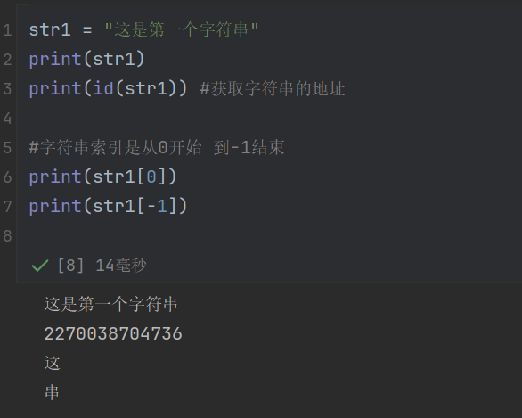
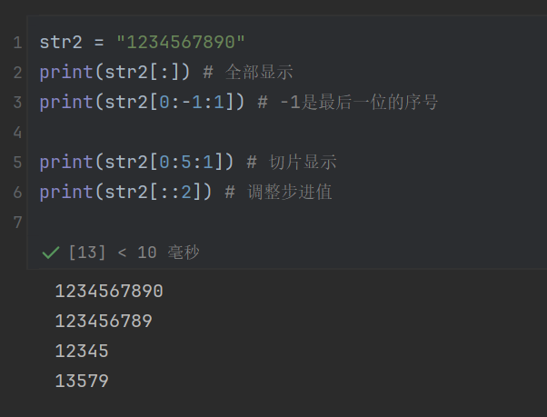
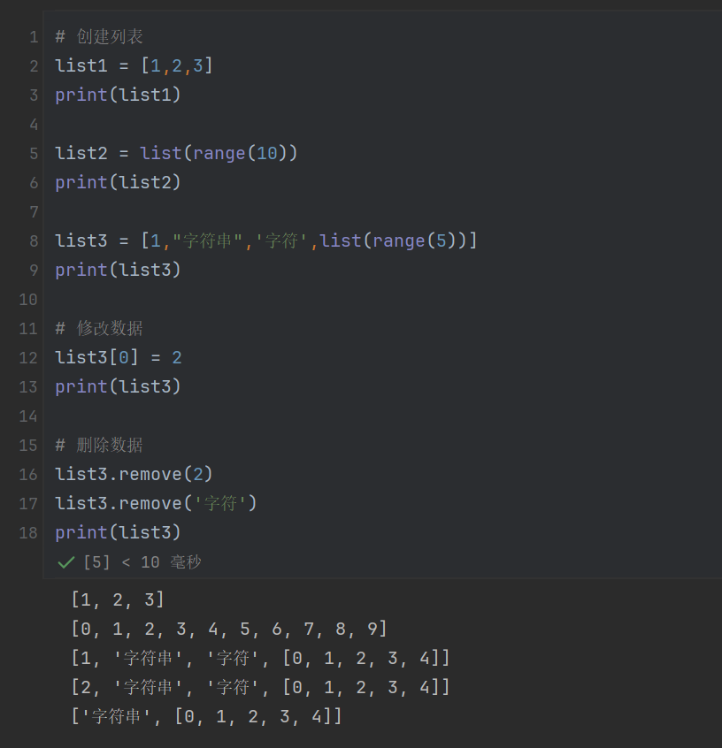
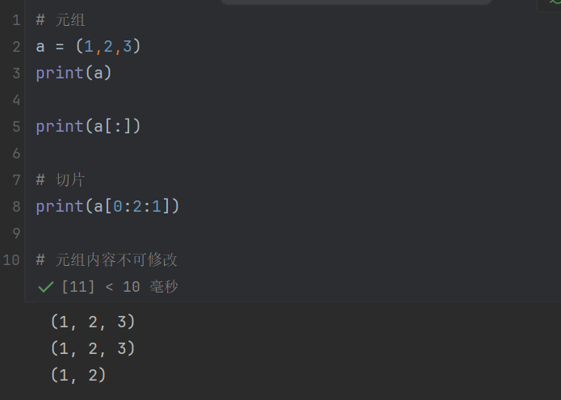
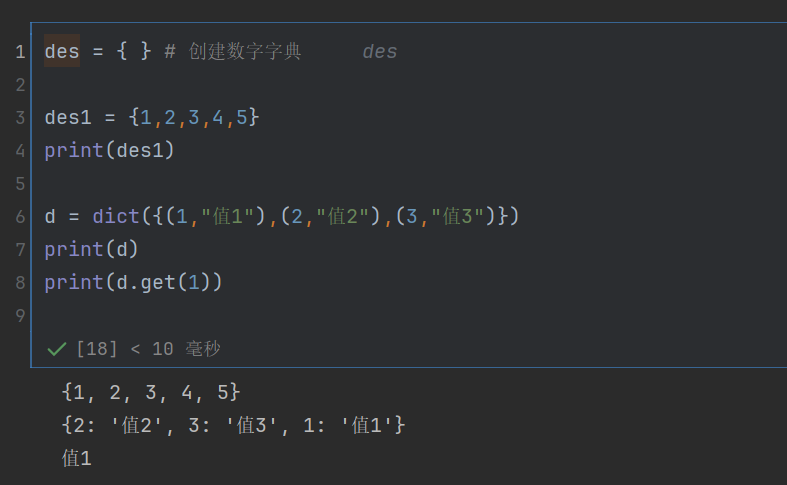
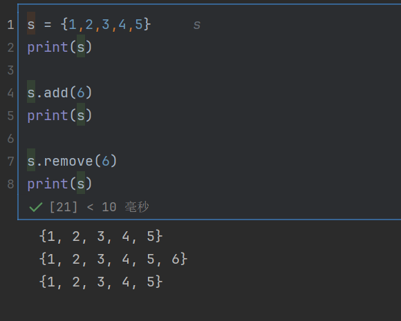

>    学习大模型搭建前的准备课程 学习六大基本数据类型和相关的增删改查 学习相关语法 对于部分名词不做介绍

## 输出函数（格式化输出）

>  输出时 按照模板进行输出的
> 
> <table border="1" cellpadding="1" cellspacing="1" style="width:500px"><caption>常见的输出格式</caption><tbody><tr><td style="width:243px">%c</td><td style="width:256px">字符</td></tr><tr><td style="width:243px">%s</td><td style="width:256px">字符串</td></tr><tr><td style="width:243px">%d</td><td style="width:256px">十进制整数</td></tr><tr><td style="width:243px">%f</td><td style="width:256px">浮点数</td></tr></tbody></table>

* * *

## Python的关键字

> 使用import keyword printf(Keyword.kwlist可以查看所有的关键字)
> 
> ```python
> ['False', 'None', 'True', 'and', 'as', 'assert', 'async', 'await', 'break', 'class', 'continue', 'def', 'del', 'elif', 'else', 'except', 'finally', 'for', 'from', '
> global', 'if', 'import', 'in', 'is', 'lambda', 'nonlocal', 'not', 'or', 'pass', 'raise', 'return', 'try', 'while', 'with', 'yield']                                 
> ```

* * *

## **六大数据类型**

**number 数值**

-   整型 (int)：在 Python3 里，只有一种整数类型 int，表示为长整型，没有 python2 中的 Long，是正或负整数或 0，不带小数点
-   布尔型 (bool)：Python3 中，bool 是 int 的子类，True 和 False 可以和数字相加，True 的值为 1、False 的值为 0
-   浮点型 (float)：浮点型由整数部分与小数部分组成，浮点类型不精确存储，浮点型也可以使用科学计数法表示（1.8e3 = 1.8 \* 10^3 = 1800 ）
-   复数 (complex)：复数由实数部分和虚数部分构成，可以用 a + bj，或者 complex (a,b) 表示，复数的实部 a 和虚部 b 都是浮点型。

```python
a = 0
print(a)

c = 'c'
print(c)

bool_1 = True
print(bool_1)
```

**String 字符串**

-   创建字符串可以使用单引号、双引号、三单引号和三双引号，其中三引号可以多行定义字符串，Python 不支持单字符类型，单字符也在 Python 也是作为一个字符串使用。
-   python 的字符串或串 (String) 是由数字、字母、下划线组成的一串字符，如：  
    a = “acc\_test”
-   字符串的索引值以 0 为开始值，-1 为从末尾的开始位置。
-   当我们定义一个 a=“Python” 语句时，它在计算机中的执行顺序是先在内存中创建一个字符串 Python ，在程序栈寄存器中创建一个变量 a，最后把 Python 的地址赋给 a。

```python
str1 = "这是第一个字符串"
print(str1)
print(id(str1)) #获取字符串的地址

#字符串索引是从0开始 到-1结束
print(str1[0])
print(str1[-1])
```

 

-   字符串可以使用切片语法 格式为 \[start:end:step\] 性质为左闭右开

```python
str2 = "1234567890"
print(str2[:]) # 全部显示
print(str2[0:-1:1]) # -1是最后一位的序号

print(str2[0:5:1]) # 切片显示
print(str2[::2]) # 调整步进值
```

 

 **List 列表**

-   List (列表) 是 Python 中使用最频繁的数据类型。
-   列表是写在方括号 \[\] 之间、用逗号分隔开的元素列表，其中元素的类型可以不相同，它支持数字，字符串甚至可以包含列表 (嵌套)，列表中的元素是可以改变的。
-   列表中的每个值都有对应的位置值，称之为索引，第一个索引为 0，第二个为 1，依次类推，同时也有负索引，-1 为末尾开始位置。

```python
# 创建列表
list1 = [1,2,3]
print(list1)

list2 = list(range(10))
print(list2)

list3 = [1,"字符串",'字符',list(range(5))]
print(list3)

# 修改数据
list3[0] = 2
print(list3)

# 删除数据
list3.remove(2)
list3.remove('字符')
print(list3)
```



**Tuple 元组**

-   python 的元组与列表类似，不同之处在于元组的元素不能修改，提高了代码编写的安全性。
-   元组使用小括号 ()，列表使用方括号 \[\]。
-   元组与字符串类似，可以被索引且下标索引从 0 开始，-1 为从末尾开始的位置，也可以进行截取。

```python
# 元组
a = (1,2,3)
print(a)

print(a[:])

# 切片
print(a[0:2:1])

# 元组内容不可修改
```



**Dictionary（字典类型）**

-   字典是另一种可变容器模型，且可存储任意类型对象。
-   字典是一种映射类型，它的元素是键值对，字典的关键字必须为不可变类型，如数字、字符串，且是唯一的，创建空字典使用 { }。
-   字典的存储单元成对出现 (key : value) 对用冒号 (:) 分割，每个对之间用逗号 (,) 分开，整个字典包括在 { } 中。

```python
des = { } # 创建数字字典

des1 = {1,2,3,4,5}
print(des1)

d = dict({(1,"值1"),(2,"值2"),(3,"值3")})
print(d)
print(d.get(1))

```



**set 集合**

集合 (set) 是一个无序不重复元素的序列，里面存储的元素是唯一的，使用大括号 {} 或者 set () 函数创建集合。

注意空集合只能用 set () 创建，因为 {} 是创建空字典。

它是无序的、不支持下标操作，可以进行交集、并集等常见的集合操作。

```python
s = {1,2,3,4,5}
print(s)

s.add(6)
print(s)

s.remove(6)
print(s)
```



* * *

## **基本结构和函数语法**

        分为顺序、分支、循环结构 然后函数使用def命名

结构

```python
# 顺序结构
a = 1
b = 2
print(a)
print(b)

# 分支结构
bool_1 = True

if bool_1 :
    print("判断条件成立")
else:
    print("判断条件不成立")

for i in range(5):
    print(i)

i = 0

while i < 5:
    print(i)
    i += 1
```

函数

```python
def add(a,b): # 函数
    return a+b;

print(add(1,2))
```

* * *

学习时间 2025年5月
