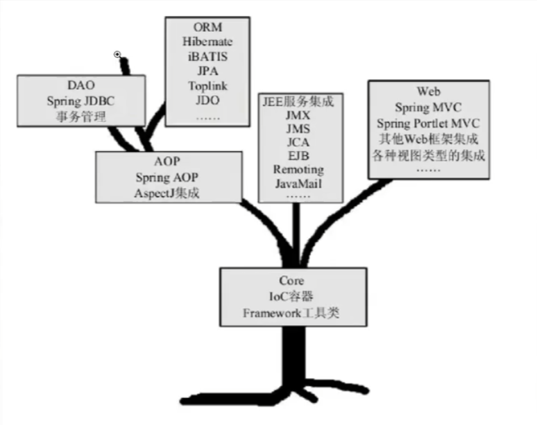
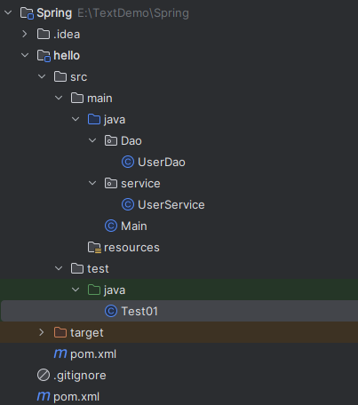
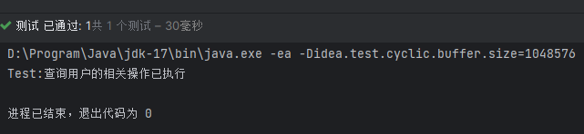
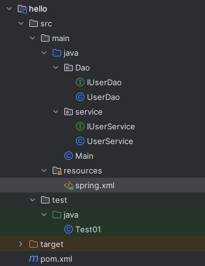
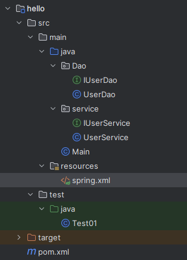
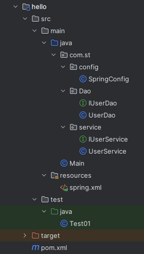
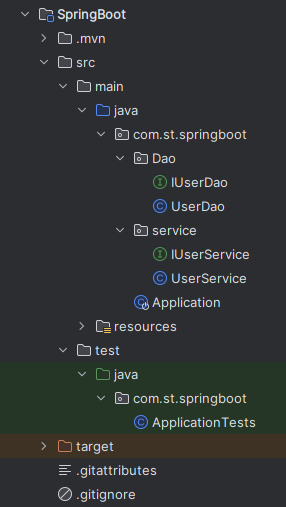
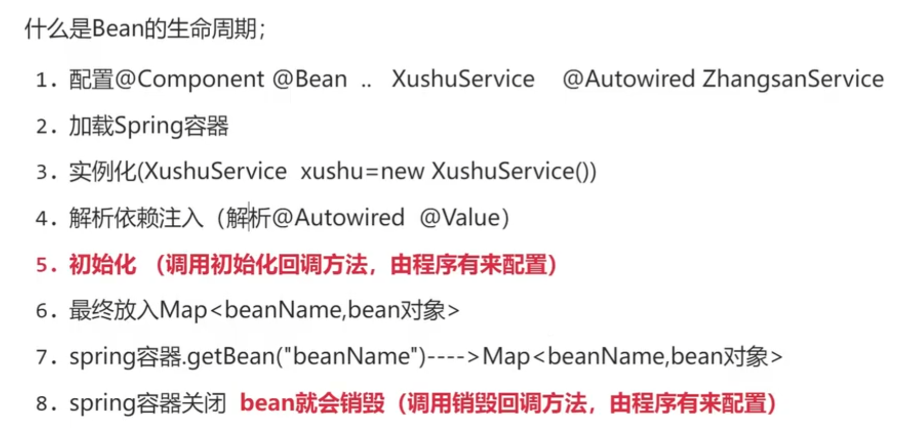
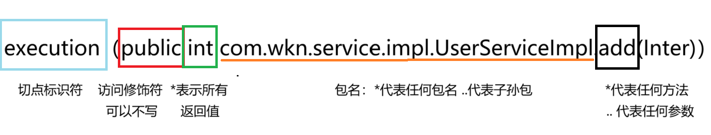
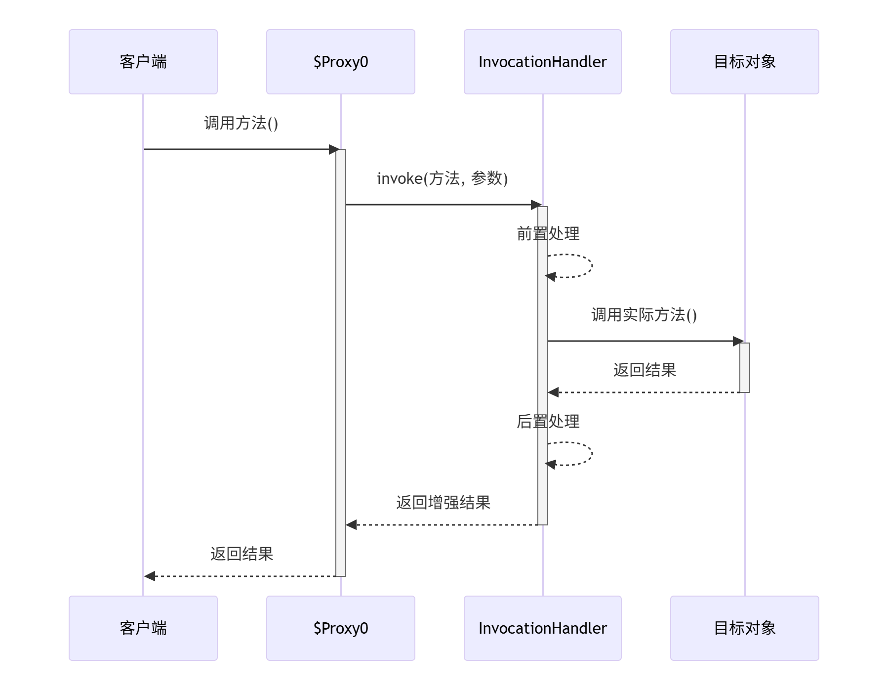

>   本文为系统性的学习一下Spring和Spring Boot的笔记

## 一  什么是框架

​**​     框架（Framework）​**​ 是软件开发中的一套​**​半成品代码​**​和​**​规范​**​，它为特定领域（如Web开发、数据库操作、测试等）提供了通用的基础结构和工具，开发者可以基于框架快速构建应用程序，而无需从零开始编写所有底层代码。

     通俗一些：​

 假设你要盖一栋房子：


​**​传统开发​**​：自己挖地基、砌墙、布电线、装水管……（从头开始，费时费力）。

​**​使用框架​**​：直接使用现成的“毛坯房框架”（比如已经搭好的钢筋结构、水电管道），你只需要装修（写业务代码）即可。

## 二  Spring 框架

### 介绍

> ​**​Spring框架​**​ 是一个开源的Java企业级开发框架，旨在简化企业级应用的开发，提供模块化、可扩展的解决方案。它通过​**​控制反转（IoC）​**​和​**​面向切面编程（AOP）​**​等核心功能，帮助开发者管理复杂的依赖关系和横切关注点（如日志、事务等），让代码更简洁、易维护。

Spring框架作为当下最主流的应用开发框架，可以解决从配置到开发的各种问题 

### 模块化的设计

> Spring将功能拆分为多个独立模块，按需引入：
> 
> -   ​**​Spring Core​**​：IoC和DI的基础容器。
> -   ​**​Spring MVC​**​：基于Servlet的Web框架，用于构建RESTful API或MVC应用。
> -   ​**​Spring Data​**​：简化数据库操作（如JPA、MongoDB）。
> -   ​**​Spring Security​**​：身份认证与权限控制。
> -   ​**​Spring Boot​**​：快速启动和自动配置（后续重点学习）。

### Spring解决了什么问题

如果熟悉Web应用开发的发展历程或者使用Servlet开发后再使用Spring就会体会到该框架的便利性

> ​**​依赖管理混乱​**​  
> 传统开发中，对象之间的依赖关系复杂，容易形成“大泥球”。Spring通过IoC容器统一管理依赖，降低耦合度。
> 
> **重复代码过多​**​  
> 例如，数据库连接、事务管理、日志记录等代码重复。Spring通过AOP和模板类（如`JdbcTemplate`）减少样板代码。
> 
> ​**​配置繁琐​**​  
> 早期Spring依赖XML配置，Spring 2.5后支持注解（如`@Component`），Spring Boot进一步通过约定优于配置简化设置。

* * *

## 三 控制反转(IoC)/依赖注入(DI)

### 介绍

> -   **IoC（Inversion of Control）​**​：将对象的创建和依赖管理交给Spring容器，而不是手动`new`对象。
> -   ​**​DI（Dependency Injection）​**​：通过构造函数、Setter方法或字段注入，由容器自动将依赖对象“注入”到目标对象中。

     这里参照视频的一个例子：在Service层中使用Dao层访问数据时，一般在Service类中会new一个Dao的对象,此时两个类就会建立起强耦合，后续需要更换Dao层的实现类时就需要去修改文件中每一个使用到的位置，会很繁琐而且很容易出现BUG。所以Spring就通过控制反转和依赖注入的方式来优化这一问题（Ioc和DI并不是Spring的思想）IoC是目标，而Di是实现的手段。**核心目标**​就是为了解耦（降低对象之间的依赖关系）

    Ioc和Di是Spring的核心功能，是Spring框架的基础



Spring框架的基础结构

>  **补充**：使用Maven构建一个项目的5步骤
> 
>  1 创建 Maven 项目结构​
> 
>  2 编写 `pom.xml` 文件​
> 
>  3 添加依赖​
> 
>  4 使用 Maven 命令构建项目​
> 
>  5 运行项目​

 **传统java开发举例**



项目结构

 Userdao

```java
package Dao;

public class UserDao {

    public void getUser() {
        System.out.println("Test:查询用户的相关操作已执行");
    }
}
```

UserService

```java
package service;
import Dao.UserDao;

public class UserService {

    UserDao userDao = new UserDao();
    public void getUser() {
        userDao.getUser();
    }
}
```

Test

```java
import org.junit.Test;
import service.UserService;

public class Test01 {

    @Test
    public void test(){

        UserService userService = new UserService();
        userService.getUser();
    }
}
```

运行结果

 

* * *

### 核心容器实现

下面开始介绍不同版本的Spring的核心容器的实现 作为快速入门实践

#### 基于xml的配置方式



spring.xml

```XML
<?xml version="1.0" encoding="UTF-8" ?>
<beans xmlns="http://www.springframework.org/schema/beans"
       xmlns:xsi="http://www.w3.org/2001/XMLSchema-instance"
       xsi:schemaLocation="http://www.springframework.org/schema/beans
                           http://www.springframework.org/schema/beans/spring-beans.xsd">

     <!-- 使用Spring帮助我们去new对象
          然后使用容器去组织对象间的依赖关系-->
    <bean class="Dao.UserDao" id="userDao"/>
    <bean class="service.UserService" name="service">
        <!-- 进行注入 -->
        <property name="userDao" ref="userDao"/>
    </bean>
</beans>
```

 UserService

```java
package service;
import Dao.UserDao;

public class UserService implements IUserService{

    UserDao userDao = new UserDao();
    @Override
    public void getUser() {
        userDao.getUser();
    }

    public void setUserDao(UserDao userDao) {
        this.userDao = userDao;
    }

    public UserDao getUserDao() {
        return userDao;
    }
}
```

UserDao

```java
package Dao;

public class UserDao implements IUserDao{


    IUserDao UserDao;

    public void setUserDao(IUserDao userDao) {
        UserDao = userDao;
    }

    public IUserDao getUserDao() {
        return UserDao;
    }

    public void getUser() {
        System.out.println("Test:查询用户的相关操作已执行");
    }
}
```

Test

```java
public class Test01 {

    @Test
    public void test01(){

        // 依赖spring注入 就使用Spring容器进行注入
        ClassPathXmlApplicationContext context = new ClassPathXmlApplicationContext("spring.xml");
        IUserService Service = context.getBean(IUserService.class);
        Service.getUser();
    }
}
```

Spring 1.0 任然采用xml文件的方式去注册使用Bean

#### 基于xml和注解的配置方式

#### 

spring.xml

```java
<?xml version="1.0" encoding="UTF-8" ?>
<beans xmlns="http://www.springframework.org/schema/beans"
       xmlns:xsi="http://www.w3.org/2001/XMLSchema-instance"
       xmlns:context="http://www.springframework.org/schema/context"
       xsi:schemaLocation="http://www.springframework.org/schema/beans
                           http://www.springframework.org/schema/beans/spring-beans.xsd http://www.springframework.org/schema/context https://www.springframework.org/schema/context/spring-context.xsd">


    <!-- 告诉spring 注解所在的包在哪里 -->
    <context:component-scan base-package="Dao,service"/>

</beans>
```

UserDao

```java
package Dao;
import org.springframework.stereotype.Component;

@Component // 标识当前的类交给Spring容器管理 交给spring进行管理 spring组件 ——— bean
public class UserDao implements IUserDao{

    // 执行查询用户
    @Override
    public void getUser() {
        System.out.println("Test:查询用户的相关操作已执行");
    }

}
```

 UserSevice

```java
package service;
import Dao.IUserDao;
import org.springframework.beans.factory.annotation.Autowired;
import org.springframework.stereotype.Component;

@Component
public class UserService implements IUserService{

    @Autowired // 自动注入
    IUserDao userDao;
    @Override
    public void getUser() {
        userDao.getUser();
    }

}
```

Spring 2.0 采用注解加xml文件的方式去标记类去注册组件使用

#### 基于java类的配置方式



SpringConfig.class

```java
package com.st.config;

import org.springframework.context.annotation.ComponentScan;
import org.springframework.context.annotation.Configuration;

// 使用这个配置类来代替xml
@Configuration // == xml的配置文件
@ComponentScan("com.st")  // == <context:component-scan />
public class SpringConfig {
}
```

 test(注意Spring容器的获取进行更换)

```java

import com.st.config.SpringConfig;
import org.junit.Test;
import org.springframework.context.annotation.AnnotationConfigApplicationContext;
import org.springframework.context.support.ClassPathXmlApplicationContext;
import com.st.service.IUserService;
import com.st.service.UserService;

public class Test01 {

    @Test
    public void test02(){

        // 使用Spring容器进行注入
        AnnotationConfigApplicationContext  ioc = new AnnotationConfigApplicationContext(SpringConfig.class);
        IUserService Service = ioc.getBean(UserService.class);
        Service.getUser();

    }
}
```

 Dao层和Service层与上述一致

#### 基于注解的配置方式

使用SpringBoot的快速启动和搭建



Application

```java
package com.st.springboot;

import org.springframework.boot.SpringApplication;
import org.springframework.boot.autoconfigure.SpringBootApplication;

@SpringBootApplication
public class Application {

    // spring 容器 当前类作为配置类
    // run方法底层就会创建一个spring容器
    // 当没有设置basepackages 时 默认扫描当前类所在的包
    public static void main(String[] args) {
        SpringApplication.run(Application.class, args);
    }

}
```

 test

```java
package com.st.springboot;

import com.st.springboot.service.IUserService;
import com.st.springboot.service.UserService;
import org.junit.jupiter.api.Test;
import org.springframework.beans.factory.annotation.Autowired;
import org.springframework.boot.test.context.SpringBootTest;

@SpringBootTest
class ApplicationTests {

    @Test
    void contextLoads() {
    }

    @Autowired
    IUserService service;

    @Test
    void test01() {
        service.getUser();
    }

}
```

UserDao 

```java
package com.st.springboot.Dao;

import org.springframework.stereotype.Component;

@Component // 标识当前的类交给Spring容器管理 交给spring进行管理 spring组件 ——— bean
public class UserDao implements IUserDao {

    // 执行查询用户
    @Override
    public void getUser() {
        System.out.println("SpringTest:查询用户的相关操作已执行");
    }

}
```

* * *

### 容器核心技术

#### Bean

##### 介绍

> 什么是Bean? 被Spring所管理的对象称为Bean

##### 配置方式

> 1\. <bean class = " ">
> 
> 2\. @Component  放置在类上  (@Repository  @Service  @Configuration)(更加精细化的设置 AOP设置)
> 
> 3\. @Bean
> 
>     放置在方法上
> 
>     放置在配置类中 （调用另一个@Bean方法 会从spring容器中获取）
> 
>     可以干预bean的实例化过程 jar包中的类如果要配置就需要用到@Bean
> 
>     在方法中声明的参数spring会帮我们自动注入
> 
> 4\. @import
> 
>     @import(.class) 放置在类上 标记的类必须是一个Bean
> 
> _spring关于Bean的底层原理不做笔记记录 后续可以单开文章介绍_

 @Bean 的使用

```java
//@Configuration
public class SpringConfig {
    
    @Bean
    public IUserService userService(){

        // 此时在注释掉@Component注解 下面的userDao是不会作为Bean组件注册的 只会认为是普通方法
        IUserDao userDao = userDao();
        return new UserService();
    }
    
    @Bean
    public IUserDao userDao(){
        return new UserDao();
    }
}
```

##### 实例化

-   默认使用无参构造器实例化

> 有多个构造函数依然会调用无参构造函数
> 
> 如果只有一个有参构造函数spring会调用，并且把参数自动装配进来

-   使用实例工厂方法实例化——@Bean

> 可以自由的使用构造函数进行实例化
> 
> ```java
> 
> @Configuration
> public class SpringConfig {
>     @Bean
>     public IUserDao userDao(IUserDao userDao){
>         
>         return userDao();
>     }
> }
> ```

-   使用工厂Bean 实例化——FactoryBean

> FactoryBean是一个接口
> 
> 需要一个Bean 一旦实现FactoryBean就成为了特殊的Bean

```java
public class OrderService implements FactoryBean {

    // 使用工厂模式 使用OrderService得到UserService
    // 特殊在于 根据名字来获取返回的对象

    /**
     * 如果想要获取FactoryBean的实例，那么需要使用getBean()来获取
     * 1 通过类型 2 在beanName前加上&
     */
    @Override
    public Object getObject() throws Exception {
        return new UserService();
    }

    @Override
    public Class<?> getObjectType() {
        return UserService.class;
    }
}
```

##### 生命周期



* * *

#### 依赖注入

##### @Autowired 自动装配

> **特性**：1 可以写在方法 构造函数 字段 参数
> 
>            2 首先会根据类型去Spring容器中找（bytype）如果有多个类型，会根据名字再去Spring容器中找（byname）
> 
>            3 如果根据名字还是匹配不到 解决方案 
> 
>                 通过@Primary设置某一个为主要的
> 
>                 通过@Qualifier("name") 告诉spring需要的是那个bean的名字
> 
>            4 如果去容器里一个都找不到会报错
> 
>                 通过设置@Autowrited(required=false)设置required=false解决
> 
> 具体原理不做笔记记录 后续有需要可能会从学习servlet的时候补充一下

##### @Injet和@Resource

> JDK官方提供
> 
> idea不建议在字段上使用@autowried
> 
> 不建议注入私有字段private 建议使用构造函数或者方法来进行自动注入
> 
> @autowrited收到框架的限制
> 
> @inject不能设置required=false属性
> 
> @Resource 会先根据名字找 再根据类型找

 用构造函数依赖注入或者用@Resource是比较好的方式

##### **@Value**

直接值（基本类型 String等）

```java
public class User{

    @Value("HJN")
    private String name;

    @Value("18")
    private int age;
}
```

* * *

对外部属性（SpringBoot配置文件）文件的引用

KN.properties

```XML
user.name = "HJN"
user.age = 18
```

User.class 

```java
@Component
@PropertySource("KN.properties")
public class User{

    //@Value("HJN")
    @Value("${name}")
    private String name;

    //@Value("18")
    @Value("${age}")
    private int age;
    
    // 复杂类型
    // @Value("#{${'语文':'90','数学':'100'}}")
    @Value("#{${score}}")
    private Map<String,Integer> score;
}
```

如果对非SpringBoot配置文件 需要额外通过@propertySource去指定属性文件的类路径 

* * *

##### @Order

> 用于改变自动装配 一个类型 有多个Bean 可以使用List来承接装备的类型 使用Order改变

 Test

```java
@SpringBootTest(classes = TestOrder.class)
public class TestOrder {

    @Bean
    public A a(){
        return new A();
    }

    @Bean
    public B b(){
        return new B();
    }


    @Autowired A a;

    @Test
    public void test(@Autowired List<Iss> i){
        System.out.println(i);
    }

}
```

A

```java
public class A implements Iss {

    public A(){
        System.out.println("A");
    }

}
```

B

```java
public class B implements Iss {

    public B(){
        System.out.println("B");
    }
}
```

懒加载

> 默认的bean会在启动的时候会创建 如果说某些Bean非常大 如果在启动的时候就会影响启动速度 可以把那些大的Bean设置为懒加载 可以优化启动速度

* * *

##### @Conditional

> 用于动态决定一个Bean是否创建 条件注入

**位置：** 你可以将 `@Conditional`注解标注在以下位置：

-   ​**​带有 `@Bean`注解的方法上：​**​ 控制这个工厂方法是否被执行，从而决定是否创建该 Bean。
    
-   ​**​带有 `@Component`（及其派生注解，如 `@Service`, `@Repository`, `@Controller`) 的类上：​**​ 控制这个组件类是否被扫描并注册为 Bean。
    
-   ​**​带有 `@Configuration`的类上：​**​ 控制整个配置类及其包含的所有 `@Bean`方法是否生效。
    

`**实现：**@Conditional`注解需要一个或多个实现了 `Condition`接口的类作为参数。

-   `@Conditional(MyCondition.class)`
    
-   `@Conditional({Condition1.class, Condition2.class})`// 多个条件是 AND 关系
    

​**​条件评估：​**​ 在 Spring 容器启动，进行 Bean 定义注册的阶段，Spring 会调用 `matches()`方法。

-   你的 `Condition`实现类利用 `context`和 `metadata`提供的信息（检查环境变量、系统属性、特定 Bean 是否存在、类路径下是否有某个类/资源、配置文件状态等）编写判断逻辑。
    
-   ​**​返回 `true`：​**​ 表示条件满足，被 `@Conditional`标记的 Bean/配置将会被创建/注册。
    
-   ​**​返回 `false`：​**​ 表示条件不满足，被 `@Conditional`标记的 Bean/配置将被​**​忽略​**​，不会创建。
    

* * *

## 四 面向切面编程（AOP）

### 介绍

**AOP是什么？​**​

> 想象你在做蛋糕（核心业务），但需要记录烘焙时间（日志）、控制烤箱温度（事务）、防止烤焦（安全）等额外操作。AOP就像聘请了专业助手，帮你自动完成这些通用操作，你只需专注于做蛋糕本身。这是一种编程思想。在不改变原有代码的基础上进行增强。（额外运行切面里面的代码）

​**​核心价值​**​

        ​**​解耦​**​：把日志、事务、安全等横切关注点与业务逻辑分离

        ​**​复用​**​：一套通用逻辑多处使用（如所有Service层方法添加日志）

        ​**​灵活​**​：动态添加/移除功能，无需修改源码

* * *

### 快速体验

这是一个常规的用户的URTD服务的实现，这里我们想要添加一个新功能，比如记录执行时的日志。如果要对功能一个一个的添加和修改就效率就太低了 所以我们现在就使用到了AOP。

```java
@Service
public class UserService {


    // 增删改查操作
    public void addUser() {
        // 现在向添加日志功能 如果要一个功能一个功能的添加就效率就太低了 所以现在就使用到了AOP
        System.out.println("添加用户");
    }

    public void deleteUser() {
        System.out.println("删除用户");
    }

    public void updateUser() {
        System.out.println("更新用户");
    }

    public void queryUser() {
        System.out.println("查询用户");
    }

}
```

 在使用前一定要先导入 ，注意版本的冲突。

创建切面：@Aspect + @Componet + 通知 + 切点

```java
@Aspect // 标记为切面类
@Component // 添加到spring容器中 必须交给Spring
public class LogAspect {

    // 切点 切点表达式 （后续会具体的说明）
    @Around("execution(* fast.aop_d1_fast.service.UserService.*(..))")
    public void log(ProceedingJoinPoint joinPoint){
        // 记录方法用时
        long  begin = System.currentTimeMillis();

        // 执行具体方法
        try {
            joinPoint.proceed();
        } catch (Throwable e) {
            throw new RuntimeException(e);
        }

        long end = System.currentTimeMillis();

        System.out.println("方法用时：" + (end - begin) + "ms");
    }

}
```

 添加后，对于User的每一个功能进行测试时 都会添加记录功能用时的功能。

* * *

### 核心概念和术语

目标对象：（Target）

> 指要被增强的对象。即包含业务逻辑的类的对象。要增强的对象（通常会有很多个）

切面：（Aspect） 

> 指的是关注点模块化，这个关注点可能会横切多个对象。事务管理是企业级java应用中有横切关注点的例子，在Spring AOP中，切面可以通用类基于模式的方式或者在普通类中以@Aspet注解（@aspetJ注解方式来实现）要增强的代码放入的那个类就叫切面类

通知：（Advice）

>  在切面的莫个特定的连接点上执行的动作。通知有多种类型，包括“aroud”,"before","after"等等（后续还会继续讨论）

 切点：（Pointcut）

> 匹配连接点的断言。通知和切点表达式相关联，并在满足这个切点的连接点上运行（例如：当执行某个特定名称的方法时）切点表达式如何和连接点匹配是AOP的核心：Spring默认使用AspectJ切点语义。 增强代码要切入到那些方法中，使用切点表达式。

 连接点：（Join point）

> 在Spring AOP中，一个连接点是代表一个方法的执行，其实就是代表增强的方法。通知和目标方法的一个桥梁，要获取目标方法的信息，就得通过JoinPoint

 顾问：（Advisor）

> 顾问是Advice的一种包装体现，Advisor是Pointcut以及Advice的一个组合，用于管理Advice和Pointcut。源代码中的体现，会封装切点和通知

 织入：（Weaving）

> 将通知切入连接点的过程

* * *

### 通知

用来放增强的代码的方法

<table align="center" border="1" cellpadding="1" cellspacing="1" style="width:680px"><tbody><tr><td>环绕通知</td><td>@Aroud</td><td>可以把代码增强在目标方法的任意地方</td></tr><tr><td>前置通知</td><td>@Before</td><td>目标方法之前执行</td></tr><tr><td>后置通知</td><td>@After</td><td>目标方法之后执行</td></tr><tr><td>异常通知</td><td>@AfterThrowing</td><td>目标方法出现了异常执行</td></tr><tr><td>返回通知</td><td>@AfterReturuning</td><td>目标方法返回值执行</td></tr></tbody></table>

####   前置通知

```java
@Aspect // 标记为切面类
@Component // 添加到spring容器中的bean
public class AdviceSpect {

    // 前置通知
    @Before("execution(* fast.aop_d1_fast.advice.UserServiceAdvice.*(..))")
    public void before(JoinPoint joinPoint) {
        // 记录当前方法的方法名，参数
        String methodName = joinPoint.getSignature().getName();

        // 参数
        Object[] args = joinPoint.getArgs();
        System.out.println("方法名：" + methodName + " 参数：" + args);
    }
}
```

####   后置通知

```java
@Aspect // 标记为切面类
@Component // 添加到spring容器中的bean
public class AdviceSpect {
    
    // 后置通知
    @Before("execution(* fast.aop_d1_fast.advice.UserServiceAdvice.*(..))")
    public void after(JoinPoint joinPoint) {
        String methodName = joinPoint.getSignature().getName();
        System.out.println("方法名：" + methodName + " 后置通知");
    }
}
```

####   返回通知

```java
@Aspect // 标记为切面类
@Component // 添加到spring容器中的bean
public class AdviceSpect {

    // 返回通知
    // 1 可以获取返回值
    // 2 可以获取方法执行结果 在后置通知之前执行
    @AfterReturning("execution(* fast.aop_d1_fast.advice.UserServiceAdvice.*(..))")
    public void afterReturning(JoinPoint joinPoint) {
        String methodName = joinPoint.getSignature().getName();
        System.out.println("方法名：" + methodName + " 返回通知");
    }
}
```

####  异常通知

```java
@Aspect // 标记为切面类
@Component // 添加到spring容器中的bean
public class AdviceSpect {

    // 异常通知
    // 1 可以获取异常信息
    // 在方法中抛出异常时执行
    @AfterReturning(pointcut = "execution(* fast.aop_d1_fast.advice.UserServiceAdvice.*(..))")
    public void afterThrowing(JoinPoint joinPoint) {
        String methodName = joinPoint.getSignature().getName();
        System.out.println("方法名：" + methodName + " 异常通知");
    }
}
```

####  通知的执行顺序

> 正常：前置 --> 目标方法 --> 返回通知 --> 后置通知（finally）
> 
> 异常：前置 --> 目标方法 --> 异常通知 --> 后置通知（finally）

* * *

### 切点

####  表达式的抽取

```java
@Aspect // 标记为切面类
@Component // 添加到spring容器中的bean
public class AdviceSpect {
    
    // 表达式抽取
    @Pointcut("execution(* fast.aop_d1_fast.advice.UserServiceAdvice.*(..))")
    public void myPoint() {}
    
    @Before("myPoint()")
    public void before_q(JoinPoint joinPoint) {
        String methodName = joinPoint.getSignature().getName();
        System.out.println("方法名：" + methodName + " 前置通知");
    }
}
```

####  切点表达式

> Spring AOP 支持使用以下的AspectJ切点表达式（PCD）用于切点表达式

**切点标识符**：规定匹配的位置

 **execution**:用于匹配方法执行连接点。这是使用spring AOP时使用的主要切点标识符。可以匹配到方法级别，细粒度



 **within:**只能匹配类这级，只能指定类，类下面的某个具体的方法无法指定，粗粒度

 within(包名，类名=？)

####  @annootation **限制匹配连接点（在Spring AOP中执行的方法具有给定的注解）**

简单汇总：

| 
​**​标识符​**​

 | 

​**​说明​**​

 | 

​**​语法示例​**​

 | 

​**​应用场景​**​

 |
| --- | --- | --- | --- |
| 

​**​execution​**​

 | 

匹配方法执行，可精确到方法签名

 | 

`execution(public * com.service.*.*(..))`

 | 

最常用，细粒度控制

 |
| 

​**​within​**​

 | 

限制匹配到指定类型（类或包）内的连接点

 | 

`within(com.service.UserService)`  
`within(com.service..*)`

 | 

类或包级别的批量处理

 |
| 

​**​@annotation​**​

 | 

匹配带有指定注解的连接点（方法级别）

 | 

`@annotation(com.annotation.Loggable)`

 | 

通过注解灵活标记方法

 |
| 

​**​@within​**​

 | 

匹配持有指定注解的类内的所有方法（类级别注解）

 | 

`@within(org.springframework.stereotype.Service)`

 | 

基于类注解的匹配

 |
| 

​**​@target​**​

 | 

匹配目标对象持有指定注解的类（运行时类型）

 | 

`@target(org.springframework.transaction.annotation.Transactional)`

 | 

根据目标类运行时注解匹配

 |
| 

​**​@args​**​

 | 

匹配传入参数类型持有指定注解的方法

 | 

`@args(com.annotation.Validated)`

 | 

参数验证等场景

 |
| 

​**​args​**​

 | 

匹配参数为指定类型的方法

 | 

`args(java.lang.String, ..)`

 | 

根据参数类型过滤（注意与execution区别）

 |
| 

​**​this​**​

 | 

匹配代理对象是指定类型的连接点（AOP代理实现的接口）

 | 

`this(com.service.UserService)`

 | 

针对代理接口的匹配

 |
| 

​**​target​**​

 | 

匹配目标对象是指定类型的连接点（实际目标对象的类型）

 | 

`target(com.service.UserServiceImpl)`

 | 

针对目标类实现的匹配

 |
| 

​**​bean​**​

 | 

Spring特有：匹配指定名称的Bean里的方法

 | 

`bean(userService)`  
`bean(*Service)`

 |

* * *

### AOP原理

####  代理模式

> 代理模式就是一种比较好理解的设计模式，简单来说：
> 
> 1 我们使用代理对象来增强目标对象（target object），这样就可以在不修改原目标对象的前提下，提供额外的功能操作，拓展目标对象的功能。
> 
> 2 将核心业务代码和非核心的公共部分分离解耦，提高代码可维护性，让被代理类专注业务降低代码复杂度
> 
> 代理模式的主要是拓展目标对象的功能。

通常用代理实现比如拦截器，事务控制，还有测试框架mock 用户鉴权 日志 全局异常处理等功能 

代理模式就像明星的经纪人——​**​不需要修改明星自身的行为​**​（目标对象），却能​**​通过经纪人（代理对象）增强明星的功能​**​（添加额外的功能） 

####  静态代理

> 就是定制版专属经纪人，手动为每个目标类编写代理类

```java
// 1. 明星接口（目标对象需要实现的接口）
public interface Celebrity {
    void sing();
    void act();
}

// 2. 明星本尊（目标对象）
public class RealStar implements Celebrity {
    @Override
    public void sing() {
        System.out.println("周杰伦唱歌：窗外的麻雀，在电线杆上多嘴...");
    }
    
    @Override
    public void act() {
        System.out.println("周杰伦演戏：哎哟，不错哦！");
    }
}

// 3. 经纪人（静态代理类）
public class StaticProxy implements Celebrity {
    private final Celebrity target;  // 持有目标对象的引用
    
    public StaticProxy(Celebrity target) {
        this.target = target;
    }
    
    @Override
    public void sing() {
        System.out.println("经纪人谈合同");
        System.out.println("经纪人安排场地");
        target.sing();  // 调用真实对象的方法
        System.out.println("经纪人收钱");
        System.out.println("经纪人组织粉丝见面会");
    }
    
    @Override
    public void act() {
        System.out.println("经纪人筛选剧本");
        System.out.println("经纪人签演出合同");
        target.act();
        System.out.println("经纪人安排庆功宴");
    }
}

// 4. 客户端使用
public class Client {
    public static void main(String[] args) {
        // 创建目标对象
        Celebrity jay = new RealStar();
        
        // 创建代理对象（经纪人）
        Celebrity agent = new StaticProxy(jay);
        
        // 通过代理对象访问功能
        agent.sing();
        System.out.println("------------------------");
        agent.act();
    }
}
```

静态代理的优缺点：

| 
​**​优点​**​

 | 

​**​缺点​**​

 |
| --- | --- |
| 

✅ 直观易懂

 | 

❌ 每个接口都需要单独代理类

 |
| 

✅ 目标类无需修改

 | 

❌ 代理类数量会爆炸式增长

 |
| 

✅ 解耦核心与辅助逻辑

 | 

❌ 接口变更需修改所有代理类

 |

####  JDK动态代理

> 全能经纪公司 运行时动态生成代理类（不需手动编写）

```java
import java.lang.reflect.InvocationHandler;
import java.lang.reflect.Method;
import java.lang.reflect.Proxy;

// 1. 经纪公司（统一处理逻辑）
public class DynamicAgent implements InvocationHandler {
    private final Object target;  // 目标对象
    
    public DynamicAgent(Object target) {
        this.target = target;
    }
    
    // 获取代理对象
    public static Object getProxy(Object target) {
        return Proxy.newProxyInstance(
            target.getClass().getClassLoader(),
            target.getClass().getInterfaces(),
            new DynamicAgent(target)
        );
    }
    
    @Override
    public Object invoke(Object proxy, Method method, Object[] args) throws Throwable {
        String methodName = method.getName();
        
        // 根据不同方法提供定制服务
        if ("sing".equals(methodName)) {
            System.out.println("【动态代理】准备演唱会...");
        } else if ("act".equals(methodName)) {
            System.out.println("【动态代理】安排影视拍摄...");
        }
        
        System.out.println("=== 执行前处理 ===");
        Object result = method.invoke(target, args);  // 反射调用真实方法
        System.out.println("=== 执行后处理 ===");
        
        // 结果处理（可修改返回值）
        if ("sing".equals(methodName)) {
            return "安可！" + result;
        }
        return result;
    }
}

// 2. 使用动态代理
public class DynamicDemo {
    public static void main(String[] args) {
        Celebrity jay = new RealStar();
        
        // 动态创建代理
        Celebrity agent = (Celebrity) DynamicAgent.getProxy(jay);
        
        // 调用方法
        String songResult = agent.sing();
        System.out.println("返回结果：" + songResult);
        System.out.println("------------------------");
        agent.act();
    }
}
```

 

####  cglib动态代理

> 改造计划 通过继承方式代理普通类（即使没有实现接口）

```java
import net.sf.cglib.proxy.Enhancer;
import net.sf.cglib.proxy.MethodInterceptor;
import net.sf.cglib.proxy.MethodProxy;

// 1. 素人类（没有实现接口）
public class OrdinaryPerson {
    public void perform() {
        System.out.println("普通人表演：唱歌跳舞");
    }
}

// 2. 星探公司（CGLIB代理）
public class CglibAgent implements MethodInterceptor {
    
    // 创建代理对象
    public static Object getProxy(Class<?> clazz) {
        Enhancer enhancer = new Enhancer();
        enhancer.setSuperclass(clazz);  // 设置父类
        enhancer.setCallback(new CglibAgent());
        return enhancer.create();
    }

    @Override
    public Object intercept(Object obj, Method method, Object[] args, MethodProxy proxy) throws Throwable {
        // 方法匹配
        if ("perform".equals(method.getName())) {
            System.out.println("【CGLIB代理】包装素人");
            System.out.println("造型设计");
            System.out.println("才艺培训");
        }
        
        System.out.println(">>>> 演出开始 <<<<");
        Object result = proxy.invokeSuper(obj, args); // 调用父类方法
        System.out.println(">>>> 演出结束 <<<<");
        
        // 增加额外行为
        if ("perform".equals(method.getName())) {
            System.out.println("微博热搜：#素人逆袭成明星#");
            return "包装后的表演结果";
        }
        return result;
    }
}

// 3. 使用CGLIB代理
public class CglibDemo {
    public static void main(String[] args) {
        // 创建代理对象（普通对象）
        OrdinaryPerson star = (OrdinaryPerson) CglibAgent.getProxy(OrdinaryPerson.class);
        
        // 调用方法
        String result = star.perform();
        System.out.println("返回结果：" + result);
    }
}
```

####  总结

| 
**特性​**​

 | 

​**​静态代理​**​

 | 

​**​JDK动态代理​**​

 | 

​**​CGLIB代理​**​

 |
| --- | --- | --- | --- |
| 

实现方式

 | 

手动编写代理类

 | 

运行时生成代理类

 | 

字节码增强

 |
| 

接口要求

 | 

需要接口

 | 

必须实现接口

 | 

不需要接口

 |
| 

性能

 | 

最快

 | 

中等

 | 

初始慢/执行快

 |
| 

学习曲线

 | 

简单

 | 

中等

 | 

复杂

 |
| 

代理对象

 | 

显式代理类

 | 

$Proxy0

 | 

TargetClass$$EnhancerByCGLIB

 |
| 

应用场景

 | 

简单少量代理

 | 

Spring默认（有接口时）

 | 

Spring无接口场景

 |
