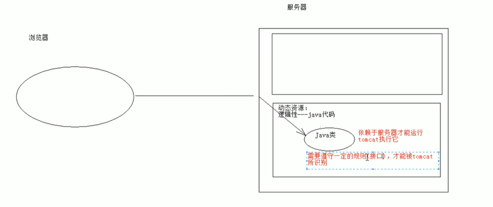
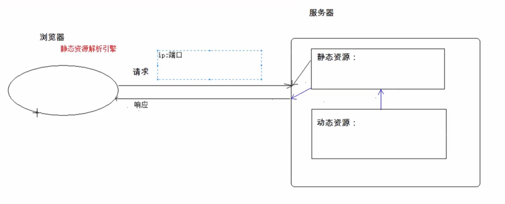

>   本文为记录Servlet学习时的一些笔记和代码 课程参考黑马程序员 对于Java Web 学习的一个复习

## 一 概述

> server applet 运行在服务器端的小程序 本质就是一个接口 定义java类被浏览器访问到（Tomcat识别）的规则
> 
> 我们会自定义这样一个类来实现复写方法实现接口
> 
> 

* * *

## 二 快速入门

> 1 创建javaEE项目
> 
> 2 定义一个类 实现servlet接口
> 
> 3 实现接口的抽象方法
> 
> 4 配置servlet

```java
package com.ts.servletdem0.servlet;

//import jakarta.servlet.*;
import jakarta.servlet.*;
import java.io.IOException;

/*
*   servlet的快速入门
* */
public class ServletDemo1 implements Servlet {
    @Override
    public void init(ServletConfig servletConfig) throws ServletException {

    }

    @Override
    public ServletConfig getServletConfig() {
        return null;
    }

    // 提供服务的方法
    @Override
    public void service(ServletRequest servletRequest, ServletResponse servletResponse) throws ServletException, IOException {
        System.out.println("Hello Servlet");
    }

    @Override
    public String getServletInfo() {
        return null;
    }

    @Override
    public void destroy() {

    }
}
```

 web配置

```XML
<?xml version="1.0" encoding="UTF-8"?>
<web-app xmlns="https://jakarta.ee/xml/ns/jakartaee"
         xmlns:xsi="http://www.w3.org/2001/XMLSchema-instance"
         xsi:schemaLocation="https://jakarta.ee/xml/ns/jakartaee https://jakarta.ee/xml/ns/jakartaee/web-app_5_0.xsd"
         version="5.0">

    // 配置Servlet
    <servlet>
        <servlet-name>demo1</servlet-name>
        <servlet-class>com.ts.servletdem0.servlet.ServletDemo1</servlet-class>
    </servlet>
    <servlet-mapping>
        <servlet-name>demo1</servlet-name>
        <url-pattern>/demo1</url-pattern>
    </servlet-mapping>

</web-app>
```

* * *

## 三 执行原理

> 1 当服务器接受到客户端浏览器的请求后 会解析浏览器的URL路径 获取访问的servlet资源
> 
> 2 查找web.xml文件 是否有对应的<url-pattern>标签体内容
> 
> 3 如果有 则寻找对应的<servlet-class>全类名
> 
> 4 tomcat会把字节码文件加载进内存 并且创建对象
> 
> 5 调用其方法

* * *

## 四 生命周期

 **servlet的生命周期方法：**

| 
生命周期方法

 | 

触发时机

 | 

执行次数

 | 

典型应用场景

 |
| --- | --- | --- | --- |
| 

`init()`

 | 

首次请求或服务器启动时

 | 

1次

 | 

初始化数据库连接、加载配置文件

 |
| 

`service()`

 | 

每次HTTP请求

 | 

多次

 | 

核心业务逻辑处理

 |
| 

`destroy()`

 | 

服务器正常关闭

 | 

1次

 | 

释放资源、保存状态

 |

> 1.被创建：调用init方法 只执行一次
> 
>     默认是第一次被访问时创建
> 
>     可以通过配置来决定执行的时机
> 
> ```XML
>   <servlet>
>         <servlet-name>demo1</servlet-name>
>         <servlet-class>com.ts.servletdem0.servlet.ServletDemo1</servlet-class>
>         <!-- 初始化创建的时机 -->
>         <!-- 负数为第一次被访问时创建 0或正整数是启动服务器的时候创建-->
>         <load-on-startup>1</load-on-startup>
>     </servlet>
> ```

>    \[一个servlet在内存中只存在一个对象 是单例的\]
> 
>    所以多个用户访问时会存在线程安全问题
> 
>    解决方法：在servlet中尽量不定义成员变量 即使定义也不要进行修改操作

> 2.提供服务：调用servlet方法 可以执行多次
> 
> 3.被销毁：执行destroy方法 只执行一次 （只有服务器正常关闭时才会执行）

```java
/*
*   servlet的方法
* */
public class ServletDemo2 implements Servlet {

    /*
    *    初始化方法
    *    在servlet创建时执行 只会调用一次init方法
    * */
    @Override
    public void init(ServletConfig servletConfig) throws ServletException {
        System.out.println("init...");
    }

    /*
    *   获取Servlet的配置对象
    *   返回ServletConfig对象
    * */
    @Override
    public ServletConfig getServletConfig() {
        return null;
    }

    /* 提供服务的方法
    *  每一次servlet服务被请求时调用
    * */
    @Override
    public void service(ServletRequest servletRequest, ServletResponse servletResponse) throws ServletException, IOException {
        System.out.println("service...");
    }

    /*
    *   获取Servlet的信息
    *   返回一个字符串，用来描述Servlet
    * */
    @Override
    public String getServletInfo() {
        return new String("ServletDemo2");
    }

    /*
    *   销毁方法
    *   在服务器关闭时执行一次 在servlet被销毁时调用
    * */
    @Override
    public void destroy() {
        System.out.println("destroy...");
    }
}
```

* * *

## 五 servlet配置 

   **XML配置​**​：

```XML
<servlet-mapping>
    <servlet-name>demo</servlet-name>
    <!-- 支持多路径映射 -->
    <url-pattern>/api/*</url-pattern>
    <url-pattern>.action</url-pattern>
</servlet-mapping>
```

   **注解配置技巧​**​：

```javascript
@WebServlet(
    name = "AdvancedServlet",
    urlPatterns = {"/v1/users", "/backup"},
    initParams = {@WebInitParam(name="timeout", value="5000")},
    loadOnStartup = 1
)
public class AdvancedServlet extends HttpServlet { ... }
```

>   servlet\_3.0 支持注解配置 使用@WebServlet("资源路径”)

```java
@WebServlet("/test")
public class TestServlet implements Servlet {
    @Override
    public void init(ServletConfig servletConfig) throws ServletException {
        System.out.println("init");
    }

    @Override
    public ServletConfig getServletConfig() {
        return null;
    }

    @Override
    public void service(ServletRequest servletRequest, ServletResponse servletResponse) throws ServletException, IOException {
        System.out.println("Servlet 3.0 启动");
    }

    @Override
    public String getServletInfo() {
        return null;
    }

    @Override
    public void destroy() {

    }
}
```



> servlet --> GenericServlet --> HttpServlet 抽象类  对Http协议的一种封装 简化操作为继承该类后 复写doGet/doPost方法 

* * *

**urlpartten: Servlet访问路径**

> (一个servlet可以配置多个访问路径)
> 
> ```java
> @WebServlet({"/t4","/tt4","/ttt4"})
> public class TestServlet1 extends HttpServlet {
>     @Override
>     protected void doGet(HttpServletRequest request, HttpServletResponse response) throws IOException {
>         System.out.println("Test_多路径");
>     }
> 
> }
> ```

* * *

## 六 HTTP

**概念**：Htyper Text Transfer Protocol 传输协议 定义了客户端和服务端通讯时 发送数据的格式

**特点**：1.基于TCP/IP的高级协议

           2.默认端口80

           3.基于请求/响应模型的：一次请求对应一次响应

           4.无状态的：每次请求之间相互独立 不能交互数据

**请求方式：**

常用的有两种：

**GET：**1 请求参数在请求行中 在url后

           2 请求的url长度有限制

           3 不太安全

**POST:**1 请求参数在请求体中

           2 请求的url长度没有限制的

           3 相对安全

**请求消息数据格式：**

**请求报文结构​**​：

> GET /test?name=value HTTP/1.1           → 请求行  
> Host: www.example.com                   ↗  
> Content-Type: text/html                → 请求头  
> Accept-Language: zh-CN                 ↗  
>                                         → 空行  
> username=admin&password=123456        → 请求体(仅POST)

       请求行  ：请求方式 请求url 请求协议 版本

       请求头： 请求体名称

       请求空行：空行

       请求体：正文

**响应消息数据格式：**

* * *

## 七 Request

```java
// 获取客户端信息
String ip = request.getRemoteAddr();
String userAgent = request.getHeader("User-Agent");

// 获取请求参数
String username = request.getParameter("user");
String[] hobbies = request.getParameterValues("hobby");

// 请求作用域传值
request.setAttribute("currentUser", userObj);
User u = (User)request.getAttribute("currentUser");

// 请求转发
request.getRequestDispatcher("/success.jsp").forward(request, response);
```

* * *

## 八 案例

```java
// File: src/main/java/com/example/web/UserServlet.java
package com.example.web;

import jakarta.servlet.*;
import jakarta.servlet.annotation.WebServlet;
import jakarta.servlet.http.*;
import java.io.*;
import java.sql.*;

@WebServlet("/user")
public class UserServlet extends HttpServlet {
    private static final String DB_URL = "jdbc:mysql://localhost:3306/userdb";
    private static final String DB_USER = "root";
    private static final String DB_PASS = "password";

    @Override
    protected void doPost(HttpServletRequest request, HttpServletResponse response) 
        throws ServletException, IOException {
        
        String action = request.getParameter("action");
        
        if ("register".equals(action)) {
            registerUser(request, response);
        } else if ("login".equals(action)) {
            loginUser(request, response);
        }
    }

    private void registerUser(HttpServletRequest request, HttpServletResponse response) 
        throws ServletException, IOException {
        
        String username = request.getParameter("username");
        String password = request.getParameter("password");
        String email = request.getParameter("email");

        try (Connection conn = DriverManager.getConnection(DB_URL, DB_USER, DB_PASS)) {
            String sql = "INSERT INTO users (username, password, email) VALUES (?, ?, ?)";
            try (PreparedStatement pstmt = conn.prepareStatement(sql)) {
                pstmt.setString(1, username);
                pstmt.setString(2, password);
                pstmt.setString(3, email);
                
                int rows = pstmt.executeUpdate();
                
                if (rows > 0) {
                    request.setAttribute("message", "注册成功！请登录");
                    request.getRequestDispatcher("/login.jsp").forward(request, response);
                } else {
                    request.setAttribute("error", "注册失败");
                    request.getRequestDispatcher("/register.jsp").forward(request, response);
                }
            }
        } catch (SQLException e) {
            throw new ServletException("数据库错误: " + e.getMessage());
        }
    }

    private void loginUser(HttpServletRequest request, HttpServletResponse response) 
        throws ServletException, IOException {
        
        String username = request.getParameter("username");
        String password = request.getParameter("password");

        try (Connection conn = DriverManager.getConnection(DB_URL, DB_USER, DB_PASS)) {
            String sql = "SELECT * FROM users WHERE username = ? AND password = ?";
            try (PreparedStatement pstmt = conn.prepareStatement(sql)) {
                pstmt.setString(1, username);
                pstmt.setString(2, password);
                
                try (ResultSet rs = pstmt.executeQuery()) {
                    if (rs.next()) {
                        // 创建会话
                        HttpSession session = request.getSession();
                        session.setAttribute("username", username);
                        session.setAttribute("email", rs.getString("email"));
                        
                        // 设置会话有效期30分钟
                        session.setMaxInactiveInterval(30 * 60);
                        
                        response.sendRedirect("profile.jsp");
                    } else {
                        request.setAttribute("error", "用户名或密码错误");
                        request.getRequestDispatcher("/login.jsp").forward(request, response);
                    }
                }
            }
        } catch (SQLException e) {
            throw new ServletException("数据库错误: " + e.getMessage());
        }
    }
    
    @Override
    protected void doGet(HttpServletRequest request, HttpServletResponse response) 
        throws ServletException, IOException {
        
        // 注销处理
        String action = request.getParameter("action");
        
        if ("logout".equals(action)) {
            HttpSession session = request.getSession(false);
            if (session != null) {
                session.invalidate();
            }
            response.sendRedirect("login.jsp");
        }
    }
}
```

```XML
<!-- File: webapp/login.jsp -->
<!DOCTYPE html>
<html>
<head>
    <title>用户登录</title>
    <style>
        body { font-family: Arial, sans-serif; max-width: 400px; margin: 0 auto; padding: 20px; }
        .form-group { margin-bottom: 15px; }
        label { display: block; margin-bottom: 5px; }
        input[type="text"], input[type="password"] { width: 100%; padding: 8px; }
        button { padding: 10px 20px; background: #007bff; color: white; border: none; cursor: pointer; }
        .error { color: red; }
    </style>
</head>
<body>
    <h2>用户登录</h2>
    <% if (request.getAttribute("error") != null) { %>
        <p class="error">${error}</p>
    <% } %>
    <form action="user" method="post">
        <input type="hidden" name="action" value="login">
        <div class="form-group">
            <label>用户名:</label>
            <input type="text" name="username" required>
        </div>
        <div class="form-group">
            <label>密码:</label>
            <input type="password" name="password" required>
        </div>
        <button type="submit">登录</button>
    </form>
    <p>还没有账号? <a href="register.jsp">立即注册</a></p>
</body>
</html>
```

```XML
<!-- File: webapp/register.jsp -->
<!DOCTYPE html>
<html>
<head>
    <title>用户注册</title>
    <style>
        body { font-family: Arial, sans-serif; max-width: 400px; margin: 0 auto; padding: 20px; }
        .form-group { margin-bottom: 15px; }
        label { display: block; margin-bottom: 5px; }
        input { width: 100%; padding: 8px; }
        button { padding: 10px 20px; background: #28a745; color: white; border: none; cursor: pointer; }
        .error { color: red; }
    </style>
</head>
<body>
    <h2>用户注册</h2>
    <% if (request.getAttribute("error") != null) { %>
        <p class="error">${error}</p>
    <% } %>
    <form action="user" method="post">
        <input type="hidden" name="action" value="register">
        <div class="form-group">
            <label>用户名:</label>
            <input type="text" name="username" required>
        </div>
        <div class="form-group">
            <label>密码:</label>
            <input type="password" name="password" required>
        </div>
        <div class="form-group">
            <label>邮箱:</label>
            <input type="email" name="email" required>
        </div>
        <button type="submit">注册</button>
    </form>
    <p>已有账号? <a href="login.jsp">立即登录</a></p>
</body>
</html>
```

```XML
<!-- File: webapp/profile.jsp -->
<!DOCTYPE html>
<html>
<head>
    <title>用户资料</title>
    <style>
        body { font-family: Arial, sans-serif; max-width: 500px; margin: 0 auto; padding: 20px; }
        .welcome { font-size: 1.2em; margin-bottom: 20px; }
        .info { background: #f8f9fa; padding: 15px; border-radius: 5px; }
        .logout { margin-top: 20px; }
    </style>
</head>
<body>
    <div class="welcome">
        <h2>欢迎, ${username}!</h2>
    </div>
    
    <div class="info">
        <p><strong>用户名:</strong> ${username}</p>
        <p><strong>注册邮箱:</strong> ${email}</p>
    </div>
    
    <div class="logout">
        <a href="user?action=logout">注销登录</a>
    </div>
</body>
</html>
```

 数据库

```sql
CREATE DATABASE userdb;
USE userdb;

CREATE TABLE users (
    id INT AUTO_INCREMENT PRIMARY KEY,
    username VARCHAR(50) NOT NULL UNIQUE,
    password VARCHAR(100) NOT NULL,
    email VARCHAR(100) NOT NULL,
    created_at TIMESTAMP DEFAULT CURRENT_TIMESTAMP
);
```

项目结构 

project-root/  
├── src/  
│   └── main/  
│       ├── java/  
│       │   └── com/  
│       │       └── example/  
│       │           └── web/  
│       │               └── UserServlet.java  
│       └── webapp/  
│           ├── WEB-INF/  
│           │   └── web.xml  
│           ├── login.jsp  
│           ├── register.jsp  
│           ├── profile.jsp  
│           └── index.html  
└── pom.xml

* * *

学习时间  2025.05.01
