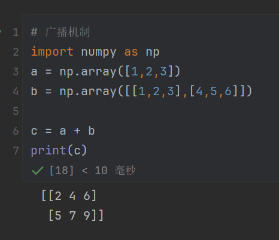

科学计算库 Numpy 的基础内容和简单操作的学习

## 一 介绍

> NumPy 是 Python 中科学计算的基础包。它是一个 Python 库，提供多维数组对象，各种派生对象（如掩码数组和矩阵），以及用于数组快速操作的各种 API，有包括数学、逻辑、形状操作、排序、选择、输入输出、离散傅立叶变换、基本线性代数等等  
> Numpy 包的核心是 ndarray 对象。它封装了 python 原生的同数据类型的 n 维数组  
> 可以便捷的进行矩阵、数组的运算

**为什么使用 Numpy**  
对于同样的数值计算任务，使用 Numpy 比直接用 Python 实现的优点在于：

-   代码更简洁：Numpy 以数组和矩阵为粒度来进行计算并支持大量的数学函数，但是 Python 需要使用循环从底部来实现
-   性能更高效：Numpy 数组的存储效率和计算性能，要比 Python 中使用 List 进行嵌套快很多
-   Numpy 还是各类科学计算库的基础库，如：SciPy、Pandas 等 

* * *

## 二 使用

###  Ndarray对象

**介绍**

> 定义一个 n 维数组对象，简称 ndarray 对象，是相同类型的元素组成的，每个元素占用相同大小的内存块

**存储** 

> 对象采用了数组的索引机制，将数组中每个元素映射到内存块上，并按照行或者列的顺序在内存块上排列

**属性**

> ndarray.ndim                      秩，即轴的数量或维度的数量  
> ndarray.shape                    数组的维度，对于矩阵，n 行 m 列  
> ndarray.size                       数组元素的总个数，相当于.shape 中 n\*m 的值  
> ndarray.dtype ndarray       对象的元素类型  
> ndarray.itemsize ndarray   对象中每个元素的大小，以字节为单位 

```python
import numpy as np

ndarray = np.ndarray([1,2,3,4,5])
# 秩，即轴的数量或维度的数量
print(ndarray.ndim)
# 数组的维度，对于矩阵，n 行 m 列
print(ndarray.shape)
# 数组元素的总个数，相当于.shape 中 n*m 的值
print(ndarray.size)
# ndarray对象的元素类型
print(ndarray.dtype)
# ndarray对象中每个元素的大小，以字节为单位
print(ndarray.itemsize)
```

**创建**

> 使用创建函数 umpy.array (object, dtype=None, copy=True, order=None,subok = False, ndmin = 0) 

```python
import numpy as np

np.array
np.ndarray

"""
object  数组的序列
dtype 可选参数 数组可通过这个改变数组的类型
copy  可选参数 当数据源为ndarray时表示数据能否被复制 默认为True
order 可选参数 当哪种内存布局来存储数组 C(行序列) F(列序列) A(默认)
ndmin 可选参数 用于指定数组的维度
subok 可选参数 类型为bool 为True时 使用object的默认对象类型 为False时 使用数组数据类型
"""
```

  其他的创建方式

> -   np.arange 创建区间数组 (start,stop,step,dtype)
> -   np.linspace 创建等差数列
> -   np.logspace 创建等比数列
> -   np.zeors 创建指定大小的数组，以 0 填充
> -   np.ones 创建指定大小的数组，以 1 填充

```python
import numpy as np

# 区间数组
arr1 = np.arange(1,10,2,int)

# 等差数组
# 三个参数 start end num
arr2 = np.linspace(1,10,5)
print(arr2)

# 等比数列
# 默认以10为底 start end 都是10的幂次数
arr3_1 = np.logspace(1,100,2)
# 可以更换幂的底数
arr3_2 = np.logspace(0,4,5, base = 2)
print(arr3)

# 创建指定长度的数组 以0填充
arr4 = np.zeros(3)
print(arr4)

# 创建指定长度的数组 以1填充
arr5 = np.ones(3)
print(arr5)
```

* * *

### 常用函数

> -   np.append (): 在数组末尾添加值
> -   np.insert (): 在给定索引值前一个值插入相应的值
> -   np.del (): 从输入数组中删除指定的子数组
> -   np.unique (): 删除数组中重复元素
> -   np.sort (): 对输入数组排序，并返回一个数组副本

```python
import numpy as np

# 常用函数
arr_test = np.array([1,2,3,4,4])
print(arr_test)
# 在数组末尾添加值
print(np.append(arr_test,[5,5]))
# 在固定索引前面插入值
print(np.insert(arr_test,2,5))
# 去除重复元素
print(np.unique(arr_test))
# 对输入数组进行排序 返回一个数组的副本
print(np.sort(arr_test))

```

* * *

**广播机制**

>         广播指 numpy 对不同形状 (shape) 的数组进行数值计算的方式，对数组的算术运算通常在相应的元素上进行。  
>         如果两个数组 a 和 b 形状相同，即满足 a.shape == b.shape，那么 a\*b 的结果就是 a 与 b 数组对应位相乘。这要求维数相同，且各维度的长度相同。  
> 简单来说就是对两个数组，分别比较他们的每一个维度，需要满足
> 
>  
> 
> -   数组拥有相同形状。
> -   当前维度的值相等。
> -   当前维度的值有一个是 1。

```python
# 广播机制
import numpy as np
a = np.array([1,2,3])
b = np.array([[1,2,3],[4,5,6]])

c = a + b
print(c)
```



* * *

 学习时间 2025.06.22
