关于Pathon的绘图库的认识和基本操作的学习 这里学习了两款常用便捷的绘图库去学习使用

## Matplotlib

### 介绍

> 是最受欢迎的一种数据可视化包 是常用的2D绘图库 一般常于Numpy和Pandas使用 是数据分析中非常重要的工具
> 
> 可以自定义XY轴 绘制线形图 柱状图 直方图 密度图 散点图 更清晰的展示数据

 基本绘图

$plt.plot(x,y,ls,lw,lable,color,marker)$

x x 为绘制做坐标点 ls 为线型linestyle lw为线宽linewidth lable为标签文本内容 color为颜色 marker为标记

<table border="1" cellpadding="1" cellspacing="1" style="width:500px"><tbody><tr><td>ls</td><td>- 实线&nbsp; : 点虚线&nbsp; --破折线&nbsp; -.点划线</td></tr><tr><td>color</td><td>r 红 g 绿 y 黄 k 黑 w 白</td></tr><tr><td>marker</td><td>. 点&nbsp; ，像素点 o 实心圆 v 下三角 * 星星</td></tr></tbody></table>

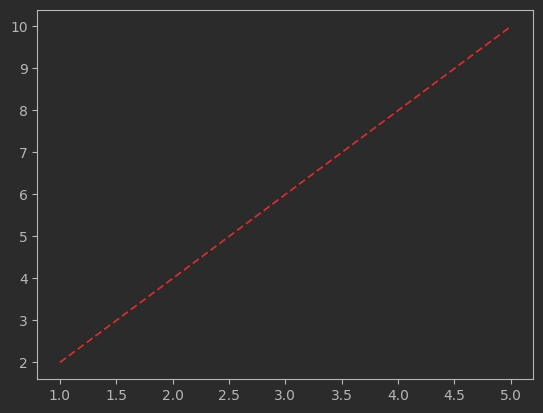

```python
# 绘制直线图
import matplotlib.pyplot as plt
x = [1,2,3,4,5]
y = [2,4,6,8,10]
plt.plot(x,y,color="r",ls="--")
plt.show()
```

### 使用

设置网格

```python
import numpy as np # 设置网格
plt.figure(figsize=(6,3),dpi=100)
x = np.linspace(0,2*np.pi)
y = np.sin(x)
plt.plot(x,y)
plt.grid() # 设置网格
```

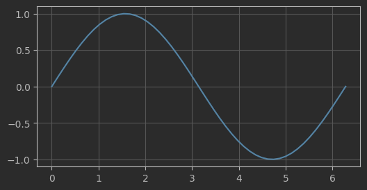

绘制多线

```python
import numpy as py # 绘制多条线 设置画布背景
plt.figure(figsize=(6,3),dpi=100) # 设置画布的长宽和分辨率
x = np.linspace(0,2*np.pi)
y = np.sin(x)
z = np.cos(x)
plt.plot(x,y)
# plt.show() # 立刻绘图 只绘制xy的图像
plt.plot(x,z)
```

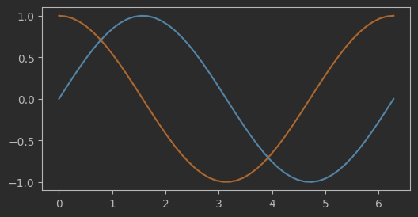

```python
# 创建数据
x = np.linspace(0,10,100)
y1 = np.sin(x)
y2 = np.cos(x)

# 绘制图形
plt.plot(x,y1,label='Sin Function',color="y",ls="-.") # 第一个数据系列
plt.plot(x,y2,label='Cos Function')

# 显示图例
plt.legend()

# 显示图形
plt.show()
```

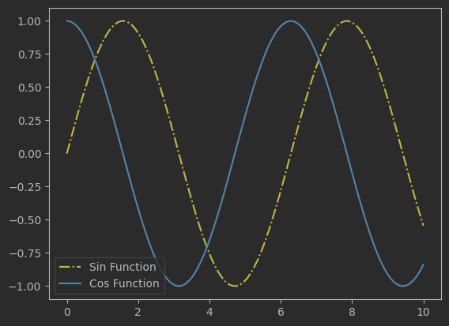

 多图布局

```python
#%%
%matplotlib inline
# 若不显示图片 则加上
import matplotlib.pyplot as plt
plt.rcParams['front.sans-serif'] = ['SimHei'] # 用于正常显示中文标签
plt.rcParams['axes.unicode_minus'] = False # 用于正常显示负号
#%%
# 绘制直线图
import matplotlib.pyplot as plt
x = [1,2,3,4,5]
y = [2,4,6,8,10]
plt.plot(x,y,color="r",ls="--")
plt.show()
#%%
import numpy as np # 设置网格
plt.figure(figsize=(6,3),dpi=100)
x = np.linspace(0,2*np.pi)
y = np.sin(x)
plt.plot(x,y)
plt.grid() # 设置网格
#%%
import numpy as py # 绘制多条线 设置画布背景
plt.figure(figsize=(6,3),dpi=100) # 设置画布的长宽和分辨率
x = np.linspace(0,2*np.pi)
y = np.sin(x)
z = np.cos(x)
plt.plot(x,y)
# plt.show() # 立刻绘图
plt.plot(x,z)
#%%
# 多图布局
import matplotlib.pyplot as plt
import numpy as np

# 创建数据
x = np.linspace(0,10,100)
y1 = np.sin(x)
y2 = np.cos(x)

# 创建一个2*2的子图布局
plt.figure(figsize=(10,6)) # 设置整个图的大小

# 第一个子图
plt.subplot(2,2,1) # 第一个子图位于2*2布局的第一个位置
plt.plot(x,y1,'r-') # 绘制曲线
plt.title('Sin Function') # 设置标题

# 第二个子图
plt.subplot(2,2,2) # 第二个子图的第二个位置
plt.plot(x,y2,'b-') # 设置cos曲线
plt.title('Cos Function')

# 第三个子图
plt.subplot(2,2,3)
plt.plot(x,y1 + y2,'h-')
plt.title('Sin + Cos Function')

# 第四个子图
plt.subplot(2,2,4)
plt.plot(x,y1 - y2,'r-')
plt.title('Sin - Cos Function')

# 调整子图之间的间距
plt.tight_layout()

# 显示图形
plt.show()
```

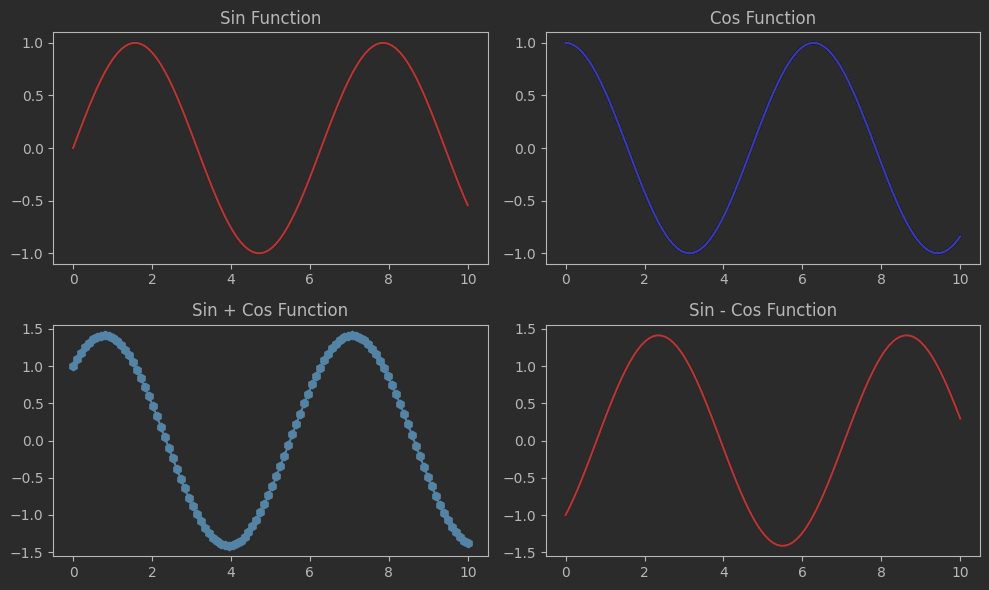

图形嵌套

```python
# 图形嵌套
import numpy as np
import matplotlib.pyplot as plt

# 创建数据
x = np.linspace(0,10,100)
y = np.sin(x)

# 创建外层图形
fig = plt.figure(figsize=(8,6))

# 在外层图形中创建嵌套的子图
plt.plot(x,y,'b-')
plt.title('Main Plot')

# 创建嵌套的子图
left,bottom, width,height = [0.4,0.5,0.25,0.25]
axes = fig.add_axes([left,bottom,width,height]) # 创建一个新的坐标轴
axes.plot(x,y,'r-',label = 'sin Function (Inset)')
plt.title('Inset Plot')

# 显示图例
plt.legend()

# 显示图形
plt.show()
```

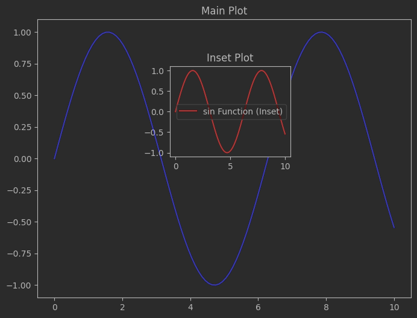

调整刻度和标签

```python
import numpy as np
import matplotlib.pyplot as plt

# 创建数据
x = np.linspace(0,10,100)
y = np.sin(x)

# 绘制图形
plt.plot(x,y,label = 'Sin Function')
plt.title('修改刻度')

# 修改X轴和Y轴的刻度
plt.xticks(np.arange(0,11,1)) # 设置刻度和步长
plt.yticks([-1,0,1])

# 添加标签
plt.xlabel('x')
plt.ylabel('y')

plt.legend()
plt.show()
```

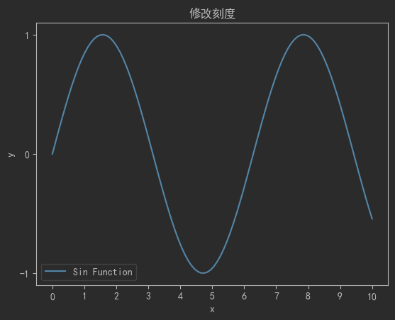

 保存图片

```python
import numpy as np
import matplotlib.pyplot as plt

x = np.linspace(0,10,100)
y = np.sin(x)

plt.plot(x,y,label = 'Sin Function')

# 标签
plt.title('Plot Example')
plt.xticks(np.arange(0,11,1))
plt.yticks([-1,0,1])
plt.legend()

plt.savefig('plot_example.png')
plt.show()
```

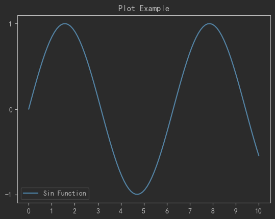

绘制折线图

```python
plt.figure(figsize=(10,6))

x = df.index # 获取月份作为x轴数据
y1 = df['语文']

plt.plot(x,y1,marker='o',color='r',ls='--',label='语文')

plt.title('张三成绩月变化情况')
plt.xlabel('月份')
plt.ylabel('分数')
plt.legend()
plt.grid(True) # 网格线

plt.xticks(rotation = 45) # x轴刻度标签的角度旋转为45度
plt.tight_layout()
plt.show()
```

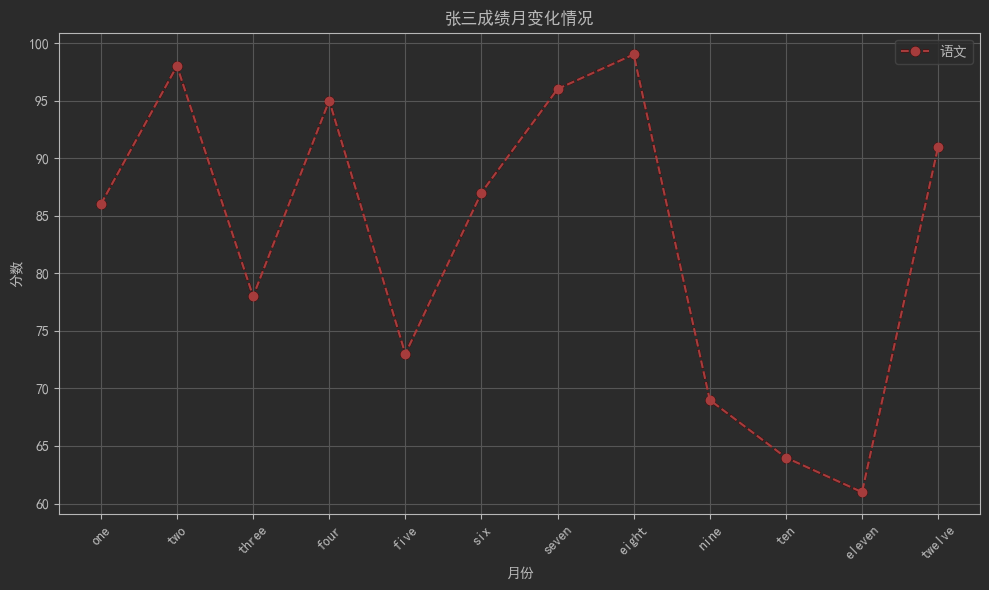

多个柱状图

```python
# 绘制多个柱状图
import numpy as np
import matplotlib.pyplot as plt

# 读取 Excel 表格数据
excel_file = '张三成绩.xlsx'
df = pd.read_excel(excel_file)

# 绘制图像
plt.figure(figsize=(10,6))

months = df.index
x = range(len(months))

# 设置柱状图的宽度
bar_width = 0.25

plt.bar(x,df['语文'],width=bar_width,align='center',label='语文',color='skyblue')
plt.bar([i + bar_width for i in x],df['英语'],width=bar_width,align='center',label='数学',color='r')
plt.bar([i + 2 * bar_width for i in x],df['英语'],width=bar_width,align='center',color='b')

plt.title('成绩月变化情况')
plt.xlabel('月份')
plt.ylabel('分数')

# 设置X轴刻度标签
plt.legend()

# 显示图形
plt.tight_layout()
plt.show()
```

绘制散点图

```python
import numpy as np
import matplotlib.pyplot as plt

np.random.seed(0)
height = np.random.normal(loc=170,scale=10, size=100)
weight = 0.6 * height + np.random.normal(loc=0,scale=5,size=100)

plt.figure(figsize=(10,6))
plt.scatter(height,weight,color='r',alpha=0.7)

plt.title('身高与体重关系散点图')
plt.xlabel('身高')
plt.ylabel('体重')

plt.grid(True)
plt.tight_layout()
plt.show()
```

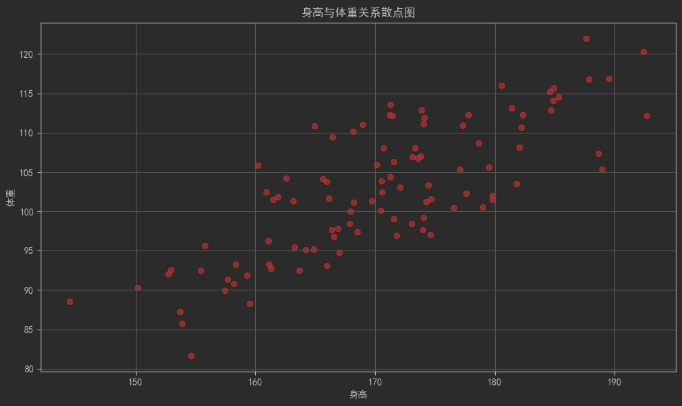

绘制饼图

```python
import numpy as np
import matplotlib.pyplot as plt

excel_file = '张三成绩.xlsx'
df = pd.read_excel(excel_file)

plt.figure(figsize=(10,6))

plt.pie(df['语文'],startangle=90) # startangle 绘制的起始位置

plt.title('成绩情况')

plt.show()
```

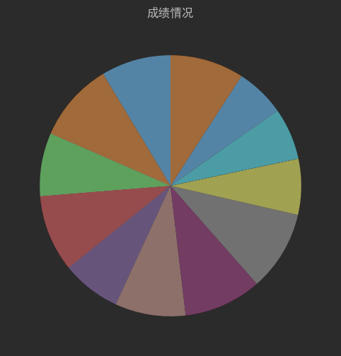

* * *

## Search

### 介绍

>     在Matplotlib的基础上进行了更高级的封装 使用极简的代码做出具有分析价值且十分美观的图形 而且也支持Pyhon的其他库 
> 
>     可以绘制 折线图 散点图（分类图）分类分布图 分类统计图 线性回归图 热力图

**风格设置**

<table border="1" cellpadding="1" cellspacing="1" style="width:500px"><tbody><tr><td><p>white</p></td><td>纯白&nbsp;</td></tr><tr><td><p>whitegrid</p></td><td>带有网格的纯白</td></tr><tr><td><p>dark</p></td><td>灰色</td></tr><tr><td><p>darkgrid</p></td><td>带网格灰色</td></tr><tr><td>ticks</td><td>白色 轴上有刻度条&nbsp;</td></tr></tbody></table>

**函数参数使用**

| 函数类型 | 函数名称 | 主要参数 | 使用场景 | 示例代码 |
| --- | --- | --- | --- | --- |
| ​**​分布类​**​ | `displot()`  
(通用分布图) | `kind`: 指定类型(hist/kde/ecdf)  
`data`: 数据集  
`x/y`: 变量  
`hue`: 分组变量  
`rug`: 显示分布密度 | 单变量分布分析  
数据分布形状探索 | `sns.displot(data=tips, x="total_bill", kind="kde", hue="time")` |
| ​**​分布类​**​ | `histplot()`  
(直方图) | `bins`: 箱数  
`kde`: 叠加密度线  
`stat`: 统计方式(count/density)  
`multiple`: 分组叠放方式 | 数值变量分布探索  
统计频次分析 | `sns.histplot(data=tips, x="tip", bins=20, kde=True, hue="sex")` |
| ​**​关系类​**​ | `scatterplot()`  
(散点图) | `x/y`: 变量坐标  
`size`: 点大小  
`style`: 点形状  
`alpha`: 透明度  
`palette`: 色板 | 双变量关系探索  
相关性可视化 | `sns.scatterplot(data=iris, x="sepal_length", y="petal_length", hue="species", size="petal_width")` |
| ​**​关系类​**​ | `lineplot()`  
(折线图) | `sort`: 是否排序  
`markers`: 显示标记  
`ci`: 置信区间  
`style`: 线型分组 | 时间趋势分析  
序列变化对比 | `sns.lineplot(data=flights, x="year", y="passengers", hue="month", ci=None)` |
| ​**​分类类​**​ | `barplot()`  
(条形图) | `estimator`: 聚合函数(mean/sum)  
`ci`: 置信区间  
`order`: 类目顺序  
`capsize`: 误差线帽宽 | 分类变量聚合比较  
均值差异分析 | `sns.barplot(data=titanic, x="class", y="fare", hue="sex", estimator=np.mean)` |
| ​**​分类类​**​ | `boxplot()`  
(箱线图) | `orient`: 方向(v/h)  
`notch`: 凹口  
`fliersize`: 离群点大小  
`width`: 宽度 | 数据分布对比  
异常值检测 | `sns.boxplot(data=penguins, x="species", y="body_mass_g", hue="sex", notch=True)` |
| ​**​分类类​**​ | `violinplot()`  
(小提琴图) | `inner`: 内部图(quartiles/stick)  
`split`: 分组合并  
`bw`: 核密度带宽 | 比较数据分布形状  
概率密度可视化 | `sns.violinplot(data=penguins, x="island", y="bill_length", hue="sex", inner="stick", split=True)` |
| ​**​矩阵类​**​ | `heatmap()`  
(热力图) | `annot`: 显示数值  
`fmt`: 数值格式  
`cbar`: 显示色标  
`linewidths`: 网格线宽  
`vmin/vmax`: 值域范围 | 相关性分析  
交叉表可视化 | `sns.heatmap(data=corr_matrix, annot=True, fmt=".2f", cmap="coolwarm")` |
| ​**​矩阵类​**​ | `clustermap()`  
(聚类热力图) | `row_colors`: 行标签色  
`method`: 聚类方法  
`metric`: 距离算法  
`z_score`: 标准化 | 聚类分析  
分组可视化 | `sns.clustermap(data=iris, method="ward", z_score=0, cmap="viridis")` |
| ​**​网格类​**​ | `FacetGrid()`  
(分面网格) | `col/row`: 分面维度  
`col_wrap`: 换行数  
`height/aspect`: 子图尺寸  
`share{x/y}`: 坐标轴共享 | 多维度分析  
数据集子集探索 | `g = sns.FacetGrid(tips, col="time", row="smoker")<br>g.map(sns.scatterplot, "total_bill", "tip")` |
| ​**​网格类​**​ | `pairplot()`  
(变量关系矩阵) | `diag_kind`: 对角线图类型  
`plot_kws`: 子图参数  
`corner`: 只显示下三角  
`kind`: 关系类型(scatter/kde) | 多变量关系探索  
数据集快速概览 | `sns.pairplot(data=iris, hue="species", diag_kind="hist", corner=True)` |

**核心参数**

| 参数 | 描述 | 示例值 |
| --- | --- | --- |
| `data` | 输入数据源 | DataFrame/tables/arrays |
| `x/y` | 坐标轴变量 | 列名 (如："total\_bill") |
| `hue` | 分组变量 | 分类列名 (如："sex") |
| `palette` | 调色板 | "viridis", "mako", "Set2" |
| `size` | 尺寸变量 | 连续变量列名 |
| `alpha` | 透明度 | 0-1值 (0.5表示半透明) |
| `legend` | 图例 | "auto"(默认)/True/False |
| `ax` | matplotlib轴对象 | 用于在已有图形上绘制 |

### 使用

折线图（使用库自带的测试数据集）

```python
import seaborn as sns
test_data = sns.load_dataset('fmri')
print(test_data.head())

sns.relplot(x="timepoint",y="signal",kind="line",data=test_data)
```

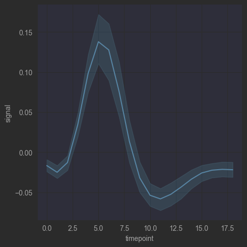

折线图（事件区分）

```python
import seaborn as sns
test_data = sns.load_dataset('fmri')
print(test_data.head())

sns.relplot(x="timepoint",y="signal",kind="line",hue="event",data=test_data)
```

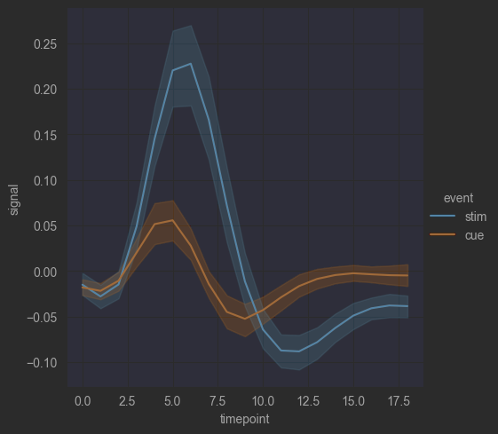

分图展示

```python
import seaborn as sns
test_data = sns.load_dataset('fmri')
print(test_data.head())

sns.relplot(x="timepoint",y="signal",kind="line",hue="event",col="event",data=test_data)
```

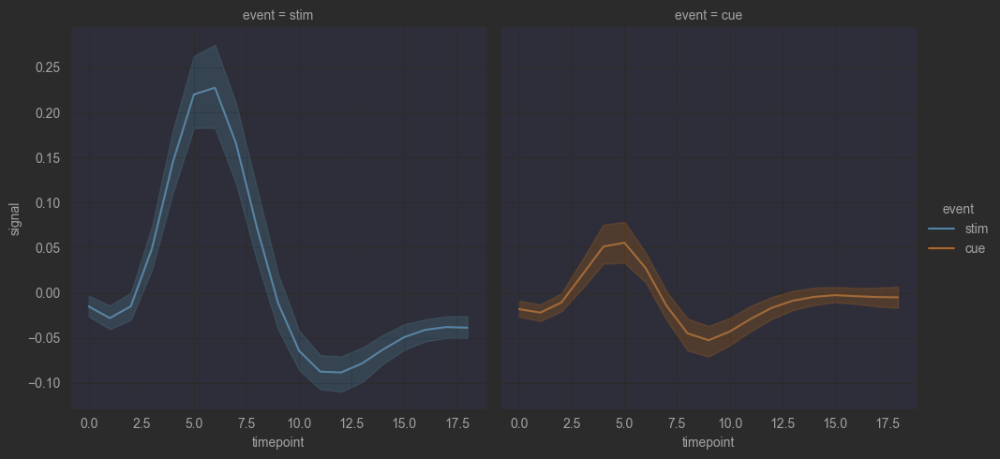

散点图（分类图）

```python
titanic = sns.load_dataset('titanic')
sns.relplot(x="age",y="fare",data=titanic)
```

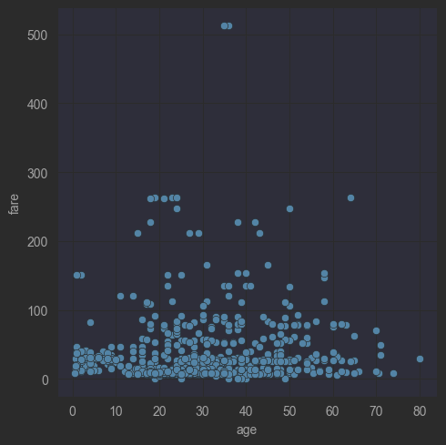

```python
sns.catplot(x="pclass",y="fare",data=titanic) # 用作做分类
```

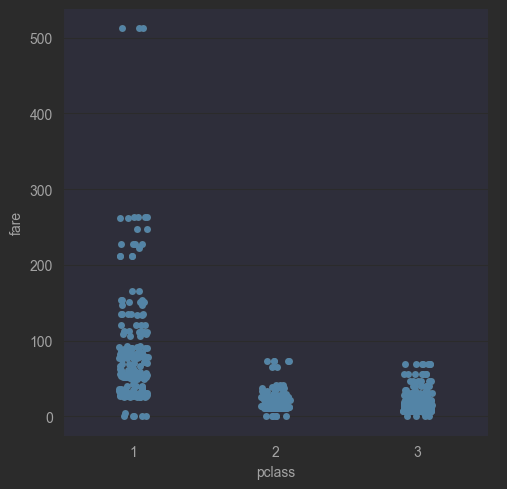

箱形图

```python
sns.boxplot(x="pclass",y="fare",data=titanic)
```

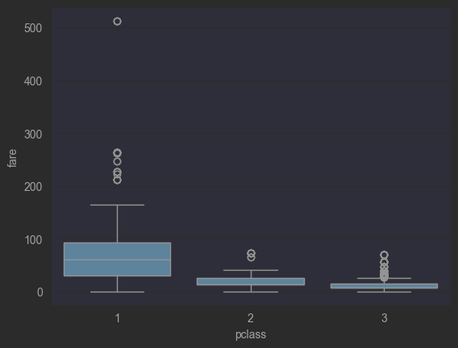

条形图

```python
sns.barplot(x="pclass",y="fare",data=titanic) # 条形图
```

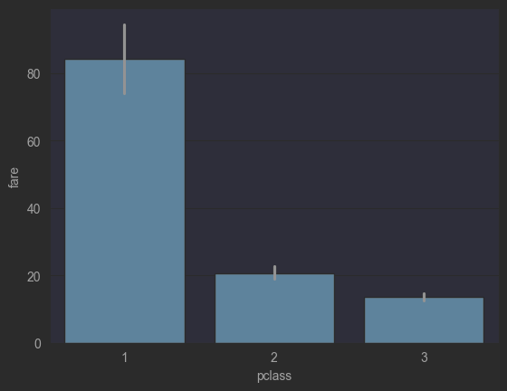

计数图

```python
sns.countplot(x="pclass",data=titanic)
sns.set_style("whitegrid") # 绘图风格设置
```

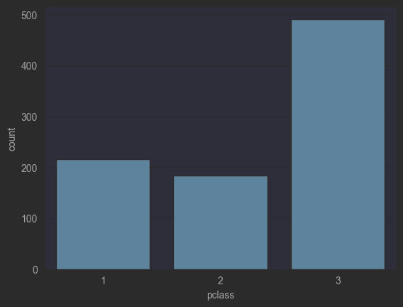

调色板

```python
# 调色板
from matplotlib import pyplot as plt
plt.rcParams['font.sans-serif'] = ['SimHei'] # 用于正常显示中文标签
plt.rcParams['axes.unicode_minus'] = False  # 用于正常显示负号
plt.figure(figsize=(10,10))
planets = sns.load_dataset('planets')
sns.barplot(x="year",y="number",data=planets,palette="rainbow")
```

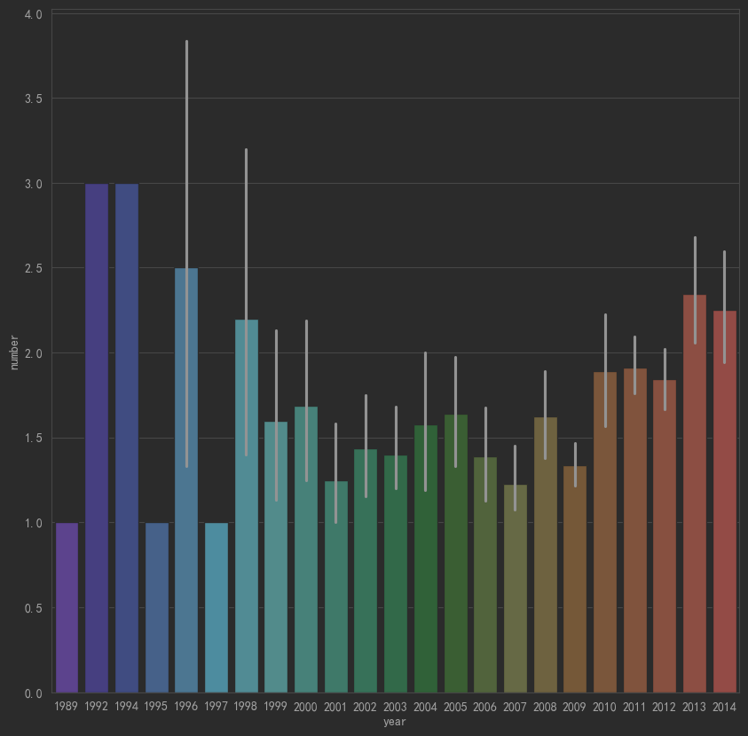

 线性关系图

```python
sns.regplot(x="age",y="fare",data=titanic)
```

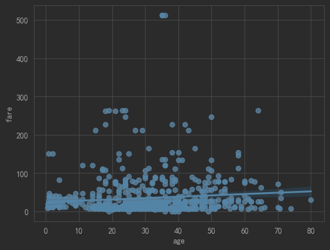

热力图

```python
# 热力图
flights = sns.load_dataset('flights')

# 将长格式转换为宽格式数据，以便于绘制热力图
f = flights.pivot(index="month",columns="year",values="passengers")

# 绘制热力图
plt.figure(figsize=(10,10))
sns.heatmap(f,annot=True,fmt='d',cmap='YlGnBu')
plt.title("Flights Passenger Count By Year ans Month")
plt.xlabel("Year")
plt.ylabel("Month")
plt.show()
```

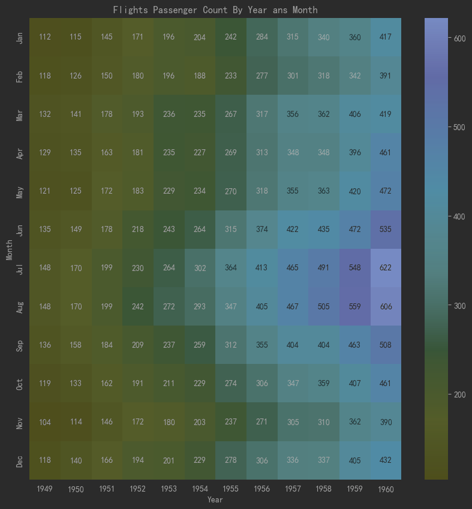

相关系数矩阵的热力图

```python
plt.figure(figsize=(10,10))
sns.heatmap(f.corr(),annot=True,cmap='coolwarm')
```

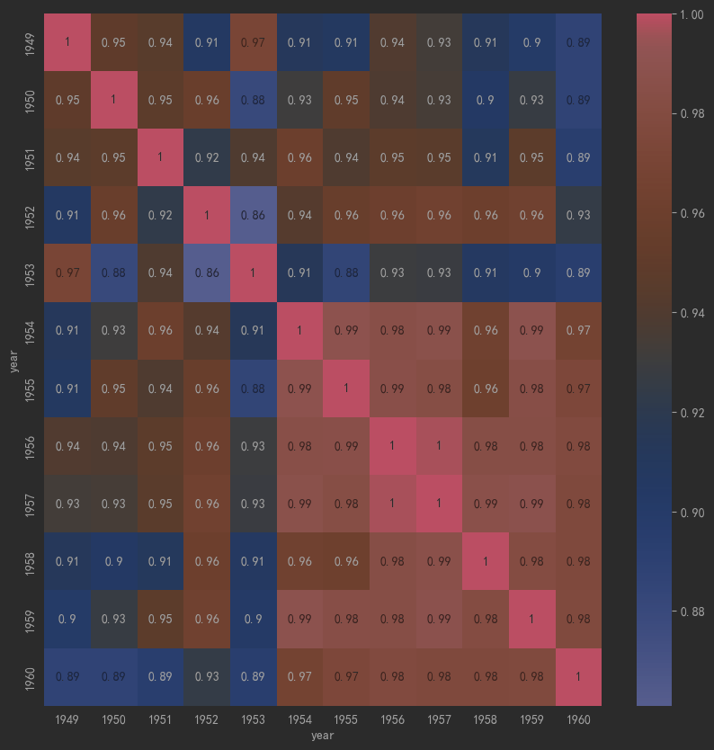

* * *

学习时间  2025.07.20
