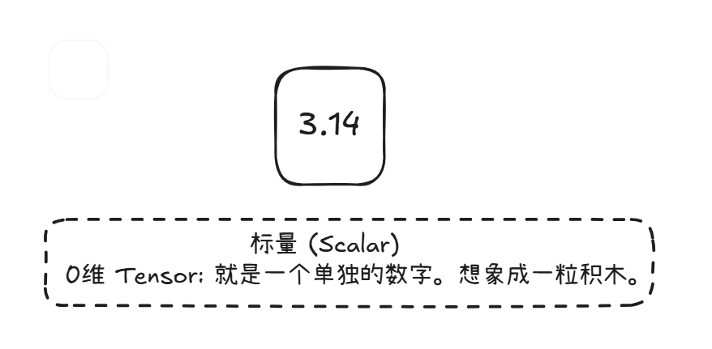
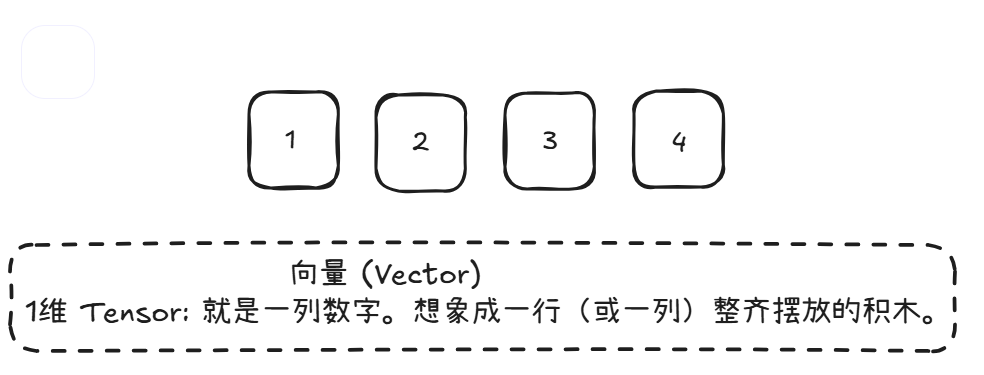
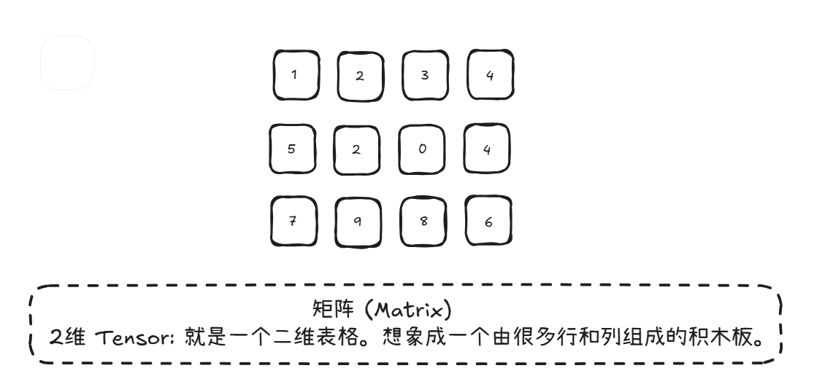
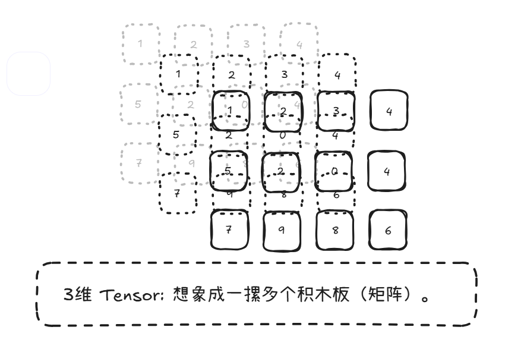
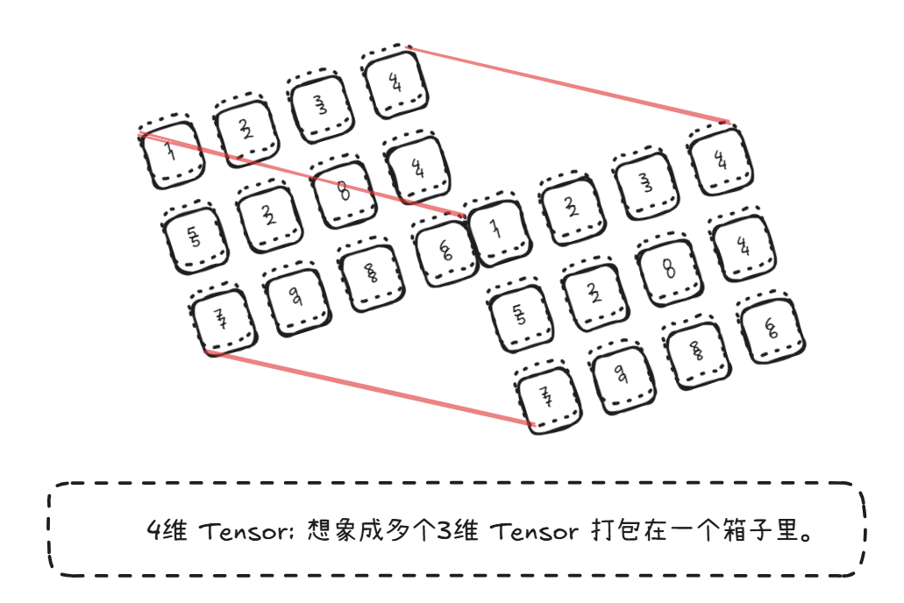
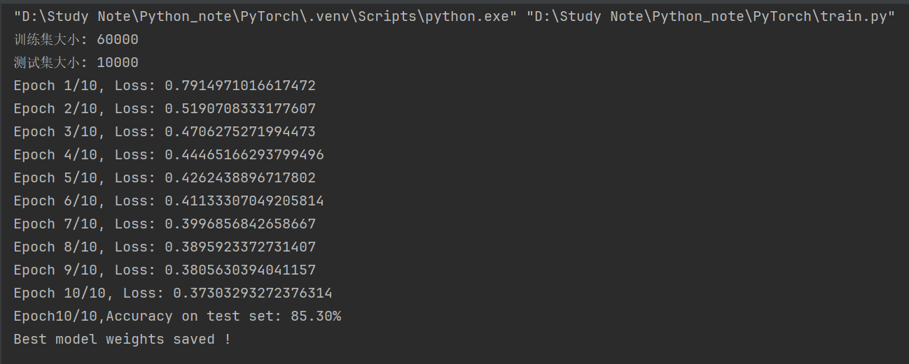

> 关于PyTorch的数据类型和使用的学习笔记  系统介绍了PyTorch的核心数据类型Tensor及其应用。Tensor作为多维矩阵数据容器，支持0-4维数据结构（标量到批量图像），并提供了多种数值类型（float32/int64等）。通过积木类比阐述了Tensor的维度概念，展示了创建、变形、随机生成等基础操作。重点演示了FashionMNIST数据集分类任务实战：构建包含两个全连接层的神经网络(QYNN)，使用交叉熵损失和SGD优化器进行训练。

## 1 介绍

>   PyTorch 是Torch的Python版本 是开源的神经网络框架 针对于GPU加速的深度神经网络编程
> 
>   Torch是一个经典的多维矩阵数据进行操作的张量（Tensor）库 在机器学习和其他数学密集型应用广泛应用 PyTorch的计算图是动态的 可以按照计算需求实时改变计算图
> 
>   PyTorch追求最少的封装 设计遵循**Tensor->Variable->nn.Module** 三个由低到高的抽象层次 分别代表高维数组（张量） 自动求导（变量） 神经网络（层/模块）三个抽象间联系紧密

* * *

## 2 基础数据类型

###  2.1 图文说明

> PyTorch处理的最基本的操作对象就是张量（Tensor）表示的就是一个多维矩阵 接下来将进行一个通俗的说明

   我们类比一下积木 ，`Tensor`就是构建一切模型和计算的最基本积木块。而PyThorch就是一个装数字的​**​盒子​**​，并且这个盒子可以有很多​**​维度​**​（几层架子）。

| 维度 | 类比描述 | 例子 | 具体场景说明 |
| --- | --- | --- | --- |
| 0维张量（标量） | 一粒积木 | 5, 3.14 | 单个数值（如温度、概率值） |
| 1维张量（向量） | 一行/一列整齐摆放的积木 | \[1, 2, 3, 4\] | 物体位置坐标、心电图波形数据 |
| 2维张量（矩阵） | 行列组成的积木板 | \[\[1,2,3\],  
\[4,5,6\]\] | 灰度图像（28x28像素）、  
Excel表格数据 |
| 3维张量 | 一摞多个积木板 | 尺寸示例：\[3,224,224\] | 彩色图像（通道×高×宽）  
MRI切片扫描数据 |
| 4维张量 | 多个3维张量  
打包的箱子 | 尺寸示例：\[32,3,224,224\] | 批量处理32张  
224x224像素的RGB图像 |

 

 





而每一个数字也自己本身的数据类型：**浮点型** 和 **整型**

| ​**​数据类型​**​ | ​**​位宽/精度​**​ | ​**​通俗解释​**​ | ​**​典型应用场景​**​ | ​**​PyTorch创建方法​**​ | ​**​内存占用​**​ |
| --- | --- | --- | --- | --- | --- |
| ​**​torch.float32​**​  
(torch.float) | 32位  
单精度浮点 | 带小数点的数  
(如3.14159) | 深度学习模型参数  
激活函数计算 | `.float()`  
`dtype=torch.float32` | 4字节/元素 |
| ​**​torch.float64​**​  
(torch.double) | 64位  
双精度浮点 | 高精度浮点数  
(更多小数位) | 科学计算  
精密数值分析 | `.double()`  
`dtype=torch.float64` | 8字节/元素 |
| ​**​torch.int32​**​  
(torch.int) | 32位整数 | 普通整数  
(如-1, 0, 42) | 一般计数  
简单索引 | `.int()`  
`dtype=torch.int32` | 4字节/元素 |
| ​**​torch.int64​**​  
(torch.long) | 64位整数 | 大范围整数  
(更大或更精确) | ​**​标签数据​**​  
复杂索引  
位置信息 | `.long()`  
`dtype=torch.int64` | 8字节/元素 |
| ​**​torch.uint8​**​ | 8位无符号整数 | 0-255整数  
(无负数) | ​**​图像像素值​**​  
(0=黑, 255=白) | `.byte()`  
`dtype=torch.uint8` | 1字节/元素 |
| ​**​torch.bool​**​ | 布尔值 | True/False  
(是/否) | 条件判断  
数据掩码  
(如x>5) | `.bool()`  
`dtype=torch.bool` | 1字节/元素 |
| ​**​torch.complex64​**​ | 64位复数 | 复数表示  
(实部+虚部浮点) | 信号处理  
量子计算 | `dtype=torch.complex64` | 8字节/元素 |
| ​**​torch.complex128​**​ | 128位复数 | 高精度复数 | 高级物理计算  
电磁场模拟 | `dtype=torch.complex128` | 16字节/元素 |

        ​**​之所以说 Tensor 是核心数据类型。**是因为 PyTorch 几乎所有操作（神经网络运算、求梯度）都建立在处理 `Tensor` 之上。你需要把你的数据（数字、图像、文本数值化表示等）最终都放进这些不同形状（维度）的 `Tensor` 盒子里，PyTorch 才能处理和计算。​ 所有东西最终都变成 Tensor 的某种形式。维度 (`shape`) 决定了数据的基本结构（标量、向量、矩阵、图片、批量）。而 ​`dtype` 去指定格子的内容类型

### 2.2 代码实现

     然后 PyTorch实际的数据类型我们再使用代码实操一下

####  **2.2.1 基础张量创建​**

```python
# 张量的定义方式和Numpy一样 传入矩阵即可生成张量
import torch
a = torch.Tensor([[1,2],[3,4]])
print(a) # <class 'torch.Tensor'>
```

```python
a = torch.eye(2)  # 创建2x2单位矩阵
print(a)           # 输出: tensor([[1., 0.], [0., 1.]])
```

#### **​2.2.2 特殊张量初始化​**

```python
 = torch.zeros(3, 3)  # 3x3全0张量
c = torch.ones(3, 3)   # 3x3全1张量
d = torch.arange(1, 10, 2)  # [1,10)区间步长为2: [1,3,5,7,9]
e = torch.linspace(1, 10, 10)  # 1-10的10个等差值
f = torch.logspace(1, 10, 10)  # 10^1到10^10的10个对数间隔值
g = torch.logspace(1, 2, 10)   # 10^1到10^2的10个值
```

#### **2.2.3 随机张量生成​**

```python
a1 = torch.rand(3, 3) # [0,1)均匀分布 a2 = torch.randn(3, 3) # 标准正态分布(μ=0, σ=1) a3 = torch.randint(1, 10, (5, 5)) # [1,10)区间的随机整数
```

#### 2.2.4 ​**NumPy互操作​**

```python
import numpy as np
a4 = np.array([1, 2])          # 创建NumPy数组
a5 = torch.from_numpy(a4)       # NumPy转PyTorch张量
# 类型转换: <class 'numpy.ndarray'> -> <class 'torch.Tensor'>
```

####  2.2.5 **张量形状操作​**

```python
a = torch.Tensor(2, 3, 128, 128)
print(a.shape)              # torch.Size([2, 3, 128, 128])
print(a[0].shape)          # torch.Size([3, 128, 128])
print(a[0][0].shape)       # torch.Size([128, 128])

# 高级切片
print(a[:1, :1, :64, :64].shape)    # torch.Size([1, 1, 64, 64])
print(a[:1, :1, :64:2, :64:2].shape) # torch.Size([1, 1, 32, 32])
```

#### **2.2.6 维度变换​**

```python
# 重塑形状
B = a.reshape(2, 3, -1)      # 展平后两维: (2,3,16384)
C = a.reshape(4, -1)        # (4, 24576)

# 增删维度
a = a.unsqueeze(2)          # 添加维度: (2,3,1,128,128)
a = a.squeeze(1)            # 删除大小为1的维度

# 维度交换
a = a.transpose(0, 1)       # 交换维度0和1: (3,2,128,128)
a = a.permute(1, 0, 3, 2)   # 维度重排: (3,2,128,128)
```

####  2.2.7 **维度扩展​** 

```python
a = torch.randn(2, 1, 128, 128)
a = a.expand(2, 3, 128, 64)  # 复制数据扩展维度
# 要求: 扩展维度必须为1或与原尺寸一致
```

#### 2.2.8 函数总结

| ​**​操作类型​**​ | ​**​函数/语法​**​ | ​**​关键特性​**​ |
| --- | --- | --- |
| 基础创建 | `eye()`, `zeros()`, `ones()` | 初始化特殊矩阵 |
| 序列生成 | `arange()`, `linspace()` | 控制步长/数量 |
| 随机生成 | `rand()`, `randn()`, `randint()` | 均匀/正态/整数分布 |
| 维度操作 | `reshape()`, `view()` | 数据不复制改变形状 |
| 维度增删 | `unsqueeze()`, `squeeze()` | 添加/移除大小为1的维度 |
| 维度交换 | `transpose()`, `permute()` | 调整维度顺序 |
| 数据扩展 | `expand()` | 复制数据扩展张量（仅支持1->N的扩展） |
| NumPy互操作 | `from_numpy()` | 零拷贝数据共享 |

* * *

## 3 实战使用

> 使用FashionMNIST数据集（FashionMNIST 是一个经典的计算机视觉基准数据集，由德国电商巨头 Zalando 的研究团队于 2017 年创建，旨在替代过于简单的 MNIST 手写数字数据集。它包含 70,000 张 28x28 像素的时尚单品灰度图像，涵盖 10 个类别。）完成一个基本的图形分类任务

        我们将从环境配置 模型训练与评估 模型使用三个阶段讲起

### 3.1 环境配置

模型训练

```python
import torch
import torch.nn as nn 
import torch.optim as optim # 导入优化器
from torchvision import datasets, transforms # 导入数据集和数据预处理库
from torch.utils.data import DataLoader # 数据加载库
```

模型使用

```python
import os # 用于操作文件
import torch
import matplotlib.pyplot as plt
from torchvision import datasets,transforms # 用于数据集和数据变换
from PIL import Image # 用于图形操作
from torchvision.datasets import FashionMNIST # 用于加载FashionMNIST数据集
from train import QYNN, transform
```

一定要添加一个本地的解释器配置环境 以免冲突 

### 3.2 模型训练与评估

  train.py

```python

import torch
import torch.nn as nn 
import torch.optim as optim # 导入优化器
from torchvision import datasets, transforms # 导入数据集和数据预处理库
from torch.utils.data import DataLoader # 数据加载库

# 设置随机种子
torch.manual_seed(21)

# 定义数据预处理
transform = transforms.Compose([
    transforms.Resize((28,28)),
    transforms.Grayscale(), #强制灰度图像（1通道）
    transforms.ToTensor(),  # 将图像转换为张量
    transforms.Normalize((0.5,), (0.5,))  # 标准化图像数据 灰度图，只需要一个0.5
])

# 加载FashionMNIST数据集
train_dataset = datasets.FashionMNIST(root='./FashionMNIST_images/train', train=True, download=True, transform=transform)  # 下载训练集
test_dataset = datasets.FashionMNIST(root='./FashionMNIST_images/test', train=False, download=True, transform=transform) #  下载测试集

# 创建数据加载器
train_loader = DataLoader(train_dataset, batch_size=64, shuffle=True) # 对训练集进行打包，指定批次为64
test_loader = DataLoader(test_dataset, batch_size=64, shuffle=False) # 对测试集进行打包

# 打印数据集大小和样本检查
print(f"训练集大小: {len(train_dataset)}")
print(f"测试集大小: {len(test_dataset)}")

# 定义神经网络模型
class QYNN(nn.Module):
    def __init__(self):
        super().__init__()
        self.fc1 = nn.Linear(28*28, 128)  # 第一个全连接层 先转换为一维向量
        self.fc2 = nn.Linear(128, 10)  # 第二个全连接层 输出10个类别

    def forward(self, x):
        x = torch.flatten(x, start_dim=1)  # 展平数据，方便进行全连接
        x = torch.relu(self.fc1(x))  # 非线性
        x = self.fc2(x) # 十分类 输出层
        return x 

# 检查是否有 GPU
device = torch.device("cuda:0" if torch.cuda.is_available() else "cpu")

# 初始化模型
model = QYNN().to(device) # 将模型移植到 GPU 或 CPU 上

# 定义损失函数和优化器
criterion = nn.CrossEntropyLoss() # 交叉熵
optimizer = optim.SGD(model.parameters(), lr=0.01) # lr 学习率 用来调整模型收敛速度

# 训练模型
epochs = 10
best_acc = 0 # 初始化最佳准确率
best_model_wts = None # 用于保存最佳权重
for epoch in range(epochs): # 0-9
    running_loss = 0.0
    model.train()  # 设置模型为训练模式
    for inputs, labels in train_loader:
        # 移动数据到GPU 或 CPU
        inputs, labels = inputs.to(device), labels.to(device)

        optimizer.zero_grad() # 梯度清零
        outputs = model(inputs) # 将图片塞进网络训练获得 输出 前向传播
        loss = criterion(outputs, labels) # 根据输出和标签做对比计算损失
        loss.backward() # 反向传播
        optimizer.step() # 更新参数
        running_loss += loss.item() # loss值累加

    print(f"Epoch {epoch+1}/{epochs}, Loss: {running_loss/len(train_loader)}")

# 测试模型
model.eval() # 设置模型为评估模式
correct = 0 # 正确的数量
total = 0 # 样本总数
with torch.no_grad(): # 不用进行梯度计算
    for inputs, labels in test_loader:
        outputs = model(inputs)
        _, predicted = torch.max(outputs, 1) # _取到的最大值，可以不要， 我们需要的是最大值对应的索引 也就是label（predicted）
        total += labels.size(0) # 获取当前批次样本数量
        correct += (predicted == labels).sum().item() # 对预测对的值进行累加

accuracy = 100 * correct / total # 计算准确率
print(f"Epoch{epoch+1}/{epochs},Accuracy on test set: {correct/total:.2%}")

# 如果当前模型的准确率比之前的最佳准率好 则保存模型权重
if accuracy > best_acc: best_acc = accuracy
best_model_wts = model.state_dict() # 保存最佳模型的权重

torch.save(model.state_dict(), "./FashionMNIST_images/model.pt")
print("Best model weights saved !")
```

### 3.3 模型使用 

test.py

```python


import os # 用于操作文件
import torch
import matplotlib.pyplot as plt
from torchvision import datasets,transforms # 用于数据集和数据变换
from PIL import Image # 用于图形操作
from torchvision.datasets import FashionMNIST # 用于加载FashionMNIST数据集
from train import QYNN, transform

# 定义数据集保存路径
data_dir = './FashionMNIST_images' # 数据集的根目录
train_dir = os.path.join(data_dir, 'train') # 训练集保存路经)
test_dir = os.path.join(data_dir, 'test')  # 测试集保存路径

# 定义分类标签 FashionMNIST共有10个类别
class_names = [
    'T-shirt/top',   # 0: T恤/上衣
    'Trouser',       # 1: 裤子
    'Pullover',      # 2: 套头衫
    'Dress',         # 3: 连衣裙
    'Coat',          # 4: 外套
    'Sandal',        # 5: 凉鞋
    'Shirt',         # 6: 衬衫
    'Sneaker',       # 7: 运动鞋
    'Bag',           # 8: 包
    'Ankle boot'     # 9: 短靴
]

model = QYNN()
model.load_state_dict(torch.load("./FashionMNIST_images/model.pt"))
model.eval()

# 定义推理和可视化函数
def infer_and_visualize_image(image_path,model,classses):
    # 打开图形并进行预处理
    img = Image.open(image_path).convert('L') # 确保灰度图片
    img = transform(img).unsqueueeze(0) # 增加一个批次维度

    # 推理
    with torch.no_grad():
        output = model(img)
        _, predicted = torch.max(output, 1)

    # 可视化图形和预测结果
    plt.imshow(img.squeeze(), cmap='gray')
    plt.title(f"Predicted {classses[predicted[0]]}")
    plt.axis('off')
    plt.show()

    # 输入图形路径
    image_path = r""

    infer_and_visualize_image(image_path, model, class_names)

```

 训练效果展示



* * *
