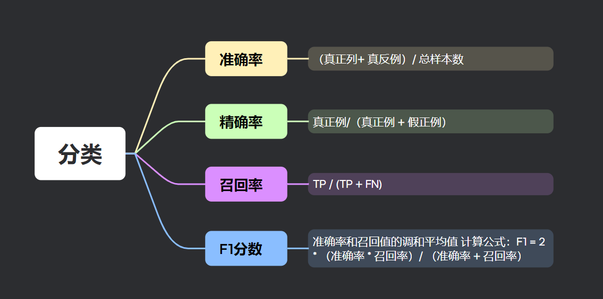
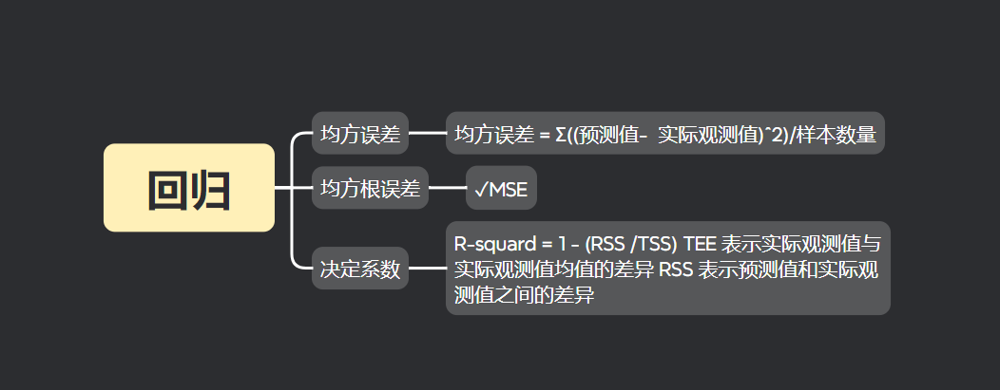
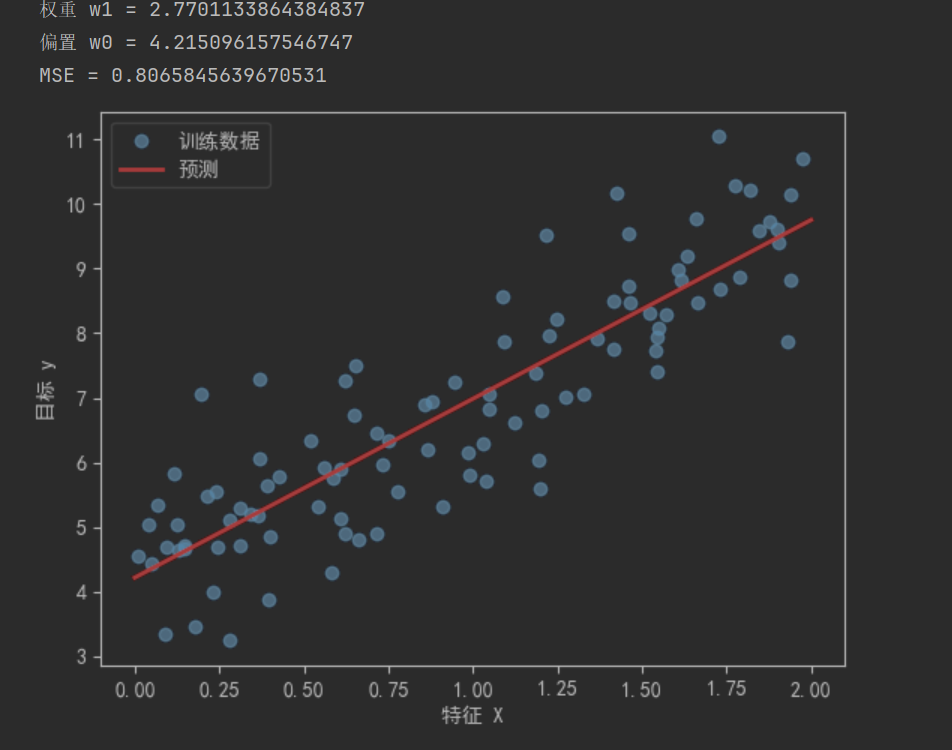
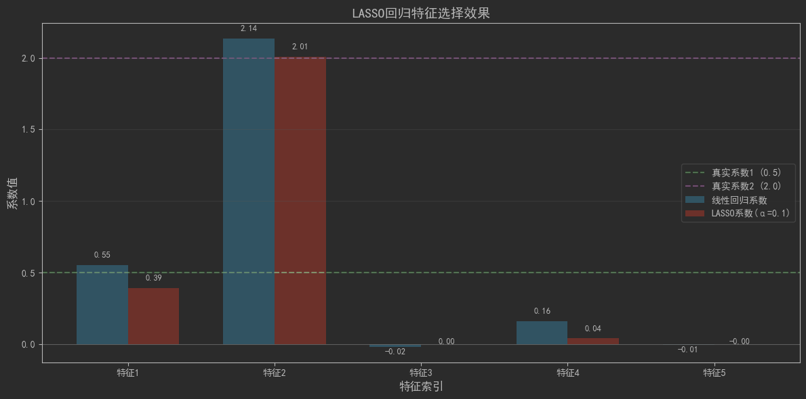
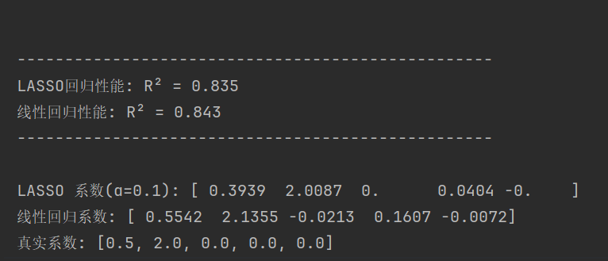
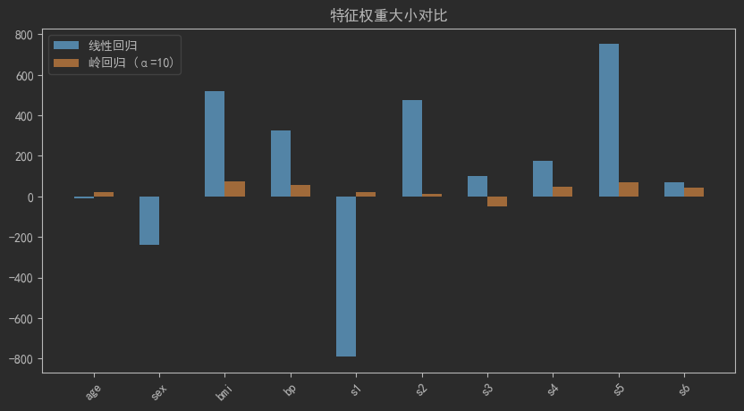
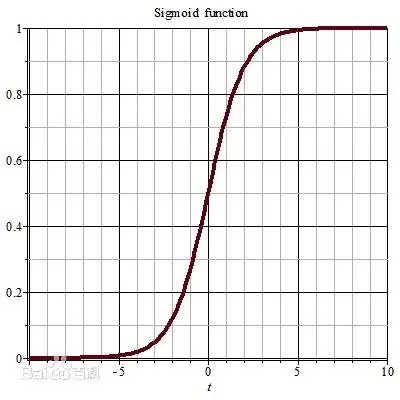
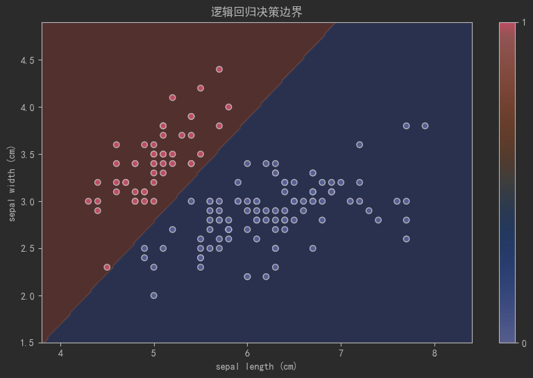
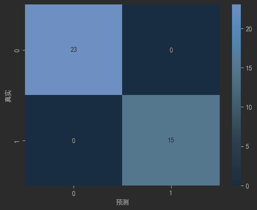
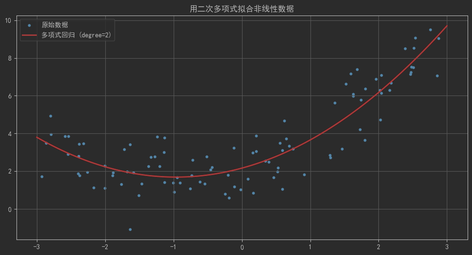

>        本文系统介绍了机器学习中的线性模型及其应用。首先阐述了线性回归的基本原理，包括其数学表达式（y=w₀+w₁x₁+...+wₙxₙ+ε）和优化目标（最小二乘法）。随后对比了分类与回归任务的特点，详细讲解了线性回归、LASSO回归（L1正则）和岭回归（L2正则）的理论基础及实现方式，通过代码示例展示了它们在特征选择和解决共线性问题上的差异。文章还介绍了逻辑回归（虽名为回归实为分类算法）和多线性回归，并通过加利福尼亚房价预测案例，比较了不同模型在实际数据集上的表现。最后，也通过可视化手段直观呈现了各模型的系数变化和预测效果。

## 1 介绍

线性回归是机器学习中最基础且最重要的预测算法，用于建立连续目标变量与特征变量之间的线性关系模型。该算法通过寻找最佳的线性方程来描述特征与目标变量之间的统计关系，为预测分析提供数学基础。

**1.1 核心原理**

-   ​**​数学表达​**​：`y = w₀ + w₁x₁ + w₂x₂ + ... + wₙxₙ + ε`
    -   `y`：目标变量（连续值）
    -   `w₀`：偏置项（所有特征为0时的基准值）
    -   `w₁-wₙ`：特征权重（衡量每个特征的影响程度）
    -   `x₁-xₙ`：输入特征
    -   `ε`：随机误差项（模型未解释的部分）
-   ​**​优化目标​**​：最小化预测值与真实值的平方差（最小二乘法）
-   ​**​训练过程​**​：通过梯度下降或正规方程求解最优权重

* * *

## 2 分类与回归

>       **分类**：分类算法是一种监督学习方法，旨在将数据集中的样本分为不同类别或标签。分散算法的目标就是进行离散的预测，输出是预测样本所属的离散类别。常见的分类算法包括决策树、支持向量机（SVM）、朴素贝叶斯、逻辑回归。
> 
>       **回归**：回归算法也是一种监督学习方法，它用于预测连续目标变量的值。回归算法的目标是进行连续值的预测，输出是预测样本的数值。常见的回归的算法包括线性回归、多项式回归、岭回归、支持向量回归（SVR）和决策树回归等。
> 
>      回归算法的评估指标通常包括均方误差（MSE）、均方根误差（RMSE）和决定系统（R - squared）等





* * *

## 3 线性回归

###  **3.1 理论介绍**

>   线性回归是最简单也最广泛使用的回归方法之一。它假设因变量和自变量之间存在线性关系
> 
> 并试图找到一条最佳拟合线来近似这种关系
> 
>   基本原理：线性回归试图找到一个线性方程，可以用来预测输出（因变量）基于输入（自变量）的变化。在一个简单的线性回归模型中，我们试图找到最佳拟合直线，这条线的方程通常写作：
> 
> $y = ax&plus;b$
> 
>   其中 y是我们试图预测的输出值，a是斜率，代表x和y之间的关系
> 
>   寻找最佳拟合直线为了找到最佳拟合直线，我们要使用一种方法来度量模型预期值和实际输出值之间的差异。我们使用均方误差来实现这一点，公式如下：
> 
> $MES =\frac{1}{n}\sum_{i=1}^{n}(yi - \widehat{yi})^{2}$
> 
>   其中：n是数据点的数量。yi是第i个实际输出值yi的平均值是第i个模型预测值

###  3.2 代码实现

```python
# 线性回归
# 导入库
import numpy as np
import matplotlib.pyplot as plt
from sklearn.linear_model import LinearRegression
from sklearn.metrics import mean_squared_error

plt.rcParams['font.sans-serif'] = ['SimHei']  # 用来正常显示中文标签
plt.rcParams['axes.unicode_minus'] = False    # 用来正常显示负号

# 1. 生成模拟数据 (y = 2x + 1 + 噪声)
np.random.seed(42)
X = 2 * np.random.rand(100, 1)  # 100个样本，1个特征
y = 4 + 3 * X + np.random.randn(100, 1)  # 真实关系 y=3x+4

# 2. 训练模型
lin_reg = LinearRegression()
lin_reg.fit(X, y)

# 3. 预测与评估
X_new = np.array([[0], [2]])  # 新样本
y_pred = lin_reg.predict(X_new)

# 4. 查看权重和偏置
print("权重 w1 =", lin_reg.coef_[0][0])  # 应接近3
print("偏置 w0 =", lin_reg.intercept_[0]) # 应接近4
print("MSE =", mean_squared_error(y, lin_reg.predict(X)))

# 5. 可视化
plt.scatter(X, y, alpha=0.7, label='训练数据')
plt.plot(X_new, y_pred, "r-", linewidth=2, label='预测')
plt.xlabel("特征 X"), plt.ylabel("目标 y")
plt.legend()
plt.show()
```



* * *

## 4 LASSO回归（L1正则）

### 4.1 理论介绍

> 定义：LASSO回归是线性回归的一种​**​正则化​**​改进版本。它在最小化残差平方和的基础上，增加了一个惩罚项：​**​模型系数绝对值之和 (L1范数)​**​。这个惩罚项会迫使一些不重要的特征的系数​**​趋近于甚至等于零​**​，从而实现​**​特征选择​**​。
> 
> 给定损失函数：
> 
> $J(0) = MSE &plus; \lambda \sum_{i=1}^{p}\theta i$**​**​
> 
> -   ​**​正则化强度 (λ / alpha)：​**​ 控制惩罚项力度的超参数。λ 越大，惩罚力度越强，被压缩到零的系数越多，模型越简单（但可能欠拟合）；λ 越小，惩罚力度越弱，模型越接近普通线性回归（可能过拟合）。
> -   ​**​损失函数：​**​ `RSS + λ * Σ|βⱼ|` (其中 `Σ|βⱼ|` 是所有系数绝对值的和，j 从1到p)。最小化这个组合损失。
> -   ​**​特征选择：​**​ L1正则化的关键特性，能自动筛选出对预测目标最重要的特征。

通俗的来说，LASOO回归是**自动挑重点：​**​ 想象你有一大堆可能影响房价的因素（面积、房间数、是否临街、附近有几棵树、卖家星座...）。LASSO能帮你自动找出那些​**​真正重要​**​的因素（比如面积、房间数），把不重要的（比如卖家星座）的影响直接降为零，忽略掉。这样模型更简单、更容易理解，也减少了用无关信息导致的错误（过拟合），尤其在特征很多时特别有用。

### 4.2 代码实现

```python
# LASSO回归 L1正则回归
from sklearn.linear_model import Lasso
import numpy as np
import matplotlib.pyplot as plt

# 生成多特征数据 (y = 0.5x1 + 2x2 + 噪声)
np.random.seed(42)  # 固定随机种子确保可复现
X_multi = np.random.randn(100, 5)  # 5个特征
y_multi = 0.5*X_multi[:,0] + 2*X_multi[:,1] + np.random.randn(100)

# LASSO 回归
lasso = Lasso(alpha=0.1)
lasso.fit(X_multi, y_multi)

# 线性回归比较
lin_reg_multi = LinearRegression()
lin_reg_multi.fit(X_multi, y_multi)

# 获取系数
lasso_coef = lasso.coef_
linear_coef = lin_reg_multi.coef_

# 创建可视化
plt.figure(figsize=(12, 6))

# 系数对比柱状图
x = np.arange(len(lasso_coef))
width = 0.35

plt.bar(x - width/2, linear_coef, width,
        label='线性回归系数', alpha=0.8, color='skyblue')
plt.bar(x + width/2, lasso_coef, width,
        label=f'LASSO系数(α={lasso.alpha})', alpha=0.8, color='salmon')

# 标记真实系数位置
plt.axhline(y=0.5, color='green', linestyle='--', alpha=0.5, label='真实系数1 (0.5)')
plt.axhline(y=2.0, color='purple', linestyle='--', alpha=0.5, label='真实系数2 (2.0)')
plt.axhline(y=0, color='gray', linewidth=0.5)

# 美化图表
plt.title('LASSO回归特征选择效果', fontsize=14)
plt.xlabel('特征索引', fontsize=12)
plt.ylabel('系数值', fontsize=12)
plt.xticks(x, [f'特征{i+1}' for i in range(5)])
plt.grid(axis='y', alpha=0.3)
plt.legend(loc='best', frameon=True)

# 添加数据标签
for i, v in enumerate(lasso_coef):
    plt.text(i + width/2, v + 0.05* np.sign(v),
             f'{v:.2f}', ha='center', fontsize=9)

for i, v in enumerate(linear_coef):
    plt.text(i - width/2, v + 0.05* np.sign(v),
             f'{v:.2f}', ha='center', fontsize=9)

plt.tight_layout()
plt.show()

# 模型评估指标
print(f"\n{'':-^50}")
print(f"LASSO回归性能: R² = {lasso.score(X_multi, y_multi):.3f}")
print(f"线性回归性能: R² = {lin_reg_multi.score(X_multi, y_multi):.3f}")
print(f"{'':-^50}\n")

# 打印系数对比
print(f"LASSO 系数(α={lasso.alpha}): {np.round(lasso.coef_, 4)}")
print(f"线性回归系数: {np.round(lin_reg_multi.coef_, 4)}")
print(f"真实系数: [0.5, 2.0, 0.0, 0.0, 0.0]")
```





* * *

## 5 岭回归（L2正则）

### 4.1 理论介绍

> 定义：岭回归是另一种线性回归的​**​正则化​**​版本。与LASSO不同，它在最小化残差平方和的基础上，增加了一个惩罚项：​**​模型系数平方和 (L2范数)​**​。这个惩罚项会​**​压缩所有系数的大小​**​，使其趋近于零但不一定会等于零（除非λ无穷大），主要解决​**​共线性​**​问题和​**​过拟合​**​。
> 
> 给定损失函数：
> 
> $J(\theta ) = MSE &plus; \lambda \sum_{i=1}^{p}\theta i^{2}$
> 
> -   ​**​正则化强度 (λ / alpha)：​**​ 同LASSO，控制惩罚项力度的超参数。λ 越大，系数被压缩得越厉害。
> -   ​**​损失函数：​**​ `RSS + λ * Σβⱼ²` (其中 `Σβⱼ²` 是所有系数平方的和)。最小化这个组合损失。
> -   ​**​解决共线性：​**​ 当特征之间高度相关（共线性）时，普通线性回归的系数会变得不稳定（对数据微小变化很敏感），方差很大。L2惩罚能有效稳定系数估计。

 **更稳当，防“过敏”：​**​ 如果影响房价的几个因素（比如“房间数”和“卧室数”）本身是有关联的，普通线性回归可能会对数据中的小波动“过敏”，给出的影响大小（系数）变化很大。岭回归给所有因素的影响力都“踩了刹车”，让它们都变小一点（但不会完全消失），这样模型整体就更稳定、更可靠，不容易被数据中的小噪音带偏（过拟合），特别适合特征之间有“纠缠”的情况。

### 4.2 代码实现

```python
# 岭回归
from sklearn.linear_model import Ridge
from sklearn.datasets import load_diabetes  # 糖尿病数据集

# 加载真实数据
data = load_diabetes()
X, y = data.data, data.target

# 岭回归
ridge = Ridge(alpha=10.0)  # 增大alpha观察系数缩小
ridge.fit(X, y)

# 对比标准线性回归
lin_reg = LinearRegression()
lin_reg.fit(X, y)

# 可视化系数变化 (缩放到相同范围)
plt.figure(figsize=(10,5))
plt.bar(np.arange(X.shape[1])-0.15, lin_reg.coef_, width=0.3, label='线性回归')
plt.bar(np.arange(X.shape[1])+0.15, ridge.coef_, width=0.3, label='岭回归 (α=10)')
plt.xticks(ticks=range(X.shape[1]), labels=data.feature_names, rotation=45)
plt.title("特征权重大小对比"), plt.legend()
plt.show()
```



L1 和 L2 正则化是机器学习中的两种常用的正则化技术，虽然有共同的目标 但是实现上和支持的效果上存在明显的不同

* * *

## 6 逻辑回归

### 4.1 理论介绍

> 定义：虽然名字叫“回归”，但逻辑回归是解决​**​二分类​**​问题（是/否，成功/失败）最常用的算法之一。它通过一个​**​Sigmoid函数 (Logistic函数)​**​ 将线性回归的预测结果 `(β₀ + β₁x₁ + ... + βₚxₚ)` 映射到 `(0, 1)` 区间，这个值可以解释为样本属于​**​正类​**​（例如“房价高于平均水平”）的​**​概率​**​。



>    **Sigmoid函数：​**​ `σ(z) = 1 / (1 + e⁻ᶻ)`。它将任意实数 `z` 压缩到 (0,1) 之间。`z` 就是线            性组合 `β₀ + β₁x₁ + ... + βₚxₚ`。
> 
> -   ​**​决策边界：​**​ 通常设定一个阈值（如0.5），当预测概率 `P(y=1|x) >= 0.5` 时，预测为正类；否则为负类。这个边界在特征空间里是线性的（或通过特征变换后线性）。
> -   ​**​损失函数：​**​ 通常使用​**​对数损失 (Log Loss / Cross-Entropy Loss)​**​： `-Σ[yᵢ log(ŷᵢ) + (1-yᵢ) log(1-ŷᵢ)]`。最小化这个损失函数。
> -   ​**​输出：​**​ 概率值 `P(y=1|x)`。

 逻辑回归算法是**算概率，做判断：​**​ 逻辑回归不是直接预测像房价那样的具体数值，而是预测​**​可能性​**​。比如，它可以根据房子的特征（面积、位置等）​**​计算出这个房子“价格高于100万”的概率有多大​**​。然后你可以设定一个标准（比如概率超过60%就认为是“贵房子”），用它来做清晰的分类决定（是贵还是便宜）。它给出的概率解释非常直观有用。

### 4.2 代码实现

```python
# 逻辑回归
from sklearn.linear_model import LogisticRegression
from sklearn.datasets import load_iris
from sklearn.model_selection import train_test_split
from sklearn.metrics import accuracy_score, confusion_matrix
import seaborn as sns

# 加载鸢尾花数据集（二分类：Setosa vs Non-Setosa）
iris = load_iris()
X = iris.data[:, :2]  # 只用前两个特征（方便可视化）
y = (iris.target == 0).astype(int)  # Setosa=1, 其他=0

# 划分训练集/测试集
X_train, X_test, y_train, y_test = train_test_split(X, y, test_size=0.25, random_state=42)

# 训练逻辑回归
log_reg = LogisticRegression()
log_reg.fit(X_train, y_train)

# 预测与评估
y_pred = log_reg.predict(X_test)
print("准确率:", accuracy_score(y_test, y_pred))

# 可视化决策边界
x_min, x_max = X[:, 0].min()-0.5, X[:, 0].max()+0.5
y_min, y_max = X[:, 1].min()-0.5, X[:, 1].max()+0.5
xx, yy = np.meshgrid(np.arange(x_min, x_max, 0.02),
                     np.arange(y_min, y_max, 0.02))
Z = log_reg.predict(np.c_[xx.ravel(), yy.ravel()])
Z = Z.reshape(xx.shape)

plt.figure(figsize=(10,6))
plt.contourf(xx, yy, Z, alpha=0.3, cmap='coolwarm')
plt.scatter(X[:,0], X[:,1], c=y, cmap='coolwarm', edgecolors='k')
plt.xlabel(iris.feature_names[0]), plt.ylabel(iris.feature_names[1])
plt.title("逻辑回归决策边界")
plt.colorbar(ticks=[0,1])
plt.show()

# 绘制混淆矩阵
sns.heatmap(confusion_matrix(y_test, y_pred), annot=True, fmt='d', cmap='Blues')
plt.xlabel('预测'), plt.ylabel('真实')
```





* * *

## 7 多项式回归

### 4.1 理论介绍

> **定义：​**​ 多项式回归是线性回归的一个扩展。它通过为原始特征添加​**​多项式项​**​（平方项、立方项、交叉项等）来拟合数据中的​**​非线性关系​**​。本质上，它仍然是线性回归，但拟合的对象变成了原始特征的​**​多项式组合​**​。
> 
> y^​=β0​+β1​x+β2​x2+⋯+βd​xd
> 
> -   ​**​多项式阶数 (Degree)：​**​ 最重要的超参数。决定了多项式的最高次幂。例如，阶数=2：会引入 `x₁, x₁², x₂, x₂², x₁x₂` 等特征。
> -   **​特征变换：​**​ 核心操作是将原始特征 `x` 映射到高维空间 `[x, x², x³, ..., xᵈ]`（单变量）或包含交叉项（多变量）。
> -   **模型公式：​**​ 以单变量为例：`ŷ = β₀ + β₁x + β₂x² + ... + βₙxⁿ`。模型在原始特征空间是非线性的，但在变换后的多项式特征空间是线性的。

 多项式回归说明 ​**​弯弯绕也能行：​**​ 线性回归只能画直线，但现实中很多关系是“弯”的（比如房价和面积：面积太小或太大时，单价可能和中等面积时不一样）。多项式回归就像给你的数据点画一条​**​平滑的曲线​**​，而不是生硬的直线，这样就能更好地捕捉那些“弯弯绕绕”的复杂模式。不过要注意，弯得太厉害（阶数太高）也可能变成“过拟合”，就是只能记住眼前这几个点，对新来的点反而猜不准了。

### 4.2 代码实现

```python
# 多项式回归
from sklearn.preprocessing import PolynomialFeatures
from sklearn.pipeline import make_pipeline

# 生成非线性数据 (y = 0.5x^2 + x + 2 + 噪声)
m = 100
X = 6 * np.random.rand(m, 1) - 3
y = 0.5 * X**2 + X + 2 + np.random.randn(m, 1)

# 创建多项式回归模型 (2次)
poly_features = PolynomialFeatures(degree=2, include_bias=False)
lin_reg = LinearRegression()
poly_model = make_pipeline(poly_features, lin_reg)
poly_model.fit(X, y)

# 预测结果
X_plot = np.linspace(-3, 3, 100).reshape(-1,1)
y_plot = poly_model.predict(X_plot)

# 可视化对比
plt.figure(figsize=(12,6))
plt.scatter(X, y, s=10, label='原始数据')
plt.plot(X_plot, y_plot, 'r-', linewidth=2, label="多项式回归 (degree=2)")
plt.title("用二次多项式拟合非线性数据"), plt.legend()
plt.grid()
```



* * *

## 8 基于线性回归的房价预测

### 8.1 题目介绍

### 8.2 代码实现 

```python
# 导入必要的库
import numpy as np
import pandas as pd
import matplotlib.pyplot as plt
import seaborn as sns
from sklearn.datasets import fetch_california_housing
from sklearn.linear_model import Lasso, LinearRegression
from sklearn.model_selection import train_test_split
from sklearn.preprocessing import StandardScaler
from sklearn.metrics import mean_squared_error, r2_score

plt.rcParams['font.sans-serif'] = ['SimHei']  # 用来正常显示中文标签
plt.rcParams['axes.unicode_minus'] = False    # 用来正常显示负号

# 使用加利福尼亚房价数据集
def load_data():
    """加载加利福尼亚房价数据集"""
    data = fetch_california_housing()
    X = pd.DataFrame(data.data, columns=data.feature_names)
    y = pd.Series(data.target, name='MedHouseVal')
    return X, y

# 加载数据
X, y = load_data()
print(f"数据集包含 {X.shape[0]} 个样本和 {X.shape[1]} 个特征")
print("特征列表:", X.columns.tolist())

# 可视化特征分布
plt.figure(figsize=(15, 10))
for i, col in enumerate(X.columns):
    plt.subplot(3, 3, i+1)
    sns.histplot(X[col], kde=True)
    plt.title(f'{col} 分布')
plt.tight_layout()
plt.suptitle('加利福尼亚房价数据集特征分布', y=1.02, fontsize=16)
plt.show()

# 特征与目标变量关系
plt.figure(figsize=(15, 10))
for i, col in enumerate(X.columns):
    plt.subplot(3, 3, i+1)
    sns.scatterplot(x=X[col], y=y)
    plt.title(f'{col} vs 房价中位数')
plt.tight_layout()
plt.suptitle('特征与房价关系', y=1.02, fontsize=16)
plt.show()

# 分割数据集
X_train, X_test, y_train, y_test = train_test_split(
    X, y, test_size=0.2, random_state=42
)

# 标准化特征
scaler = StandardScaler()
X_train_scaled = scaler.fit_transform(X_train)
X_test_scaled = scaler.transform(X_test)

# LASSO回归模型
lasso = Lasso(alpha=0.1)
lasso.fit(X_train_scaled, y_train)

# 线性回归模型（比较用）
lin_reg = LinearRegression()
lin_reg.fit(X_train_scaled, y_train)

# 预测结果
y_pred_lasso = lasso.predict(X_test_scaled)
y_pred_lin = lin_reg.predict(X_test_scaled)

# 评估模型
mse_lasso = mean_squared_error(y_test, y_pred_lasso)
r2_lasso = r2_score(y_test, y_pred_lasso)

mse_lin = mean_squared_error(y_test, y_pred_lin)
r2_lin = r2_score(y_test, y_pred_lin)

# 创建可视化 - 系数对比
plt.figure(figsize=(12, 6))
feature_names = list(X.columns)

# 设置位置
x = np.arange(len(feature_names))
width = 0.35

# 绘制柱状图
plt.bar(x - width/2, lin_reg.coef_, width,
        label='线性回归系数', alpha=0.8, color='skyblue')
plt.bar(x + width/2, lasso.coef_, width,
        label=f'LASSO系数(α={lasso.alpha})', alpha=0.8, color='salmon')

# 添加零参考线
plt.axhline(y=0, color='gray', linewidth=0.5)

# 设置标签和标题
plt.title('LASSO回归特征选择效果（加利福尼亚房价数据集）', fontsize=14)
plt.xlabel('特征', fontsize=12)
plt.ylabel('系数值', fontsize=12)
plt.xticks(x, feature_names, rotation=45)
plt.grid(axis='y', alpha=0.3)
plt.legend(loc='best', frameon=True)

# 添加数据标签
for i, v in enumerate(lasso.coef_):
    plt.text(i + width/2, v + 0.02 * np.sign(v),
             f'{v:.3f}', ha='center', fontsize=9, color='darkred')

for i, v in enumerate(lin_reg.coef_):
    plt.text(i - width/2, v + 0.02 * np.sign(v),
             f'{v:.3f}', ha='center', fontsize=9, color='darkblue')

plt.tight_layout()
plt.show()

# 创建可视化 - 预测结果对比
plt.figure(figsize=(12, 6))

# 绘制真实值与预测值的对比
plt.scatter(y_test, y_pred_lin, alpha=0.5,
            label=f'线性回归 (MSE={mse_lin:.3f}, R²={r2_lin:.3f})')
plt.scatter(y_test, y_pred_lasso, alpha=0.5,
            label=f'LASSO回归 (MSE={mse_lasso:.3f}, R²={r2_lasso:.3f})')

# 绘制完美预测线
max_val = max(y_test.max(), y_pred_lin.max(), y_pred_lasso.max()) + 0.5
min_val = min(y_test.min(), y_pred_lin.min(), y_pred_lasso.min()) - 0.5
plt.plot([min_val, max_val], [min_val, max_val], 'k--', lw=1)

# 设置标签和标题
plt.title('房价预测结果对比', fontsize=14)
plt.xlabel('真实房价 (单位：十万美元)', fontsize=12)
plt.ylabel('预测房价', fontsize=12)
plt.legend(loc='best')
plt.grid(alpha=0.3)

plt.tight_layout()
plt.show()

# 打印模型比较结果
print("\n" + "="*60)
print("          模型性能比较 (加利福尼亚房价数据集)")
print("="*60)
print(f"{'':10}{'线性回归':<20}{'LASSO回归':<20}")
print(f"{'MSE':10}{mse_lin:<20.4f}{mse_lasso:<20.4f}")
print(f"{'R²':10}{r2_lin:<20.4f}{r2_lasso:<20.4f}")
print("="*60)

# 打印系数比较
print("\n特征系数对比:")
for name, lin_coef, lasso_coef in zip(feature_names, lin_reg.coef_, lasso.coef_):
    diff = abs(lin_coef - lasso_coef)
    reduction = f"(压缩: {100 * (1 - abs(lasso_coef)/abs(lin_coef)):.1f}%)" if lin_coef != 0 else ""
    print(f"{name:<10}: 线性回归={lin_coef:.5f}, LASSO={lasso_coef:.5f} {reduction}")
```
