>   KNN算法是一种基于实例的惰性学习算法，其核心思想是通过"多数投票"机制进行分类决策。算法流程包括数据准备（需归一化处理）、距离计算（常用欧氏距离）、选择K值（通过交叉验证确定）和决策规则（分类用投票，回归取平均）。KNN具有简单直观、无需训练等优点，但也存在预测速度慢、高维效果差等缺点。实际应用中需注意K值选择、样本不平衡等问题，可通过距离加权、自适应K值等方法优化。文中以鸢尾花分类为例展示了KNN的实现过程，并通过可视化展示了不同K值对决策边界的影响。

## 1 介绍

       **案例导学**：假设你刚搬到一个新城市，正在寻找一个好的餐馆吃晚餐。你可能会询问你的邻居们推荐一个好的餐馆。如果大多数邻居推荐同一家餐馆，你可能会认为这家餐馆的确不错，并选择去那里用餐。在这个例子中，你在做一个决策，而你的决策基于你的邻居们的意见或“投票”

>  **要义**：K - 最近邻居（KNN）算法是一种基于实例的学习，它用于分类和回归。在分类中，一个对象的分类由其邻居的“多数投票”决定，即对象被分配到其K个最近邻居中最常见得到类别中。投票规则是整个算法最核心的部分。（K值 维度 距离） KNN算法在机器学习领域的重要性主要体现在它的直观性、易理解性和在某些场合（如小规模数据、低纬度问题）下的有效性

 KNN是一种​**​惰性学习算法​**​，核心步骤：

1.  计算目标点与所有样本点的距离
    
2.  选取距离最近的K个样本
    
3.  通过投票（分类）或平均值（回归）得出结果
    

* * *

## 2 KNN实现流程

> **步骤分解​**​：
> 
> 1.  ​**​数据准备​**​
>     
>     -   数值型特征归一化（避免量纲影响）
>         
>     -   处理缺失值（KNN对缺失值敏感）
>         
> 2.  ​**​距离计算​**​
>     
>     -   常用欧氏距离（见第4节）
>         
> 3.  ​**​选择K值​**​
>     
>     -   通过交叉验证选择最优K（通常取3-10的奇数）
>         
> 
>         （ 交叉验证：将样本按照一定比例 拆分成训练和验证用的数据 从一个较小的K值开始               不断增加 然后验证集合的方差 最终找一个比较合适的K值）
> 
> 1.  ​**​决策规则​**​
>     
>     -   分类：多数投票法
>         
>     -   回归：K个样本的平均值
>         

* * *

## 3 KNN注意事项

| 
注意事项

 | 

原因与解决方案

 |
| --- | --- |
| 

​**​数据归一化​**​

 | 

不同特征量纲不同会导致距离计算偏差，需标准化

 |
| 

​**​K值选择​**​

 | 

K太小易受噪声影响，太大导致欠拟合（用网格搜索优化）

 |
| 

​**​样本不平衡​**​

 | 

多数类主导投票（解决方案：加权投票）

 |
| 

​**​高维灾难​**​

 | 

维度过高时距离失去意义（需特征选择/降维）

 |
| 

​**​计算效率​**​

 | 

需存储全部数据，预测慢（优化：KD树、球树）

 |

```python
# 观察不同K值对准确率的影响
import matplotlib.pyplot as plt
plt.rcParams['font.sans-serif'] = ['SimHei'] # 用于正常显示中文标签
plt.rcParams['axes.unicode_minus'] = False # 用于正常显示负号

k_values = range(1, 15)
accuracies = []
for k in k_values:
    knn = KNeighborsClassifier(n_neighbors=k).fit(X_train, y_train)
    accuracies.append(knn.score(X_test, y_test))

# 绘制曲线（通常出现"倒U型"）

plt.plot(k_values, accuracies)
plt.xlabel('K值'); plt.ylabel('准确率')
plt.show()  # 选择准确率最高的K值
```

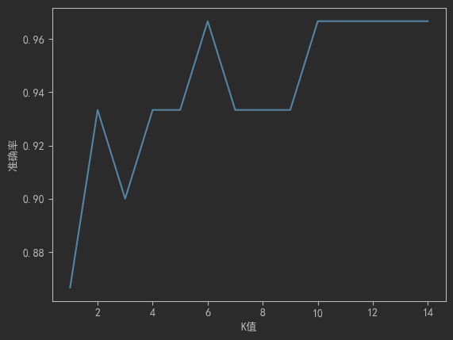

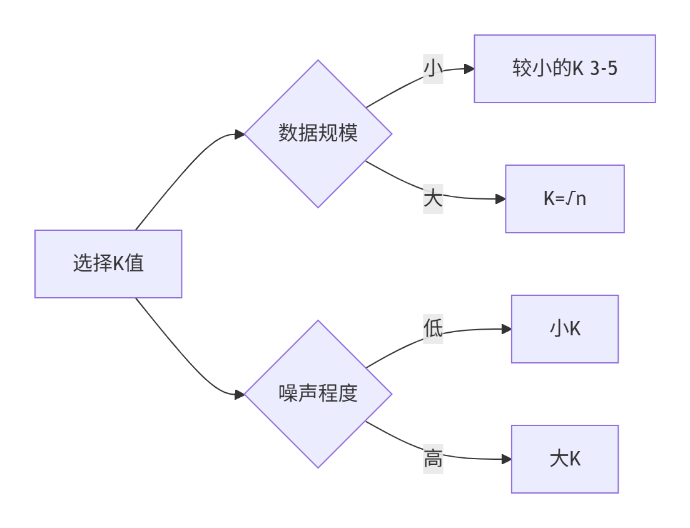 K值选择

* * *

## 4 KNN常用距离

| 
距离类型

 | 

公式

 | 

适用场景

 |
| --- | --- | --- |
| 

​**​欧氏距离​**​

 | 

√Σ(x\_i - y\_i)²

 | 

连续数值特征（最常用）

 |
| 

​**​曼哈顿距离​**​

 | 

Σ|x\_i - y\_i|

 | 

稀疏特征（如文本分类）

 |
| 

​**​余弦相似度​**​

 | 

(A·B)/(|A||B|)

 | 

方向差异＞大小差异（如推荐系统）

 |
| 

​**​闵可夫斯基距离​**​

 | 

(Σ|x\_i - y\_i|^p)^(1/p)

 | 

欧氏/曼哈顿的泛化形式

 |

> ​**​注​**​：公式中 `x_i`, `y_i`表示两个样本的第i个特征值

* * *

## 5 KNN优缺点

### 5.1 优缺点分析

**优点​**​：

✅ 简单直观，适合多分类

✅ 无需训练（实时学习）

✅ 耗时短 模型训练速度快

✅ 对数据分布无假设

✅ 对异常值不敏感

​**​缺点​**​：

❌ 预测速度慢（需遍历所有样本）

❌ 对异常值敏感

❌ 维度过高时效果差

❌ 需要大量内存存储数据

### 5.2 变体和演进

​**​距离加权KNN​**​： 给更近的邻居赋予更大权重

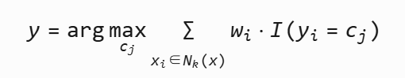

 权重 wi​=d(x,xi​)21​或 exp(−d(x,xi​))

​**​自适应KNN​**​：不同区域使用不同K值（密集区域用小K，稀疏区域用大K）

​**​KNN回归​**​：对连续目标的预测取近邻平均值

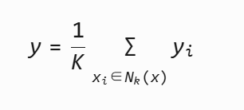

### 5.3 与其他模型的对比

| 
算法

 | 

训练速度

 | 

预测速度

 | 

适用场景

 | 

与KNN主要差异

 |
| --- | --- | --- | --- | --- |
| 

KNN

 | 

O(1)

 | 

O(n)

 | 

小规模数据、低维度

 | 

\-

 |
| 

决策树

 | 

O(n logn)

 | 

O(深度)

 | 

大规模数据

 | 

全局决策 vs 局部决策

 |
| 

SVM

 | 

O(n³)

 | 

O(支持向量数)

 | 

高维数据

 | 

最大边距超平面 vs 最近邻

 |
| 

神经网络

 | 

O(epoch×n)

 | 

O(层数)

 | 

复杂模式

 | 

特征自动提取 vs 原始特征距离

 |

* * *

## 6 项目使用

### 6.1 体验项目

```python
# 体验项目
from sklearn.neighbors import NearestNeighbors
import pandas as pd
import numpy as np
import matplotlib.pyplot as plt
from mpl_toolkits.mplot3d import Axes3D

plt.rcParams['font.sans-serif'] = ['SimHei'] # 用于正常显示中文标签
plt.rcParams['axes.unicode_minus'] = False # 用于正常显示负号

# 创建电影数据集 (用户评分矩阵)
movies = ['复仇者联盟', '泰坦尼克号', '盗梦空间', '肖申克的救赎', '阿凡达', '你的名字']
users = ['用户A', '用户B', '用户C', '用户D', '用户E']

# 创建用户评分矩阵 (范围1-5)
ratings = np.array([
    [5, 3, 4, 5, 2, 1],  # 用户A
    [1, 5, 2, 4, 5, 3],  # 用户B
    [4, 5, 5, 3, 4, 4],  # 用户C
    [2, 4, 3, 5, 1, 2],  # 用户D
    [3, 2, 5, 4, 5, 4]   # 用户E
])

# 转换为DataFrame
ratings_df = pd.DataFrame(ratings, index=users, columns=movies)

# 使用KNN查找相似用户
model = NearestNeighbors(metric='cosine', n_neighbors=2)
model.fit(ratings)

# 为"用户A"寻找相似用户
userA_ratings = ratings[0].reshape(1, -1)
distances, indices = model.kneighbors(userA_ratings, n_neighbors=3)

print(f"与用户A最相似的用户:")
similar_users = [users[i] for i in indices[0][1:]]  # 排除自己
print(similar_users)

# 基于相似用户做推荐
similar_users_ratings = ratings[indices[0][1:]]
recommendation_scores = similar_users_ratings.mean(axis=0)
recommendations = np.argsort(recommendation_scores)[::-1]

print("\n推荐给用户A的电影:")
for i in recommendations:
    if ratings[0, i] == 0:  # 未看过的电影
        print(f"- {movies[i]} (推荐指数: {recommendation_scores[i]:.2f})")

# 3D可视化用户评分空间
fig = plt.figure(figsize=(10, 8))
ax = fig.add_subplot(111, projection='3d')

# 使用PCA降维到3维进行可视化
pca = PCA(n_components=3)
ratings_3d = pca.fit_transform(ratings)

for i, user in enumerate(users):
    ax.scatter(ratings_3d[i, 0], ratings_3d[i, 1], ratings_3d[i, 2], s=100, label=user)

# 添加标签
ax.set_xlabel('维度1')
ax.set_ylabel('维度2')
ax.set_zlabel('维度3')
ax.set_title('用户评分空间分布')
plt.legend()
plt.show()
```


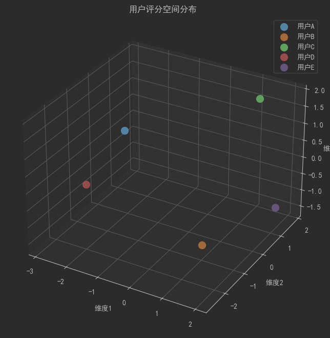

### 6.2 鸢尾花分类

```python
# 使用scikit-learn完成鸢尾花分类
from sklearn.datasets import load_iris
from sklearn.model_selection import train_test_split
from sklearn.preprocessing import StandardScaler
from sklearn.neighbors import KNeighborsClassifier

# 加载数据
iris = load_iris()
X, y = iris.data, iris.target

# 数据预处理（归一化）
scaler = StandardScaler()
X = scaler.fit_transform(X)

# 划分训练集/测试集
X_train, X_test, y_train, y_test = train_test_split(X, y, test_size=0.2)

# 创建KNN模型（K=5）
knn = KNeighborsClassifier(n_neighbors=5)
knn.fit(X_train, y_train)

# 评估模型
accuracy = knn.score(X_test, y_test)
print(f"准确率: {accuracy:.2f}")  # 输出: 0.93~0.97
```

### 6.3 拓展案例

```python
# 案例拓展
import numpy as np
from sklearn.datasets import make_classification
import matplotlib.pyplot as plt
from matplotlib.colors import ListedColormap

# 生成复杂数据集（同心圆）
X, y = make_classification(n_samples=500, n_features=2, n_redundant=0,
                           n_classes=3, n_clusters_per_class=1,
                           class_sep=0.8, random_state=4)

# 可视化决策边界函数
def plot_decision_boundary(k):
    cmap_light = ListedColormap(['#FFAAAA', '#AAFFAA', '#AAAAFF'])
    cmap_bold = ListedColormap(['#FF0000', '#00FF00', '#0000FF'])

    h = 0.02  # 网格步长
    # 创建网格
    x_min, x_max = X[:, 0].min() - 1, X[:, 0].max() + 1
    y_min, y_max = X[:, 1].min() - 1, X[:, 1].max() + 1
    xx, yy = np.meshgrid(np.arange(x_min, x_max, h),
                         np.arange(y_min, y_max, h))

    # 训练模型并预测
    knn = KNeighborsClassifier(n_neighbors=k)
    knn.fit(X, y)
    Z = knn.predict(np.c_[xx.ravel(), yy.ravel()])
    Z = Z.reshape(xx.shape)

    # 绘图
    plt.figure(figsize=(8, 6))
    plt.pcolormesh(xx, yy, Z, cmap=cmap_light, shading='auto')
    plt.scatter(X[:, 0], X[:, 1], c=y, cmap=cmap_bold, edgecolor='k', s=20)
    plt.xlim(xx.min(), xx.max())
    plt.ylim(yy.min(), yy.max())
    plt.title(f"KNN决策边界 (K={k})")
    plt.show()

# 观察K值对边界的影响
plot_decision_boundary(k=1)   # 过拟合：边界过于复杂
plot_decision_boundary(k=15)  # 欠拟合：边界过度平滑
plot_decision_boundary(k=7)   # 最佳平衡点
```

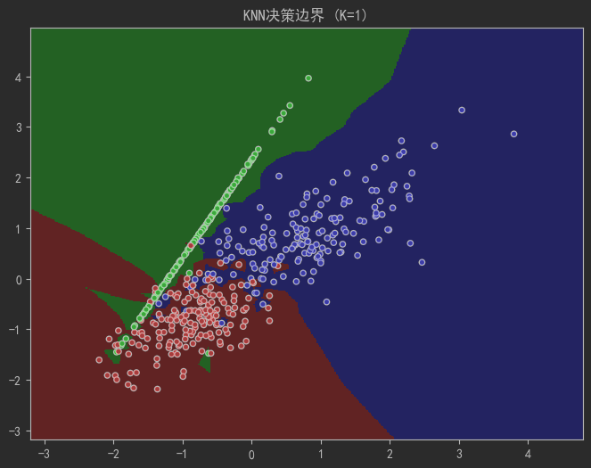

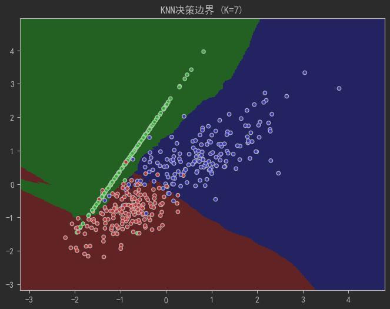

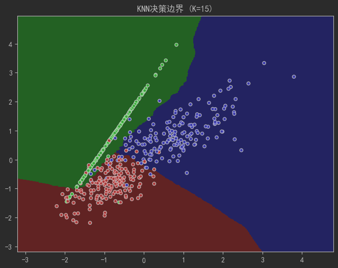

### 6.4 KD树加速查询

```python
# KD树加速查询
from sklearn.neighbors import KDTree, KNeighborsClassifier
import numpy as np
import time

# 生成测试数据（10000个样本，10维特征）
np.random.seed(42)
X_train = np.random.rand(10000, 10)
y_train = np.random.randint(0, 3, 10000)

# 普通KNN计算
start_time = time.time()
knn_normal = KNeighborsClassifier(n_neighbors=5)
knn_normal.fit(X_train, y_train)
normal_time = time.time() - start_time

# KDTree加速的KNN
start_time = time.time()
knn_kd = KNeighborsClassifier(
    n_neighbors=5,
    algorithm='kd_tree',  # 使用KD树算法
    leaf_size=30  # 叶子节点包含的最小样本数
)
knn_kd.fit(X_train, y_train)
kd_time = time.time() - start_time

print(f"普通KNN训练耗时: {normal_time:.4f}秒")
print(f"KD树加速后训练耗时: {kd_time:.4f}秒")
print(f"加速比: {normal_time/kd_time:.1f}倍")

# 测试查询速度
test_sample = np.random.rand(1, 10)

start_time = time.time()
knn_normal.predict(test_sample)
normal_pred_time = time.time() - start_time

start_time = time.time()
knn_kd.predict(test_sample)
kd_pred_time = time.time() - start_time

print(f"\n普通KNN预测耗时: {normal_pred_time:.6f}秒")
print(f"KD树预测耗时: {kd_pred_time:.6f}秒")
print(f"预测加速比: {normal_pred_time/kd_pred_time:.1f}倍")
```

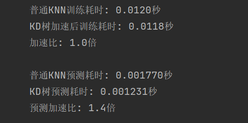

### 6.5 类别不平衡的加权KNN

```python
# 类别不平衡的加权KNN
from sklearn.neighbors import KNeighborsClassifier
from sklearn.datasets import make_classification
from sklearn.metrics import classification_report
import numpy as np

# 创建不平衡数据集（3类，比例10:2:1）
X, y = make_classification(
    n_samples=1300, n_classes=3, n_features=4,
    weights=[0.10, 0.15, 0.75], random_state=42
)

# 查看类别分布
print("类别分布:", np.bincount(y))

# 1. 普通KNN（未处理不平衡）
knn_normal = KNeighborsClassifier(n_neighbors=5)
knn_normal.fit(X, y)
print("\n[普通KNN分类报告]")
print(classification_report(y, knn_normal.predict(X)))

# 2. 距离加权KNN（权重与距离成反比）
knn_weighted = KNeighborsClassifier(
    n_neighbors=5,
    weights='distance'  # 距离加权
)
knn_weighted.fit(X, y)
print("\n[距离加权KNN分类报告]")
print(classification_report(y, knn_weighted.predict(X)))

# 3. 类别加权KNN + 距离加权
knn_class_weighted = KNeighborsClassifier(
    n_neighbors=5,
    weights='distance',
    class_weight='balanced'  # 类别平衡加权
)
knn_class_weighted.fit(X, y)
print("\n[类别加权+距离加权KNN分类报告]")
print(classification_report(y, knn_class_weighted.predict(X)))
```

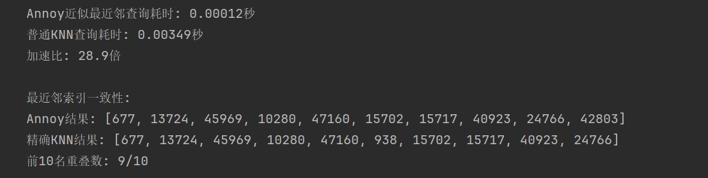

### 6.6 网格搜索超参数调优

```python
# 网络优化
from sklearn.neighbors import KNeighborsClassifier
from sklearn.datasets import load_iris
from sklearn.model_selection import GridSearchCV, train_test_split
from sklearn.preprocessing import StandardScaler
import matplotlib.pyplot as plt
import seaborn as sns

# 加载并预处理数据
iris = load_iris()
X, y = iris.data, iris.target
scaler = StandardScaler()
X_scaled = scaler.fit_transform(X)

# 参数网格配置
param_grid = {
    'n_neighbors': [3, 5, 7, 9, 11, 13],
    'weights': ['uniform', 'distance'],
    'metric': ['euclidean', 'manhattan', 'minkowski'],
    'p': [1, 2]  # 闵可夫斯基距离的参数
}

# 创建GridSearchCV对象
grid_search = GridSearchCV(
    KNeighborsClassifier(),
    param_grid,
    cv=5,  # 5折交叉验证
    scoring='accuracy',
    n_jobs=-1  # 使用所有CPU核心
)

# 执行网格搜索
grid_search.fit(X_scaled, y)

# 输出最佳参数
print(f"最佳参数组合: {grid_search.best_params_}")
print(f"最佳交叉验证准确率: {grid_search.best_score_:.4f}")

# 可视化参数性能热图
results = pd.DataFrame(grid_search.cv_results_)
top_results = results[results['param_weights'] == grid_search.best_params_['weights']]
pivot_table = top_results.pivot_table(
    values='mean_test_score',
    index='param_n_neighbors',
    columns='param_metric',
)

plt.figure(figsize=(10, 6))
sns.heatmap(pivot_table, annot=True, fmt=".3f", cmap="YlGnBu")
plt.title("参数性能热力图")
plt.xlabel("距离度量")
plt.ylabel("K值")
plt.show()
```

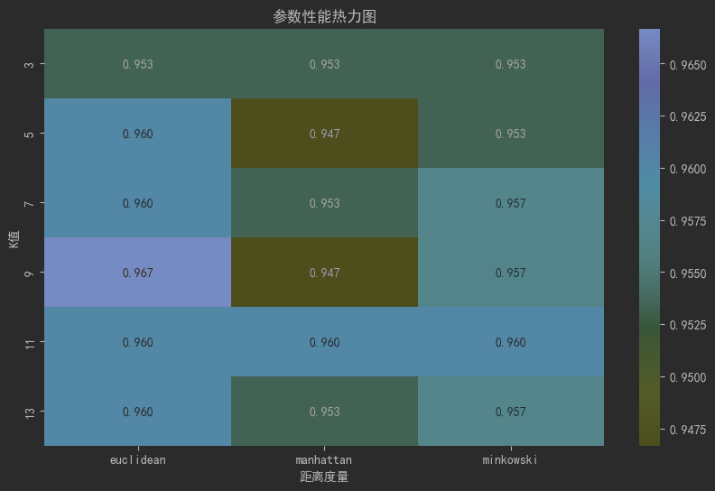

### 6.7 近似最近邻(ANN)与维度约减

```python
# 近似最近邻(ANN)与维度约减
from annoy import AnnoyIndex
from sklearn.decomposition import PCA
import numpy as np
import time

# 生成大规模测试数据（5万样本，50维）
np.random.seed(42)
X = np.random.randn(50000, 50)

# 1. PCA降维 (50维 -> 10维)
pca = PCA(n_components=10)
X_pca = pca.fit_transform(X)

# 2. 构建Annoy索引
num_trees = 20  # 构建的树数量（精度-速度权衡）
annoy_index = AnnoyIndex(X_pca.shape[1], 'euclidean')

# 添加所有向量到索引
for i, vec in enumerate(X_pca):
    annoy_index.add_item(i, vec)

# 构建索引
annoy_index.build(num_trees)

# 查询测试
test_vec = np.random.randn(10)
start_time = time.time()

# 查找10个最近邻
indices = annoy_index.get_nns_by_vector(test_vec, n=10)

annoy_time = time.time() - start_time
print(f"Annoy近似最近邻查询耗时: {annoy_time:.5f}秒")

# 对比原始KNN查询
start_time = time.time()
distances = np.linalg.norm(X_pca - test_vec, axis=1)
sorted_indices = np.argsort(distances)[:10]

knn_time = time.time() - start_time
print(f"普通KNN查询耗时: {knn_time:.5f}秒")
print(f"加速比: {knn_time/annoy_time:.1f}倍")

# 检查结果一致性
print("\n最近邻索引一致性:")
print("Annoy结果:", indices)
print("精确KNN结果:", sorted_indices.tolist())
print(f"前10名重叠数: {len(set(indices) & set(sorted_indices))}/10")
```

* * *
