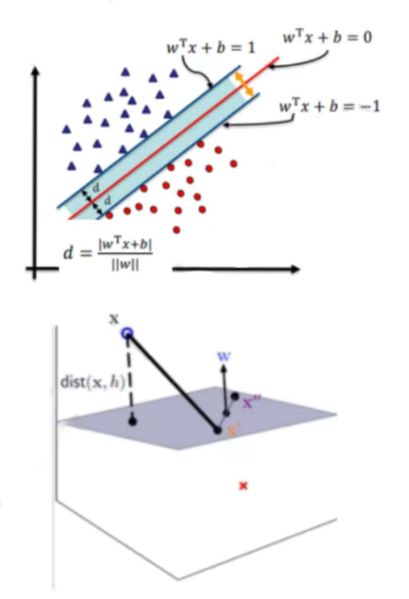
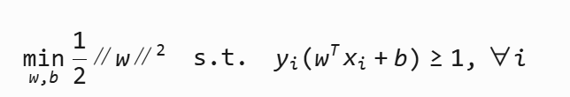
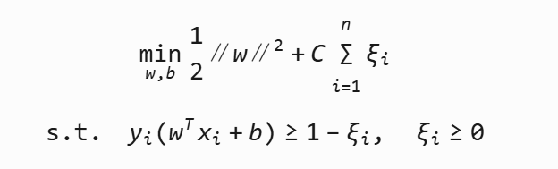
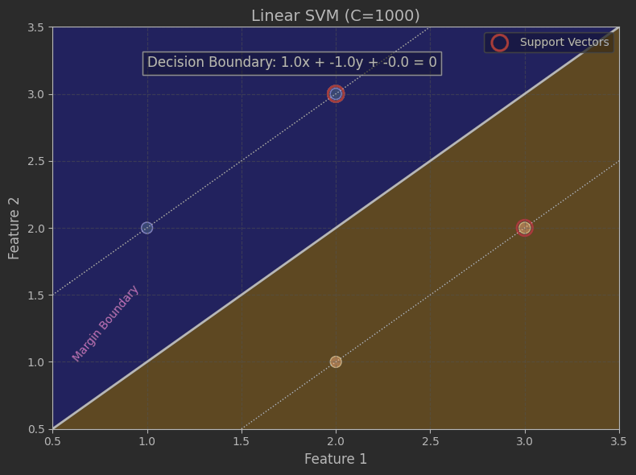
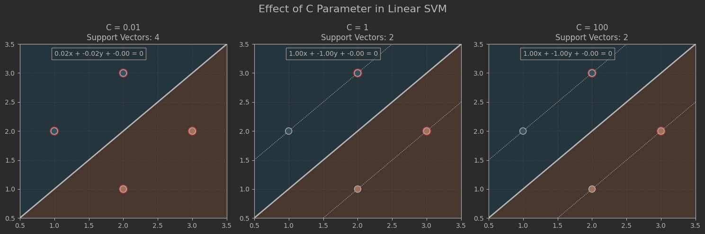
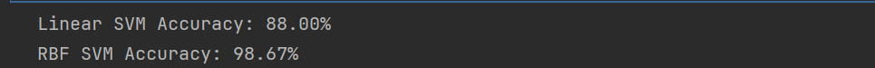
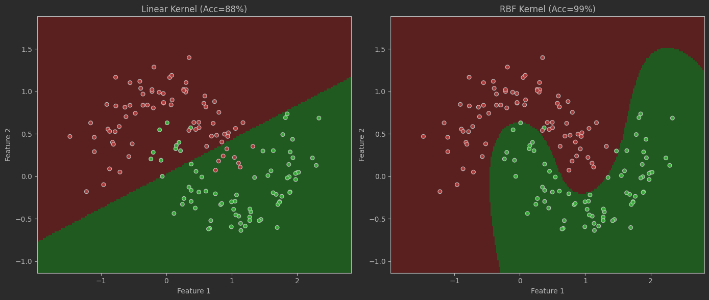
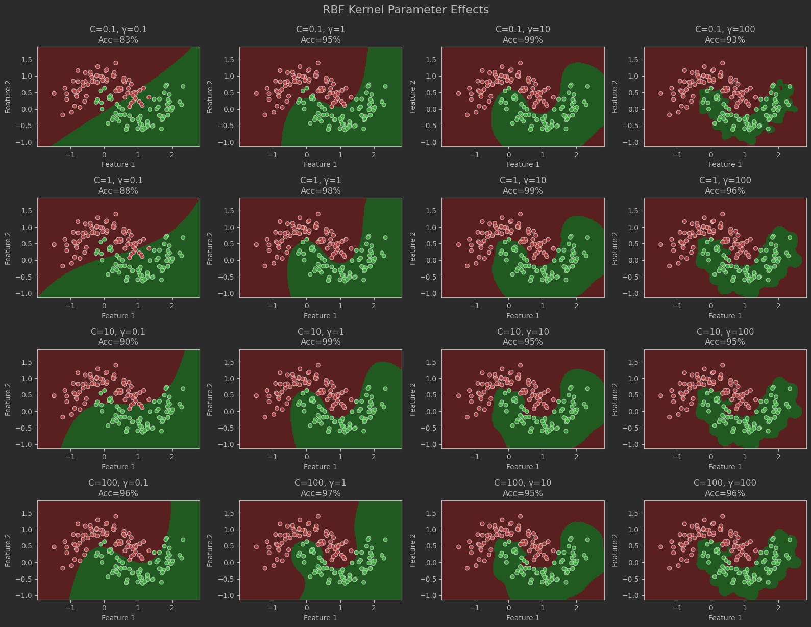

    本文系统介绍了支持向量机(SVM)的理论与实践。理论部分首先区分了线性可分与不可分问题，阐述了SVM通过寻找最优超平面实现分类的核心思想，包括支持向量、间隔最大化等关键概念。详细讲解了硬间隔与软间隔SVM的数学原理，以及核函数(线性核、多项式核、RBF核)在非线性问题中的应用。实践部分通过Python代码演示了SVM在不同场景下的应用：线性可分数据分类、参数C的调节效果、非线性数据分类中核函数的选择比较，并以信用卡欺诈检测为例，展示了网格搜索调参和模型评估的完整流程。最后总结了SVM在小样本、高维数据中的优势及其参数敏感的局限性。。

## 1 线性可分与线性不可分

        在分类任务中（二分类为典型代表），我们需要找到一个模型（或称为决策边界）来区分不同类别的数据点。

> ​**​线性可分：​**​ 如果存在一个​**​线性​**​的决策边界（在特征空间中表现为一条直线、一个平面或一个超平面），能够完美地将属于不同类别的数据点分隔开来（即所有正类样本在边界的一侧，所有负类样本在另一侧，没有样本被错误分类），那么我们称这个数据集在该特征空间中是​**​线性可分​**​的。
> 
> ​**​核心：​**​ 分类任务可以通过一个简单的线性模型（如线性函数）100%准确完成。

> ​**​线性不可分：​**​ 如果不存在任何一条直线、一个平面或一个超平面能够完美地将不同类别的数据点区分开来（即任何线性边界都会错误地分类至少一部分样本），那么我们称这个数据集在该特征空间中是​**​线性不可分​**​的。
> 
> ​**​核心：​**​ 无法仅用一个线性模型来获得完美的分类精度。需要一个更复杂的（通常是​**​非线性​**​的）模型来处理数据的分布。

        我们可以想象一张纸上有两种颜色的豆子，线性可分是可以用一支笔划一条直线分开两种颜色豆子。而线性不可分就是两种颜色豆子混杂在一起，无法划一条直线完全分开。

         而支持向量机（SVM）要解决的就是什么样的决策边界是最好的？特征数据本身如果就很难分，该怎么办？计算复杂度怎么样？能实际应用嘛？

* * *

## 2 SVM基本概念

> 支持向量机（SVM）是一类按**监督学习**方式对数进行二元分类的广义线性分类器

### 2.1 核心思想

  SVM的目标是找到一个​**​决策超平面​**​（Decision Hyperplane），不仅正确分类数据，还要确保该平面​**​距离最近的数据点最远​**​。

  假设我们是要在两国争议地带划界，需要满足：**公平性​**​：边界离两国最近的村庄距离相等（分类准确）。**安全性​**​：边界离两国领土尽可能远（最大化间隔），**这就是SVM的追求​**​。

### 2.2 关键组成

| 术语 | 数学意义 | 生活比喻 |
| --- | --- | --- |
| ​**​超平面​**​ | $w\cdot x&plus;b=0$ | 划界的“墙” |
| ​**​支持向量​**​ | 离超平面最近的样本点 | 边界上的“争议村庄” |
| ​**​间隔​**​ | $\frac{2}{||W||}$ | 边界到村庄的安全距离 |

* * *

## 3 SVM距离定义

这些理论和内容已经有完整的数学体系 不进行深入的学习和介绍。知其然即可

超平面可以用一个线性方程来描述： $W^{_{T}}x&plus;b=0$ 。在二维空间点（x,y）到直线Ax + By + C = 0的距离为：$\tfrac{Ax&plus;By&plus;C}{\sqrt{A^{2}&plus;B^{2}}}$ 扩展到n维空间后点x = （x1,x2,...,xn）到直线 $W^{_{T}}x&plus;b=0$ 的距离为： $\left \| w \right \| = \sqrt{w_{1}^{2} &plus; ... &plus; w_{n}^{2}}$    $\frac{1}{\left \| W \right \|}|W^{_{T}}x&plus;b|$



* * *

## 4 SVM决策面

根据支持向量的定义，我们知道，支持向量到超平面的距离为d。其他点到超面的距离大于d，我们暂且令d为1。于是我们得到：

$\left\{\begin{matrix} \frac{W^{_{T}}x&plus;b }{|w|} \geqslant d& y = 1\\ \frac{W^{_{T}}x&plus;b }{|w|} \leq -d& y =- 1 \end{matrix}\right.$

* * *

## 5 SVM优化目标

使用的拉格朗日乘子算法条件进行了优化



* * *

## 6 SVM软间隔

​**​**由于噪音数据或轻微线性不可分导致找不到完美分隔。**因此**引入松弛变量 ξi​，允许少量错误。



 C为惩罚参数，C越大，对分类的惩罚就越大。

* * *

## 7 SVM核变换

核函数 将样本从原始空间映射到一个更高维的特质空间中，使得样本在新的空间中线性可分

| 核函数 | 公式 | 特点 |
| --- | --- | --- |
| 线性核 | xiT​xj​ | 不进行高维映射 |
| 多项式核 | (γxiT​xj​+r)d | 可调阶数 d |
| RBF核 | exp(−γ∥xi​−xj​∥2) | 最常用，非线性强 |

* * *

##  8 练习使用

上述内容基本都是理论和实际公式以及推导的一些内容，还是直接使用代码使用来强化使用和参数调整的学习

线性可分的数据

```python
import numpy as np
import matplotlib.pyplot as plt
from sklearn.svm import SVC

# ===== 1. 数据准备 =====
X = np.array([
    [1, 2],  # 负类点1
    [2, 3],  # 负类点2
    [2, 1],  # 正类点1
    [3, 2]   # 正类点2
])
y = np.array([-1, -1, 1, 1])  # 前两个负类，后两个正类

# ===== 2. 模型训练 =====
model = SVC(kernel='linear', C=1000)
model.fit(X, y)

# ===== 3. 可视化修复 =====
plt.figure(figsize=(8, 6))

# 先绘制数据点 (先创建坐标系)
plt.scatter(X[:, 0], X[:, 1], c=y, s=100, cmap=plt.cm.Paired,
            edgecolor='k', marker='o')

# 设置坐标轴范围 (显式设定确保边界完整)
plt.xlim(0.5, 3.5)  # 覆盖所有X值
plt.ylim(0.5, 3.5)  # 覆盖所有Y值

# 生成网格点 (基于当前坐标系范围)
ax = plt.gca()
xlim = ax.get_xlim()
ylim = ax.get_ylim()

xx = np.linspace(xlim[0], xlim[1], 100)
yy = np.linspace(ylim[0], ylim[1], 100)
YY, XX = np.meshgrid(yy, xx)
xy = np.vstack([XX.ravel(), YY.ravel()]).T

# 计算决策函数值
Z = model.decision_function(xy).reshape(XX.shape)

# 关键修复：使用contourf填充背景展示决策效果
# 填充决策区域（更直观显示分类）
plt.contourf(XX, YY, Z, levels=[-np.inf, 0, np.inf],
             alpha=0.3, colors=['blue', 'orange'])

# 绘制决策边界和间隔线（三种线型区分）
plt.contour(XX, YY, Z, colors='k',
            levels=[-1, 0, 1],
            linestyles=[':', '-', ':'],
            linewidths=[1, 2, 1])

# 标记支持向量（红框突出显示）
plt.scatter(model.support_vectors_[:, 0],
           model.support_vectors_[:, 1],
           s=200, facecolors='none',
           edgecolors='red', linewidths=2,
           label='Support Vectors')

# 添加决策边界公式（数学展示）
w = model.coef_[0]
b = model.intercept_[0]
boundary_text = f'Decision Boundary: {w[0]:.1f}x + {w[1]:.1f}y + {b:.1f} = 0'
plt.text(1.0, 3.2, boundary_text, fontsize=12, bbox=dict(facecolor='white', alpha=0.7))

# 添加间隔线说明
plt.text(0.6, 1.0, 'Margin Boundary', fontsize=10, color='purple', rotation=50)

# 添加标题和标签
plt.title(f"Linear SVM (C={model.C})", fontsize=14)
plt.xlabel("Feature 1", fontsize=12)
plt.ylabel("Feature 2", fontsize=12)
plt.grid(True, linestyle='--', alpha=0.4)
plt.legend()

plt.tight_layout()
plt.show()
```



SVM调整

```python
import numpy as np
import matplotlib.pyplot as plt
from sklearn.svm import SVC

# 统一数据集
X = np.array([
    [1, 2], [2, 3], [2, 1], [3, 2]
])
y = np.array([-1, -1, 1, 1])

# 确定全局坐标范围（所有子图统一）
x_min, x_max = 0.5, 3.5
y_min, y_max = 0.5, 3.5

# 创建高密度网格（固定范围）
xx = np.linspace(x_min, x_max, 200)
yy = np.linspace(y_min, y_max, 200)
XX, YY = np.meshgrid(xx, yy)
grid_points = np.c_[XX.ravel(), YY.ravel()]

# 不同C值对比实验
C_values = [0.01, 1, 100]
plt.figure(figsize=(15, 5))

for i, C_val in enumerate(C_values):
    # 训练不同C值的模型
    model = SVC(kernel='linear', C=C_val)
    model.fit(X, y)

    # 计算决策函数值
    Z = model.decision_function(grid_points).reshape(XX.shape)

    # 绘制子图
    ax = plt.subplot(1, 3, i+1)

    # 绘制决策区域背景（辅助观察）
    ax.pcolormesh(XX, YY, np.sign(Z), cmap=plt.cm.Paired, alpha=0.2)

    # 绘制决策边界（3条线）
    ax.contour(XX, YY, Z, colors='k',
               levels=[-1, 0, 1],
               linestyles=[':', '-', ':'],
               linewidths=[1, 2, 1])

    # 标记支持向量
    ax.scatter(model.support_vectors_[:, 0], model.support_vectors_[:, 1],
               s=150, facecolors='none', edgecolors='red',
               linewidths=1.5, label='Support Vectors')

    # 绘制数据点
    ax.scatter(X[:, 0], X[:, 1], c=y, s=100, cmap=plt.cm.Paired,
               edgecolors='k', zorder=10)

    # 统一范围设置
    ax.set_xlim(x_min, x_max)
    ax.set_ylim(y_min, y_max)

    # 添加标题和网格
    ax.set_title(f"C = {C_val}\nSupport Vectors: {len(model.support_vectors_)}")
    ax.grid(True, linestyle='--', alpha=0.3)

    # 添加决策边界公式
    w = model.coef_[0]
    b = model.intercept_[0]
    equation = f"{w[0]:.2f}x + {w[1]:.2f}y + {b:.2f} = 0"
    ax.text(1.0, 3.3, equation, fontsize=10,
            bbox=dict(facecolor='white', alpha=0.7))

# 添加主标题
plt.suptitle("Effect of C Parameter in Linear SVM", fontsize=16, y=0.98)
plt.tight_layout()
plt.show()
```



非线性数据

```python
# 非线性数据分类
from sklearn.datasets import make_moons
from sklearn.model_selection import train_test_split
import matplotlib.pyplot as plt
from matplotlib.colors import ListedColormap

# ===== 1. 生成非线性数据 =====
'''
参数说明：
- noise=0.2：20%的噪声（控制数据混杂度）
- random_state=42：固定随机种子
'''
X, y = make_moons(n_samples=500, noise=0.2, random_state=42)

# ===== 2. 数据分割 =====
X_train, X_test, y_train, y_test = train_test_split(
    X, y,
    test_size=0.3,      # 30%测试集
    random_state=42
)

# ===== 3. 线性核表现 =====
linear_svm = SVC(kernel='linear', C=0.1)
linear_svm.fit(X_train, y_train)
lin_score = linear_svm.score(X_test, y_test)
print(f"Linear SVM Accuracy: {lin_score:.2%}")  # ~55-65%

# ===== 4. RBF核表现 =====
rbf_svm = SVC(kernel='rbf', gamma=1, C=10)
rbf_svm.fit(X_train, y_train)
rbf_score = rbf_svm.score(X_test, y_test)
print(f"RBF SVM Accuracy: {rbf_score:.2%}")  # ~90-95%

# ===== 5. 可视化函数 =====
def plot_decision_boundary(model, X, y, title):
    # 生成网格
    h = 0.02  # 网格步长
    x_min, x_max = X[:, 0].min()-0.5, X[:, 0].max()+0.5
    y_min, y_max = X[:, 1].min()-0.5, X[:, 1].max()+0.5
    xx, yy = np.meshgrid(np.arange(x_min, x_max, h),
                         np.arange(y_min, y_max, h))

    # 预测网格分类
    Z = model.predict(np.c_[xx.ravel(), yy.ravel()])
    Z = Z.reshape(xx.shape)

    # 创建配色
    cmap_light = ListedColormap(['#FFAAAA', '#AAFFAA'])
    cmap_bold = ListedColormap(['#FF0000', '#00FF00'])

    # 绘制决策区域
    plt.pcolormesh(xx, yy, Z, cmap=cmap_light, alpha=0.8)
    # 绘制数据点
    plt.scatter(X[:, 0], X[:, 1], c=y,
                cmap=cmap_bold, s=30, edgecolor='k')

    plt.xlim(xx.min(), xx.max())
    plt.ylim(yy.min(), yy.max())
    plt.title(title)
    plt.xlabel("Feature 1")
    plt.ylabel("Feature 2")

# ===== 6. 对比可视化 =====
plt.figure(figsize=(14, 6))

plt.subplot(121)
plot_decision_boundary(linear_svm, X_test, y_test,
                      f"Linear Kernel (Acc={lin_score:.0%})")

plt.subplot(122)
plot_decision_boundary(rbf_svm, X_test, y_test,
                      f"RBF Kernel (Acc={rbf_score:.0%})")

plt.tight_layout()
plt.show()
```



SVM优化

```python
# 参数调整
# RBF核参数网格分析
plt.figure(figsize=(16, 12))
C_values = [0.1, 1, 10, 100]
gamma_values = [0.1, 1, 10, 100]

for i, C in enumerate(C_values):
    for j, gamma in enumerate(gamma_values):
        # 训练模型
        model = SVC(kernel='rbf', C=C, gamma=gamma)
        model.fit(X_train, y_train)
        acc = model.score(X_test, y_test)

        # 绘制子图
        plt.subplot(4, 4, i*4 + j+1)
        plot_decision_boundary(model, X_test, y_test,
                              f"C={C}, γ={gamma}\nAcc={acc:.0%}")
        plt.grid(False)

plt.tight_layout()
plt.suptitle("RBF Kernel Parameter Effects", y=1.02, fontsize=16)
plt.show()
```



* * *

**实战案例：信用卡欺诈检测的SVM优化分析**

**案例概述**

使用SVM进行信用卡欺诈检测任务，通过对比不同核函数和参数设置对模型性能的影响，展示在实际场景中如何优化SVM模型。使用Kaggle经典数据集Credit Card Fraud Detection。

**数据集特点**

-   ​**​规模​**​：284,807笔交易（492笔欺诈交易，占比0.172%）
-   ​**​特征​**​：28个匿名V变量(V1-V28) + 金额 + 时间
-   ​**​挑战​**​：极度不平衡数据（欺诈仅占0.172%）

**代码实现**

```python
import numpy as np
import pandas as pd
import matplotlib.pyplot as plt
import seaborn as sns
from sklearn.model_selection import train_test_split, GridSearchCV
from sklearn.preprocessing import StandardScaler
from sklearn.svm import SVC
from sklearn.metrics import (confusion_matrix, classification_report,
                             precision_recall_curve, PrecisionRecallDisplay,
                             roc_curve, roc_auc_score, f1_score)
from imblearn.over_sampling import SMOTE
from imblearn.pipeline import Pipeline

# 设置随机种子
np.random.seed(42)

# 1. 数据加载与准备
df = pd.read_csv('creditcard.csv')

# 2. 特征工程
# 创建时间特征
df['hour'] = (df['Time'] % 86400) // 3600

# 3. 数据标准化
scaler = StandardScaler()
df[['Amount', 'Time']] = scaler.fit_transform(df[['Amount', 'Time']])

# 4. 处理类别不平衡（使用SMOTE）
X = df.drop('Class', axis=1)
y = df['Class']

# 5. 数据分割
X_train, X_test, y_train, y_test = train_test_split(
    X, y, test_size=0.3, stratify=y, random_state=42
)

print(f"训练集形状: {X_train.shape}, 测试集形状: {X_test.shape}")
print(f"训练集欺诈比例: {y_train.mean():.6f}, 测试集欺诈比例: {y_test.mean():.6f}")
#%%
# 创建建模流水线
pipeline = Pipeline([
    ('smote', SMOTE(random_state=42)),  # 处理类别不平衡
    ('clf', SVC(class_weight='balanced', probability=True))  # 设置类别权重
])

# 定义参数网格
param_grid = [
    {
        'clf__kernel': ['linear'],
        'clf__C': [0.01, 0.1, 1, 10, 100]
    },
    {
        'clf__kernel': ['rbf'],
        'clf__C': [0.01, 0.1, 1, 10, 100],
        'clf__gamma': [0.001, 0.01, 0.1, 1]
    },
    {
        'clf__kernel': ['poly'],
        'clf__C': [0.01, 0.1, 1, 10],
        'clf__gamma': [0.001, 0.01, 0.1],
        'clf__degree': [2, 3]
    }
]

# 执行网格搜索
grid_search = GridSearchCV(
    pipeline, 
    param_grid,
    scoring='f1',
    cv=3,
    n_jobs=-1,
    verbose=1
)

grid_search.fit(X_train, y_train)

# 输出最佳参数
print("Best parameters:", grid_search.best_params_)
print("Best F1 score:", grid_search.best_score_)

# 在测试集上评估最佳模型
best_model = grid_search.best_estimator_
y_pred = best_model.predict(X_test)

print("\nClassification Report:")
print(classification_report(y_test, y_pred))

print("\nConfusion Matrix:")
print(confusion_matrix(y_test, y_pred))

# 保存评估结果
results_df = pd.DataFrame({
    'Model': [f"{params['clf__kernel']}_C{params['clf__C']}" + 
              (f"_γ{params.get('clf__gamma', '')}" if 'clf__gamma' in params else '') + 
              (f"_d{params.get('clf__degree', '')}" if 'clf__degree' in params else '') 
              for params in grid_search.cv_results_['params']],
    'F1_Score': grid_search.cv_results_['mean_test_score'],
    'Parameters': grid_search.cv_results_['params']
})
#%%
plt.figure(figsize=(18, 12))

# 1. F1分数比较柱状图
plt.subplot(2, 2, 1)
sns.barplot(
    y='F1_Score',
    x='Model',
    data=results_df.sort_values('F1_Score', ascending=False).head(10),
    palette='viridis'
)
plt.xticks(rotation=45, ha='right')
plt.title('Top 10 SVM Models by F1 Score')
plt.xlabel('Model Configuration')
plt.ylabel('F1 Score')

# 2. 混淆矩阵热力图
plt.subplot(2, 2, 2)
cm = confusion_matrix(y_test, y_pred)
sns.heatmap(cm, annot=True, fmt='d', cmap='Blues',
            xticklabels=['Legit', 'Fraud'],
            yticklabels=['Legit', 'Fraud'])
plt.title('Confusion Matrix - Best Model')
plt.xlabel('Predicted')
plt.ylabel('Actual')

# 3. ROC曲线比较
plt.subplot(2, 2, 3)
# 绘制不同模型的ROC曲线
model_combinations = [
    ('Linear (C=0.1)', SVC(kernel='linear', C=0.1, probability=True, class_weight='balanced')),
    ('RBF (C=1, γ=0.1)', SVC(kernel='rbf', C=1, gamma=0.1, probability=True, class_weight='balanced')),
    ('Poly (C=10, γ=0.01, d=3)', SVC(kernel='poly', C=10, gamma=0.01, degree=3, probability=True, class_weight='balanced')),
    ('Best Model', best_model)
]

for name, model in model_combinations:
    model.fit(X_train, y_train)
    y_proba = model.predict_proba(X_test)[:, 1]
    fpr, tpr, _ = roc_curve(y_test, y_proba)
    auc = roc_auc_score(y_test, y_proba)
    plt.plot(fpr, tpr, label=f'{name} (AUC={auc:.3f})')

plt.plot([0, 1], [0, 1], 'k--')
plt.xlabel('False Positive Rate')
plt.ylabel('True Positive Rate')
plt.title('ROC Curve Comparison')
plt.legend(loc='lower right')

# 4. 精确率-召回率曲线
plt.subplot(2, 2, 4)
PrecisionRecallDisplay.from_predictions(
    y_test, best_model.predict_proba(X_test)[:, 1],
    name=f"Best Model (F1={f1_score(y_test, y_pred):.3f})"
)
plt.title('Precision-Recall Curve')
plt.grid(True)

plt.tight_layout()
plt.savefig('svm_comparison.png', dpi=300)
plt.show()
```

* * *

## 9 小结

​**​SVM优点​**​：高维有效、泛化能力强、鲁棒性好（尤其适合中小数据集）。

​**​SVM缺点​**​：对参数敏感、大规模训练慢、需要特征缩放。

​**​核心记忆点​**​：

> ​**​间隔最大化 → 支持向量 → 对偶问题 → 核技巧 → 软间隔​**​

通过调参工具（如网格搜索 `GridSearchCV`）和核函数选择，SVM能灵活应对线性与非线性问题。
