>  决策树是一种通过树形结构进行数据分类或回归的直观算法，其核心是通过层级决策路径模拟规则推理。主要算法包括：ID3算法基于信息熵和信息增益选择划分属性；C4.5算法改进ID3，引入增益率和剪枝技术解决多值特征偏差；CART算法采用二叉树结构，支持分类（基尼系数）与回归（方差）任务。信用卡欺诈检测案例实践展示了全流程应用：通过SMOTE处理样本不平衡，转换时间特征及标准化数值完成数据预处理；利用网格搜索优化模型参数，可视化特征重要性与树结构；设置动态阈值平衡误报与漏报率，最终部署为实时检测系统并定期更新模型。该案例验证了决策树在复杂业务场景中的解释性与工程落地价值。

## 1 案例导学

想象你玩“20个问题”猜动物游戏：

问1：是哺乳动物吗？→ 是

问2：有尾巴吗？→ 是

问3：生活在水中吗？→ 否

...

最后得出​**​答案是狗​🐕**​

决策树就是一套自动生成这种“问题流程”的算法，专治选择困难症！

* * *

## 2 决策树

> 决策树（Decision Tree），它是一种以树形数据结构来展示决策规则和分类结果的模型，作为一种**归纳学习算法**，其重点是将看似无序、杂乱的已知数据，通过某种技术手段将它们转化成可以预测未知数据的树状模型，每一条从根结点（对最终分类结果贡献最大的属性）到叶子结点（最终分类结果）的路径都代表一条决策的规则。

当构建好决策树后，那么分类和预测的任务就很简单了，只需要走一遍就可以了，那么难点就在于如何构造出一棵树。

**构建流程**

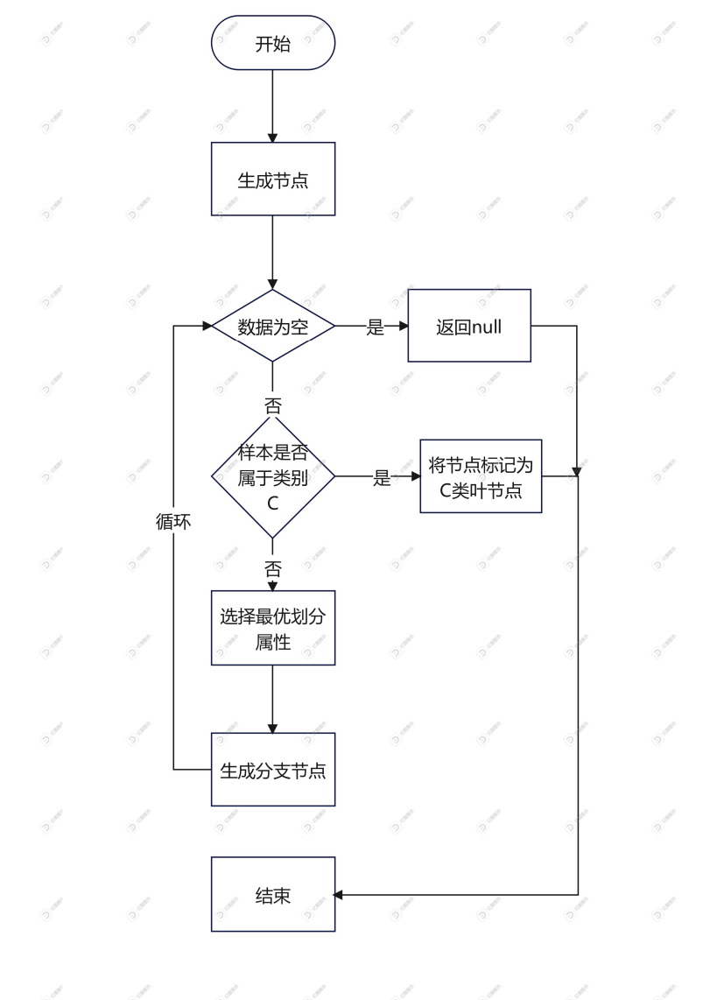

1.  首先从开始位置，将所有数据划分到一个节点，即根节点。
2.  然后经历橙色的两个步骤，橙色的表示判断条件：
3.  若数据为空集，跳出循环。如果该节点是根节点，返回null；如果该节点是中间节点，将该节点标记为训练数据中类别最多的类
4.  若样本都属于同一类，跳出循环，节点标记为该类别；
5.  如果经过橙色标记的判断条件都没有跳出循环，则考虑对该节点进行划分。既然是算法，则不能随意的进行划分，要讲究效率和精度，选择当前条件下的最优属性划分（什么是最优属性，这是决策树的重点，后面会详细解释）
6.  经历上步骤划分后，生成新的节点，然后循环判断条件，不断生成新的分支节点，直到所有节点都跳出循环。
7.  结束。这样便会生成一棵决策树。

在执行决策树生成的过程中，我们发现寻找最优划分属性是决策树过程中的重点。那么如何在众多的属性中选择最优的呢？下面我们学习三种算法。

* * *

## 3 ID3算法

> ID3算法最早是由罗斯昆于1975提出的一种决策树构建算法，算法的核心是“信息熵”。该算法是以信息论为基础，以**信息增益**为衡量标准，从而实现对数据的归纳分类。而实际的算法流程是计算每个属性的信息增益，并选取具有最高增益的属性作为给定的测试属性。

### 3.1 信息熵 

熵就是表示随机变量不确定性的度量，物体内部的混乱程度。熵越大，系统越混乱。

信息熵公式如下：

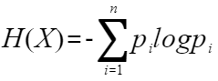

> ​**​X：​**​ 代表一个​**​离散随机变量​**​，它有 `n`个可能的结果（或状态）。例如：抛硬币的结果（正、反），掷骰子的点数（1到6），明天天气的类型（晴、雨、阴等），一个英文文本中的字母。
> 
> ​**​pᵢ：​**​ 代表随机变量 `X`取第 `i`个可能结果发生的​**​概率​**​。例如，抛一枚公平硬币，p(正面) = p(反面) = 0.5。掷一个公平骰子，p(点数为k) = 1/6。
> 
> ​**​∑ (i=1 到 n)：​**​ 表示对所有可能的结果（从1到n）进行求和。
> 
> ​**​log：​**​ 通常取​**​以2为底的对数 (log₂)​**​。单位是​**​比特 (bit)​**​。有时也取自然对数 (ln)，单位是​**​纳特 (nat)​**​。
> 
> ​**​pᵢ log pᵢ：​**​ 这一项衡量了​**​单个结果 i 所贡献的“惊奇度”或“信息量”​**​。注意，因为概率 `pᵢ`在0到1之间，所以 `log pᵢ`是负数（或零）。因此，我们加了一个负号 `-`。
> 
> ​**​- pᵢ log pᵢ：​**​ 负号使这个量变成了​**​非负数​**​。`pᵢ log pᵢ`本身是个负值（因为概率小于等于1，其对数小于等于0），加上负号后就变成了正值。​**​`-pᵢ log pᵢ`可以理解为结果 `i`发生所能提供的期望信息量（基于其概率）。​**​
> 
> ​**​H(X)：​**​ 对所有可能结果的 `-pᵢ log pᵢ`求和，得到的就是 ​**​X 的熵 `H(X)`。它代表了描述随机变量 `X`（平均意义上）所需要的最小信息量（以比特或纳特为单位），或者更根本地说，是 `X`本身的平均不确定性的度量。​**

信息熵就是“万物皆有其不确定性的数学度量”。它告诉我们，要描述一个不确定的东西，平均最少要多少信息。这个数字越大，那件事情就越“难猜”，越“出乎意料”。从扔硬币到宇宙的复杂度，信息熵为我们理解随机性和信息本身提供了一个强有力的量化工具。​

我们按照某一个属性对数据进行划分以后，得到第二个信息熵。

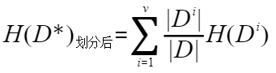

了解了信息熵以后，我们接下来认识一下信息增益。 

### 3.2 信息增益

**信息增益：**表示特征X使得类Y的不确定性减少的程度，分类后的专一性，希望分类后的结果是同类在一起。


其实就是划分前的信息熵减去划分后的信息熵。其中a代表的此次划分中所使用的属性。决策树使用信息增益准则来选择最优划分属性的话，在划分前会针对每个属性都计算信息增益，选择能使得信息增益最大的属性作为最优划分属性。

### 3.3 代码实现

以“是否适合打网球”为例子简单实现一下使用ID3的决策树

```python
# 使用ID3算法
import numpy as np
import math
from collections import Counter

class Node:
    """决策树节点类"""
    def __init__(self, feature=None, value=None, results=None, children=None):
        self.feature = feature  # 分割特征的索引
        self.value = value      # 特征值（用于判断分支）
        self.results = results  # 叶节点的分类结果
        self.children = children # 子节点字典{特征值: 节点}

def entropy(data):
    """计算数据集的信息熵"""
    labels = [row[-1] for row in data]
    label_counts = Counter(labels)
    probs = [count / len(labels) for count in label_counts.values()]
    return -sum(p * math.log2(p) for p in probs)

def split_data(data, feature_index, value):
    """按指定特征分割数据集"""
    return [row for row in data if row[feature_index] == value]

def information_gain(data, feature_index):
    """计算特征的信息增益"""
    base_entropy = entropy(data)
    feature_values = {row[feature_index] for row in data}
    
    new_entropy = 0.0
    for value in feature_values:
        subset = split_data(data, feature_index, value)
        prob = len(subset) / len(data)
        new_entropy += prob * entropy(subset)
        
    return base_entropy - new_entropy

def find_best_feature(data):
    """寻找信息增益最大的特征"""
    best_gain = 0.0
    best_feature = -1
    # 最后1列是标签，所以特征索引是0到len-2
    for feature_index in range(len(data[0]) - 1):
        gain = information_gain(data, feature_index)
        if gain > best_gain:
            best_gain = gain
            best_feature = feature_index
    return best_feature

def build_tree(data, feature_names):
    """递归构建决策树"""
    # 如果所有样本属于同一类别，返回叶节点
    labels = [row[-1] for row in data]
    if len(set(labels)) == 1:
        return Node(results=labels[0])
    
    # 选择最佳分割特征
    best_feature_idx = find_best_feature(data)
    if best_feature_idx == -1:  # 如果没有特征可选
        majority_label = Counter(labels).most_common(1)[0][0]
        return Node(results=majority_label)
    
    # 递归构建子树
    feature_name = feature_names[best_feature_idx]
    unique_vals = {row[best_feature_idx] for row in data}
    children = {}
    for value in unique_vals:
        subset = split_data(data, best_feature_idx, value)
        children[value] = build_tree(subset, feature_names)
    
    return Node(feature=feature_name, children=children)

def print_tree(node, indent=""):
    """打印决策树结构"""
    if node.results is not None:
        print(indent + "结果:", node.results)
    else:
        print(indent + "特征:", node.feature)
        for value, child in node.children.items():
            print(indent + "├── 分支:", value)
            print_tree(child, indent + "│   ")

# 数据集格式: [Outlook, Temperature, Humidity, Windy, PlayTennis]
data = [
    ['Sunny', 'Hot', 'High', 'Weak', 'No'],
    ['Sunny', 'Hot', 'High', 'Strong', 'No'],
    ['Overcast', 'Hot', 'High', 'Weak', 'Yes'],
    ['Rain', 'Mild', 'High', 'Weak', 'Yes'],
    ['Rain', 'Cool', 'Normal', 'Weak', 'Yes'],
    ['Rain', 'Cool', 'Normal', 'Strong', 'No'],
    ['Overcast', 'Cool', 'Normal', 'Strong', 'Yes'],
    ['Sunny', 'Mild', 'High', 'Weak', 'No'],
    ['Sunny', 'Cool', 'Normal', 'Weak', 'Yes'],
    ['Rain', 'Mild', 'Normal', 'Weak', 'Yes'],
    ['Sunny', 'Mild', 'Normal', 'Strong', 'Yes'],
    ['Overcast', 'Mild', 'High', 'Strong', 'Yes'],
    ['Overcast', 'Hot', 'Normal', 'Weak', 'Yes'],
    ['Rain', 'Mild', 'High', 'Strong', 'No']
]

feature_names = ['Outlook', 'Temperature', 'Humidity', 'Windy']

# 构建决策树
decision_tree = build_tree(data, feature_names)

# 打印决策树
print("构建的决策树结构:")
print_tree(decision_tree)
```

> 构建的决策树结构:  
> 特征: Outlook  
> ├── 分支: Overcast  
> │   结果: Yes  
> ├── 分支: Rain  
> │   特征: Windy  
> │   ├── 分支: Weak  
> │   │   结果: Yes  
> │   ├── 分支: Strong  
> │   │   结果: No  
> ├── 分支: Sunny  
> │   特征: Humidity  
> │   ├── 分支: Normal  
> │   │   结果: Yes  
> │   ├── 分支: High  
> │   │   结果: No

### 3.4 优缺点分析

#### ​3.4.1 优点**​​**​

1.  ​**​直观易理解 ​**​决策树结构直观反映了特征重要性（根节点即最重要特征）
2.  ​**​计算复杂度较低​**​ 训练时间复杂度为O(n \* d \* log n)，n为样本数，d为特征数
3.  ​**​不需要数据预处理​**​ 天然支持离散特征（连续特征需离散化）能自动处理多类别问题
4.  ​**​特征选择能力强​**​ 使用信息增益自动选择重要特征

#### 3.4.2 ​**​缺点** ​

1.  ​**​过拟合风险高​**​ 会不断分裂直到完美拟合训练数据 对噪声敏感，容易学习到训练数据中的随机波动
2.  ​**​倾向选择多值特征​**​ 信息增益偏向选择取值更多的特征（更多分支导致熵减少更多）
3.  ​**​不直接支持连续特征​**​ 需要预处理将连续特征离散化
4.  ​**​缺少全局优化​**​  采用贪心算法（每次选局部最优特征），非全局最优树 对数据小变化敏感.
5.  ​**​类别不平衡问题​**​信息增益在类别不平衡数据中可能偏差

* * *

## 4 C4.5算法

> C4.5算法是ID3算法的改进。用**信息增益率**来选择属性。在决策树构造过程中进行减枝，可以对非离散数据和不完整的数据进行处理。

我们想象你在商场做促销活动策划，现在有两个选择：

-   选择1：按会员卡号分组 → 每组1人（信息增益最大）
    
-   选择2：按消费等级分组 → 每组人数适中
    

ID3会选方案1，因为每个会员都是"纯分组"，但这实际毫无价值！C4.5就是为了解决这种问题而诞生的。

### 4.1 增益率

​**​增益率公式：​**​

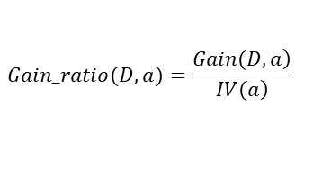

其中分裂信息：

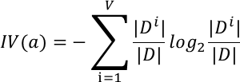

> ​**​通俗理解​**​：
> 
> 原始信息增益是"奖励"，分裂信息是"惩罚"（当特征取值过多时惩罚加重）
> 
> 就像公司发奖金时，既要看业绩（增益），也要考虑工作难度系数（分裂信息）

### 4.2  剪枝技术

C4.5采用​**​悲观错误剪枝(PEP)​**​：

1.  计算节点误差上限：
    

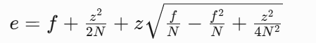

1.  比较子树和叶节点的预期误差
    
2.  当剪枝后预期误差不增加时，剪掉子树
    

> ✂️ ​**​剪枝哲学​**​：
> 
> "与其保留可能出错的分支，不如当机立断截肢"

### 4.3 代码实现

```python
# 使用c4.5算法
import numpy as np
import math
from collections import Counter

class Node:
    """决策树节点类（C4.5版本）"""
    def __init__(self, feature=None, threshold=None, value=None, results=None, children=None):
        self.feature = feature      # 分割特征名称
        self.threshold = threshold  # 连续特征的分割阈值（仅用于连续特征）
        self.value = value          # 特征值（用于离散特征分支判断）
        self.results = results      # 叶节点的分类结果
        self.children = children     # 子节点字典{特征值/区间: 节点}

class C45DecisionTree:
    """C4.5决策树实现"""
    def __init__(self, min_samples_split=2, max_depth=5):
        self.min_samples_split = min_samples_split  # 最小分裂样本数
        self.max_depth = max_depth                  # 树的最大深度
        self.root = None                            # 决策树根节点
        self.feature_types = {}                     # 存储特征类型（离散/连续）

    def fit(self, data, feature_names, target_name):
        """构建决策树"""
        self._determine_feature_types(data, feature_names)
        self.root = self._build_tree(data, feature_names, target_name, depth=0)

    def _determine_feature_types(self, data, feature_names):
        """确定特征类型（离散/连续）"""
        for i, name in enumerate(feature_names):
            # 尝试转换为数值，如果成功则为连续特征
            try:
                float(data[0][i])
                self.feature_types[name] = 'continuous'
            except ValueError:
                self.feature_types[name] = 'categorical'

    def _entropy(self, data):
        """计算数据集的信息熵"""
        labels = [row[-1] for row in data]
        label_counts = Counter(labels)
        probs = [count / len(labels) for count in label_counts.values()]
        return -sum(p * math.log2(p) if p > 0 else 0 for p in probs)

    def _split_information(self, data, feature_index):
        """计算特征的分裂信息（用于增益率计算）"""
        feature_values = [row[feature_index] for row in data]

        # 连续特征处理
        if isinstance(feature_values[0], (int, float)):
            return 1  # 连续特征分裂信息设为1，简化处理

        # 离散特征计算分裂信息
        value_counts = Counter(feature_values)
        total = len(feature_values)
        return -sum((count/total) * math.log2(count/total) for count in value_counts.values())

    def _gain_ratio(self, data, feature_index):
        """计算特征的增益率（C4.5核心改进）"""
        base_entropy = self._entropy(data)
        feature_values = [row[feature_index] for row in data]
        total = len(data)

        # 连续特征处理 - 寻找最佳分割点
        if isinstance(feature_values[0], (int, float)):
            sorted_values = sorted(set(feature_values))
            best_gain = 0
            best_threshold = None

            # 检查所有可能的分割点
            for i in range(1, len(sorted_values)):
                threshold = (sorted_values[i-1] + sorted_values[i]) / 2
                below = [row for row in data if row[feature_index] <= threshold]
                above = [row for row in data if row[feature_index] > threshold]

                if len(below) == 0 or len(above) == 0:
                    continue

                new_entropy = (len(below)/total) * self._entropy(below) + \
                              (len(above)/total) * self._entropy(above)

                gain = base_entropy - new_entropy
                if gain > best_gain:
                    best_gain = gain
                    best_threshold = threshold

            # 避免除以0
            split_info = self._split_information(data, feature_index)
            return best_gain, best_threshold, best_gain / split_info if split_info > 0 else 0

        # 离散特征处理
        value_counts = Counter(feature_values)
        new_entropy = 0.0
        for value, count in value_counts.items():
            subset = [row for row in data if row[feature_index] == value]
            new_entropy += (count / total) * self._entropy(subset)

        gain = base_entropy - new_entropy
        split_info = self._split_information(data, feature_index)
        return gain, None, gain / split_info if split_info > 0 else 0

    def _find_best_feature(self, data, feature_names):
        """使用增益率寻找最佳特征"""
        best_gain_ratio = -1
        best_feature_idx = -1
        best_threshold = None

        for i in range(len(data[0]) - 1):
            gain, threshold, gain_ratio = self._gain_ratio(data, i)

            # 当增益为0时跳过，避免无意义分裂
            if gain > 0 and gain_ratio > best_gain_ratio:
                best_gain_ratio = gain_ratio
                best_feature_idx = i
                best_threshold = threshold

        return best_feature_idx, best_threshold

    def _build_tree(self, data, feature_names, target_name, depth=0):
        """递归构建决策树（增加停止条件）"""
        # 停止条件1: 所有样本属于同一类别
        labels = [row[-1] for row in data]
        if len(set(labels)) == 1:
            return Node(results=labels[0])

        # 停止条件2: 无特征可用或样本数过少
        if len(data[0]) == 1 or len(data) < self.min_samples_split:
            majority_label = Counter(labels).most_common(1)[0][0]
            return Node(results=majority_label)

        # 停止条件3: 达到最大深度
        if depth >= self.max_depth:
            majority_label = Counter(labels).most_common(1)[0][0]
            return Node(results=majority_label)

        # 选择最佳分割特征
        best_feature_idx, best_threshold = self._find_best_feature(data, feature_names)

        # 停止条件4: 找不到合适的分裂特征
        if best_feature_idx == -1:
            majority_label = Counter(labels).most_common(1)[0][0]
            return Node(results=majority_label)

        feature_name = feature_names[best_feature_idx]
        children = {}

        # 连续特征分割
        if self.feature_types[feature_name] == 'continuous' and best_threshold is not None:
            # 创建两个分支：小于等于阈值 和 大于阈值
            below = [row for row in data if row[best_feature_idx] <= best_threshold]
            above = [row for row in data if row[best_feature_idx] > best_threshold]

            children[f"≤{best_threshold:.2f}"] = self._build_tree(
                below, feature_names, target_name, depth+1
            )
            children[f">{best_threshold:.2f}"] = self._build_tree(
                above, feature_names, target_name, depth+1
            )

            return Node(
                feature=feature_name,
                threshold=best_threshold,
                children=children
            )

        # 离散特征分割
        unique_vals = {row[best_feature_idx] for row in data}
        for value in unique_vals:
            subset = [row for row in data if row[best_feature_idx] == value]
            if subset:  # 确保子集不为空
                children[value] = self._build_tree(
                    subset, feature_names, target_name, depth+1
                )

        return Node(feature=feature_name, children=children)

    def predict(self, sample, feature_names):
        """预测单个样本"""
        node = self.root
        while node.children is not None:
            feature_idx = feature_names.index(node.feature)

            # 连续特征处理
            if node.threshold is not None:
                if sample[feature_idx] <= node.threshold:
                    node = node.children[f"≤{node.threshold:.2f}"]
                else:
                    node = node.children[f">{node.threshold:.2f}"]
            # 离散特征处理
            else:
                value = sample[feature_idx]
                if value in node.children:
                    node = node.children[value]
                else:
                    # 处理未见过的特征值 - 使用默认子节点
                    node = list(node.children.values())[0]

        return node.results

    def print_tree(self, node=None, indent="", feature_names=None):
        """打印决策树结构（优化可读性）"""
        if node is None:
            node = self.root
            print("决策树结构:")

        if node.results is not None:
            print(indent + "结果:", node.results)
        else:
            # 处理连续特征显示
            if node.threshold is not None:
                print(indent + f"特征: {node.feature} (阈值={node.threshold:.2f})")
                for value, child in node.children.items():
                    print(indent + "├── 分支:", value)
                    self.print_tree(child, indent + "│   ", feature_names)
            # 处理离散特征
            else:
                print(indent + f"特征: {node.feature}")
                children_items = list(node.children.items())
                for i, (value, child) in enumerate(children_items):
                    prefix = "├──" if i < len(children_items)-1 else "└──"
                    print(indent + prefix + " 分支:", value)
                    self.print_tree(child, indent + ("│   " if i < len(children_items)-1 else "    "), feature_names)

# 示例数据集（添加数值型特征）
# 数据集格式: [Outlook, Temperature, Humidity, WindSpeed, PlayTennis]
data = [
    ['Sunny', 85, 85, 10, 'No'],
    ['Sunny', 88, 90, 15, 'No'],
    ['Overcast', 83, 86, 8, 'Yes'],
    ['Rain', 75, 80, 5, 'Yes'],
    ['Rain', 68, 65, 5, 'Yes'],
    ['Rain', 65, 70, 17, 'No'],
    ['Overcast', 64, 65, 12, 'Yes'],
    ['Sunny', 72, 95, 6, 'No'],
    ['Sunny', 69, 70, 5, 'Yes'],
    ['Rain', 75, 80, 5, 'Yes'],
    ['Sunny', 72, 60, 18, 'Yes'],
    ['Overcast', 81, 75, 16, 'Yes'],
    ['Overcast', 88, 60, 7, 'Yes'],
    ['Rain', 76, 75, 15, 'No']
]

feature_names = ['Outlook', 'Temperature', 'Humidity', 'WindSpeed']
target_name = 'PlayTennis'

# 创建并训练C4.5决策树
tree = C45DecisionTree(min_samples_split=3, max_depth=3)
tree.fit(data, feature_names, target_name)

# 打印决策树
tree.print_tree()

# 预测示例
sample = ['Sunny', 80, 90, 12]
prediction = tree.predict(sample, feature_names)
print(f"\n预测样本 {sample} -> {prediction}")
```

决策树结构:  
特征: Humidity (阈值=88.00)  
├── 分支: ≤88.00  
│   特征: WindSpeed (阈值=9.00)  
│   ├── 分支: ≤9.00  
│   │   结果: Yes  
│   ├── 分支: >9.00  
│   │   特征: Humidity (阈值=67.50)  
│   │   ├── 分支: ≤67.50  
│   │   │   结果: Yes  
│   │   ├── 分支: >67.50  
│   │   │   结果: No  
├── 分支: >88.00  
│   结果: No

预测样本 \['Sunny', 80, 90, 12\] -> No

###  4.4 优缺点分析

| 
特性

 | 

ID3

 | 

C4.5

 |
| --- | --- | --- |
| 

​**​分裂准则​**​

 | 

信息增益

 | 

增益率

 |
| 

​**​特征类型​**​

 | 

仅离散值

 | 

支持连续值

 |
| 

​**​缺失值处理​**​

 | 

不支持

 | 

支持缺失值（分布式处理）

 |
| 

​**​剪枝技术​**​

 | 

无

 | 

悲观剪枝法

 |
| 

​**​多值特征偏好​**​

 | 

严重

 | 

有效缓解

 |
| 

​**​应用场景​**​

 | 

小型数据集

 | 

中等规模数据集

 |
| 

​**​计算复杂度​**​

 | 

低

 | 

中等（需排序连续值）

 |
| 

​**​过拟合风险​**​

 | 

高

 | 

中等（通过剪枝控制）

 |

**适用场景**

1.  混合型数据（连续值+离散值）
    
2.  特征重要性分析
    
3.  需要可视化决策逻辑的场景
    
4.  中等规模数据集（<10万条）
    

**主要局限​**​：

1.  对高维数据计算效率低
    
2.  预剪枝可能导致欠拟合
    
3.  内存消耗较大
    
4.  多分类任务可能过于复杂
    

> "了解C4.5，就掌握了决策树进化的关键钥匙" —— 这就是为什么它仍是机器学习课程的核心内容！

* * *

## 5 CarT算法

> CART（Classification and Regression Trees）是既能解决分类问题又能处理回归任务的二叉树模型。与ID3和C4.5不同，CART有两大革命性创新：

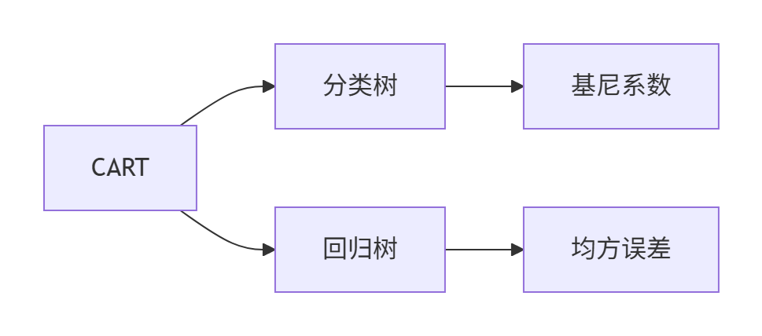

-   每个节点只做二选一决策（是/否）
    
-   即使面对多分类特征，也通过二分法处理（如"颜色=红色?是→其他颜色?是→..."）
    
-   结构更简单，预测路径更清晰
    

### 5.1 分类树

**基尼系数**

> 基尼系数（Gini Index）是决策树（特别是CART算法）中用于衡量数据不纯度（Impurity）的核心指标

基尼系数可以理解为：​**​随机抽取两个样本，其类别不一致的概率​。**想象你把不同颜色的弹珠倒进一个盒子：

-   如果全是红色弹珠→基尼=0（完全纯净）
    
-   红蓝绿各占1/3→基尼=1-3×(1/3)²=0.67（高度混乱）
    

而CarT算法的目标：每次分裂让盒子里的弹珠颜色尽量统一！

基尼系数公式：

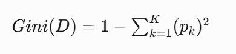

​​基尼增益计算​​：

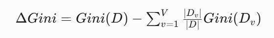

```python
def gini_impurity(labels):
    """计算基尼不纯度"""
    counter = Counter(labels)
    impurity = 1.0
    for count in counter.values():
        prob = count / len(labels)
        impurity -= prob ** 2
    return impurity

def best_split(X, y):
    """寻找最佳分割点（基于基尼系数）"""
    best_gain = -1
    best_feature = None
    best_threshold = None
    
    for feature_idx in range(X.shape[1]):
        # 对连续特征排序
        thresholds = np.unique(X[:, feature_idx])
        
        for threshold in thresholds:
            # 根据阈值分割数据集
            left_indices = X[:, feature_idx] <= threshold
            right_indices = ~left_indices
            
            # 计算左右子集的基尼不纯度
            gini_left = gini_impurity(y[left_indices])
            gini_right = gini_impurity(y[right_indices])
            
            # 加权平均
            n_left = len(y[left_indices])
            n_right = len(y[right_indices])
            weighted_gini = (n_left * gini_left + n_right * gini_right) / len(y)
            
            # 基尼增益 = 父节点不纯度 - 子节点加权不纯度
            gain = gini_impurity(y) - weighted_gini
            
            if gain > best_gain:
                best_gain = gain
                best_feature = feature_idx
                best_threshold = threshold
    
    return best_feature, best_threshold
```

### 5.2 回归树

当对于连续值进行预测的时候，CART切换到回归模式：

核心公式

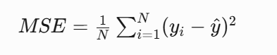

**分裂策略​**​：

1.  对每个特征寻找最佳切分点s
    
2.  计算分裂后的样本方差
    
3.  选择使方差减少最多的(s)：
    

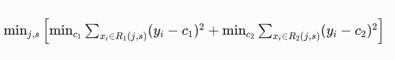

### 5.3 代码实现

```python
# CarT算法实现
import numpy as np
import math
from collections import Counter

class Node:
    """CART决策树节点类"""
    def __init__(self, feature=None, threshold=None, value=None,
                 left=None, right=None, results=None):
        self.feature = feature      # 分割特征名称
        self.threshold = threshold  # 分割阈值（用于连续特征）
        self.value = value          # 特征值（用于离散特征）
        self.left = left            # 左子树
        self.right = right          # 右子树
        self.results = results      # 叶节点的结果（分类时为类别，回归时为预测值）

class CARTDecisionTree:
    """CART决策树实现（支持分类和回归）"""
    def __init__(self, min_samples_split=2, max_depth=5, task='classification'):
        """
        参数:
        min_samples_split: 最小分裂样本数
        max_depth: 树的最大深度
        task: 'classification' 或 'regression'
        """
        self.min_samples_split = min_samples_split
        self.max_depth = max_depth
        self.task = task
        self.root = None
        self.feature_types = {}

    def fit(self, X, y, feature_names):
        """构建决策树"""
        data = np.column_stack([X, y])
        self._determine_feature_types(data, feature_names)
        self.root = self._build_tree(data, feature_names, depth=0)

    def _determine_feature_types(self, data, feature_names):
        """确定特征类型（离散/连续）"""
        for i, name in enumerate(feature_names):
            try:
                float(data[0][i])
                self.feature_types[name] = 'continuous'
            except ValueError:
                self.feature_types[name] = 'categorical'

    def _calculate_impurity(self, data):
        """计算不纯度（基尼系数或方差）"""
        target_values = [row[-1] for row in data]

        if self.task == 'classification':
            # 分类任务使用基尼系数
            counts = Counter(target_values)
            impurity = 1.0
            for count in counts.values():
                prob = count / len(target_values)
                impurity -= prob ** 2
            return impurity
        else:
            # 回归任务使用方差
            mean = np.mean([float(val) for val in target_values])
            variance = np.mean([(float(val) - mean) ** 2 for val in target_values])
            return variance

    def _find_best_split(self, data, feature_idx, feature_type):
        """为单个特征寻找最佳分割点"""
        best_gain = -float('inf')
        best_threshold = None
        best_left_indices = None
        best_right_indices = None
        values = [row[feature_idx] for row in data]
        target_values = [row[-1] for row in data]

        if feature_type == 'continuous':
            # 连续特征处理
            unique_vals = sorted(set(float(val) for val in values))

            # 检查所有可能的分割点
            for i in range(1, len(unique_vals)):
                threshold = (unique_vals[i-1] + unique_vals[i]) / 2
                left_indices = []
                right_indices = []

                for j, val in enumerate(values):
                    if float(val) <= threshold:
                        left_indices.append(j)
                    else:
                        right_indices.append(j)

                if not left_indices or not right_indices:
                    continue

                # 计算不纯度减少量
                gain = self._calculate_split_gain(
                    data, left_indices, right_indices, target_values
                )

                if gain > best_gain:
                    best_gain = gain
                    best_threshold = threshold
                    best_left_indices = left_indices
                    best_right_indices = right_indices

        else:
            # 离散特征处理（二值分裂）
            unique_vals = set(values)

            for val in unique_vals:
                left_indices = []
                right_indices = []

                for j, v in enumerate(values):
                    if v == val:
                        left_indices.append(j)
                    else:
                        right_indices.append(j)

                if not left_indices or not right_indices:
                    continue

                # 计算不纯度减少量
                gain = self._calculate_split_gain(
                    data, left_indices, right_indices, target_values
                )

                if gain > best_gain:
                    best_gain = gain
                    best_threshold = val
                    best_left_indices = left_indices
                    best_right_indices = right_indices

        return best_gain, best_threshold, best_left_indices, best_right_indices

    def _calculate_split_gain(self, data, left_indices, right_indices, target_values):
        """计算分裂带来的不纯度减少量"""
        n = len(data)
        n_left = len(left_indices)
        n_right = len(right_indices)

        # 计算父节点的不纯度
        parent_impurity = self._calculate_impurity(data)

        # 获取左右子树的数据
        left_data = [data[i] for i in left_indices]
        right_data = [data[i] for i in right_indices]

        # 计算左右子树的不纯度
        left_impurity = self._calculate_impurity(left_data)
        right_impurity = self._calculate_impurity(right_data)

        # 计算加权平均不纯度
        weighted_impurity = (n_left / n) * left_impurity + (n_right / n) * right_impurity

        # 增益 = 父节点不纯度 - 子节点加权不纯度
        return parent_impurity - weighted_impurity

    def _find_best_split_feature(self, data, feature_names):
        """寻找最佳分裂特征和分割点"""
        best_gain = -float('inf')
        best_feature_idx = None
        best_threshold = None
        best_left_indices = None
        best_right_indices = None

        for i, name in enumerate(feature_names):
            feature_type = self.feature_types[name]
            gain, threshold, left_indices, right_indices = self._find_best_split(
                data, i, feature_type
            )

            if gain > best_gain:
                best_gain = gain
                best_feature_idx = i
                best_threshold = threshold
                best_left_indices = left_indices
                best_right_indices = right_indices

        return best_feature_idx, best_threshold, best_left_indices, best_right_indices

    def _build_tree(self, data, feature_names, depth=0):
        """递归构建决策树"""
        # 停止条件1: 所有样本目标值相同
        target_values = [row[-1] for row in data]
        if len(set(target_values)) == 1:
            return Node(results=target_values[0])

        # 停止条件2: 达到最大深度或样本数不足
        if depth >= self.max_depth or len(data) < self.min_samples_split:
            return self._create_leaf_node(data)

        # 寻找最佳分割点
        best_feature_idx, best_threshold, left_indices, right_indices = self._find_best_split_feature(
            data, feature_names
        )

        # 如果找不到有效的分裂点
        if best_feature_idx is None or left_indices is None or right_indices is None:
            return self._create_leaf_node(data)

        # 获取左右子树的数据
        left_data = [data[i] for i in left_indices]
        right_data = [data[i] for i in right_indices]

        # 创建当前节点
        node = Node(
            feature=feature_names[best_feature_idx],
            threshold=best_threshold,
            left=self._build_tree(left_data, feature_names, depth+1),
            right=self._build_tree(right_data, feature_names, depth+1)
        )

        return node

    def _create_leaf_node(self, data):
        """创建叶节点（根据任务类型返回不同结果）"""
        target_values = [row[-1] for row in data]

        if self.task == 'classification':
            # 分类任务：返回多数类别
            most_common = Counter(target_values).most_common(1)
            return Node(results=most_common[0][0])
        else:
            # 回归任务：返回平均值
            return Node(results=np.mean([float(val) for val in target_values]))

    def predict(self, sample, feature_names):
        """预测单个样本"""
        return self._traverse_tree(sample, self.root, feature_names)

    def _traverse_tree(self, sample, node, feature_names):
        """递归遍历决策树进行预测"""
        # 到达叶节点
        if node.results is not None:
            return node.results

        # 获取特征索引
        feature_idx = feature_names.index(node.feature)

        # 根据特征类型处理
        if self.feature_types[node.feature] == 'continuous':
            # 连续特征：与阈值比较
            if float(sample[feature_idx]) <= float(node.threshold):
                return self._traverse_tree(sample, node.left, feature_names)
            else:
                return self._traverse_tree(sample, node.right, feature_names)
        else:
            # 离散特征：检查是否等于阈值
            if sample[feature_idx] == node.threshold:
                return self._traverse_tree(sample, node.left, feature_names)
            else:
                return self._traverse_tree(sample, node.right, feature_names)

    def print_tree(self, node=None, indent="", feature_names=None):
        """打印决策树结构"""
        if node is None:
            node = self.root
            print("CART决策树结构:")

        if node.results is not None:
            print(indent + "结果:", node.results)
        else:
            if self.feature_types[node.feature] == 'continuous':
                print(indent + f"特征: {node.feature} (阈值={node.threshold:.2f})")
            else:
                print(indent + f"特征: {node.feature} (值={node.threshold})")

            print(indent + "├── 左子树:")
            self.print_tree(node.left, indent + "│   ", feature_names)

            print(indent + "└── 右子树:")
            self.print_tree(node.right, indent + "    ", feature_names)

# 分类任务示例
print("==== 分类任务示例 ====")
# 数据集格式: [Outlook, Temperature, Humidity, WindSpeed, PlayTennis]
X = [
    ['Sunny', 85, 85, 10],
    ['Sunny', 88, 90, 15],
    ['Overcast', 83, 86, 8],
    ['Rain', 75, 80, 5],
    ['Rain', 68, 65, 5],
    ['Rain', 65, 70, 17],
    ['Overcast', 64, 65, 12],
    ['Sunny', 72, 95, 6],
    ['Sunny', 69, 70, 5],
    ['Rain', 75, 80, 5],
    ['Sunny', 72, 60, 18],
    ['Overcast', 81, 75, 16],
    ['Overcast', 88, 60, 7],
    ['Rain', 76, 75, 15]
]
y = ['No', 'No', 'Yes', 'Yes', 'Yes', 'No', 'Yes', 'No', 'Yes', 'Yes', 'Yes', 'Yes', 'Yes', 'No']
feature_names = ['Outlook', 'Temperature', 'Humidity', 'WindSpeed']

# 创建并训练CART分类树
class_tree = CARTDecisionTree(min_samples_split=3, max_depth=3, task='classification')
class_tree.fit(X, y, feature_names)

# 打印决策树
class_tree.print_tree(feature_names=feature_names)

# 预测示例
sample = ['Sunny', 80, 90, 12]
prediction = class_tree.predict(sample, feature_names)
print(f"\n预测样本 {sample} -> {prediction}")

# 回归任务示例
print("\n==== 回归任务示例 ====")
# 房价预测数据集: [房间数, 面积(m²), 房龄(年), 房价(万元)]
X = [
    [3, 85, 10],
    [4, 88, 5],
    [2, 83, 20],
    [3, 75, 15],
    [4, 68, 8],
    [3, 65, 25],
    [3, 64, 18],
    [2, 72, 10],
    [1, 69, 30],
    [4, 75, 5],
    [3, 72, 12],
    [5, 81, 7],
    [3, 88, 3],
    [2, 76, 22]
]
y = [200, 240, 180, 190, 210, 175, 170, 185, 150, 250, 195, 280, 270, 165]
feature_names = ['房间数', '面积', '房龄']

# 创建并训练CART回归树
reg_tree = CARTDecisionTree(min_samples_split=2, max_depth=4, task='regression')
reg_tree.fit(X, y, feature_names)

# 打印决策树
reg_tree.print_tree(feature_names=feature_names)

# 预测示例
sample = [3, 80, 12]
prediction = reg_tree.predict(sample, feature_names)
print(f"\n预测样本 {sample} -> 房价: {prediction:.2f}万元")
```

\==== 分类任务示例 ====  
CART决策树结构:  
特征: Humidity (阈值=88.00)  
├── 左子树:  
│   特征: WindSpeed (阈值=9.00)  
│   ├── 左子树:  
│   │   结果: Yes  
│   └── 右子树:  
│       特征: Outlook (值=Overcast)  
│       ├── 左子树:  
│       │   结果: Yes  
│       └── 右子树:  
│           结果: No  
└── 右子树:  
    结果: No

预测样本 \['Sunny', 80, 90, 12\] -> No

\==== 回归任务示例 ====  
CART决策树结构:  
特征: 房龄 (阈值=7.50)  
├── 左子树:  
│   特征: 房间数 (阈值=4.50)  
│   ├── 左子树:  
│   │   特征: 房间数 (阈值=3.50)  
│   │   ├── 左子树:  
│   │   │   结果: 270  
│   │   └── 右子树:  
│   │       特征: 面积 (阈值=81.50)  
│   │       ├── 左子树:  
│   │       │   结果: 250  
│   │       └── 右子树:  
│   │           结果: 240  
│   └── 右子树:  
│       结果: 280  
└── 右子树:  
    特征: 房龄 (阈值=16.50)  
    ├── 左子树:  
    │   特征: 房间数 (阈值=3.50)  
    │   ├── 左子树:  
    │   │   特征: 房间数 (阈值=2.50)  
    │   │   ├── 左子树:  
    │   │   │   结果: 185  
    │   │   └── 右子树:  
    │   │       结果: 195.0  
    │   └── 右子树:  
    │       结果: 210  
    └── 右子树:  
        特征: 房间数 (阈值=1.50)  
        ├── 左子树:  
        │   结果: 150  
        └── 右子树:  
            特征: 面积 (阈值=79.50)  
            ├── 左子树:  
            │   结果: 170.0  
            └── 右子树:  
                结果: 180

预测样本 \[3, 80, 12\] -> 房价: 195.00万元

### 5.4 优缺点分析

**核心优势​**​：

1\. 双重任务能力 业界唯一同时支持分类和回归的决策树 统一框架简化模型选型

2\. 二叉树效率革命 决策路径复杂度：O(log₂n) vs 其他决策树的O(n) 更快的预测速度

3\. 优秀的剪枝机制  代价复杂度剪枝有效控制过拟合 惩罚系数α提供精细调节

4\. 特征处理全能王 自动处理连续/离散特征 无缩放要求，鲁棒性强

​**​主要局限​**​：

1\. 二元分裂限制 对多分类特征需要多次分裂 可能创建冗余分支

2\. 贪心算法缺陷 局部最优但不保证全局最优 对分裂顺序敏感

3\. 高方差问题  小数据集易过拟合 需依赖剪枝和集成方法

4\. 解释性折衷  比单棵树的逻辑回归难解释 多路径分析复杂

* * *

## 6 案例使用

**信用卡欺诈检测**

下面是一个完整的信用卡欺诈检测案例，使用决策树算法识别可疑交易。该案例包含详细的数据预处理、模型训练、评估和可视化步骤。

```python
import numpy as np
import pandas as pd
import matplotlib.pyplot as plt
import seaborn as sns
from sklearn.model_selection import train_test_split, GridSearchCV
from sklearn.preprocessing import StandardScaler
from sklearn.tree import DecisionTreeClassifier, plot_tree
from sklearn.metrics import (confusion_matrix, classification_report,
                             roc_auc_score, roc_curve, precision_recall_curve,
                             average_precision_score)
from sklearn.utils import resample
from imblearn.over_sampling import SMOTE
import warnings
warnings.filterwarnings('ignore')

# 1. 数据加载与探索
# 数据集来源：Kaggle信用卡欺诈检测数据集（已脱敏）
# https://www.kaggle.com/mlg-ulb/creditcardfraud

# 加载数据
df = pd.read_csv('creditcard.csv')  # 请确保文件路径正确

print("数据集维度:", df.shape)
print("\n前5行数据:")
print(df.head())

# 检查数据分布
print("\n类别分布:")
print(df['Class'].value_counts(normalize=True))

# 可视化类别分布
plt.figure(figsize=(10, 6))
sns.countplot(x='Class', data=df)
plt.title('交易类别分布 (0:正常, 1:欺诈)')
plt.show()

# 2. 数据预处理
# 检查缺失值
print("\n缺失值统计:")
print(df.isnull().sum().max())  # 该数据集没有缺失值

# 特征和时间处理
# 将Time特征转换为小时
df['Hour'] = df['Time'].apply(lambda x: divmod(x, 3600)[0])
df.drop(['Time'], axis=1, inplace=True)

# 对Amount进行标准化
scaler = StandardScaler()
df['Amount'] = scaler.fit_transform(df['Amount'].values.reshape(-1, 1))

# 分离特征和标签
X = df.drop('Class', axis=1)
y = df['Class']

# 3. 处理类别不平衡
# 欺诈交易仅占0.17%，需要处理不平衡问题

# 方法1：下采样多数类
# normal = df[df.Class == 0]
# fraud = df[df.Class == 1]
# normal_downsampled = resample(normal,
#                              replace=False,
#                              n_samples=len(fraud),
#                              random_state=42)
# df_downsampled = pd.concat([normal_downsampled, fraud])
# X_down = df_downsampled.drop('Class', axis=1)
# y_down = df_downsampled['Class']

# 方法2：使用SMOTE过采样少数类（效果更好）
smote = SMOTE(random_state=42)
X_res, y_res = smote.fit_resample(X, y)

print("\n过采样后类别分布:")
print(pd.Series(y_res).value_counts(normalize=True))

# 4. 划分训练集和测试集
X_train, X_test, y_train, y_test = train_test_split(
    X_res, y_res, test_size=0.2, random_state=42, stratify=y_res
)

print("\n训练集维度:", X_train.shape)
print("测试集维度:", X_test.shape)

# 5. 决策树模型训练
# 创建基础决策树模型
base_dt = DecisionTreeClassifier(random_state=42)
base_dt.fit(X_train, y_train)

# 模型评估函数
def evaluate_model(model, X_test, y_test):
    """评估模型性能并生成报告"""
    y_pred = model.predict(X_test)
    y_prob = model.predict_proba(X_test)[:, 1]

    # 混淆矩阵
    cm = confusion_matrix(y_test, y_pred)
    plt.figure(figsize=(8, 6))
    sns.heatmap(cm, annot=True, fmt='d', cmap='Blues',
               xticklabels=['正常', '欺诈'],
               yticklabels=['正常', '欺诈'])
    plt.xlabel('预测值')
    plt.ylabel('真实值')
    plt.title('混淆矩阵')
    plt.show()

    # 分类报告
    print("\n分类报告:")
    print(classification_report(y_test, y_pred, target_names=['正常', '欺诈']))

    # ROC曲线
    fpr, tpr, thresholds = roc_curve(y_test, y_prob)
    roc_auc = roc_auc_score(y_test, y_prob)

    plt.figure(figsize=(10, 8))
    plt.plot(fpr, tpr, color='darkorange', lw=2, label=f'ROC曲线 (AUC = {roc_auc:.2f})')
    plt.plot([0, 1], [0, 1], color='navy', lw=2, linestyle='--')
    plt.xlim([0.0, 1.0])
    plt.ylim([0.0, 1.05])
    plt.xlabel('假阳性率')
    plt.ylabel('真阳性率')
    plt.title('受试者工作特征曲线 (ROC)')
    plt.legend(loc="lower right")
    plt.show()

    # 精确率-召回率曲线
    precision, recall, _ = precision_recall_curve(y_test, y_prob)
    avg_precision = average_precision_score(y_test, y_prob)

    plt.figure(figsize=(10, 8))
    plt.plot(recall, precision, color='blue', lw=2,
             label=f'PR曲线 (AP = {avg_precision:.2f})')
    plt.xlabel('召回率')
    plt.ylabel('精确率')
    plt.title('精确率-召回率曲线')
    plt.legend(loc="upper right")
    plt.show()

    return roc_auc, avg_precision

# 评估基础模型
print("基础决策树模型性能:")
base_roc_auc, base_ap = evaluate_model(base_dt, X_test, y_test)

# 6. 模型优化 - 网格搜索调参
param_grid = {
    'max_depth': [5, 10, 15, 20, None],
    'min_samples_split': [2, 5, 10],
    'min_samples_leaf': [1, 2, 4],
    'criterion': ['gini', 'entropy'],
    'max_features': ['sqrt', 'log2', None]
}

grid_dt = GridSearchCV(
    DecisionTreeClassifier(random_state=42),
    param_grid=param_grid,
    cv=5,
    scoring='roc_auc',
    n_jobs=-1,
    verbose=1
)

grid_dt.fit(X_train, y_train)

# 最佳参数
print("\n最佳参数:")
print(grid_dt.best_params_)

# 使用最佳参数的模型
best_dt = grid_dt.best_estimator_

# 评估优化后的模型
print("\n优化后决策树模型性能:")
best_roc_auc, best_ap = evaluate_model(best_dt, X_test, y_test)

# 7. 特征重要性分析
# 获取特征重要性
feature_importances = best_dt.feature_importances_
feature_names = X_train.columns

# 创建特征重要性DataFrame
feature_imp_df = pd.DataFrame({
    'Feature': feature_names,
    'Importance': feature_importances
}).sort_values('Importance', ascending=False)

# 可视化特征重要性
plt.figure(figsize=(12, 8))
sns.barplot(x='Importance', y='Feature', data=feature_imp_df.head(15))
plt.title('Top 15 特征重要性')
plt.xlabel('重要性')
plt.ylabel('特征')
plt.show()

# 8. 决策树可视化
plt.figure(figsize=(20, 12))
plot_tree(
    best_dt,
    max_depth=3,  # 限制深度以便可视化
    feature_names=feature_names,
    class_names=['正常', '欺诈'],
    filled=True,
    rounded=True,
    proportion=True
)
plt.title('决策树结构 (前3层)')
plt.show()

# 9. 在原始不平衡数据上评估模型
# 注意：我们使用原始测试集（未过采样）
y_pred_orig = best_dt.predict(X_test_orig)
y_prob_orig = best_dt.predict_proba(X_test_orig)[:, 1]

# 计算欺诈检测的关键指标
tn, fp, fn, tp = confusion_matrix(y_test_orig, y_pred_orig).ravel()

print("\n在原始不平衡测试集上的性能:")
print(f"准确率: {(tp+tn)/(tp+tn+fp+fn):.4f}")
print(f"精确率: {tp/(tp+fp):.4f}")
print(f"召回率: {tp/(tp+fn):.4f}")
print(f"F1分数: {2*tp/(2*tp+fp+fn):.4f}")
print(f"AUC: {roc_auc_score(y_test_orig, y_prob_orig):.4f}")

# 10. 业务应用 - 设置阈值优化
# 寻找最佳阈值以平衡精确率和召回率
precisions, recalls, thresholds = precision_recall_curve(y_test_orig, y_prob_orig)

# 计算F1分数
f1_scores = 2 * (precisions * recalls) / (precisions + recalls + 1e-8)

# 找到最佳阈值（最大化F1分数）
best_idx = np.argmax(f1_scores)
best_threshold = thresholds[best_idx]
best_f1 = f1_scores[best_idx]

print(f"\n最佳阈值: {best_threshold:.4f}")
print(f"最佳F1分数: {best_f1:.4f}")

# 使用最佳阈值进行预测
y_pred_thresh = (y_prob_orig >= best_threshold).astype(int)

# 混淆矩阵
cm_thresh = confusion_matrix(y_test_orig, y_pred_thresh)
plt.figure(figsize=(8, 6))
sns.heatmap(cm_thresh, annot=True, fmt='d', cmap='Blues',
           xticklabels=['正常', '欺诈'],
           yticklabels=['正常', '欺诈'])
plt.xlabel('预测值')
plt.ylabel('真实值')
plt.title('使用最佳阈值的混淆矩阵')
plt.show()

# 11. 模型部署建议
print("\n模型部署建议:")
print("1. 在实时交易系统中集成模型预测功能")
print("2. 当模型预测为欺诈时，触发人工审核流程")
print("3. 设置动态阈值调整机制，根据业务需求平衡误报率和漏报率")
print("4. 定期（每周/每月）重新训练模型以适应数据分布变化")
print("5. 监控模型性能指标，特别是欺诈类别的召回率")

# 12. 保存模型
import joblib

joblib.dump(best_dt, 'credit_card_fraud_detection_model.pkl')
print("\n模型已保存为 'credit_card_fraud_detection_model.pkl'")
```

> 数据集维度: (284807, 31)
> 
> 前5行数据:  
>    Time        V1        V2        V3        V4        V5        V6        V7  \\  
> 0   0.0 -1.359807 -0.072781  2.536347  1.378155 -0.338321  0.462388  0.239599     
> 1   0.0  1.191857  0.266151  0.166480  0.448154  0.060018 -0.082361 -0.078803     
> 2   1.0 -1.358354 -1.340163  1.773209  0.379780 -0.503198  1.800499  0.791461     
> 3   1.0 -0.966272 -0.185226  1.792993 -0.863291 -0.010309  1.247203  0.237609     
> 4   2.0 -1.158233  0.877737  1.548718  0.403034 -0.407193  0.095921  0.592941   
> 
>          V8        V9  ...       V21       V22       V23       V24       V25  \\  
> 0  0.098698  0.363787  ... -0.018307  0.277838 -0.110474  0.066928  0.128539     
> 1  0.085102 -0.255425  ... -0.225775 -0.638672  0.101288 -0.339846  0.167170     
> 2  0.247676 -1.514654  ...  0.247998  0.771679  0.909412 -0.689281 -0.327642     
> 3  0.377436 -1.387024  ... -0.108300  0.005274 -0.190321 -1.175575  0.647376     
> 4 -0.270533  0.817739  ... -0.009431  0.798278 -0.137458  0.141267 -0.206010   
> 
>         V26       V27       V28  Amount  Class    
> 0 -0.189115  0.133558 -0.021053  149.62      0    
> 1  0.125895 -0.008983  0.014724    2.69      0    
> 2 -0.139097 -0.055353 -0.059752  378.66      0    
> 3 -0.221929  0.062723  0.061458  123.50      0    
> 4  0.502292  0.219422  0.215153   69.99      0  
> 
> \[5 rows x 31 columns\]
> 
> 类别分布:  
> Class  
> 0    0.998273  
> 1    0.001727  
> Name: proportion, dtype: float64

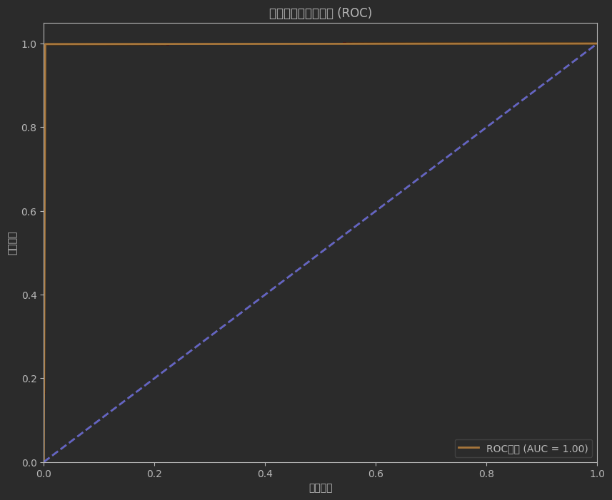
