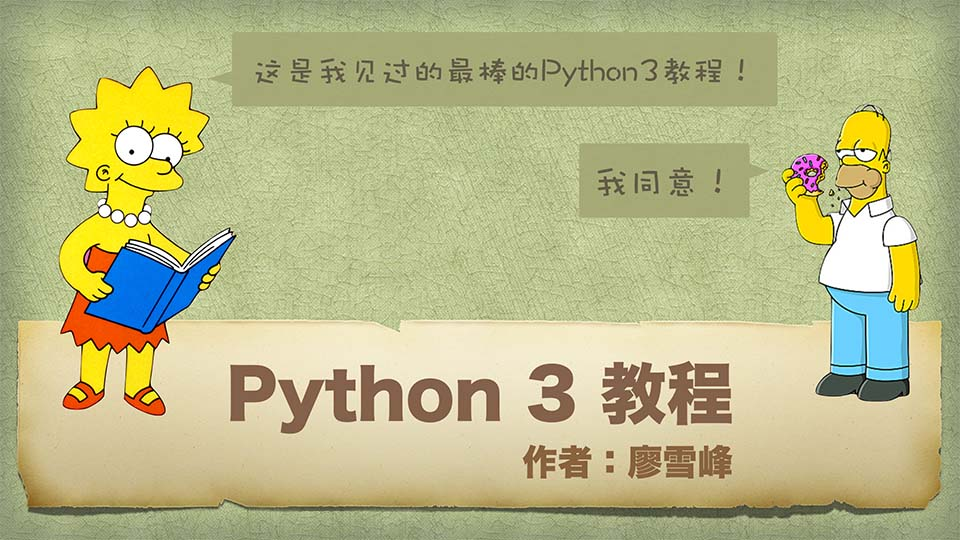
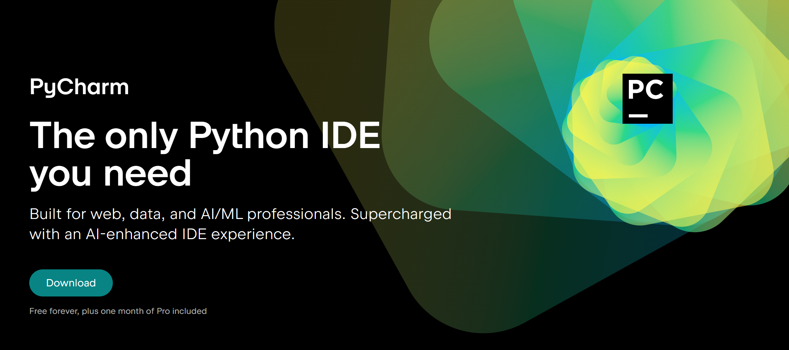
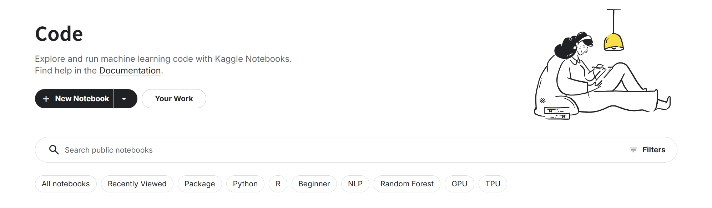
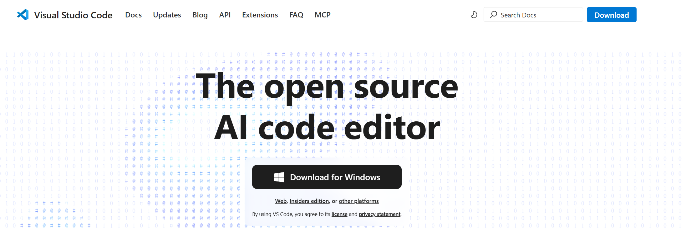
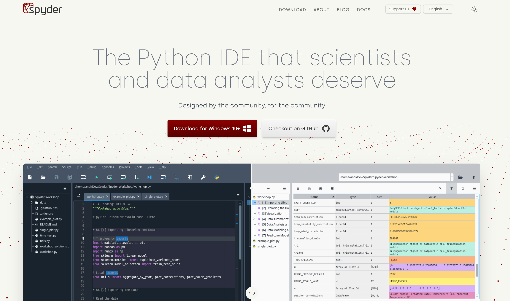
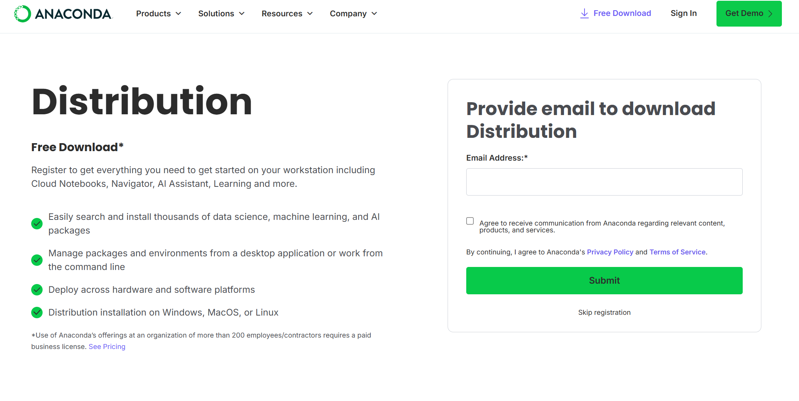
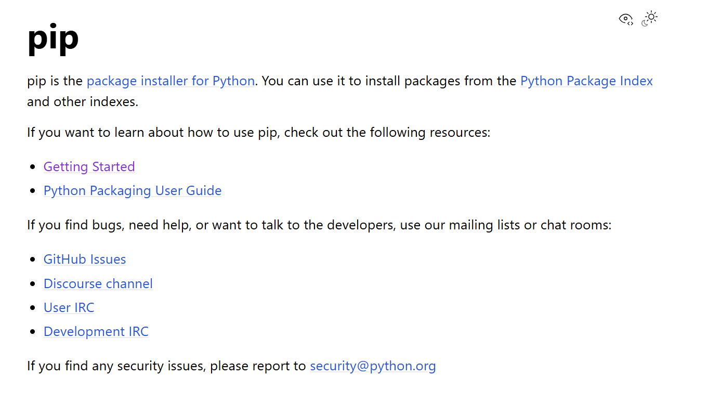

️本文对于​**​人工智能学习中常用的工具合集**进行了整理**​**​，内容涵盖了编译器/环境、工具、学习资源和推荐的学习思路，并附带了一些资源路径和网址。希望能为你提供一些帮助

* * *

## 1 核心编程语言与环境

1.  ​**​Python:​**​ AI领域的绝对主流语言，生态丰富。​（建议安装3.13版本 项目有实际需要的按需要进行安装）
    

> Python官网: [Welcome to Python.org](https://www.python.org/ "Welcome to Python.org")
> 
> 官方文档/教程: [The Python Tutorial — Python 3.13.5 documentation](https://docs.python.org/3/tutorial/index.html "The Python Tutorial — Python 3.13.5 documentation")

 安装教程：[【2024版】超详细Python+Pycharm安装保姆级教程，Python+Pycharm环境配置和使用指南，看完这一篇就够了\_python pycharm-CSDN博客](https://blog.csdn.net/m0_62283350/article/details/140489237?fromshare=blogdetail&sharetype=blogdetail&sharerId=140489237&sharerefer=PC&sharesource=Hismybestlove&sharefrom=from_link "【2024版】超详细Python+Pycharm安装保姆级教程，Python+Pycharm环境配置和使用指南，看完这一篇就够了_python pycharm-CSDN博客")

> 优秀教程: Real Python ([Python Tutorials – Real Python](https://realpython.com/ "Python Tutorials – Real Python"))，廖雪峰Python教程 ([简介 - Python - 廖雪峰的官方网站](https://www.liaoxuefeng.com/wiki/1016959663602400 "简介 - Python - 廖雪峰的官方网站"))

### ​**​1.1 集成开发环境/代码编辑器**

​**​PyCharm (Professional/Community):​ （推荐使用）**​

JetBrains出品，专门为Python设计，功能强大（尤其专业版对Web开发和科学计算支持好）。

资源: 官网 [PyCharm: The only Python IDE you need](https://www.jetbrains.com/pycharm/ "PyCharm: The only Python IDE you need") 

建议下载专业版 然后破解 下载教程上面有 可以联系我获取破解工具

**Jupyter Notebook/JupyterLab:​**​

交互式计算环境，非常适合数据探索、可视化和教学。

资源: 官网 [Project Jupyter | Home](https://jupyter.org/ "Project Jupyter | Home") / 在线试用: Google Colab ([https://colab.research.google.com/](https://colab.research.google.com/ "https://colab.research.google.com/")) 或 Kaggle Kernels ([Run Data Science & Machine Learning Code Online | Kaggle](https://www.kaggle.com/code "Run Data Science & Machine Learning Code Online | Kaggle"))

​**​Visual Studio Code:​**​

轻量级且强大的编辑器，拥有极其丰富的扩展（Python, Pylance, Jupyter, Git, Docker等）。

资源: 官网 [Visual Studio Code - Code Editing. Redefined](https://code.visualstudio.com/ "Visual Studio Code - Code Editing. Redefined")

​**​Spyder:​**​

科学计算风格IDE，类似MATLAB，集成Ipython、变量查看器等。

资源: 官网 [https://www.spyder-ide.org/](https://www.spyder-ide.org/ "https://www.spyder-ide.org/")

​**​Google Colab:​**​ (云端环境)

免费GPU/TPU资源，无需本地配置环境，在线运行Jupyter Notebook。

资源: [https://colab.research.google.com/](https://colab.research.google.com/ "https://colab.research.google.com/")

### ​**​1.2 环境与包管理**​

​**​Anaconda / Miniconda:​（强烈推荐安装 管理环境）**​

科学计算的Python发行版，包含大量预装包，强大的包和环境管理工具`conda`。解决依赖关系神器。

资源: 官网 [Download Anaconda Distribution | Anaconda](https://www.anaconda.com/products/distribution "Download Anaconda Distribution | Anaconda") / Miniconda [https://docs.conda.io/en/latest/miniconda.html](https://docs.conda.io/en/latest/miniconda.html "https://docs.conda.io/en/latest/miniconda.html")

安装教程：

[2024年超详细Anaconda安装保姆级教程，Python环境配置和使用指南-CSDN博客](https://blog.csdn.net/2301_78095812/article/details/144539490?fromshare=blogdetail&sharetype=blogdetail&sharerId=144539490&sharerefer=PC&sharesource=Hismybestlove&sharefrom=from_link "2024年超详细Anaconda安装保姆级教程，Python环境配置和使用指南-CSDN博客")

​**​pip + virtualenv / venv:​**​

Python官方的包管理器和虚拟环境工具（`venv`内置）。

资源: pip文档 [pip documentation v25.2](https://pip.pypa.io/en/stable/ "pip documentation v25.2") / venv文档 [venv — Creation of virtual environments — Python 3.13.5 documentation](https://docs.python.org/3/library/venv.html "venv — Creation of virtual environments — Python 3.13.5 documentation")

​**​Docker:​**​

容器化技术，创建隔离、可复现的环境，解决“在我的机器上能运行”的问题。

资源: 官网 [Docker: Accelerated Container Application Development](https://www.docker.com/ "Docker: Accelerated Container Application Development") / Docker Hub [https://hub.docker.com/](https://hub.docker.com/ "https://hub.docker.com/") (包含大量预构建AI环境镜像)

* * *

## 2 机器学习与深度学习框架/库

### 2.1 ​**​机器学习基础库**​

​**​NumPy:​**​

高性能科学计算和数组操作基石。

资源: 官网 [NumPy](https://numpy.org/ "NumPy") / 官方文档

​**​Pandas:​**​

强大灵活的数据分析和操作工具，核心数据结构DataFrame/Series。

资源: 官网 [pandas - Python Data Analysis Library](https://pandas.pydata.org/ "pandas - Python Data Analysis Library") / 官方文档

​**​Scikit-learn (sklearn):​**​

机器学习核心库，包含几乎所有经典ML算法（分类、回归、聚类、降维、模型选择、预处理）。

资源: 官网 [scikit-learn: machine learning in Python — scikit-learn 1.7.1 documentation](https://scikit-learn.org/stable/ "scikit-learn: machine learning in Python — scikit-learn 1.7.1 documentation") / 优秀教程 [https://scikit-learn.org/stable/tutorial/index.html](https://scikit-learn.org/stable/tutorial/index.html "https://scikit-learn.org/stable/tutorial/index.html")

### ​**​2.2 深度学习框架**

 ​**​PyTorch:​（推荐学习使用）**​

Facebook出品，研究社区最流行，动态图机制使其更灵活、易调试。

资源: 官网 [PyTorch](https://pytorch.org/ "PyTorch") / 官方教程 [Welcome to PyTorch Tutorials — PyTorch Tutorials 2.7.0+cu126 documentation](https://pytorch.org/tutorials/ "Welcome to PyTorch Tutorials — PyTorch Tutorials 2.7.0+cu126 documentation") / 优秀入门教程：[Learn the Basics — PyTorch Tutorials 2.7.0+cu126 documentation](https://pytorch.org/tutorials/beginner/basics/intro.html "Learn the Basics — PyTorch Tutorials 2.7.0+cu126 documentation")

### ​

​**​TensorFlow (Keras):​**​

谷歌出品，工业部署生态强大。Keras已集成为`tf.keras`，是TensorFlow的高级API首选。

资源: 官网 [https://www.tensorflow.org/](https://www.tensorflow.org/ "https://www.tensorflow.org/") / 官方教程 [https://www.tensorflow.org/tutorials](https://www.tensorflow.org/tutorials "https://www.tensorflow.org/tutorials") / Keras文档 [Keras: Deep Learning for humans](https://keras.io/ "Keras: Deep Learning for humans")

​**​JAX:​**​

谷歌研究社区新宠，基于NumPy，函数自动微分（`grad`），即时编译（`jit`），向量化映射（`vmap`），并行化`pmap`)，性能强大，尤其适合科研。

资源: 官网 [JAX: High performance array computing — JAX documentation](https://jax.readthedocs.io/en/latest/ "JAX: High performance array computing — JAX  documentation") / Google Research博客介绍。

### ​**​2.3 可视化库:​**​

​**​Matplotlib:​**​ 最基础和广泛使用的绘图库。

资源: 官网 [Matplotlib — Visualization with Python](https://matplotlib.org/ "Matplotlib — Visualization with Python") / 官方示例

​**​Seaborn:​**​ 基于Matplotlib的高级统计图形库，API简洁美观。

资源: 官网 [seaborn: statistical data visualization — seaborn 0.13.2 documentation](https://seaborn.pydata.org/ "seaborn: statistical data visualization — seaborn 0.13.2 documentation") / 官方示例库

​**​Plotly / Plotly Express:​**​ 交互式可视化库，支持精美交互图表和Dash仪表盘。

资源: Plotly Python [Plotly Python Graphing Library](https://plotly.com/python/ "    Plotly Python Graphing Library    ") / Plotly Express [Plotly express in Python](https://plotly.com/python/plotly-express/ "     Plotly express in Python")

### ​**​2.4 大模型与自然语言处理 :​**​

​**​Hugging Face Transformers 🤗:​**​

提供数千种预训练模型（BERT, GPT, T5等）的统一API，极大简化NLP任务。提供`Trainer` API训练模型。

资源: 官网 [https://huggingface.co/docs/transformers](https://huggingface.co/docs/transformers "https://huggingface.co/docs/transformers") / Hugging Face Hub (模型仓库) [https://huggingface.co/models](https://huggingface.co/models "https://huggingface.co/models") / 优秀教程 [https://huggingface.co/learn/nlp-course](https://huggingface.co/learn/nlp-course "https://huggingface.co/learn/nlp-course")

​**​LangChain:​**​

用于开发大语言模型应用（LLM Apps）的框架，简化提示工程、模型链式调用、记忆、代理等。

资源: 官网 [Introduction | 🦜️🔗 LangChain](https://python.langchain.com/ "Introduction | 🦜️🔗 LangChain") / 文档

​**​spaCy:​**​

工业级的开源NLP库，速度快，预训练模型质量高，API设计优秀。

资源: 官网 [spaCy · Industrial-strength Natural Language Processing in Python](https://spacy.io/ "spaCy · Industrial-strength Natural Language Processing in Python") / 官方文档和教程

### ​**​2.5 专用工具/库:​**​

​**​OpenCV:​**​ 计算机视觉基础库。

资源: 官网 [https://opencv.org/](https://opencv.org/ "https://opencv.org/") / Python版文档 [OpenCV: OpenCV-Python Tutorials](https://docs.opencv.org/master/d6/d00/tutorial_py_root.html "OpenCV: OpenCV-Python Tutorials")

​**​NLTK:​**​ 经典但较重的NLP工具包（教学和研究常用）。

资源: 官网 [NLTK :: Natural Language Toolkit](https://www.nltk.org/ "NLTK :: Natural Language Toolkit") / Book [https://www.nltk.org/book/](https://www.nltk.org/book/ "https://www.nltk.org/book/")

* * *

## 3 学习资源与社区平台

### 3.1 ​**​在线学习平台**​

​**​Coursera:​**​

吴恩达《机器学习》、《深度学习专项课程》经典必学。

资源: [Coursera | Degrees, Certificates, & Free Online Courses](https://www.coursera.org/ "Coursera | Degrees, Certificates, & Free Online Courses")

​**​edX:​**​

包含MIT, Harvard等名校课程。

资源: [edX | Online Courses, Certificates & Degrees from Leading Institutions](https://www.edx.org/ "edX | Online Courses, Certificates & Degrees from Leading Institutions")

​**​Udacity:​**​ 纳米学位项目，偏重项目实战。

资源: [https://www.udacity.com/](https://www.udacity.com/ "https://www.udacity.com/")

​**​Fast.ai:​**​ 强调实践，提供免费高质量课程和优秀库。

资源: 实用深度学习课程 [Practical Deep Learning for Coders - Practical Deep Learning](https://course.fast.ai/ "Practical Deep Learning for Coders - Practical Deep Learning") / 库 [fast.ai—Making neural nets uncool again – fast.ai](https://www.fast.ai/ "fast.ai—Making neural nets uncool again – fast.ai")

​**​Stanford Online:​**​

CS231n (CNN for Visual Recognition), CS224n (NLP with Deep Learning) 官网提供课程材料、讲义、笔记。

资源: CS231n [Stanford University CS231n: Deep Learning for Computer Vision](http://cs231n.stanford.edu/ "Stanford University CS231n: Deep Learning for Computer Vision") / CS224n [Stanford CS 224N | Natural Language Processing with Deep Learning](https://web.stanford.edu/class/cs224n/ "Stanford CS 224N | Natural Language Processing with Deep Learning")

​**​DeepLearning.AI:​**​

吴恩达创建，提供一系列高质量专项课程。

资源: [DeepLearning.AI: Start or Advance Your Career in AI](https://www.deeplearning.ai/ "DeepLearning.AI: Start or Advance Your Career in AI")

### 3.2 ​**​代码与项目平台**​

​**​GitHub:​**​

全球最大的代码托管平台，寻找项目、阅读源码、参与开源。

资源: [https://github.com/](https://github.com/ "https://github.com/") (搜索关键词如 `machine learning`, `deep learning`, `pytorch tutorial`, `tensorflow examples`)

​**​GitLab / Bitbucket:​**​ 类似GitHub的代码托管平台。

### ​**​3.3 竞赛与数据集平台**​

​**​Kaggle:​**​

数据科学竞赛、公开数据集、代码分享(Kernels)、学习教程。入门实战的最佳平台之一。

资源: [Kaggle: Your Machine Learning and Data Science Community](https://www.kaggle.com/ "Kaggle: Your Machine Learning and Data Science Community") (数据集, 竞赛, Kernels, 学习微课程)

​**​Papers with Code**​

最新的AI研究论文及其开源代码实现链接。

资源: [https://paperswithcode.com/](https://paperswithcode.com/ "https://paperswithcode.com/")

**数据集搜集合集**

> 1、DataSearch ：https://datasetsearch.research.google.com
> 
> 2、OpenDatalab : https://opendatalab.com/
> 
> 3、Kaggle ：https://www.kaggle.com/
> 
> 4、github: https ://github.com/Bio-Datasets/bio-datasets
> 
> 5、huggingface :https://huggingface.co/datasets/arcee-ai/EvolKit-20k-vi
> 
> 6、arXiv : https://arxiv.org/
> 
> 7、魔搭社区：https://modelscope.cn/datasets
> 
> 8、FindData：https://www.findata.cn/
> 
> 9、DataCite Commons : https://commons.datacite.org/doi.org
> 
> 10、MendeleyData: https://data.mendeley.com/
> 
> 11、超神经：https://hyper.ai/cn
> 
> 12、DataONE : https://search.dataone.org/data
> 
> 13、Harvard Dataverse: https://dataverse.harvard.edu/
> 
> 14、MagicHub开源社区：https://magichub.com/
> 
> 15、DataCite Commons：https://commons.datacite.org/doi.org
> 
> 16、Papers with Code ：https://paperswithcode.com/
> 
> 17、DataHub ：https://datahub.io/
> 
> 18：data.public.lu：https://data.public.lu/
> 
> 19、帕依提提：https://www.payititi.com/
> 
> 20、data.gov：https://catalog.data.gov/dataset
> 
> 21、和鲸社区：https://www.heywhale.com/
> 
> 23、AI\_Studio：https://aistudio.baidu.com/
> 
> 24、Opendata cern：https://opendata.cern.ch
> 
> 25、PANGAEA：https://www.pangaea.de/
> 
> 26、极市：https://www.cvmart.net/
> 
> 27、Roboflow：https://universe.roboflow.com/
> 
> 28、IEEE：https://ieee-dataport.org/datasets
> 
> 29、Stanford：http://snap.stanford.edu/data/
> 
> 30、GBIF： https://www.gbif.org/dataset/search
> 
> 31、阿里云天池：https://tianchi.aliyun.com/

### 3.4 ​**​模型仓库**​

​**​Hugging Face Model Hub:​**​ 主流的预训练模型中心。

​**​TensorFlow Hub:​**​ TensorFlow模型的官方仓库。

资源: [Find Pre-trained Models | Kaggle](https://tfhub.dev/ "Find Pre-trained Models | Kaggle")

​**​PyTorch Hub:​**​ PyTorch模型的官方简仓库。

资源: [PyTorch HubFor Researchers – PyTorch](https://pytorch.org/hub/ "PyTorch HubFor Researchers – PyTorch")

### 3.5 ​**​文档与搜索**​

​**​官方文档:​**​ 任何库/框架的学习，首先看官方文档。

​**​Stack Overflow:​**​ 编程问题解答。

资源: [https://stackoverflow.com/](https://stackoverflow.com/ "https://stackoverflow.com/") (搜索Python, TensorFlow, PyTorch相关问题)

​**​Google Scholar:​**​ 学术论文搜索。

资源: [https://scholar.google.com/](https://scholar.google.com/ "https://scholar.google.com/")

### 3.6 ​**​社区与博客**​

​**​arXiv:​**​ AI研究论文预印本平台。

资源: [arXiv.org e-Print archive](https://arxiv.org/ "arXiv.org e-Print archive") (搜索 `cs.CV`, `cs.CL`, `cs.LG`, `stat.ML`)

​**​Medium:​**​ 大量优质技术博客。

资源: [https://medium.com/](https://medium.com/ "https://medium.com/") (搜索关键词 + site:medium.com)

​**​Towards Data Science (在Medium上):​**​ 高质量数据科学博客集合。

资源: [https://towardsdatascience.com/](https://towardsdatascience.com/ "https://towardsdatascience.com/")

​**​Reddit:​**​

`r/MachineLearning`, `r/deeplearning`, `r/Python`, `r/LanguageTechnology` 等版块。

### ​**​3.7 云平台 (供实践和部署)**​

​**​Google Cloud Platform (GCP) - AI Platform/Vertex AI:​**​

资源: [https://cloud.google.com/ai](https://cloud.google.com/ai "https://cloud.google.com/ai") / [https://cloud.google.com/vertex-ai](https://cloud.google.com/vertex-ai "https://cloud.google.com/vertex-ai")

​**​Amazon Web Services (AWS) - SageMaker:​**​

资源: [The center for all your data, analytics, and AI – Amazon SageMaker – AWS](https://aws.amazon.com/sagemaker/ "The center for all your data, analytics, and AI – Amazon SageMaker – AWS")

​**​Microsoft Azure - Azure Machine Learning:​**​

资源: [https://azure.microsoft.com/en-us/products/machine-learning](https://azure.microsoft.com/en-us/products/machine-learning "https://azure.microsoft.com/en-us/products/machine-learning")

​**​Google Colab Pro / Kaggle Pro:​**​ 提供更强的计算资源（GPU/TPU）。

* * *

## 4 学习路径推荐思路

学习过程一定要注重理解并结合动手实践：

### ​**​4.1 基础打牢** ​

​**​Python 精通:​**​ 语言特性、常用库(NumPy, Pandas, Matplotlib)。

​**​数学基础温习:​**​ 线性代数(向量、矩阵运算)、微积分(导数、梯度)、概率论与统计(基本概念、贝叶斯)。

​**​机器学习基础理论:​**​ 学习经典算法原理（线性回归、逻辑回归、决策树、SVM、KNN、聚类K-Means）及其应用场景。​**​工具：Scikit-learn。​**

​

​**​深度学习入门与实践:​**​

​**​框架选择:​**​ 深入一个主流框架(​**​强烈推荐PyTorch或TensorFlow with Keras​**​)。

​**​核心概念:​**​ 神经网络结构（全连接、CNN、RNN）、激活函数、损失函数、优化器、反向传播。理解训练过程。

### ​**​4.2 基础项目实践**​

使用CNN在MNIST/Fashion-MNIST/CIFAR-10上做图像分类。

使用RNN/LSTM在IMDB电影评论上做情感分析。 ​**​工具：PyTorch/TensorFlow, Jupyter Notebook.​**​​**​方向深化与项目实战 (持续):​**

​

### ​**​4.3 根据兴趣选择方向**​

​**​计算机视觉:​**​ 目标检测(YOLO, SSD)、图像分割(U-Net, Mask R-CNN)、生成模型(GANs, Stable Diffusion/Versions)。​**​工具：OpenCV, PyTorch/TensorFlow CV库, Hugging Face Diffusers。​**​

​**​自然语言处理:​**​ 词嵌入(Word2Vec, GloVe)、序列模型(BERT, GPT)、文本分类/翻译/摘要/对话。​**​工具：Hugging Face Transformers, spaCy, NLTK, LangChain。​**​

​**​强化学习:​**​ Gymnasium库、Q-Learning, DQN, Policy Gradients。

​**​其他:​**​ 推荐系统、图神经网络(GNNs)、大语言模型应用开发(LLM Apps)。

​**​参与竞赛:​**​ 在Kaggle上找合适的比赛，从理解问题、特征工程、模型构建到调参集成，全面提升能力。

​**​复现论文:​**​ 选择感兴趣的经典或前沿论文，尝试阅读并复现代码，理解细节。

​**​个人项目:​**​ 解决自己感兴趣的实际问题（即使很小）。

### ​**​4.4 提升工程能力与前沿追踪**​

​**​软件工程实践:​**​ Git版本控制、代码规范(PEP8)、模块化、单元测试、日志。

​**​模型部署:​**​ 学习基础模型部署工具 (如Flask/FastAPI + ONNX Runtime/TensorFlow Serving, 或云平台部署服务)。

​**​容器化:​**​ 学习Docker。

### ​**​4.5 持续学习**​

定期阅读​**​arXiv​**​或​**​Papers with Code​**​上的最新论文。

关注顶级会议(CVPR, ICCV, ECCV, ACL, EMNLP, NeurIPS, ICML, ICLR)。

阅读​**​Towards Data Science​**​, ​**​官方博客​**​和​**​社区讨论​**​。

​**​参与开源:​**​ 为感兴趣的开源项目贡献代码或文档。

* * *

**总结:​**​ 学习AI是一个持续迭代和**实践**的过程。

1.  ​**​动手！动手！动手！​**​ 理论再看10遍不如自己敲代码跑通一个模型。
2.  ​**​打好基础至关重要。​**​ 不要急于求成，Python、数学、ML基础是上层建筑的根基。
3.  ​**​善用官方文档和社区。​**​ 学会自己查找资料和解决问题是最核心的能力之一。
4.  ​**​保持好奇，持续学习。​**​ AI领域发展日新月异。

* * *

希望这份合集能为你的AI学习之旅提供有力的支持！祝学习顺利！
