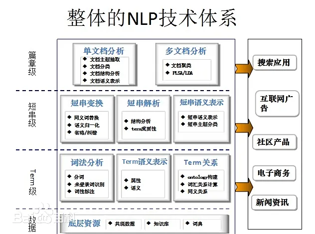
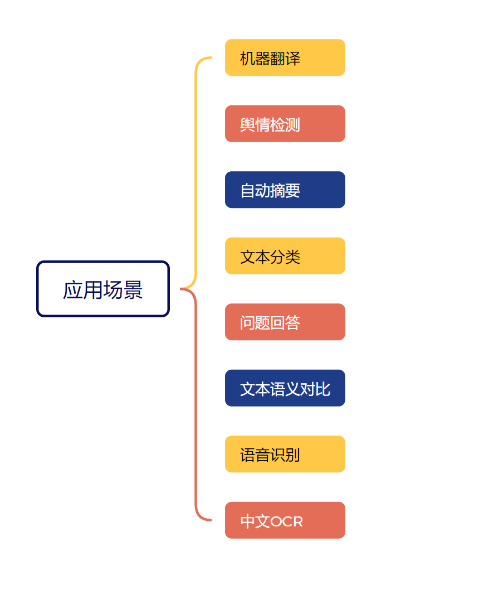
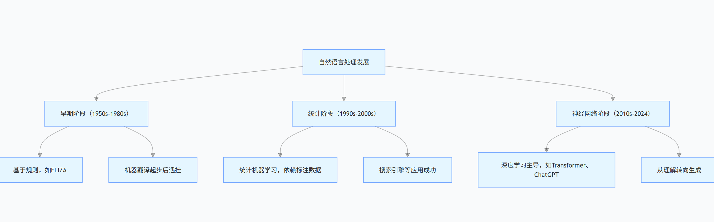
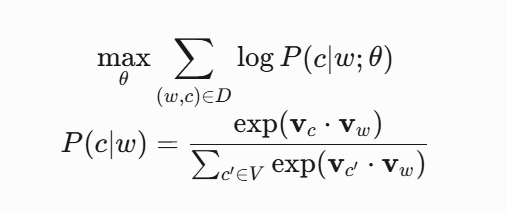

> 本文价绍了自然语言处理（NLP）是人工智能的重要分支，旨在让计算机理解、处理和生成人类语言。其发展经历了规则方法、统计学习和深度学习三个阶段。本文介绍了NLP的基本概念、应用场景（如机器翻译、情感分析等）以及文本表示方法的演变：从简单的One-Hot编码、考虑词频权重的TF-IDF，到捕捉词序的N-gram模型，再到能够表达语义关系的分布式表示（如Word2Vec）。最后列举了PyTorch、HuggingFace等常用工具框架。这些技术共同构成了现代NLP系统的基础。

* * *

## 1 基本概念

### 1.1 定义



>         自然语言处理( Natural Language Processing, NLP)是**人工智能**领域的重要研究方向, 融合了语言学、计算机科学、机器学习、数学、认知心理学等多个学科领域的知识，是一门集计算机科学、人工智能和语言学于一体的交叉学科，它包含自然语言理解和自然语言生成两个主要方面, 研究内容包括**字、词、短语、句子、段落和篇章**等多种层次，是机器语言和人类语言之间沟通的桥梁。它旨在使机器理解、解释并生成人类语言，实现人机之间有效沟通，使计算机能够执行语言翻译、情感分析、文本摘要等任务。
> 
>         自然语言认知和理解是让计算机把输入的语言变成有意义的符号和关系，然后根据目的再处理。自然语言生成系统则是把计算机数据转化为自然语言。
> 
>         自然语言处理的任务包括研制表示语言能力和语言应用的模型, 建立计算框架来实现并完善语言模型，根据语言模型设计各种实用系统及探讨这些系统的评测技术。

        这是来自百度百科的定义，其实自然语言处理就是教**机器像人一样“读懂话里有话”​**。不只是单纯的按照分词去理解。当女友说“我没事”：让AI听出“快来哄我” 或者当老板说“项目很有潜力”：让AI看懂是老板认为当前的“进度太慢” 

### 1.2 应用场景



**a 自然语言理解：​**​

词法分析 (分词)

词性标注

句法分析 (依存句法分析、成分句法分析)

语义分析 (词义消歧、语义角色标注)

信息抽取 (命名实体识别 NER、关系抽取、事件抽取) ​**​重要应用！​**​

文本分类 & 情感分析 ​**​重要应用！​**​

问答系统 (Q&A - 检索式、生成式) ​**​重要应用！​**​

机器翻译 (MT) ​**​重要应用！​**​

​**​b 自然语言生成：​**​

文本摘要 (抽取式、生成式) ​**​重要应用！​**​

机器翻译 (MT 也涉及生成) ​**​重要应用！​**​

对话系统 & 聊天机器人 (Chatbots)

自动写作 (新闻、诗歌、报告等)

图像字幕生成 (多模态)

* * *

## **2 发展历程**

自然语言处理的发展可分为三个主要阶段：​

早期阶段（1950s-1980s）：以基于规则为核心，代表性系统有 ELIZA 等；机器翻译在此阶段起步，但后续因进展未达预期遭遇挫折。​

统计阶段（1990s-2000s）：统计机器学习成为主流，依赖标注数据开展研究；在搜索引擎等应用领域取得了显著成功。​

神经网络阶段（2010s-2024）：深度学习占据主导地位，Transformer、ChatGPT 等是重要代表；发展重点从自然语言理解转向了自然语言生成。



* * *

## **3 数据处理的演变**

### 3.1 ONE HOT

>  **数学本质​**​：
> 
> -   词表大小 ∣V∣，每个词 wi​表示为：
>     
>     one-hot(wi​)=\[0,...,1,...,0\]∈{0,1}∣V∣
>     
> -   任意两个词向量点积为0 → ​**​完全相互独立​**​
>     

 每个词都是宇宙中独一无二的存在！词典里有多少个不同的词（词汇表大小 = V），我就创建多长的一个向量（比如V=10000，向量就是10000维的）。

​**​**可以**想象**一个超大的体育场，有成千上万个座位（维度）。每个词对应一个专属座位（一个维度）。当某个词出场时（比如“狗”），只有它的座位上亮起红灯（值为1），其他所有座位一片漆黑（值为0）。

```python
# 示例词汇表 - 想象我们只关心这4个词
vocabulary = ["猫", "狗", "鱼", "汽车"]

# 创建 ONE HOT 编码映射字典
one_hot_dict = {}
for index, word in enumerate(vocabulary):
    # 创建一个全零向量，长度等于词汇表大小
    vector = [0] * len(vocabulary)
    # 把当前词的专属位置设为 1
    vector[index] = 1
    one_hot_dict[word] = vector

# 打印结果
print("词汇表:", vocabulary)
print("猫的One-Hot:", one_hot_dict["猫"])  # [1, 0, 0, 0]
print("狗的One-Hot:", one_hot_dict["狗"])  # [0, 1, 0, 0]
print("鱼的One-Hot:", one_hot_dict["鱼"])  # [0, 0, 1, 0]
print("汽车的One-Hot:", one_hot_dict["汽车"]) # [0, 0, 0, 1]
```

### 3.2 TF-IDF

> **数学本质​**​：
> 
> -   ​**​TF (词频)​**​： tf(t,d)=文档d总词数词t在文档d中出现次数​
>     
> -   ​**​IDF (逆文档频率)​**​： idf(t)=log包含词t的文档数文档总数​
>     
> -   ​**​最终权重​**​： tf-idf(t,d)=tf(t,d)×idf(t)
>     

 一个词在一篇文档里出现次数多（​**​Term Frequency, TF​**​），不代表它就重要。也许它是个“烂大街”的词（比如“的”、“是”、“在”）。所以要降低这些“大众词”的权重！怎么降低？看这个词在整个文档​**​集合​**​（比如所有新闻、所有论文）中出现的有多​**​稀有​**​（​**​Inverse Document Frequency, IDF​**​）。一个词越少出现在其他文档里，说明它在当前文档中就越独特、越重要！

-   ​**​如何计算？​**​
    
    -   `TF(词, 文档)`\= 该词在​**​当前文档​**​中出现的次数 / 当前文档的总词数。 (或者log化避免过长文档的优势）
        
    -   `IDF(词)`\= log( ​**​语料库中文档总数(N)​**​ / ​**​包含该词的文档数(df)​**​ ) + 1 (加1防止分母为0，平滑)
        
    -   `TF-IDF(词, 文档)`\= `TF(词, 文档)`\* `IDF(词)`
        

​**​结果：​**​ 一篇文章中的每个词，我们计算它的TF-IDF值。一个词的TF-IDF值越高，它在这篇文档里就越重要、越有代表性。

​**​向量表示：​**​ 一篇文档可以用所有词的TF-IDF值组成的向量来表示（长度还是词汇表大小V，但里面的值是连续有意义的权重了）。

​**​优点：​**​ 考虑了词频信息和词的全局分布信息（稀有度），能有效突出文档的关键词。常用于信息检索、文本分类等。

​**​缺点：​**​ 本质上还是一个“词袋子”（Bag of Words）模型，丢失了词的顺序和位置信息（比如“喜欢-不喜欢”和“不喜欢-喜欢”算出来一样）。还是很难直接表达语义（“苹果”作为水果和公司，权重可能高，但计算机不知道区别）。

```python
from sklearn.feature_extraction.text import TfidfVectorizer

# 示例文档集合 (语料库)
documents = [
    "猫喜欢吃鱼，狗也喜欢吃肉。",   # 文档1
    "狗是人类忠实的朋友。",       # 文档2
    "我的汽车是红色的，速度很快。" # 文档3
]

# 1. 创建TF-IDF向量器 (可以设置参数，如停用词、最大特征数、ngram范围等)
vectorizer = TfidfVectorizer(token_pattern=r"(?u)\b\w+\b")  # 使用简单分词，匹配单词

# 2. 学习词汇表并计算TF-IDF特征矩阵 (fit_transform)
tfidf_matrix = vectorizer.fit_transform(documents)

# 3. 查看词汇表
print("词汇表(特征名):", vectorizer.get_feature_names_out())  # ['人类', '喜欢', '吃肉', '很快', '朋友', '汽车', '猫', '红色', '忠实', '速度', '鱼', '狗']

# 4. 打印TF-IDF矩阵（稀疏矩阵存储，打印非零值形式）
print("\nTF-IDF矩阵（稀疏格式）：")
print(tfidf_matrix)  # 展示稀疏坐标和值

# 5. 查看第一篇文章（索引0）的密集向量表示（可以访问）
# tfidf_matrix[0].toarray() 是一个二维数组
print("\n第一篇文档的TF-IDF向量（密集表示）:")
print(tfidf_matrix[0].toarray().round(2))  # 打印第一个文档向量，保留两位小数

# 6. 找到第一篇文档中最重要的词（按TF-IDF值排序）
feature_names = vectorizer.get_feature_names_out()
sorted_idx = tfidf_matrix[0].toarray().argsort()[0][::-1]  # 降序排序索引
print("\n第一篇文档中最重要的词（按TF-IDF降序）：")
for idx in sorted_idx[:3]:  # 看前3个
    if tfidf_matrix[0, idx] > 0:  # 只输出有值的
        print(f"{feature_names[idx]}: {tfidf_matrix[0, idx]:.4f}")

# 输出结果示例 (具体数字可能因scikit-learn版本和内部计算细节略有不同)：
# 词：猫 (只出现在文档1) -> IDF高；出现次数中等 -> 可能权重高
# 词：喜欢 (出现在文档1和2) -> IDF中等；在文档1出现次数多 -> 在文档1权重也较高
# 词：的 (几乎每篇都出现) -> IDF非常低 -> 在文档3的TF-IDF很低
# 词：汽车 (只出现在文档3) -> IDF高；在文档3出现一次 -> 权重高
```

### 3.3 N-gram

> **数学本质​**​：
> 
> -   马尔可夫假设：P(wn​∣w1​,...,wn−1​)≈P(wn​∣wn−N+1​,...,wn−1​)
>     
> -   对于bigram：P(语言∣自然)=count(自然)count(自然 语言)​
>     

One Hot和TF-IDF（词袋子）都只关心单个词本身，忽略了词序！这是个大问题！“狗咬人”和“人咬狗”意思完全相反啊！N-gram来救场：它把连续的N个词组合在一起，作为一个整体（单元）来看待。​

-   ​**​Unigram (1-gram)：​**​ 单个词。还是词袋子，相当于OneHot/TF-IDF的基础。
    
-   ​**​Bigram (2-gram)：​**​ 两个连续词组合。“我喜欢” -> (“我”, “喜欢”)。
    
-   ​**​Trigram (3-gram)：​**​ 三个连续词组合。“我喜欢猫” -> (“我”, “喜欢”, “猫”)。
    
-   以此类推...
    

​**​如何表示：​**​ 现在，“词汇表”不再是单个词，而是所有可能的N元词组。比如Bigram词汇表，就是所有两个连续词的组合（即使本身可能没意义）。同样可以用One-Hot或TF-IDF来处理这些N-gram单元。

​**​优点：​**​ 终于捕获了局部的上下文信息和词序！能让机器学习到一些简单的词组、短语结构（比如“纽约市”、“人工智能”、“非常好吃”）。能更好地处理歧义（“机器学习”是学科，“学习机器”是动词短语）。

​**​缺点：​**​就是**维度还是爆炸升级，**当​词汇量是V，Bigram组合数理论上是V \* V，Trigram是V^3！虽然实际会少很多，但维度依然比Unigram大得多，存储和计算还是大头难题。而且​**​上下文有限：​**​ N越大，上下文越长，但同时维度爆炸更严重，数据稀疏性问题也更大（很多N-gram在实际语料中根本没出现过）。长距离依赖依然难以捕捉（句首和句尾的关系）。

​**​边界处理：​**​ 需要添加起始/结束符（<s>, </s>）来标记N-gram的开始和结束。

```python
# 示例：手动生成Bigrams
def generate_ngrams(text, n):
    words = text.split()  # 简单分词，实际中需要更好的分词器
    ngrams = []
    for i in range(len(words) - n + 1):
        ngrams.append(words[i:i+n])  # 生成连续的n个词
    return ngrams

sentence = "猫喜欢抓沙发"
bigrams = generate_ngrams(sentence, 2)  # 提取Bigram
trigrams = generate_ngrams(sentence, 3) # 提取Trigram

print("句子:", sentence)
print("Bigrams:", bigrams)  # [['猫', '喜欢'], ['喜欢', '抓'], ['抓', '沙发']]
print("Trigrams:", trigrams) # [['猫', '喜欢', '抓'], ['喜欢', '抓', '沙发']]

# 结合TF-IDF (使用sklearn的 TfidfVectorizer 指定ngram_range)
from sklearn.feature_extraction.text import CountVectorizer, TfidfVectorizer

# 示例使用CountVectorizer看特征名 (同样适用于TfidfVectorizer)
vectorizer = CountVectorizer(ngram_range=(1, 2))  # 同时包含unigram和bigram
X = vectorizer.fit_transform([sentence])
print("\n词汇表(Unigram + Bigram):", vectorizer.get_feature_names_out())
# 可能输出: ['喜欢', '抓', '沙发', '猫', '猫 喜欢', '喜欢 抓', '抓 沙发']
```

### 3.4 分布式表示

> **Skip-gram模型**
> 
> 
> 
> ​**​语义运算​**​：国王−男人+女人≈女王

 突破“一个维度只代表一个词”的思想禁锢！不再为每个词分配一个稀疏的、超长的、孤立的标识符向量。而是用一个​**​低维、稠密、固定长度​**​的实数向量（比如50维、100维、300维）来表示一个词。这个向量不是只有一个位置是1，而是在所有维度上都有值（通常是小数）。​**​这些维度不再和词一一对应，而是学习出来，用来编码这个词的“语义特征”。​**​

​**​理论基础（分布式假设）：​**​ 一个词的“含义”是由它经常出现的上下文决定的（Firth的名言: "You shall know a word by the company it keeps!"）。“国王”经常和“王后”、“王室”、“加冕”一起出现；“男人”经常和“女人”、“父亲”、“强壮”一起出现。

> ​**​如何学习？​**​
> 
> ​**​统计方法：​**​ 观察目标词在大型语料库中出现的上下文窗口（如前后N个词）分布，构造“共现矩阵”，然后用奇异值分解（SVD）/主成分分析（PCA）等方法降维，近似出每个词的低维向量（如Latent Semantic Analysis / Indexing, LSA/LSI）。
> 
> ​**​预测方法 (主流)：​**​ ​**​浅层神经网络模型​**​ (Word Embedding Models)，特别是Word2Vec（Skip-gram和CBOW）和GloVe。
> 
> ​**​Skip-gram：​**​ 用中心词预测周围的上下文词。
> 
> ​**​CBOW：​**​ 用周围的上下文词预测中心词。
> 
> ​**​GloVe：​**​ 结合全局词-词共现统计信息和局部窗口预测。

这些模型通过训练，调整词向量的值（权重），使得向量间的运算能反映语义或语法关系。最著名的例子： ​**​King - Man + Woman ≈ Queen​**​。

​**​优点：​**​

-   ​**​维度剧降：​**​ 向量长度通常只有50-300维，节省空间计算快。
    
-   ​**​语义宝库：​**​ 向量空间中的​**​距离​**​（如余弦相似度）能反映​**​语义相似度​**​！同义词、反义词、类比关系都能在向量计算中体现（如“北京之于中国 ≈ 东京之于日本”）。
    
-   ​**​泛化能力：​**​ 能更好地处理未见词或低频词（根据其可能的上下文）。
    
-   ​**​代表模型：​**​ Word2Vec (Skip-gram, CBOW), GloVe, fastText。
    

```python
from gensim.models import Word2Vec
import jieba  # 中文分词

# 1. 准备语料 (示例)
sentences = [
    "猫喜欢吃鱼，也喜欢晒太阳。",
    "狗是人类忠诚的好朋友，喜欢啃骨头。",
    "鱼在水中游来游去，非常自由。",
    "这辆红色汽车速度很快，我很喜欢。"
]

# 对中文进行分词预处理
tokenized_sentences = [jieba.lcut(sent) for sent in sentences]
print("分词后的句子:", tokenized_sentences)

# 2. 训练 Word2Vec模型 (使用Skip-gram算法)
# sg=1: Skip-gram; sg=0: CBOW
# vector_size: 词向量维度; window: 上下文窗口大小; min_count: 词频低于此值忽略; workers: 并行线程数
model = Word2Vec(sentences=tokenized_sentences, vector_size=5, window=2, min_count=1, sg=1, epochs=100, workers=1)
# 注意：实际应用需要更大语料库和更合适参数

# 3. 检查训练好的词向量
print("\n词汇表:", list(model.wv.index_to_key))

# 4. 查看指定词的向量 (稠密低维向量)
vector_cat = model.wv["猫"]
vector_dog = model.wv["狗"]
print("\n'猫'的向量 (5维):", vector_cat.round(2))
print("'狗'的向量 (5维):", vector_dog.round(2))

# 5. 计算两个词的余弦相似度 (1最相似，0无关，-1最相反)
sim_cat_dog = model.wv.similarity("猫", "狗")
sim_cat_car = model.wv.similarity("猫", "汽车")
print(f"\n'猫'与'狗'的相似度: {sim_cat_dog:.4f}")
print(f"'猫'与'汽车'的相似度: {sim_cat_car:.4f}")

# 6. 找最相似的词 (按余弦相似度排序)
print("\n与'狗'最相似的词:")
similar_words = model.wv.most_similar("狗", topn=2)
for word, score in similar_words:
    print(f"{word}: {score:.4f}")

# 7. 玩向量运算 (经典例子) - 小样本可能效果不好，只做演示
# 目标: 国王 - 男人 + 女人 ≈ 王后 -> 我们语料没有这些词，改为演示类型： 狗 - 啃 + 吃 ≈ 猫?
man = model.wv['男人']  # 可能不存在
woman = model.wv['女人'] # 可能不存在
# 用我们语料中存在的词演示：假设我们的语料能学到“猫-吃”和“狗-啃”的关系
# 期望: 猫 ≈ 狗 + (吃 - 啃) ?? 效果可能不明显，需大规模语料训练
result = model.wv.most_similar(positive=["狗", "吃"], negative=["啃"], topn=1)
print(f"\n向量运算 '狗' - '啃' + '吃' ≈ {result[0][0]}, 分数：{result[0][1]:.4f} (期望得到'猫')")

# 注意：由于示例语料库非常小且简单，向量维度也很低，模拟效果可能不佳。大规模真实语料库训练的效果会非常好！
```

* * *

4 工具和资源

**主流框架：​**​ PyTorch, TensorFlow。

​**​经典库：​**​ NLTK (教育研究), spaCy (工业级高效NLP处理)。

​**​Transformer 模型库：​**​ Hugging Face Transformers (绝对主流，提供了海量预训练模型的便捷接口)。

​**​数据集：​**​

通用文本语料：Wikipedia, Common Crawl。

任务特定数据集：GLUE/SuperGLUE (理解)、SQuAD (问答)、CoNLL (NER)、WMT (机器翻译) 等。
