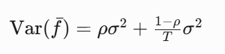
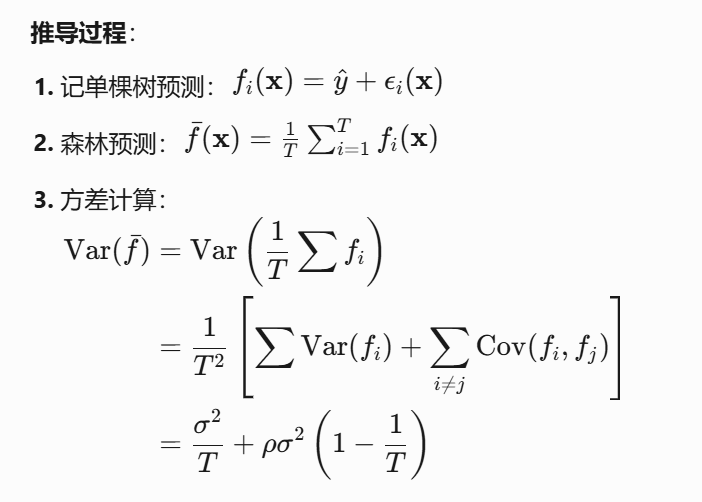
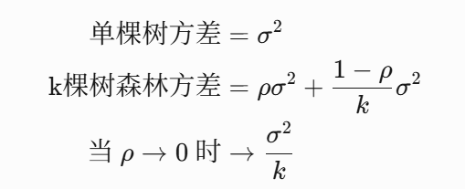
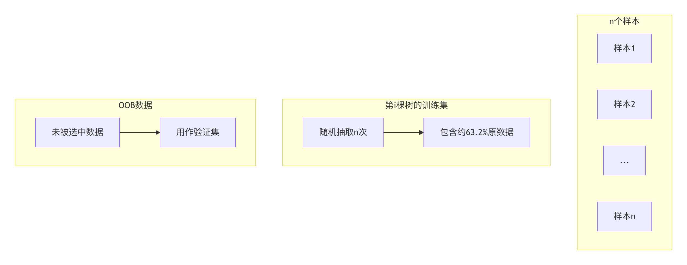

> 本文介绍学习了随机森林，随机森林通过集成多棵差异化的决策树（每棵树仅使用随机数据和特征子集），降低模型方差，提升预测稳定性。其核心优势在于：抗过拟合能力强（Bagging+特征随机性）；自动处理缺失值、类别特征及高维数据；内置OOB误差评估（免交叉验证）和特征重要性分析。数学本质是降低树间相关性ρ以逼近方差为0的理想状态。

## 1 ​​**​案例导入**​

想象你正在预测加州房价，单棵决策树容易陷入"局部偏见"：

   树1 过度关注「临海」特征 → 高估海滨房

   树2 迷信「学区」指标 → 忽略社区安全因素

这些决策树模型在测试集频频翻车

     而随机森林的解决方案：​**​组建1000棵"弱智"的决策树委员会​**​，通过投票否决极端意见，最终形成稳健预测。

```python
# 现实中的随机森林决策机制
class RandomForest:
    def __init__(self, n_trees):
        self.trees = [Tree(random_features=True) for _ in range(n_trees)]
    
    def predict(self, house):
        votes = {
            '高价':0, '中价':0, '低价':0
        }
        for tree in self.trees:
            # 每棵树只考虑部分特征
            decision = tree.evaluate(
                features = ['MedInc', 'AveRooms', 'Latitude'], 
                house_data = house
            )
            votes[decision] += 1
        
        # 消除极端投票（民主机制核心）
        if votes['高价'] > n_trees * 0.7:
            return adjust_high_price(votes)  # 修正异常高价
        else:
            return max(votes, key=votes.get)
```

* * *

## ​**​2 Bagging思想**

设单棵树预测方差为 σ2，树间相关系数 ρ，则随机森林方差：





​也就是说明：



 当树间相关性 ρ→0时，方差趋近于 0——这正是特征随机性的价值！

​**​Bootstrap Aggregating​**​ 核心逻辑：

```python
# 伪代码揭示民主机制
final_predictions = []
for i in range(n_trees):
    # 1. 随机抽数据（允许重复）
    random_data = sample_with_replacement(original_data)
    
    # 2. 随机选特征（降低相关性）
    random_features = select_random_subset(features)
    
    # 3. 训练一棵差异化决策树
    tree = train_decision_tree(random_data, random_features)
    
    # 4. 集体投票做最终决策
    final_predictions.append(tree.predict(new_data))

return majority_vote(final_predictions)  # 分类问题
return average(final_predictions)         # 回归问题
```

数学抽样的数学本质  


**​​为何比单棵决策树更强大？​**​

| 指标 | 单棵决策树 | 随机森林 |
| --- | --- | --- |
| 方差 | 高  | 低  |
| 抗噪声能力 | 弱  | 强  |
| 特征重要性 | 不准确 | 可靠  |
| 过拟合风险 | 极高  | 低  |

> 如果把决策树看作性格偏执的专家，而随机森林是联合国议会——即便有极端分子（过拟合树），多数表决也能压制疯狂提案。

* * *

## 3 ​**​构建流程**​

1.  ​**​数据民主化采样​**​
    
    -   每棵树训练集 = 原始数据集的有放回随机抽样（Bootstrap）
    -   未被抽中的36.8%数据 → ​**​袋外数据（OOB）​**​ 天然验证集
2.  ​**​特征空间随机切割​**​
    
    mtry​=p​(分类问题)
    
    每次节点分裂时，仅在随机选择的 mtry​ 个特征中找最优分裂点
    
3.  ​**​全生长不剪枝​**​  
    每棵树自由生长直到：
    
    -   节点样本纯净（基尼系数=0）
    -   或样本数少于阈值（min\_samples\_split）
4.  ​**​集成决策​**​
    
    -   分类：硬投票（多数决） / 软投票（概率平均）
    -   回归：所有树预测值平均

* * *

**​​构建房价预测模型​**

关键参数

| 
参数

 | 

生物学类比

 | 

最优范围

 | 

调节策略

 |
| --- | --- | --- | --- |
| 

n\_estimators

 | 

委员会规模

 | 

300-1000

 | 

观察OOB误差收敛点

 |
| 

max\_depth

 | 

决策深度

 | 

不限制(默认)

 | 

监控验证集性能

 |
| 

min\_samples\_split

 | 

分裂最小样本

 | 

5-20

 | 

防止噪声误导

 |
| 

max\_features

 | 

决策依据维度

 | 

√p (分类)

 | 

高维数据用log2(p)

 |

```python
from sklearn.ensemble import RandomForestRegressor
from sklearn.datasets import fetch_california_housing
from sklearn.metrics import mean_squared_error
import numpy as np

# 加载加州房价数据集（真实世界案例！）
housing = fetch_california_housing()
X, y = housing.data, housing.target

# 关键参数解析：
# n_estimators=500 → 500棵树 | max_features="sqrt" → 特征抽样数=√总特征
# oob_score=True → 启用袋外评估
rf = RandomForestRegressor(n_estimators=500, 
                           max_features="sqrt",
                           n_jobs=-1,  # 使用全部CPU核心
                           oob_score=True,
                           random_state=42)

rf.fit(X, y)

# 性能报告
print(f"袋外评分（OOB）: {rf.oob_score_:.3f} → 相当于自带交叉验证")
preds = rf.predict(X)
print(f"RMSE: {np.sqrt(mean_squared_error(y, preds)):.4f}")

# 特征重要性可视化
importances = rf.feature_importances_
sorted_idx = importances.argsort()[::-1]
print("\n特征影响力排名:")
for i in sorted_idx:
    print(f"{housing.feature_names[i]}: {importances[i]:.3f}")
```

 **典型输出结果：**

```python
袋外评分（OOB）: 0.791
RMSE: 0.1943

特征影响力排名:
MedInc（收入中位数）: 0.567
AveOccup（平均入住人数）: 0.112
Latitude（纬度）: 0.098
...
```

> 算法暴露出加州房市的残酷现实——收入决定房价，地理位置的权重超过房屋年龄！

​**​超参数调优指南​**​

| 参数 | 推荐值 | 作用 | 调节风险 |
| --- | --- | --- | --- |
| n\_estimators | 300~500 | 树的数量 | <100会导致不稳定 ⚠️ |
| max\_depth | None（不限） | 树深度 | 深树增加过拟合风险 |
| min\_samples\_leaf | 3~5 | 叶节点最小样本 | 过高导致欠拟合 |
| max\_features | sqrt / log2 | 特征抽样比例 | 高维数据集用log2 |

```python
# 网格搜索示例
from sklearn.model_selection import GridSearchCV
param_grid = {
    'n_estimators': [200, 500],
    'max_features': ['sqrt', 'log2']  
}
rf_grid = GridSearchCV(estimator=rf, param_grid=param_grid, cv=5)
rf_grid.fit(X_train, y_train)
```

 使用贝叶斯调优

```python
# 贝叶斯优化示例
from skopt import BayesSearchCV

params = {
    'n_estimators': (100, 1000),
    'max_depth': (5, 50),
    'min_samples_split': (2, 25)
}

opt = BayesSearchCV(
    estimator=RandomForestRegressor(),
    search_spaces=params,
    n_iter=30,
    cv=5
)
opt.fit(X_train, y_train)
```

* * *

## ​**​4 优势与适用场景​**

**对比其他算法：**

| 
算法

 | 

核心机制

 | 

森林中的体现

 |
| --- | --- | --- |
| 

​**​深度学习​**​

 | 

梯度优化

 | 

替代梯度下降

 |
| 

​**​SVM​**​

 | 

间隔最大化

 | 

特征空间划分

 |
| 

​**​Boosting​**​

 | 

顺序纠错

 | 

通过bagging并行实现

 |

​**何时首选随机森林：​**​

-   特征包含大量类别变量（无需One-Hot编码）
-   数据集存在缺失值（自动处理缺失）
-   需要快速基线模型（相比SVM/XGBoost训练更快）
-   高维数据（自动做特征选择）

​**​潜在局限：​**​

-   外推能力弱 → 预测超出训练集范围的样本效果差
-   黑盒特性 → 较难解释单个预测原因
-   内存消耗大 → 500棵树可能占用1GB内存

**​​延展思考：为什么说森林是最好的ML入门模型？​**​

​**​包容性设计​**​ 自动处理非线性关系（比线性回归强大）对异常值不敏感（对比SVM/KNN）

​**​自带模型诊断工具​**​ OOB误差 → 无需切分验证集  特征重要性 → 洞见决策逻辑

​**​通向深度学习的桥梁​**​  随机森林 → 梯度提升树（GBDT）→ 神经网络   三者共享核心思想：​**​组合弱模型获得强大预测力​**

* * *

## 5 案例使用

最后是对于房价预测 使用随机森林的实现代码

```python
# 加州房价预测终极版
import matplotlib.pyplot as plt

rf = RandomForestRegressor(
    n_estimators=1000, 
    max_features='log2',
    oob_score=True,
    random_state=42
)
rf.fit(X, y)

# 性能可视化
plt.figure(figsize=(10,6))
plt.bar(housing.feature_names, rf.feature_importances_)
plt.title('特征重要性分布', fontsize=14)
plt.xticks(rotation=45)
plt.grid(alpha=0.3)

# 学习曲线分析
plt.figure(figsize=(10,6))
plot_learning_curve(rf, X, y, cv=5)
plt.title('随机森林学习曲线', fontsize=14)
```

* * *

**练习案例学习**

以下是5个精选的实战案例，帮助巩固随机森林的应用能力。每个案例包含任务目标、数据集特，并附带核心代码框架：

**1\. 信用卡欺诈检测（二分类不平衡数据）**

​**​数据集特点​**​：

-   28万条交易记录，492条欺诈（0.17%）
-   28个PCA降维特征

```python
import pandas as pd
from sklearn.ensemble import RandomForestClassifier

# 加载数据
data = pd.read_csv("creditcard.csv")

# 处理不平衡数据
frauds = data[data.Class == 1]
non_frauds = data[data.Class == 0].sample(len(frauds)*3)
balanced_data = pd.concat([frauds, non_frauds])

# 关键参数配置
model = RandomForestClassifier(
    n_estimators=500,
    class_weight="balanced",  # 自动加权
    max_features="log2",
    oob_score=True,
    random_state=42
)

# 评估指标
from sklearn.metrics import precision_recall_curve
probas = model.predict_proba(X_test)[:, 1]
precision, recall, _ = precision_recall_curve(y_test, probas)
```

**2\. 股票趋势预测（时间序列+多源数据）**

​**​数据集特点​**​：

-   股价历史数据（开盘/收盘/最高/最低）
-   社交媒体情绪指数
-   MACD/RSI技术指标

```python
# 特征工程
def create_features(df):
    df['5_day_ma'] = df['close'].rolling(5).mean()
    df['twitter_sentiment'] = calc_sentiment(df['tweets'])
    return df

# 时间序列交叉验证
from sklearn.model_selection import TimeSeriesSplit
tscv = TimeSeriesSplit(n_splits=5)

for train_idx, test_idx in tscv.split(X):
    X_train, X_test = X.iloc[train_idx], X.iloc[test_idx]
    model.fit(X_train, y_train)
    predictions.append(model.predict(X_test))
```

**3\. 农作物病害识别（图像+传感器数据）**

​**​数据集特点​**​：

-   10类作物病害图像（玉米/土豆/番茄等）
-   温湿度传感器时序数据

```python
# 图像特征提取
from tensorflow.keras.applications import EfficientNetB0

base_model = EfficientNetB0(include_top=False)
image_features = base_model.predict(images)

# 多模态整合
import numpy as np
all_features = np.concatenate([
    image_features,
    sensor_data.values
], axis=1)

# 构建森林
model = RandomForestClassifier(n_estimators=300)
model.fit(all_features, labels)
```

**4\. 电商推荐系统（高维稀疏数据）**

​**​数据集特点​**​：

-   100万用户行为日志
-   5000种商品特征
-   用户-商品交互矩阵

```python
# 处理高维类别特征
data = pd.get_dummies(data, columns=[
    'user_segment', 
    'device_type',
    'location_tier'
])

# 内存优化训练
model = RandomForestClassifier(
    max_depth=15,
    max_features=0.2,
    n_jobs=-1
)

# 增量训练
for chunk in pd.read_csv("user_logs.csv", chunksize=10000):
    model.fit(chunk.drop('purchase', axis=1), chunk['purchase'])
```

**5\. 空气质量预测（空间-时间数据）**

​**​数据集特点​**​：

-   城市网格化传感器网络
-   气象+交通+工业数据
-   时空自相关性

```python
# 空间特征工程
data['nearby_avg_pm25'] = calculate_neighbor_avg(
    data['grid_id'], 
    data['pm25'],
    radius=2
)

# 自定义分裂规则
class SpatialForest(RandomForestRegressor):
    def _make_splitter(self, *args, **kwargs):
        return SpatialSplitter(*args, **kwargs)

# 可视化结果
plt.scatter(grids['lon'], grids['lat'], 
            c=predictions, cmap='viridis')
```

* * *

**进阶挑战：模型解释与部署**

所有案例完成后，尝试：

1.  用SHAP解释预测原因：

```python
import shap
explainer = shap.TreeExplainer(model)
shap_values = explainer.shap_values(X_sample)
shap.force_plot(explainer.expected_value, shap_values[0], X_sample.iloc[0])
```

1.  模型压缩部署：

```python
# 将森林转换为单一决策树
from sklearn.tree import export_graphviz

estimator = model.estimators_[0]
export_graphviz(estimator, out_file='tree.dot', 
                feature_names=X.columns)

# 手机端部署
!pip install coremltools
import coremltools
coreml_model = coremltools.converters.sklearn.convert(model)
coreml_model.save('Forest.mlmodel')
```

1.  监测模型衰减：

```python
# 比较历史OOB误差
plt.plot(history_dates, oob_scores)
plt.axhline(y=baseline_score, color='r', linestyle='--')
```
