>   系统梳理了机器学习与神经网络的基础知识，涵盖理论、核心概念及代码实践。理论部分包括线性模型（向量表示、广义线性模型）、分类与回归的区别、梯度下降（批量/随机/小批量）、激活函数（Sigmoid、ReLU等）、维度诅咒（特征数量与过拟合关系）、过拟合与欠拟合（误差分析及处理方法）、正则化（L1/L2原理及差异）、数据增强（传统与生成式手段）及数值稳定性（梯度消失/爆炸解决）。神经网络核心涉及激活函数作用、模型复杂度与泛化平衡。代码实践部分通过线性模型梯度下降演示、不同优化策略对比、激活函数可视化、过拟合模拟及神经网络（MNIST分类）构建，直观展示理论应用。

## 1 线性模型

        我们首先来回忆一下之前学习过的线性模型。给定n维输入x = \[x1,x2,...,xn\]T，线性模型有一个n维权重和一个标量偏差 w = \[w1.w2,....,wn\]T, b。输出是输入的加权和 :

$y = w_{1} x_{1}&plus; w_{2} x_{2}&plus;...&plus; w_{n} x_{n}&plus;b$

转换为向量版本就是 

$y = \left \langle w,x \right \rangle &plus; b$

就像我们之前描述影响房价的关键因素是卧室个数，卫生间个数和居住面积记为x1,x2,x3。成交价是关键因素的加权和：

$y = w_{1} x_{1}&plus; w_{2} x_{2}&plus; w_{3} x_{3}&plus;b$

除了直接让模型预测值逼近实值标记 y，我们还可以让它逼近 y 的衍生物，这就是 广义线性模型

$y =g^{-1}( w^{T} x &plus; b)$

其中  $g^{-1}$称为 联系函数（link function），要求单调可微。使用广义线性模型我们可以实现强大的非线性函数映射功能。比方说 对数线性回归（log-linear regression），令

$ln y =w ^{T} x &plus; b$

此时模型预测值对应的是真实值标记在指数尺度上的变化，如下图所示 。

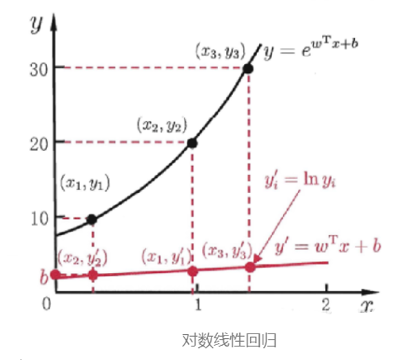

* * *

## 2 分类与回归

 我们再回顾到监督学习，监督学习分为回归和分类。

<table border="1" cellpadding="1" cellspacing="1" style="width:500px"><tbody><tr><td style="text-align:center">监督学习</td><td style="text-align:center">标签</td><td style="text-align:center">示例</td></tr><tr><td style="text-align:center">回归</td><td style="text-align:center">用于标签连续&nbsp;</td><td style="text-align:center">如何预测上海浦东的房价？</td></tr><tr><td style="text-align:center">分类</td><td style="text-align:center">用于标签离散</td><td style="text-align:center">根据肿瘤的体积、患者的年龄来判断</td></tr></tbody></table>

线性模型的输出可以是任意一个实值，也就是值域是连续的，因此可以天然用于做回归问题。而分类问题的标记是离散值，怎么把这两者联系起来？

其实广义线性模型已经给了我们答案，我们要做的就是：找到一个单调可微的联系函数，把两者联系起来。对于一个二分类任务，比较理想的函数是 单位阶跃函数（unit\_step function）:

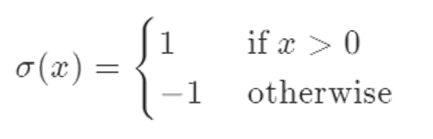

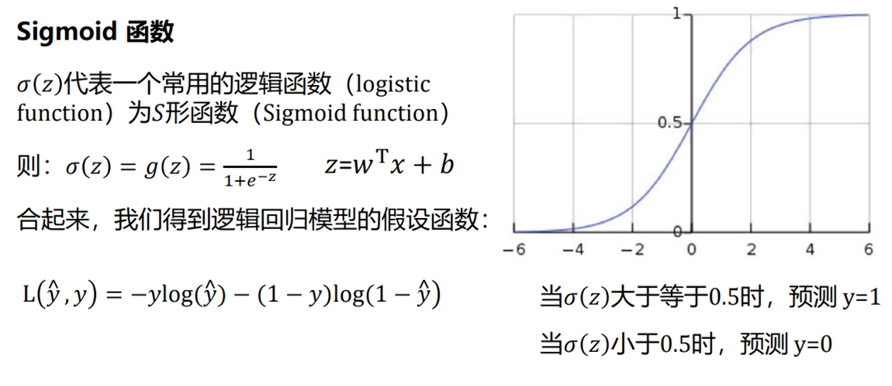

* * *

## 3 感知机模型

> 感知机是一种简单的线性分类模型，主要用于解决二分类问题。它的核心思想是通过找到一个分离超平面，将特征空间中的正负两类样本点区分开来。
> 
>  
> 
> 感知机的模型形式可以表示为：给定输入特征向量 x，通过权重向量 w 和偏置 b 计算线性组合 w・x + b，然后根据这个结果的符号来判断样本类别。具体来说，当 w・x + b ≥ 0 时，将样本判定为正类；当 w・x + b <0 时，判定为负类，可用符号函数表示为 f (x) = sign (w・x + b)。
> 
>  
> 
> 感知机的学习过程就是求解合适的权重 w 和偏置 b 的过程，其目标是最小化分类错误。学习算法采用**随机梯度下降法**，通过逐个处理误分类样本，不断调整 w 和 b 的值：当样本被误分类时，根据错误情况对 w 和 b 进行更新，使超平面向误分类样本一侧移动，逐渐减少误分类的情况，直到没有误分类样本为止。

这是对于感知机的一个简单介绍，M.Minsky仔细分析了以感知机为代表的神经网络的局限性，指出了感知机不能解决非线性问题。

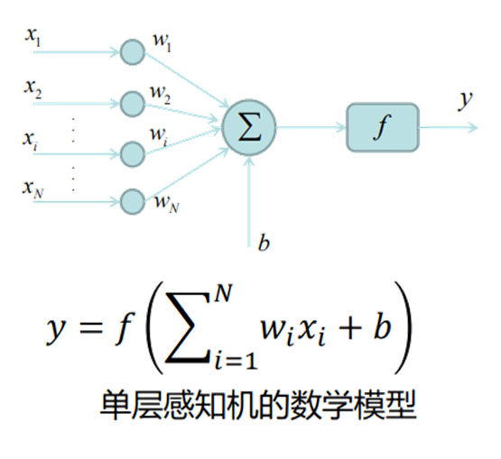

1986年，Rumelhart和McClelland为首的科学家提出了BP(Back Propagation)神经网络的概念，是一种按照误差**逆向传播**算法训练的多层前馈神经网络，目前是使用最广泛的神经网络。

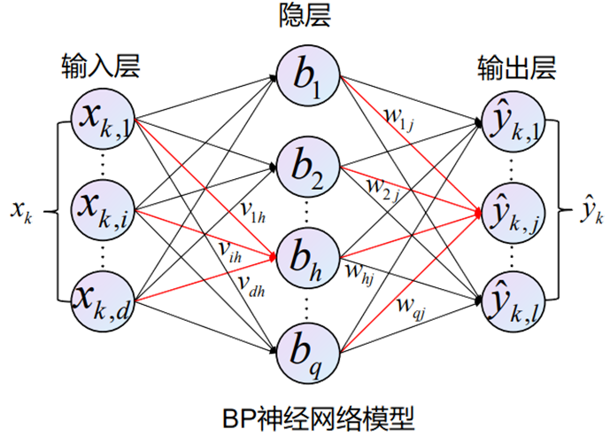

我们会收集一些数据点来决定模型的参数值（权重和偏差），例如过去6个月卖的房子。这被称之为训练数据。通常越多越好 。

假设我们有n个样本，记

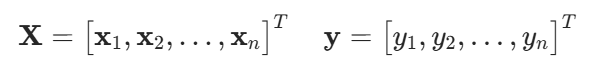

我们来比较真实值和我们预估的一个值，例如房屋售价和估价。假设Y是真实值，$\widehat{y}$是估计值，我们可以比较平方损失(该形式方便于后续微分)

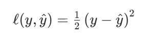

训练损失：

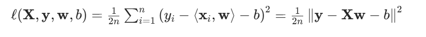

我们最小化损失来学习参数：

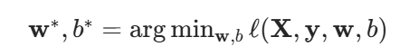

好的，接下来我们继续介绍**梯度下降：**我们对于一个初始值$w_{0}$,在重复迭代参数t = 1,2,3..

**$w_{t} = w_{t-1} - \eta \frac{\delta t}{\delta w _{t-1} }$**

沿梯度方向将增加损失函数值，而学习率就是步长的超参数。

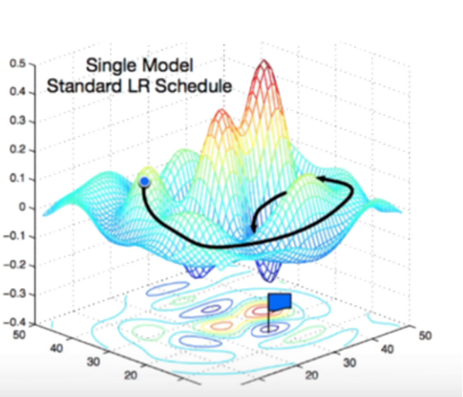

我们之所使用小批量随机梯度下降，因为在整个训练集上算梯度太贵，一个深度神经网络模型可能需要数分钟至数小时。

我们可以随机采样 b个样本来近似损失

$\frac{1}{b}\sum L(X_{i},Y_{i},W)$

b是一个重要的超参数，表示批量大小。选择一个合理的批量大小。不能太小，每次计算量太小，不适合并行来最大利用计算资源。也不能太大，内存消耗增加浪费计算，例如如果所有样本都是相同的。

那么，模型是如何进行训练和调参的呢？接下来我们学习模型的执行步骤：

**step 1 :  初始化神经网络**

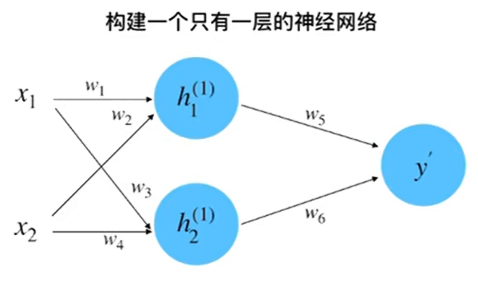

初始随机赋值：x1 = 0.5,x2 = 1.0,y = 0.8,w1 = 1.0,w2 = 0.5,w3 = 0.5,w4 = 0.7,w5 = 1.0,w6 = 2.0

**step 2 :  前向计算**

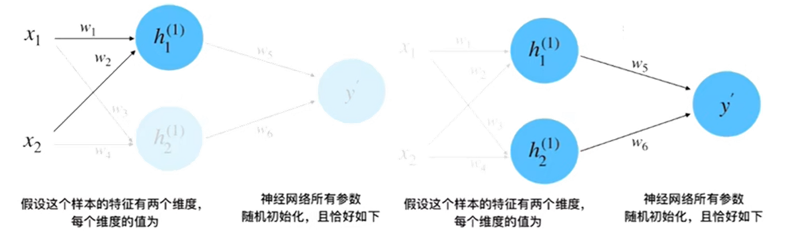参数赋值：x1 = 0.5,x2 = 1.0,y = 0.8,w1 = 1.0,w2 = 0.5,w3 = 0.5,w4 = 0.7,w5 = 1.0,w6 = 2.0

$h_{1}^{(1)} = w_{1}x_{1} &plus; w_{2}x_{2}$ = 1.0 \* 0.5 + 0.5 \* 1.0 = 1.0 计算得到：

$h_{1}^{(1)} = 1.0$   $h_{2}^{(1)} = 0.95$ 继而，${y}' = w_{5}h_{1}^{(1)} &plus; w_{6}h_{2}^{(1)}$ 计算得到值为2.9

**step 3 : 计算损失**


计算一下损失率：$\delta = \frac{1}{2}(y - {y}')^{2}$ 得到结果为2.205

**step 4 : 计算微分**


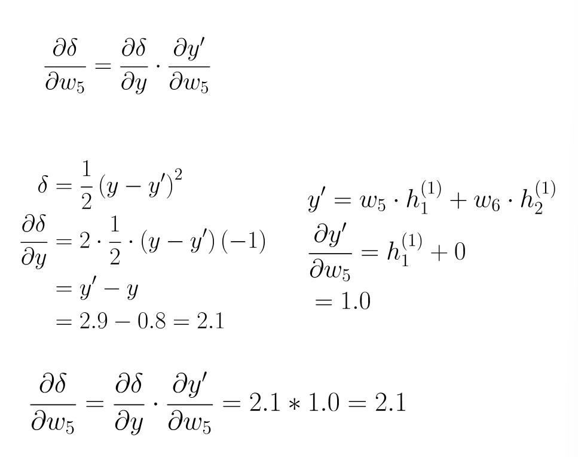

**step 5 : 梯度下降**

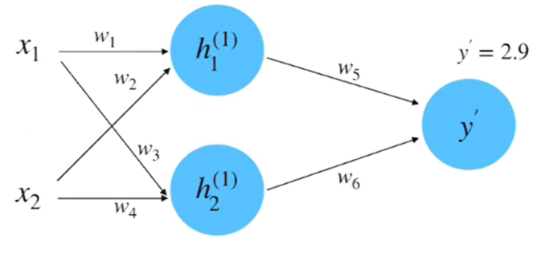

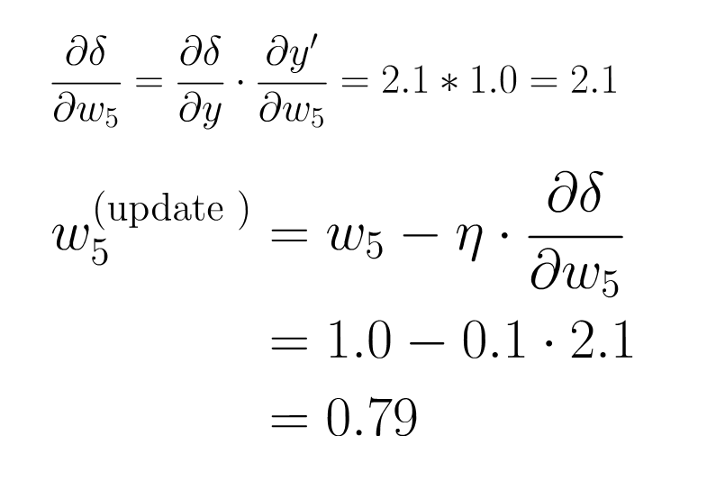

**step6 : 反向传播**

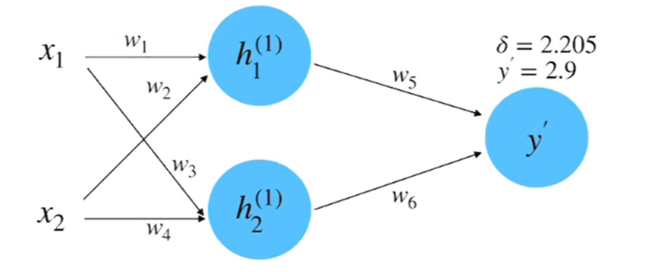

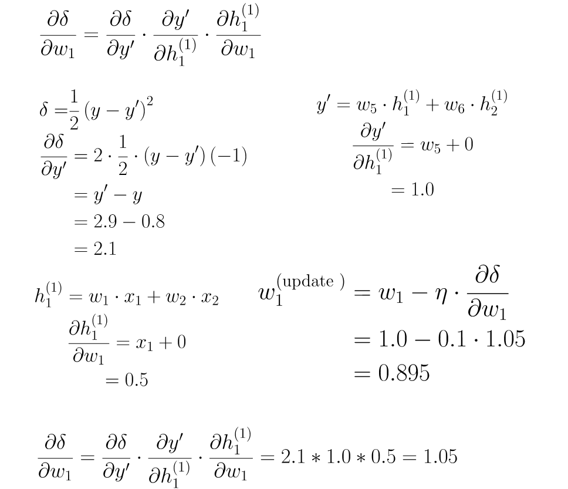

介绍完理论和公式，我们用**摆摊煎饼果子的致富计划**来做一个通俗的解释，便于我们理解：

你是一个夜市煎饼新手（神经网络）。你的目标是摊出完美的煎饼（最小化损失函数）。你的老师傅会一直巡逻然后教导你（梯度下降），而顾客会以抽样试吃团向你反馈（小批量样本）。

​**​初摊灾难：面糊炸锅事件​**​

你开始对怎么摊煎饼果子一窍不通。初始配方（𝑤₀=随机参数）如下：

面粉500g+水1勺 → 直接面糊变水泥

酱料致死量 → 辣哭第一位顾客 

顾客给出差评：“煎饼像砖头！酱料像喷火！”（损失值爆表）

​**梯度下降：老师傅救场**​

老师傅掂着锅怒骂：

“你看看你这煎饼。误差在哪？重点改三样！”（计算梯度）

① ​**​酱太辣（误差+80%）​**​→降辣度优先级MAX！

② ​**​面太厚（误差+50%）​**​→减面粉次之

③ ​**​薄脆太少（误差-10%）​**​→可忽略

​你开始按照师傅的建议进行配方的调整。而你调整的幅度就是**​学习率η**​

当η太大（猛降辣度80%）：新品甜如月饼 → 顾客掀摊：“我要吃煎饼不是点心！”

η太小（只降辣度1%）：继续摆摊3个月仍被骂“喷火龙煎饼”

​**​设η=30%​**​：酱料减辣30%+面粉减20% → 有效减少误差！

​**​小批量训练：夜市速成法​**​

老师傅：“你这样观察100个客人太费时！还摆不摆摊了”（全量训练费时）

你随机抓 ​**​5个试吃员（b=5）​**​：

学生A：酱少点！

上班族B：多加薄脆！

大妈C：面糊稀些！

你就按照这些信息进行​**​批量调整​**​：酱少一点，薄脆多一点，面糊含水量再多一点。这样就能够让80%客人满意！

​**​批量大小b：地摊生存法则​**​

​**​b=1（只听1人）​**​：学生说“多刷酱” → 狂加酱 → 大妈怒：“咸得发齁！”（过拟合）

​**​b=10（问卷普查）​**​：收10份需求时城管来了 → 摊没了！（内存溢出）

​**​b=5（黄金值）​**​：多样反馈+快速调整 → 出摊效率翻倍

​**​终极迭代：从地狱到米其林​**​

第1天：面糊水泥饼（损失值100）

第7天：老师傅举喇叭循环播放：“往梯度反方向调！酱料误差大就重点降酱！”

第30天：摊位排长队——

“老板！照着你这参数（𝑤=最佳面粉比, 𝑏=黄金酱量）再来十套！”

**名词介绍**​​

① ​**​梯度下降​**​ = 老师傅骂你改配方：

​**​骂最狠的地方​**​（最大误差）​**​优先改​**​

​**​骂多凶​**​（η）​**​决定你改多猛​**​

② ​**​小批量​**​ = 抓几个路人试吃：用小样本撬动大市场

③ ​**​批量b​**​：问太少→盲目，问太多→摊子瘫痪了

* * *

## 4 激活函数

我们在深度学习中，一般习惯在每层神经网络的计算结果送到下一层前都会添加一个激活函数。

> 激活函数是神经网络的​**​非线性引擎​**​，通过动态调制神经元输出与梯度流，使深度模型具备逼近复杂世界的表达能力。
> 
> ​​激活函数引入非线性​​，破除线性模型的枷锁。若无激活函数，无论叠加多少层，网络仅能表达​**​线性变换​**​（等效于单层线性模型）。使神经网络具备​**​逼近任意复杂函数​**​的能力（如图像、语言等非线性数据），形成​**​深度学习的表达能力根基​**​。
> 
> ​ ​**操作时**接收上一层输入的加权和（`z = Σ(w_i·x_i) + b`），通过函数 `f(z)`进行非线性转换，输出激活值 `a`至下一层。决定神经元是否被激活（如ReLU：正输入激活，负输入抑制）。

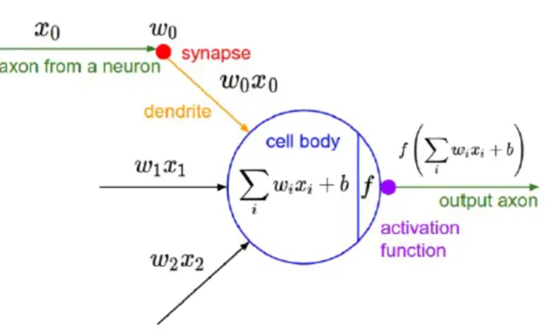

下面是几种常用的激活函数和对应的图像：

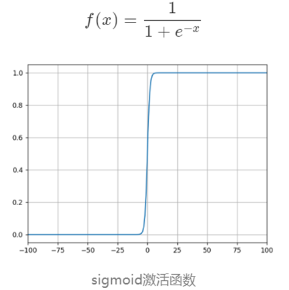

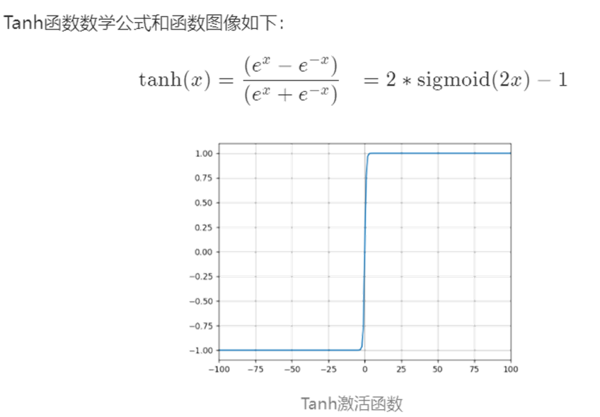


* * *

## 5 维度诅咒​​

我们在进行分类问题的处理时，这里以猫狗分类为例：

​​一维特征（如"圆眼睛"）​​：由于猫狗均具备此特征，无法实现完美分类。


​​二维特征（增加"尖耳朵"）​​：在二维空间中数据开始分离，但仍存在重叠区域。

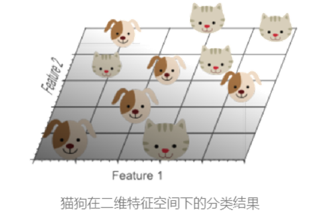​

所以引入第三个特征（如"长鼻子"），构建​​三维特征空间​​：

数据分布更离散，可通过一个​​分类超平面​​（如绿色平面）有效区分猫狗。

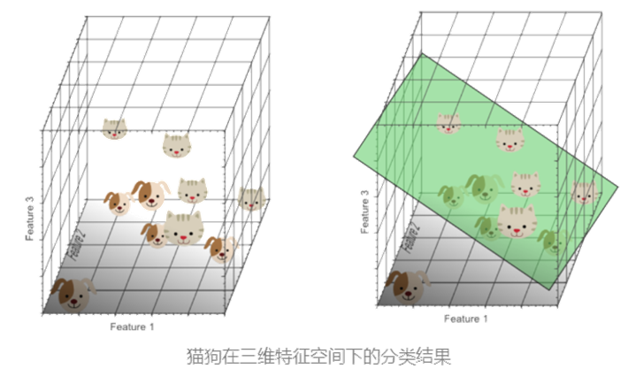

此时模型在一个高维度下能拟合更复杂的决策边界，分类效果提升。​

我们在持续增加特征数量时，问题也会凸显：

​​当样本密度指数级下降​​：特征空间维数越高，数据分布越稀疏。

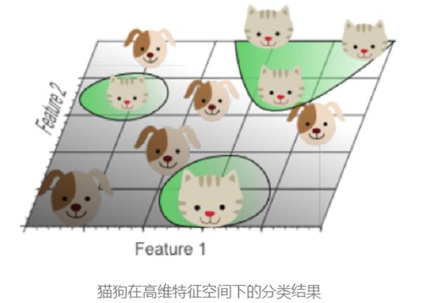

​​这样的稀疏性使找到"完美"分类超平面变得容易，但这是一种假象。此时在训练集上的效果太好了，而训练集不可能完全反应显示现实生活，无法代表真实世界复杂性。这就是**过拟合。**

​​过拟合的本质​​是高维分类结果映射回低维时，决策边界扭曲复杂，无法泛化到真实数据。

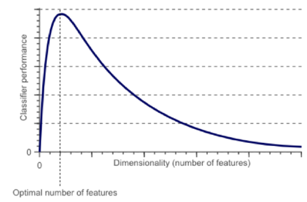

如图像所示，随特征数量增加，​​分类性能先上升后下降​​，存在最优特征数量阈值。

维度诅咒揭示了特征工程中的关键权衡——​​适当增加特征可提升模型能力，但盲目追求高维会导致过拟合​​。合理控制特征数量与复杂度，是规避诅咒的核心策略。（**神经网络的隐藏层其实就是在做数据的升降维。**）

* * *

## 6 过拟合与欠拟合

刚刚我们提到了过拟合，而影响模型过拟合或者欠拟合的原因注意有两个：数据（数据量多少）和模型容量（模型复杂度）

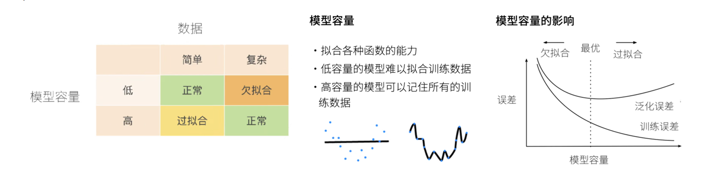​

​**​训练误差​**​：模型在训练数据集上的误差。

​**​泛化误差​**​：模型在无限多真实分布数据上误差的期望（实际通过独立测试集估计）。

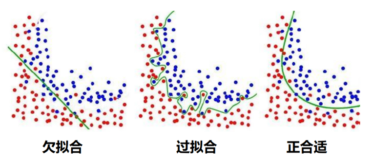

​**​过拟合​**​：训练误差极小，但泛化误差大（模型过度学习训练噪声）。

​**​欠拟合​**​：训练误差与泛化误差均大（模型未能捕捉数据规律）。

> ​**​目标​**​：同时降低训练与泛化误差，避免两种现象影响模型泛化能力。

​**​过拟合的处理方法​**

<table border="1" cellpadding="1" cellspacing="1" style="width:500px"><tbody><tr><td>​​正则化​</td><td>减少参数规模（如L1/L2正则化），约束模型复杂度。</td></tr><tr><td>​​数据增强​</td><td>增加数据数量、质量或难度（如翻转、裁剪图像）。</td></tr><tr><td>​​降维​</td><td>丢弃无关特征（手动选择或算法如PCA）。</td></tr><tr><td>​​集成学习​</td><td><p>​融合多个模型（如Bagging/Boosting），降低单模型过拟合风险。</p></td></tr></tbody></table>

**欠拟合的处理方法​**

<table border="1" cellpadding="1" cellspacing="1" style="width:500px"><tbody><tr><td>​​添加新特征​</td><td>挖掘组合特征，强化特征与标签相关性。</td></tr><tr><td>​​增加模型复杂度​</td><td>线性模型添加高次项；神经网络扩展层数/神经元。</td></tr><tr><td>​​减小正则化系数​</td><td>降低正则化强度（如减少λ值），释放模型学习能力。</td></tr></tbody></table>

​**​过拟合需抑制模型复杂度​**​（正则化、数据扩充），​**​欠拟合需提升模型能力​**​（特征/复杂度增强）。

始终以降低泛化误差为目标，平衡模型复杂性与数据特征表达力。

* * *

## 7 正则

深度学习中正则可视为通过约束模型复杂度来防止过拟合的手段。模型复杂度由参数量大小和参数取值范围共同决定，因此正则分为两个方向：

> 约束模型参数量（如 Dropout）
> 
> 约束模型参数的取值范围（如 weight decay）

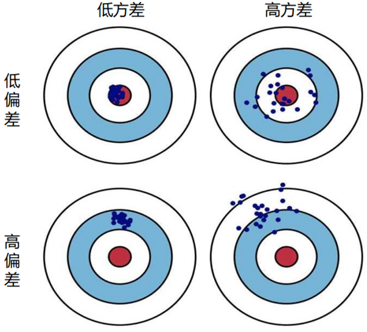

​**​偏差-方差权衡​**​

随着模型复杂度增加，**方差**会**​**​逐渐增大（模型对噪声敏感）。**偏差​**​逐渐减小（模型拟合能力增强）。正则化的核心是在虚线位置（模型复杂度适中）找到平衡点，使偏差和方差均适度，实现“适度拟合”。

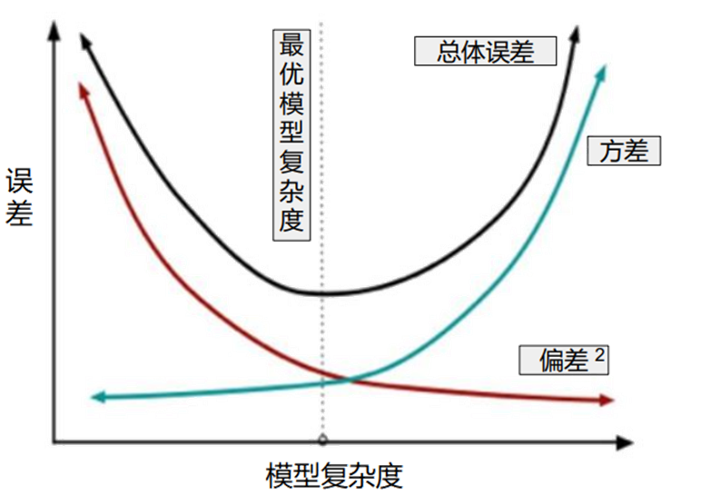

​**​L1 与 L2 正则化的区别​**​

> ​**​L2 正则化​**​：
> 
> 约束参数向原点靠近，使解更平滑。
> 
> ​**​L1 正则化​**​：
> 
> 约束解靠近某些坐标轴，同时使部分参数为零，产生稀疏解。

* * *

## 8 数据增强​

数据增强是通过​**​扩充训练集容量​**​防止过拟合（与正则化互补）。

解决模型在数据量不足时过度依赖训练样本的问题。

​

​**​数据量增强​**​：

对现有样本进行​**​简单变换​**​生成新样本（如旋转、翻转、裁剪、缩放、添加噪声）。

示例：图像数据通过旋转90°生成新训练样本（需保持标签有效性）。

​**​数据质量增强​**​：

提升数据信息密度（如文本数据清洗、图像分辨率增强）。

​**​现代扩展​**​

​**​生成对抗网络（GAN）​**​：

利用神经网络生成​**​逼真新样本​**​（如生成符合训练集分布的图像）。

实验验证可有效扩充数据集并提升泛化能力。

​**​关键结论​**​

> ​**​"成功的机器学习应用不是拥有最好的算法，而是拥有最多的数据！"​**​​

| 
方向

 | 

具体手段

 | 

作用

 |
| --- | --- | --- |
| 

​**​传统增强​**​

 | 

旋转/翻转/裁剪/加噪

 | 

低成本扩展数据量

 |
| 

​**​生成式增强​**​

 | 

GAN生成合成数据

 | 

解决小样本问题

 |
| 

​**​本质目标​**​

 | 

突破训练数据有限性

 | 

使模型适应真实世界复杂性

 |

* * *

## 9 数值稳定性


这种数值不稳定性问题再深度学习训练过程中被称作梯度消失和梯度爆炸。

梯度消失：由于累乘导致的梯度接近0的现象，此时训练没有进展。

梯度爆炸：由于累乘导致计算结果超出数据类型能记录的数据范围，导致报错。

防止出现数值不稳定原因的方法是进行数据归一化处理。

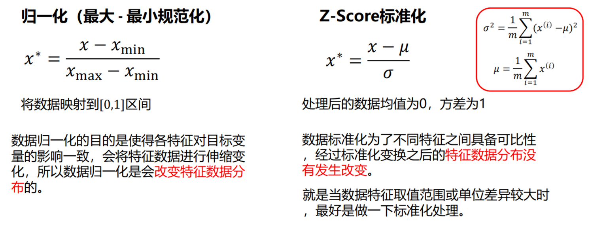

* * *

## 10 代码实现

###  10.1 线性模型与梯度下降演示

```python
# 线性模型与梯度下降演示

import numpy as np
import matplotlib
import matplotlib.pyplot as plt

matplotlib.rcParams['font.sans-serif'] = ['SimHei']
matplotlib.rcParams['axes.unicode_minus'] = False

# 随机种子
np.random.seed(42)

# 模拟数据
x = np.random.rand(100, 1) * 10  # 100个样本，1维特征
y = 3 * x + 2 + np.random.randn(100, 1) * 2  # 真实值

# 初始化参数
w = np.random.randn(1)  # 权重
b = np.random.randn(1)  # 偏置
lr = 0.0001  # 学习率
epochs = 1000  # 迭代次数

# 梯度下降训练
loss_history = []

for epoch in range(epochs):
    # 前向计算
    y_pred = w * x + b

    # 计算损失
    loss = np.mean((y_pred - y)**2)
    loss_history.append(loss)

    # 计算梯度
    dw = 2 * np.mean((y_pred - y) * x)  # w的梯度
    db = 2 * np.mean(y_pred - y)       # b的梯度

    # 参数更新
    w -= lr * dw
    b -= lr * db

# 输出结果
print(f"训练后参数：w={w[0]:.4f}, b={b[0]:.4f}")

# 绘制损失曲线
plt.figure(figsize=(8, 4))
plt.plot(range(epochs),loss_history,color='tab:blue', linewidth=1.5)
plt.xlabel("迭代次数")
plt.ylabel("平方损失")
plt.title("梯度下降收敛过程")
plt.grid(True, linestyle='--', alpha=0.6)
plt.show()
```

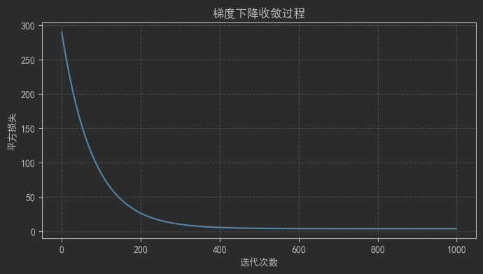

* * *

### 10.2 对比梯度下降的收敛速度

```python
def bgd(x, y, lr=0.01, epochs=100):
    """批量梯度下降"""
    # 初始化参数（w形状为(1,1)，b形状为(1,1)）
    w, b = np.random.randn(1, 1), np.random.randn(1, 1)
    n = len(x)  # 样本数量（n=100）
    loss = []

    for _ in range(epochs):
        # 前向传播：x形状(100,1)，w形状(1,1)，结果形状(100,1)
        y_pred = x.dot(w) + b

        # 计算误差（形状(100,1)）
        error = y_pred - y

        # 计算梯度（x.T形状(1,100)，与error点积后得到(1,1)的梯度）
        dw = (2/n) * x.T.dot(error)  # 形状(1,1)
        db = (2/n) * np.sum(error)   # 标量（形状()）

        # 参数更新（w和b形状匹配）
        w -= lr * dw
        b -= lr * db

        # 记录当前参数下全量数据的MSE损失（形状()）
        loss.append(np.mean(error**2))

    return loss

def sgd(x, y, lr=0.01, epochs=100):
    """随机梯度下降"""
    # 初始化参数（w形状(1,1)，b形状(1,1)）
    w, b = np.random.randn(1, 1), np.random.randn(1, 1)
    n = len(x)
    loss = []

    for _ in range(epochs):
        # 随机选择1个样本（索引范围0~99）
        idx = np.random.randint(n)
        # 提取单样本并保持二维形状（避免一维广播问题）
        xi = x[idx].reshape(1, 1)  # 形状(1,1)
        yi = y[idx].reshape(1, 1)  # 形状(1,1)

        # 前向传播（单样本预测值，形状(1,1)）
        y_pred = xi.dot(w) + b

        # 计算单样本误差（形状(1,1)）
        error = y_pred - yi

        # 计算单样本梯度（形状(1,1)）
        dw = 2 * error * xi  # 形状(1,1)
        db = 2 * error       # 标量（形状()）

        # 参数更新（w和b形状匹配）
        w -= lr * dw
        b -= lr * db

        # 计算全量数据的MSE损失（使用当前参数预测所有样本）
        y_pred_full = x.dot(w) + b  # 形状(100,1)
        loss.append(np.mean((y_pred_full - y)**2))  # 标量

    return loss

def mbgd(x, y, lr=0.01, epochs=100, batch_size=10):
    """小批量梯度下降"""
    # 初始化参数（w形状(1,1)，b形状(1,1)）
    w, b = np.random.randn(1, 1), np.random.randn(1, 1)
    n = len(x)
    loss = []

    for _ in range(epochs):
        # 随机选择batch_size个样本（不重复）
        idx = np.random.choice(n, batch_size, replace=False)
        # 提取批量数据并保持二维形状（形状(batch_size,1)）
        xi = x[idx].reshape(batch_size, 1)
        yi = y[idx].reshape(batch_size, 1)

        # 前向传播（批量预测值，形状(batch_size,1)）
        y_pred = xi.dot(w) + b

        # 计算批量误差（形状(batch_size,1)）
        error = y_pred - yi

        # 计算批量梯度（xi.T形状(1,batch_size)，与error点积后得到(1,1)的梯度）
        dw = (2/batch_size) * xi.T.dot(error)  # 形状(1,1)
        db = (2/batch_size) * np.sum(error)    # 标量（形状()）

        # 参数更新（w和b形状匹配）
        w -= lr * dw
        b -= lr * db

        # 计算全量数据的MSE损失（使用当前参数预测所有样本）
        y_pred_full = x.dot(w) + b  # 形状(100,1)
        loss.append(np.mean((y_pred_full - y)**2))  # 标量

    return loss

# 生成线性关系数据（y = 3x + 2 + 噪声）
np.random.seed(42)
x = np.random.rand(100, 1) * 10  # 100个样本，1个特征，形状(100,1)
y = 3 * x + 2 + np.random.randn(100, 1) * 1.5  # 真实标签，形状(100,1)

# 运行三种梯度下降（确保返回的loss长度均为100）
bgd_loss = bgd(x, y, lr=0.001, epochs=100)
sgd_loss = sgd(x, y, lr=0.0005, epochs=100)  # SGD学习率更小
mbgd_loss = mbgd(x, y, lr=0.001, epochs=100, batch_size=10)

# 绘制收敛曲线（确保x和y长度一致）
plt.figure(figsize=(10, 6))
plt.plot(range(100), bgd_loss, label='批量梯度下降 (BGD)')
plt.plot(range(100), sgd_loss, label='随机梯度下降 (SGD)')
plt.plot(range(100), mbgd_loss, label='小批量梯度下降 (MBGD)')
plt.xlabel('迭代次数')
plt.ylabel('均方误差 (MSE)')
plt.title('不同梯度下降策略收敛速度对比')
plt.legend()
plt.grid(True)
plt.show()
```

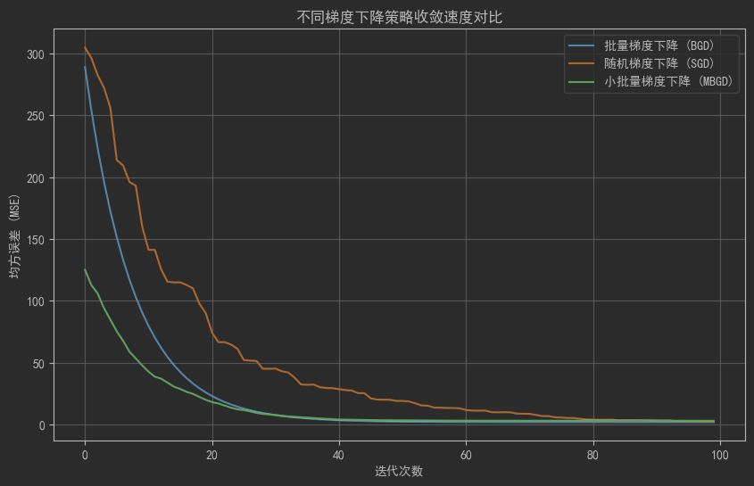

* * *

### 10.3 激活函数以及图像

```python
# 激活函数可视化

# 定义激活函数
def sigmoid(x):
    return 1 / (1 + np.exp(-x))

def tanh(x):
    return np.tanh(x)

def relu(x):
    return np.maximum(0, x)

def leaky_relu(x, alpha=0.1):
    return np.where(x > 0, x, alpha * x)

# 生成输入数据
x = np.linspace(-5, 5, 100)

# 绘制图像
plt.figure(figsize=(12, 8))

plt.subplot(2, 2, 1)
plt.plot(x, sigmoid(x))
plt.title('Sigmoid')
plt.grid()

plt.subplot(2, 2, 2)
plt.plot(x, tanh(x))
plt.title('Tanh')
plt.grid()

plt.subplot(2, 2, 3)
plt.plot(x, relu(x))
plt.title('ReLU')
plt.grid()

plt.subplot(2, 2, 4)
plt.plot(x, leaky_relu(x))
plt.title('Leaky ReLU')
plt.grid()

plt.tight_layout()
plt.show()
```

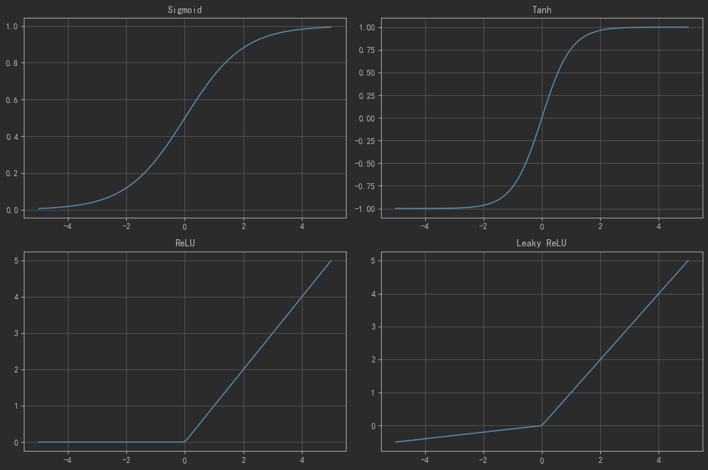

* * *

### 10.4 过拟合与欠拟合

```python
# 过拟合与欠拟合演示

from sklearn.linear_model import LinearRegression
from sklearn.preprocessing import PolynomialFeatures
from sklearn.pipeline import make_pipeline
from sklearn.model_selection import train_test_split

# 生成模拟数据
np.random.seed(42)
x = np.linspace(0, 2*np.pi, 100)
y = np.sin(x) + np.random.randn(100) * 0.1
x = x.reshape(-1, 1)
x_train, x_test, y_train, y_test = train_test_split(x, y, test_size=0.3, random_state=42)

# 定义不同阶数的多项式模型
degrees = [1, 3, 5, 10, 15]
train_errors = []
test_errors = []

for degree in degrees:
    # 构建多项式回归模型
    model = make_pipeline(
        PolynomialFeatures(degree=degree),
        LinearRegression()
    )
    model.fit(x_train, y_train)

    # 计算训练和测试误差
    y_train_pred = model.predict(x_train)
    y_test_pred = model.predict(x_test)
    train_errors.append(np.mean((y_train_pred - y_train)**2))
    test_errors.append(np.mean((y_test_pred - y_test)**2))

# 绘制误差曲线
plt.figure(figsize=(10, 6))
plt.plot(degrees, train_errors, 'o-', label='训练误差')
plt.plot(degrees, test_errors, 'o-', label='测试误差')
plt.xlabel('多项式阶数（模型复杂度）')
plt.ylabel('均方误差')
plt.title('过拟合与欠拟合：模型复杂度 vs 误差')
plt.xticks(degrees)
plt.legend()
plt.grid()
plt.show()
```

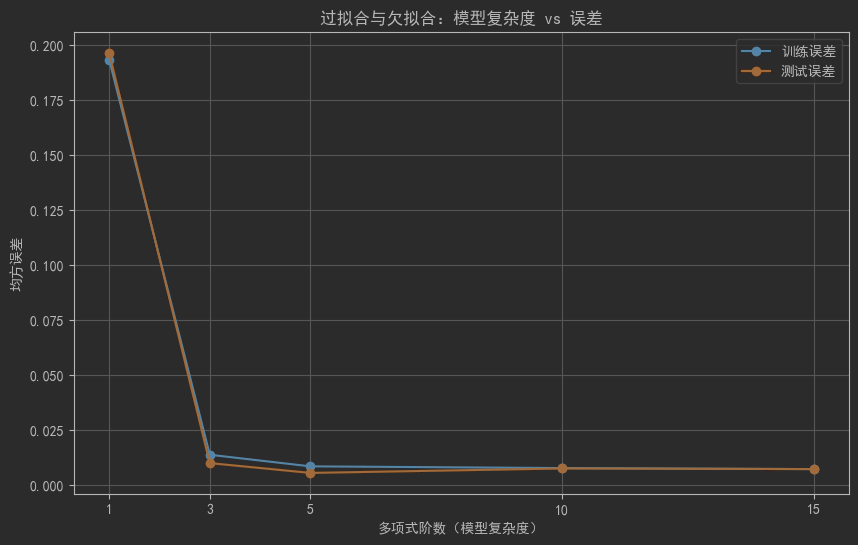

* * *

### 10.5 正则化处理

```python
import numpy as np
import matplotlib.pyplot as plt
from sklearn.linear_model import Ridge, LinearRegression
from sklearn.datasets import make_regression
from sklearn.model_selection import train_test_split

# 生成高维稀疏数据（模拟维度诅咒场景）
X, y = make_regression(n_samples=100, n_features=20, noise=0.1, random_state=42)
X_train, X_test, y_train, y_test = train_test_split(X, y, test_size=0.3, random_state=42)

# 训练普通线性回归和L2正则回归
lr = LinearRegression()
ridge = Ridge(alpha=1.0)  # alpha是正则化强度

lr.fit(X_train, y_train)
ridge.fit(X_train, y_train)

# 输出参数对比
print("普通线性回归参数（绝对值）：", np.abs(lr.coef_).round(4))
print("L2正则回归参数（绝对值）：   ", np.abs(ridge.coef_).round(4))

# 绘制泛化误差对比
plt.figure(figsize=(8, 5))
plt.bar(['普通线性回归', 'L2正则回归'],
        [np.mean((lr.predict(X_test)-y_test)**2),
         np.mean((ridge.predict(X_test)-y_test)**2)],
        color=['skyblue', 'lightcoral'])
plt.ylabel('测试集均方误差')
plt.title('正则化对泛化能力的影响')
plt.grid(axis='y', linestyle='--')
plt.show()
```

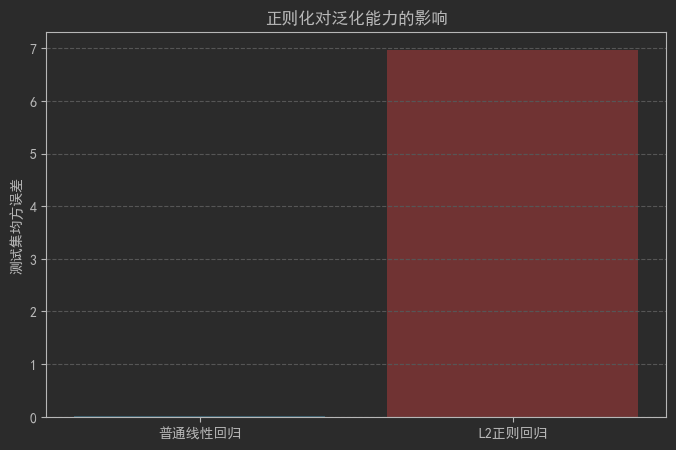

* * *

### 10.6 神经网络简单构建

```python
# 导入必要库
import torch
import torch.nn as nn
import torch.optim as optim
from torchvision import datasets, transforms
from torch.utils.data import DataLoader
import matplotlib.pyplot as plt

# ---------------------- 1. 数据准备 ----------------------
# 定义数据预处理（归一化 + 转换为张量）
transform = transforms.Compose([
    transforms.ToTensor(),  # 将PIL图像转为Tensor（形状：[1,28,28]）
    transforms.Normalize((0.1307,), (0.3081,))  # MNIST全局均值0.1307，标准差0.3081
])

# 加载训练集和测试集
train_dataset = datasets.MNIST(
    root='./data', train=True, download=True, transform=transform)
test_dataset = datasets.MNIST(
    root='./data', train=False, download=True, transform=transform)

# 创建数据加载器（批量加载数据）
batch_size = 64
train_loader = DataLoader(train_dataset, batch_size=batch_size, shuffle=True)
test_loader = DataLoader(test_dataset, batch_size=batch_size, shuffle=False)

# ---------------------- 2. 定义神经网络模型 ----------------------
class SimpleNN(nn.Module):
    def __init__(self):
        super(SimpleNN, self).__init__()
        # 定义网络层结构：输入层→隐藏层→输出层
        self.layers = nn.Sequential(
            nn.Linear(in_features=28 * 28, out_features=128),  # 输入层（784→128）
            nn.ReLU(),  # 激活函数（引入非线性）
            nn.Linear(in_features=128, out_features=64),   # 隐藏层（128→64）
            nn.ReLU(),
            nn.Linear(in_features=64, out_features=10)     # 输出层（64→10，对应0-9分类）
        )
    
    def forward(self, x):
        # 前向传播：展平图像（从[64,1,28,28]→[64,784]）→通过各层
        x = x.view(x.size(0), -1)  # 展平操作（关键！）
        x = self.layers(x)
        return x

# ---------------------- 3. 初始化模型、损失函数和优化器 ----------------------
model = SimpleNN()
criterion = nn.CrossEntropyLoss()  # 多分类交叉熵损失（内置Softmax）
optimizer = optim.Adam(model.parameters(), lr=0.001)  # Adam优化器（自适应学习率）

# ---------------------- 4. 训练模型 ----------------------
epochs = 10  # 训练轮数
train_losses = []  # 记录每轮训练损失
train_accuracies = []  # 记录每轮训练准确率

for epoch in range(epochs):
    model.train()  # 开启训练模式（影响Dropout/BatchNorm等层）
    running_loss = 0.0
    correct = 0
    total = 0
    
    for batch_idx, (images, labels) in enumerate(train_loader):
        # 前向传播
        outputs = model(images)
        loss = criterion(outputs, labels)
        
        # 反向传播 + 优化
        optimizer.zero_grad()  # 清空梯度
        loss.backward()        # 计算梯度
        optimizer.step()       # 更新参数
        
        # 统计指标
        running_loss += loss.item()
        _, predicted = torch.max(outputs.data, 1)  # 获取预测类别（概率最大的索引）
        total += labels.size(0)
        correct += (predicted == labels).sum().item()
        
        # 每100个batch打印一次日志
        if (batch_idx+1) % 100 == 0:
            print(f'Epoch [{epoch+1}/{epochs}], Batch [{batch_idx+1}/{len(train_loader)}], '
                  f'Loss: {running_loss/100:.4f}, Acc: {100*correct/total:.2f}%')
            running_loss = 0.0
    
    # 记录本轮平均损失和准确率
    avg_loss = running_loss / len(train_loader)
    train_losses.append(avg_loss)
    train_acc = 100 * correct / total
    train_accuracies.append(train_acc)
    print(f'Epoch [{epoch+1}/{epochs}] 完成，平均损失: {avg_loss:.4f}, 训练准确率: {train_acc:.2f}%')

# ---------------------- 5. 测试模型 ----------------------
model.eval()  # 开启评估模式（关闭Dropout/BatchNorm等）
test_correct = 0
test_total = 0

with torch.no_grad():  # 关闭梯度计算（节省内存）
    for images, labels in test_loader:
        outputs = model(images)
        _, predicted = torch.max(outputs.data, 1)
        test_total += labels.size(0)
        test_correct += (predicted == labels).sum().item()

print(f'测试集准确率: {100 * test_correct / test_total:.2f}%')

# ---------------------- 6. 可视化训练过程 ----------------------
plt.figure(figsize=(12, 4))

# 损失曲线
plt.subplot(1, 2, 1)
plt.plot(range(1, epochs+1), train_losses, 'bo-', label='训练损失')
plt.xlabel('轮数')
plt.ylabel('损失')
plt.title('训练损失变化')
plt.legend()

# 准确率曲线
plt.subplot(1, 2, 2)
plt.plot(range(1, epochs+1), train_accuracies, 'ro-', label='训练准确率')
plt.xlabel('轮数')
plt.ylabel('准确率 (%)')
plt.title('训练准确率变化')
plt.legend()

plt.tight_layout()
plt.show()
```

* * *
