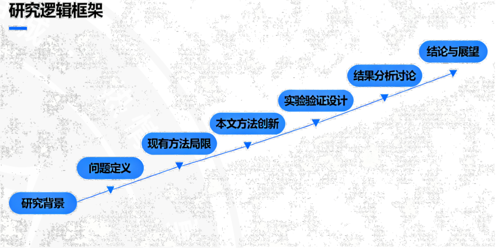
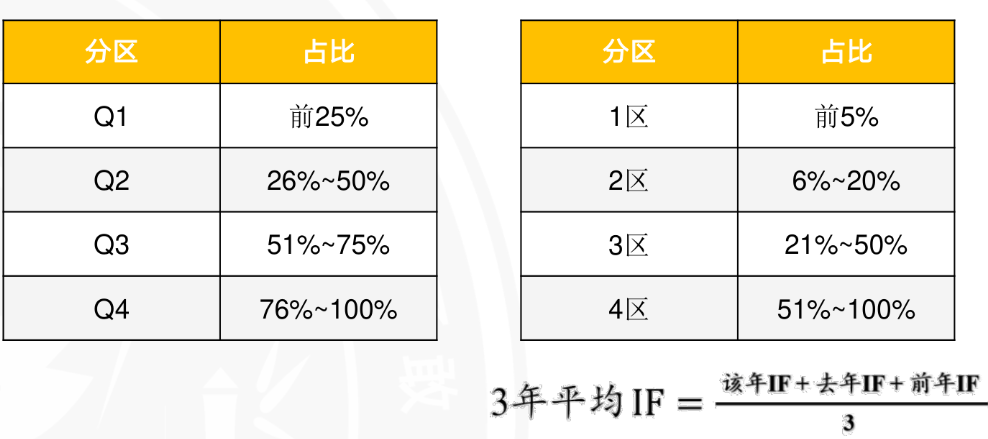
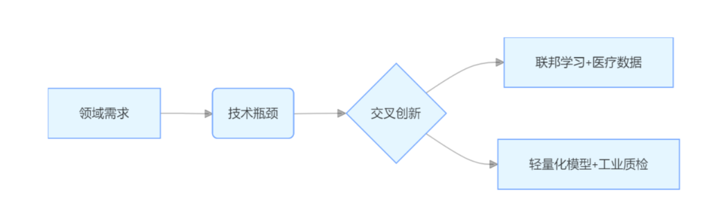
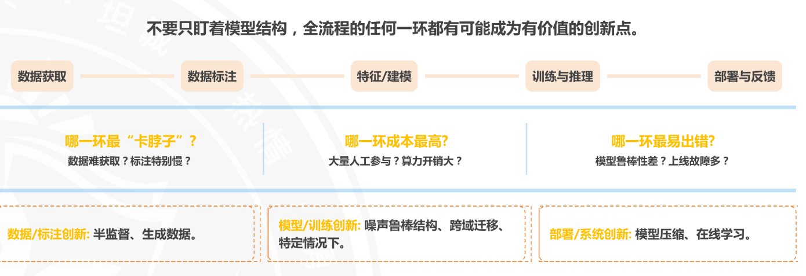

关于人工智能相关的论文选题和开题的学习方法，包含

## 1 论文的标准结构

AI论文通常遵循以下通用的结构，每一部分都有明确的功能与写作要点。

**标题**

标题是论文的门面，要求准确反映贡献，包含关键词，吸引读者注意力。

作用：简明扼要地概括论文的核心创新点。

核心：让读者一眼看出论文的创新点与价值所在。

**摘要**

摘要是论文高度浓缩的精华，一般200-300词，独立成文，主要突出创新价值，需要包含一些关键的数据和结论。

作用：高度概括研究背景、方法、结果和结论

核心：摘要是论文的“电梯演讲”，需要在有限篇幅内传达最大价值。

**引言**

引言就是讲好研究故事，一般由宏观到微观层层递进，明确研究缺口。

作用：建立研究背景，指出现有不足、明确本文贡献。

核心：引言就像讲故事，要引导读者从已知走向未知，再展示你的解决方案。

**方法**

方法就是对于核心技术的展示，应该是清晰完整，确保可复现，重点突出创新模块，提供足够的技术细节

作用：详细描述模型的架构、算法设计。

核心：方法部分要像菜谱一样详细，让其他研究者能够明白你所用的方法与模型原理。

**实验**

实验就是用数据说话，进行数据集描述，描述数据集的来源、规模、划分。然后对于实验的设置，环境、参数、基线等等。通过量化指标对比实验结果。最后进行消融分析，分析模块贡献度。

作用：描述实验细节，验证方法有效性，进行充分对比和分析

**讨论与结论**

讨论部分是深入分析结果现象、解释成功或者失败的原因。

结论部分是总结全文贡献，强调一下创新价值，指出方法局限性、展望未来工作。

在此部分忌讳引入新内容、过度夸大成果、忽略方法局限性。

总结：讨论过程中要体现作者的思考深度，结论部分要简洁有力。

**逻辑框架**  

**\*图表在论文中的核心地位**

图表作为论文的可视化工具，在论文描述中发挥重要作用。

**设计原则**  
简洁明了 - 避免过度装饰

信息完整 - 包含必要标注

自解释性强 - 图表标题清5

**常见图表类型**

模型架构图-展示网络结构

结果对比图-柱状图、曲线图

消融分析图-热力图、雷达图

特征可视化-注意力图、特征图

总结：

AI论文有明确的结构规范，每部分承担特定功能

核心功能句是理解论文贡献的关键

图表是AI论文中不可或缺的可视化工具

通过逻辑拆解可以深入理解论文的创新思路

* * *

## 2 论文的级别

**顶级会议vs顶级期刊**

顶级会议：

特定领域内最具影响力的学术会议，通常每年或定期举办，用于发布最新研究成果、促进学者交流与合作。

-   审稿周期短（3-6个月）
-   注重创新性与前沿性
-   会议现场交流活跃

顶级期刊：

特定领域内权威性最高的学术期刊，定期出版（如月刊或季刊），发表经过严格同行评审的完整研究文章。

-   审稿周期长（6-12个月，甚至更长）
-   要求工作完整、理论扎实
-   实验充分、系统性强

核心：顶会适合“新快尖”，顶刊适合“系统深”，根据研究类型和发表目标选择。

### 主流索引系统区别

#### 三种国际学术期刊索引系统

SCI：自然科学领域高质量期刊索引，理工科重要评价指标，注重实验数据与理论创新。

SSCI：人文社会科学领域期刊索引，适用于经济、心理、教育、社会学等。

EI：工程技术领域文献索引（如机械、电子、计算机等），收录期刊与会议论文。

适用场景：

理工科优先选择SCI期刊（尤其是高分区），EI可作为备选。

人文社科优先选择SSCI期刊。

跨学科研究可尝试SCI或SSCI的交叉方向。

### SCI期刊评价体系

#### 影响因子IF

影响因子是由科睿唯安出品的期刊印证报告中的一项数据，是国际上通用的期刊评价指标。

### SCI分区

主要有两种分区标准：科睿唯安JCR分区（Q1~Q4）,中科院JCR分区（1区~4区）。两种标准都是基于期刊的IF将SCI期刊分为4个区，只是IF划分区间的标准不同。

### 投稿目标分析实例

工具链接：[https://www.letpub.com.cn/index.php?page=journalapp&view=search](https://www.letpub.com.cn/index.php?page=journalapp&view=search "https://www.letpub.com.cn/index.php?page=journalapp&view=search")

* * *

## 3 如何找和读论文

#### 论文检索网站汇总

Goole Scholar

网址：[http://https;//Scholar.goole.com](http://https;//Scholar.goole.com "http://https;//Scholar.goole.com")

特点：免费，广泛的学术资源，涵盖期刊文章、书籍、会议论文、学位论文等，支持跨学科搜索。提供引文分析和引用跟踪功能。

百度学术

网址:[https://xueshu.baidu.com](https://xueshu.baidu.com "https://xueshu.baidu.com")

特点:专为中文用户设计的学术搜索引擎，涵盖了中国的学术资源，支持文献检索和引用查找。

PubMed

网址：[https://pubmed.ncbi.nlm.nih.gov](https://pubmed.ncbi.nlm.nih.gov "https://pubmed.ncbi.nlm.nih.gov")

特点：由美国国立卫生研究院提供，主要用于生物医学、生命科学相关文献的检索，涵盖了大量的期刊论文、研究报告等。

IEEE Xplore

网址：[http://htpps://ieeexplore.ieee.org](http://htpps://ieeexplore.ieee.org "http://htpps://ieeexplore.ieee.org")

特点：主要收录电子、计算机科学、工程技术等领域的文献，尤其是IEEE出版的期刊和会议论文。

CNKI（中国知网）

网址：[https://www.cnki.net](https://www.cnki.net "https://www.cnki.net")

特点：收录了大量中文学术期刊、硕博士论文、会议论文资源，广泛用于中国的学术文献查找。

Elsevier ScienceDirect

网址：[https://www.sciencedirect.com](https://www.sciencedirect.com "https://www.sciencedirect.com")

特点：主要收录科学、技术、医学等领域的期刊文章，尤其以工程、化学、物理学等领域的资源为主。

SpringerLink

网址：[https://link.springer.com](https://link.springer.com "https://link.springer.com")

特点：收录了大量科学、技术和医学领域的期刊文章、书籍和会议论文，适合跨学科研究。

ACM Digital Library

网址：[https://dl.acm.org](https://dl.acm.org "https://dl.acm.org")

特点：计算机科学领域的经典文库，收录了大量计算机科学期刊、会议论文、技术报告等。

ArXiv

网址：[https://arxiv.org](https://arxiv.org "https://arxiv.org")

特点：免费开放的预印本数据库，主要包含物理学、数学、计算机科学等领域的最新研究成果。

Web of Science(WoS)

网址：[https://www.webofscience.com](https://www.webofscience.com "https://www.webofscience.com")

特点：高质量的文献检索数据库，提供自然科学、社会科学、艺术人文科学的文献资源，尤其注重文献的引用和影响力分析。

* * *

#### 高效读论文

看论文本身不是目的，而是手段。是服务于科研这一中心工作的。要带着科研目的去看论文。

科研的基本目标是四点：

1.  熟悉当前的研究领域
2.  跟进最新的科研进展
3.  寻找新的创新点
4.  寻找解决当前科研问题的借鉴方法

那么看论文我们需要学到什么呢？

为什么要做这个研究？

关注引言阐述的本项研究的重大意义、要解决什么难题或者解释什么机制？问题的急迫性。

研究发现了什么，得到什么结论？

体现最核心的结论，对问题有什么新的认识？提出了什么研究方法？优先关注摘要。

研究如何实施？

这部分比较具体，详细。研究的实施过程就是论文的主体内容。

* * *

#### **文献阅读三步法**

**第一步 快速扫描整篇文章（5-10分钟）**

> 仔细阅读题目、摘要和引言。
> 
> 阅读章节和子章节的标题，但忽略其他内容。
> 
> 阅读结论。

完成这部分阅读，应该可以回答5个问题

-   类型：这是什么类型的研究？定量研究？还是对现有体系的一个分析？
-   情景：它与什么论文有关？分析这个问题的理论基础是什么?
-   正确性：假设是否有效？
-   贡献：论文的主要贡献是什么？
-   清晰度：论文写的好吗？

按照这五个问题，决定要不要继续阅读。不阅读有可能是我们对这个领域了解不够，无法理解。也可能只是不属于研究领域。

**第二步 记录要点或者做出批注（最多一个小时）**

> 仔细看论文的数字、图表、插图
> 
> 记住相关的未读的参考文献

这次完整后应该可以掌握论文的内容，可以进行总结论文的主旨，并提供支持证据。

**第三步 完全理解文章（四到五个小时）**

> 这步骤非常注重细节。应该识别并挑战每一个陈述中的每一个假设。考虑一下如何表述一个特定的想法。有助于了解演示技术。

* * *

## 4 选题的原则与方法

#### 选题的原则和要素

科研选题

<table border="1" cellpadding="1" cellspacing="1" style="width:650px"><tbody><tr><td style="width:71px">科学性</td><td style="width:577px">选题需要有理有据，深刻掌握理论和该选题的国内外的研究现状和发展趋势，避免选题误入歧途或低水平重复。</td></tr><tr><td style="width:71px">创新性</td><td style="width:577px">科学研究的灵魂，创新性是科学研究的核心，是衡量研究水平的主要标准。</td></tr><tr><td style="width:71px">实用性</td><td style="width:577px">理论上具有学术价值，同时有现实意义，应用的可操作性。应该具备相当广阔的前景。</td></tr><tr><td style="width:71px">可行性</td><td style="width:577px">研究方案的可行性，计划 的合理性和预见性。等符合现实意义</td></tr></tbody></table>

选题要素

<table border="1" cellpadding="1" cellspacing="1" style="width:650px"><tbody><tr><td>需求性</td><td>国家科技发展战略的需求，经济社会发展的需求，企业技术创新的需求</td></tr><tr><td>创新性</td><td>知识创新，技术创新，技术转移</td></tr></tbody></table>

* * *

#### 研究问题的挖掘与分析方法

对于AI相关的文章，研究问题的挖掘和分析基本符合关键痛点。

领域痛点：

<table border="1" cellpadding="1" cellspacing="1" style="width:650px"><tbody><tr><td>关键难题</td><td>小样本学习精度不足，大模型幻觉</td></tr><tr><td>方法缺陷</td><td>传统AI动态场景实时性差、高维数据效率低</td></tr><tr><td>应用瓶颈</td><td>部署算力高、推理速度慢</td></tr><tr><td>场景短板</td><td>强噪声环境识别率低、能力边界模糊</td></tr></tbody></table>

交叉点研究：

* * *

#### 误区规避与研究课题

常见误区

<table border="1" cellpadding="1" cellspacing="1" style="width:650px"><tbody><tr><td>技术拼接</td><td>简单拼接多个技术（同时使用但是无核心逻辑）</td><td>
应该聚焦核心问题，明确技术的必要性
</td></tr><tr><td>问题模糊</td><td>研究范围过宽</td><td>精准界定边界</td></tr><tr><td>创新过小</td><td>仅调整模型参数和数据集优化标注等细微改进</td><td>确保创新点有技术跨度</td></tr><tr><td>脱离现实</td><td>忽略落地条件</td><td>结合具体应用场景设计</td></tr></tbody></table>

* * *

选题构思实操框架

<table border="1" cellpadding="1" cellspacing="1" style="width:650px"><tbody><tr><td>领域选择</td><td>我感兴趣的AI细分领域是（ ）</td></tr><tr><td>痛点识别</td><td>该领域当前最紧迫的问题是（ ）</td></tr><tr><td>技术分析</td><td>现有AI方法的主要局限是（）</td></tr><tr><td>创新定位</td><td>我的潜在切入点是（）</td></tr><tr><td>价值论证</td><td>价值论证：研究的理论和应用价值是（）</td></tr></tbody></table>

* * *

## 5 数据获取

#### 数据价值

数据质量决定模型上限

  高质量数据是模型性能的关键，相关、干净、可用的数据优于单纯的大数据，直接影响研究结果。

缺乏数据导致研究受阻

  没有合适的数据，模型无法验证，论文难以发表，产品无法落地，造成重复劳动与资源浪费。

数据优先的研究策略

  形成先数据后模型的研究优先级，从数据出发规划研究路径，提升研究效率与成果价值。

#### 公开数据集速查

综合类平台：

  kaggle与UCI Learning Repository是综合类平台，提供丰富多样的数据集，适用于多种研究方向。

医学影像领域：

  NIH ChestX-ray与TCIA提供高质量医学影像数据，助力医疗AI研究，推动医疗技术发展。

AI社区资源：

  Hugging Face Datasets与OpenML专注于AI领域，数据集经过优化，便于直接使用，加速研究进程。

其他领域专用：

  教育领域的EdNet与ASSISTments、金融领域的Quandl与WRDS，为特定领域研究提供精准数据支持。

#### 高效搜索数据集的4把钥匙

学术论文附录

  学术论文附录或补充材料常隐藏高质量数据，作者已清洗完毕，可直接用于研究，节省时间与经历。

GitHub

  目标实验室官网与GitHub仓库常发布最新数据，通过搜索关键词搜索可快速找到相关数据链接，获取一手资源。

数据集搜索引擎

  Google Dataset Search是强大的数据集搜索引擎，利用关键词与过滤条件，能精准定位所需数据。

Kaggle站内搜索

  Kaggle站内搜索通过“AI+领域”组合词，快速浏览相关竞赛与数据集，发现热门研究方向与数据资源。

#### 自建与合作数据

网络爬虫

  利用网络爬虫自动化收集公开网页数据，注意遵守robots协议与版权声明，确保数据合法获取。

实验与传感器采集

  通过实验设备与传感器采集图像、语言等多模态数据，选择合适的硬件与标注策略，提升数据质量。

调研问卷

  设计科学的调查问卷，获取一手调查数据，需关注样本量计算与伦理审批，确保数据有效与合规。

合作获取

  与企业或实验室签订数据使用协议，明确条款与风险，获取高质量数据，助力研究突破。

#### 数据清洗与伦理

#### 数据清洗与预处理操作清单

缺失值处理

  处理缺失值时，可选择均值填补或删除策略，根据数据特征与研究需求灵活选择，确保数据完整性。

异常值识别

  利用箱线图识别异常值，设定合理阈值，修正或剔除异常数据，提升数据准确性。

特征标准化

  对特征进行标准化处理，如Z-score与Min-Max标准化，消除量纲影响

* * *

## 6 论文如何找寻创新点

#### 创新点是什么

创新并非从零到一的颠覆，而是在某个维度的有改进、有证据。

常见的5类创新

<table border="1" cellpadding="1" cellspacing="1" style="width:650px"><tbody><tr><td>新场景/数据</td><td>将成熟方法应用于新领域</td></tr><tr><td>新问题/指标</td><td>重新定义问题或评价方式</td></tr><tr><td>新方法/模型</td><td>提出或改进算法、结构</td></tr><tr><td>新系统/流程</td><td>整合技术为可用系统</td></tr><tr><td>新对比/分析</td><td>通过实验得出新结论</td></tr></tbody></table>

常见的3种创新形态

<table border="1" cellpadding="1" cellspacing="1" style="width:650px"><tbody><tr><td>AI+行业场景创新</td><td>有行业资源、算力一般、熟悉业务流程</td></tr><tr><td>模型或算法改进</td><td>编程基础好、了解模型结构、有算力支持</td></tr><tr><td>系统与流程优化</td><td>工程能力强、愿意做系统Demo</td></tr></tbody></table>

#### 从痛点到问题

真正有价值的创新点，往往源自于对真实痛点的深度挖掘。选择一个具体的场景，然后问自己三个问题。①现在怎么做？②哪里效率低？成本高？③AI帮忙后的理想状态？然后输出一句：问题+目标。

#### 文献与流程

文献调研的核心目的，是找到已有方案的"边界"，为创新找起点。

查文献重点关注四件事：

> 场景/数据集：用在什么领域？数据是否公开？
> 
> 模型/方法：核心算法框架是什么？有和特殊模块？
> 
> 指标/评价：用哪些指标衡量？是够贴近业务？
> 
> 局限性：作者承认的不足。或未来工作方向。

#### 判断与定位

<table border="1" cellpadding="1" cellspacing="1" style="width:650px"><tbody><tr><td>对比度</td><td>能否说清楚和谁比？（基线方法、系统、人工）</td></tr><tr><td>可测量</td><td>能否用指标证明？（准确率、成本、时间）</td></tr><tr><td>可解释</td><td>能否用2-3句话讲清楚？（让非专业同学听懂）</td></tr></tbody></table>

* * *

## 7 常用的研究方法

#### 适用场景

<table border="1" cellpadding="1" cellspacing="1" style="width:650px"><tbody><tr><td>监督学习</td><td>标签数据充足、任务目标明确</td><td>分类 回归、目标检测</td></tr><tr><td>无监督学习</td><td>无标签数据、探索内在结构</td><td>聚类、降维、异常检测</td></tr><tr><td>自监督学习</td><td>利用无标签的数据生成伪标签进行预训练</td><td>生成学习、对比学习、大规模预训练</td></tr></tbody></table>

#### 机器学习和深度学习

<table border="1" cellpadding="1" cellspacing="1" style="width:650px"><tbody><tr><td style="background-color:#66ff99">对比维度</td><td style="background-color:#66ff99">机器学习</td><td style="background-color:#66ff99">深度学习</td></tr><tr><td>特征处理</td><td>依赖人工特征工程</td><td>自动提取特征</td></tr><tr><td>可解释性</td><td>较强</td><td>较弱（黑盒）</td></tr><tr><td>数据需求</td><td>小样本、结构化数据</td><td>大数据、非结构化数据（图像、文本等）</td></tr><tr><td>典型模型</td><td>SVM XGBoost 决策树</td><td>CNN RNN Transfomer GNN</td></tr><tr><td>适用场景</td><td>特征明确 任务简单</td><td>高维复杂任务（数据 语言）</td></tr></tbody></table>

#### 主流模型

<table border="1" cellpadding="1" cellspacing="1" style="width:650px"><tbody><tr><td style="background-color:#66ff99">模型类型</td><td style="background-color:#66ff99">适用场景</td><td style="background-color:#66ff99">经典代表模型</td></tr><tr><td>CNN</td><td>图像 视频 局部空间结构数据</td><td>ResNet EfficientNet VGG</td></tr><tr><td>RNN/LSTM</td><td>时序序列 短期依赖文本</td><td>LSTM、GRU</td></tr><tr><td>Tranformer</td><td>长序列建模、NLP、多模态</td><td>BERT、GPT、ViT</td></tr><tr><td>GNN</td><td>图结构数据（社交网络、分子结构）</td><td>GCN GrtaphSAGE GAT</td></tr></tbody></table>

#### 训练方式

<table border="1" cellpadding="1" cellspacing="1" style="width:650px"><tbody><tr><td>迁移学习</td><td>数据量小但任务相似</td><td>预训练 + 微调</td></tr><tr><td>多任务学习</td><td>多个相关任务并行</td><td>共享表示 提高泛化能力</td></tr><tr><td>对比学习</td><td>通过鼓励模型区分相似（正）和不相似（反）的数据样本来对学习鲁棒的表示</td><td></td></tr></tbody></table>

* * *

## 8 实验设计的原则与方法

#### **对照组设置**

**SOTA基线**

<table border="1" cellpadding="1" cellspacing="1" style="width:650px"><tbody><tr><td style="background-color:#66ff99">核心维度</td><td style="background-color:#66ff99">关键内容</td></tr><tr><td>定义</td><td>特定数据集和任务上 公开可查的性能最优 认可度最高的模型/方法。是新模型的标杆</td></tr><tr><td>核心价值</td><td>锁定性能坐标 确保研究突破性</td></tr><tr><td>选择来源</td><td>顶会论文（infoemer等）、领域经典模型（LSTM）</td></tr></tbody></table>

**消融实验**

<table border="1" cellpadding="1" cellspacing="1" style="width:650px"><tbody><tr><td style="background-color:#66ff99">核心维度</td><td style="background-color:#66ff99">关键内容</td></tr><tr><td>定义</td><td>通过移除/替换/调整模型模块 观察性能变化，验证模块有效性与必要性的实验方法</td></tr><tr><td>核心价值</td><td>验证模块价值 定位关键模块 排除冗杂设计 增强模型的可解释性</td></tr><tr><td>常见形式</td><td>模块移除（比如删去全局注意力模块）结构替换（用ReLU替换自适应激活函数）</td></tr></tbody></table>

SOTA证明“好不好用”，消融解释“为什么好用”，共同构成严谨的模块验证体系

#### **实验可重复性保障**

追求可靠和可复现的结果

区分性能提升是源于模型改进还是随机运气

评估模型在不同随机条件下的稳定性

提供可验证的基准

* * *

## 未完待续

* * *
