        人脑中有很多相互连接的神经元，当大脑处理信息时，这些神经元之间通过电信号和化学物质相互作用，在大脑的不同区域之间传递信息。神经网络使用人工神经元模仿这种生物现象，这些人工神经元由称为节点的软件模块构成，使用数值计算来进行通信和传递信息。

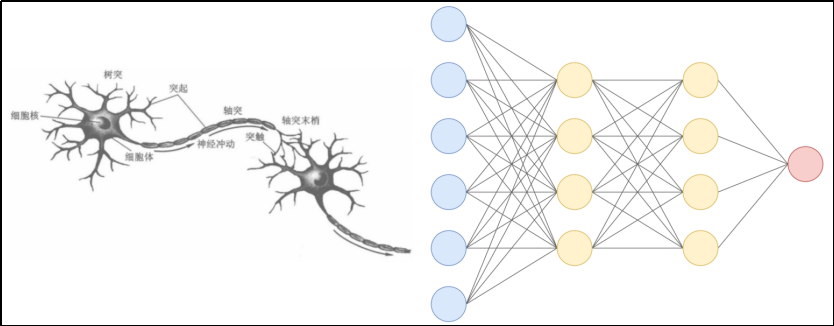

* * *

## 一 神经网络介绍

        人工神经网络（Artificial Neural Network，ANN）简称 ****神经网络（NN）****，是一种模仿生物神经网络结构和功能的计算模型。大多数情况下人工神经网络能在外界信息的基础上改变内部结构，是一种自适应系统(adaptive system)，通俗地讲就是具备学习功能。

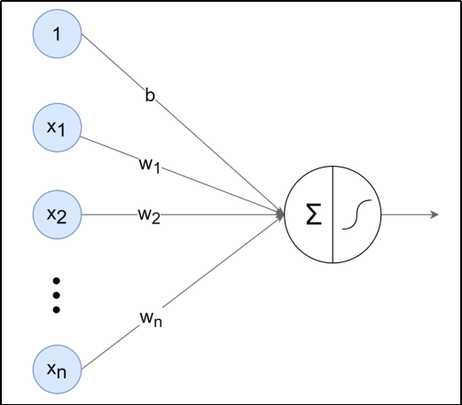

         人工神经网络中的神经元，一般可以对多个输入进行加权求和，再经过特定的“激活函数”转换后输出。

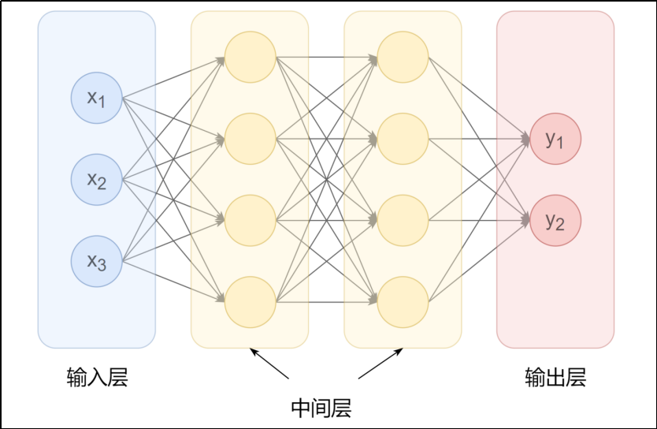

        使用多个神经元就可以构建多层神经网络，最左边的一列神经元都表示输入，称为 ****输入层****；最右边一列表示网络的输出，称为 ****输出层****；输入层与输出层之间的层统称为 ****中间层（隐藏层）****。

        相邻层的神经元相互连接（图中下一层每个神经元都与上一层所有神经元连接，称为 ****全连接****），每个连接都会有一个 ****权重****。

        神经元中的信息逐层传递（一般称为 ****前向传播********forward****），上一层神经元的输出作为下一层神经元的输入。

* * *

## 二 激活函数

### 2.1 感知机    

感知机（Perceptron）是二分类模型，接收多个信号，输出一个信号。感知机的信号只有0、1两种取值。

下图是一个接收两个输入信号的感知机的例子：

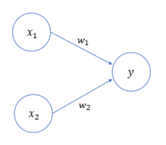

 $x_{_{1}},x_{_{2}}$是输入信号，$y_{}$是输出信号，$w_{1},w_{2}$是权重，○ 称为神经元或节点。输入信号被送往神经元时，会分别乘以固定的权重。神经元会计算传送过来的信号的总和，只有当这个总和超过某个界限值时才会输出1，也称之为神经元被激活。   

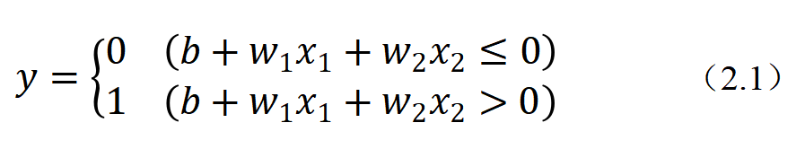

这里将界限的阈值设为0。除了权重之外，还可以增加一个参数$b^{^{}}$，被称为 ****偏置****。

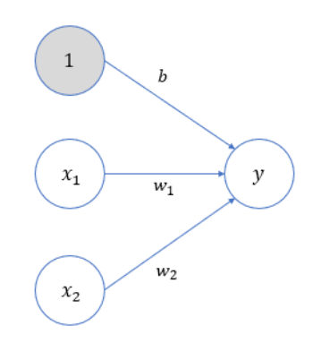

感知机的多个输入信号都有各自的权重，这些权重发挥着控制各个信号的重要性的作用，权重越大，对应信号的重要性越高。偏置则可以用来控制神经元被激活的容易程度。

### 2.2 激活函数

#### 2.2.1 引入介绍

可以看出，式（2.1）中包含了两步处理操作：首先按照输入各自的权重及偏置，计算出一个加权总和；然后再根据这个总和与阈值的大小关系，决定输出0还是1。

如果定义一个函数：

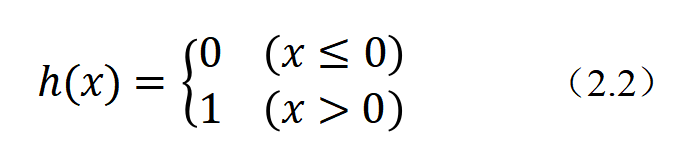     那么式（2.1）就可以简化为：

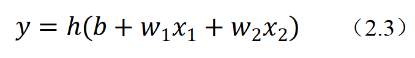   

为了更明显地表示出两个处理步骤，可以进一步写成：

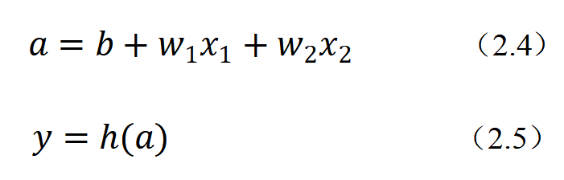这里，我们将输入信号和偏置的加权总和，记作a。可以将输入信号的加权总和转换为输出信号，起到“激活神经元”的作用，所以被称为 ****激活函数****。

激活函数是连接感知机和神经网络的桥梁，在神经网络中起着至关重要的作用。

如果没有激活函数，整个神经网络就等效于单层线性变换，不论如何加深层数，总是存在与之等效的“无隐藏层的神经网络”。激活函数必须是非线性函数，也正是激活函数的存在为神经网络引入了非线性，使得神经网络能够学习和表示复杂的非线性关系。

#### 2.2.2 常用激活函数

（1）阶越函数

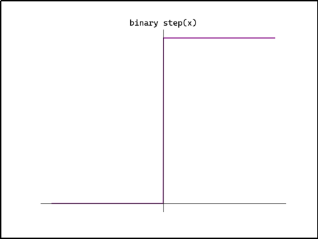

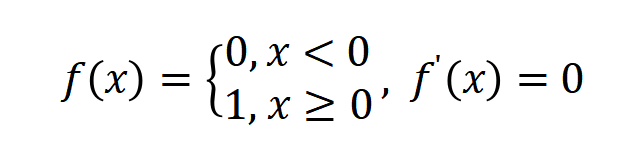

代码实现：

> def step\_function(x):  
>     if x \> 0:  
>         return 1  
>     else:  
>         return 0

这里的__x__只能取一个数值（浮点数）。如果我们希望直接传入Numpy数组进行批量化的操作，可以改进如下：

> def step\_function(x):  
>     return np.array(x \> 0, dtype\=int)

（2）Sigmoid函数

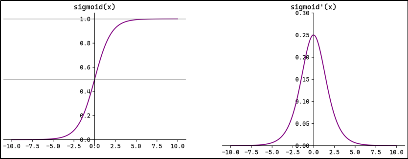

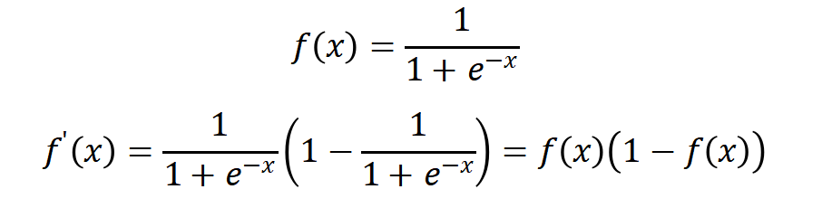

        Sigmoid（也叫Logistic函数）是平滑的、可微的，能将任意输入映射到区间(0,1)。常用于二分类的输出层。但因其涉及指数运算，计算量相对较高。

        Sigmoid的输入在\[-6,6\]之外时，其输出值变化很小，可能导致信息丢失。

        Sigmoid的输出并非以0为中心，其输出值均＞0，导致后续层的输入始终为正，可能影响后续梯度更新方向。

        Sigmoid的导数范围为(0,0.25)，梯度较小。当输入在\[-6,6\]之外时，导数接近0，此时网络参数的更新将会极其缓慢。使用Sigmoid作为激活函数，可能出现梯度消失（在逐层反向传播时，梯度会呈指数级衰减）。

Sigmoid函数可以用代码实现如下：

> def sigmoid(x):  
>     return 1 / (1 \+ np.exp(-x))  

（3）Tanh函数

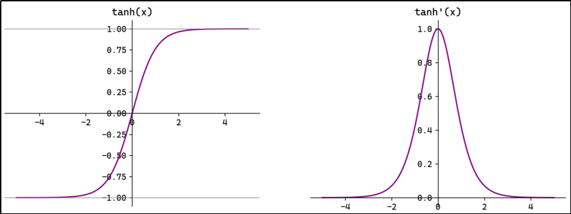

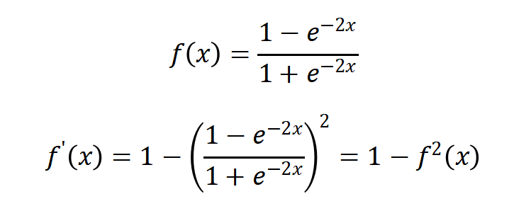

Tanh（双曲正切）将输入映射到区间(-1,1)。其关于原点中心对称。常用在隐藏层。

输入在\[-3,3\]之外时，Tanh的输出值变化很小，此时其导数接近0。

Tanh的输出以0为中心，且其梯度相较于Sigmoid更大，收敛速度相对更快。但同样也存在梯度消失现象。

（4）ReLU函数

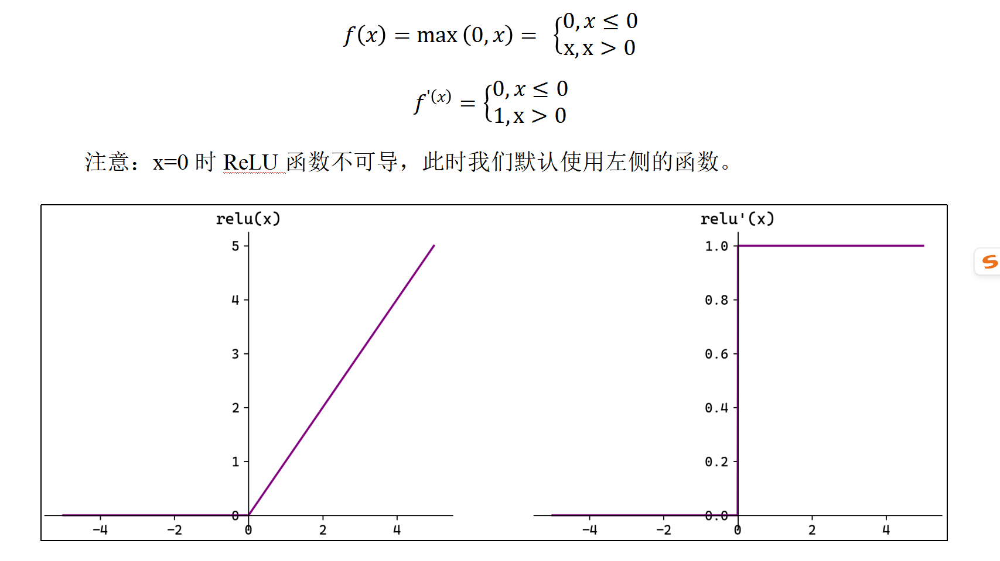

ReLU（Rectified Linear Unit，修正线性单元）会将小于0的输入转换为0，大于等于0的输入则保持不变。ReLU定义简单，计算量小。常用于隐藏层。

ReLU作为激活函数不存在梯度消失。当输入小于0时，ReLU的输出为0，这意味着在神经网络中，ReLU激活的节点只有部分是“活跃”的，这种稀疏性有助于减少计算量和提高模型的效率。

当神经元的输入持续为负数时，ReLU的输出始终为0。这意味着神经元可能永远不会被激活，从而导致“神经元死亡”问题。这会影响模型的学习能力，特别是如果大量的神经元都变成了“死神经元”。为解决此问题，可使用Leaky ReLU来代替ReLU作为激活函数。

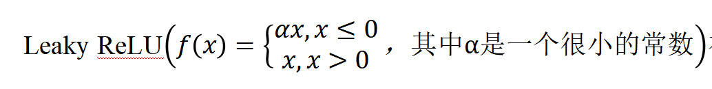

在负数区域引入一个小的斜率来解决“神经元死亡”问题。

ReLU函数可以用代码实现如下：

> def relu(x):  
>     return np.maximum(0, x)

（5）Softmax函数

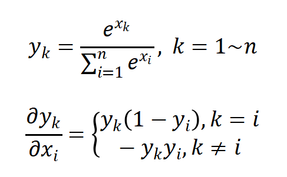

Softmax将一个任意的实数向量转换为一个概率分布，确保输出值的总和为1,是二分类激活函数Sigmoid在多分类上的推广。Softmax常用于多分类问题的输出层，用来表示类别的预测概率。

Softmax会放大输入中较大的值，使得最大输入值对应的输出概率较大，其他较小的值会被压缩。即在类别之间起到了一定的区分作用。

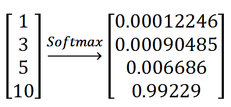

Softmax函数可以用代码实现如下：

> def softmax(x):  
>     return np.exp(x) / np.sum(np.exp(x))

考虑到x较大时，指数函数的值会非常大，容易溢出，可以改进为：

> def softmax(x):  
>     x \= x \- np.max(x) __\#__ __溢出对策__  
>     return np.exp(x) / np.sum(np.exp(x))

考虑到x为二维数组（矩阵）的情况，可以进一步写为：

> def softmax(x):  
>     if x.ndim == 2:  
>         x \= x.T  
>         x \= x \- np.max(x, axis\=0)  
>         y \= np.exp(x) / np.sum(np.exp(x), axis\=0)  
>         return y.T  
>   
>     x \= x \- np.max(x) __\#__ __溢出对策__  
>     return np.exp(x) / np.sum(np.exp(x))

（6）其他函数

① Identity（恒等函数）

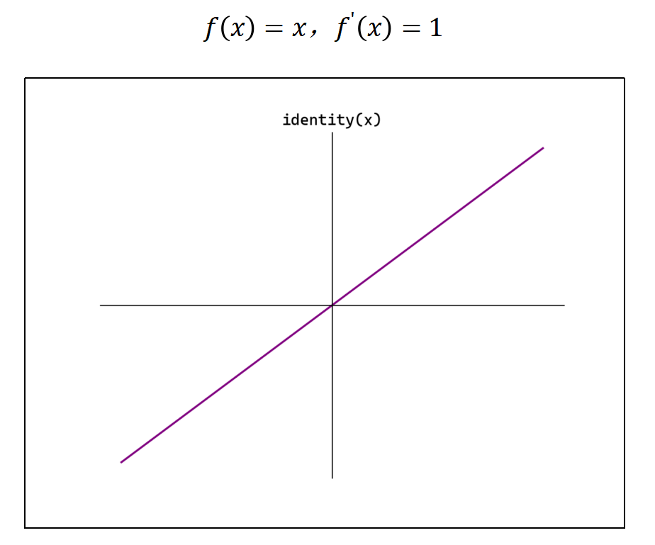

②Leaky ReLU（Leaky Rectified Linear Unit）

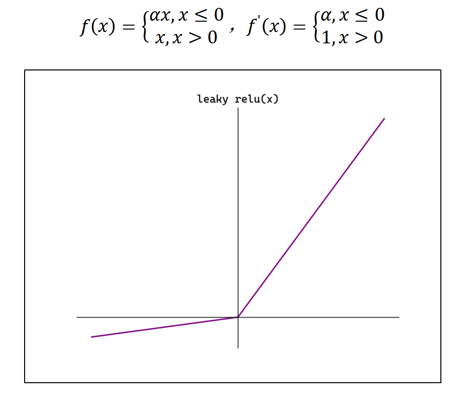

③PReLU（Parametric Rectified Linear Unit）

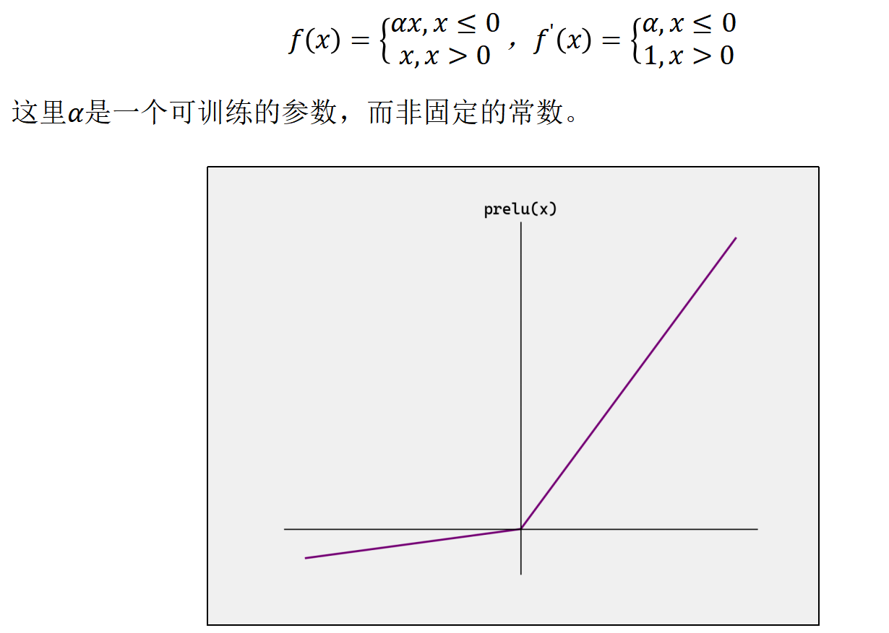

④RReLU（Randomized Leaky ReLU）

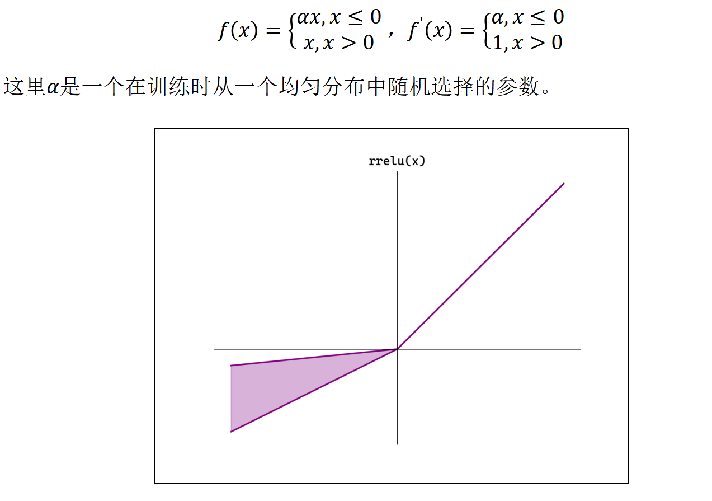

⑤ELU（Exponential Linear Unit）

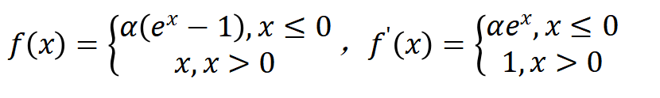

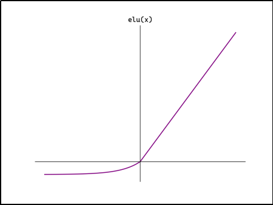

⑥Swish（也称Sigmoid Linear Unit，SiLU）

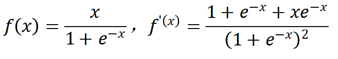

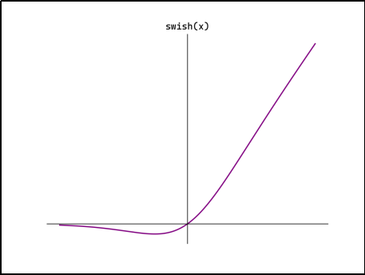

⑦softplus


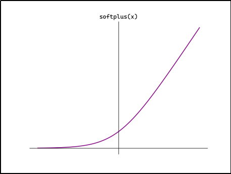

2.2.3 如何选择

隐藏层

        首选ReLU，如果效果不好可尝试Leaky ReLU等。

        Sigmoid在隐藏层易导致梯度消失，应尽量避免。

        Tanh的输出均值为0，对中心化数据更友好，但仍可能引发梯度消失，仅适用于浅层网络。

输出层

        二分类选择Sigmoid。

        多分类选择Softmax。

        回归默认选择Identity。

* * *

## 三 信息传递过程

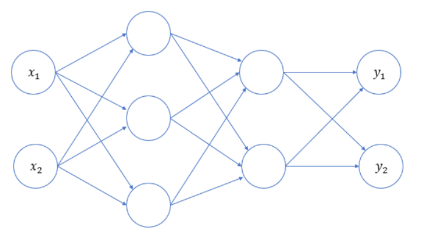

 上面只是三层网络的示意图，实际上每层还应该有偏置，各输入信号加权总和还要经过激活函数的处理。接下来逐层进行分析，考察信号在各层之间传递的过程。

**（1）输入层（第0层）→ 第1层**

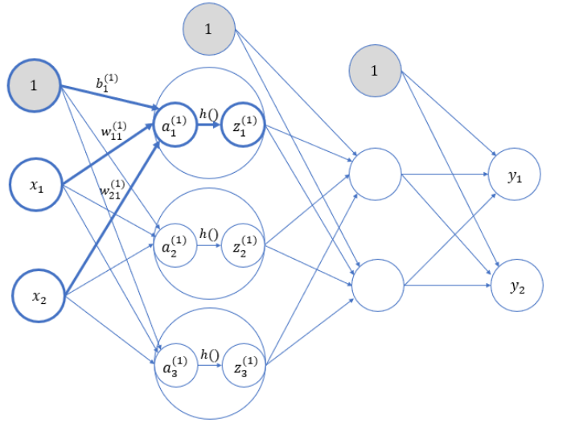

        权重和神经元的上标（1）表示网络层号。而下标对于神经元来说，就是这一层内的“索引号”；对于权重来说则包含两个数字，分别代表前一层和后一层神经元的索引号。所以，

         就表示这是第1层的权重（输入层到第1层），并且是从第2个输入节点到第1层第1个节点。偏置的下标只有1个，因为前一层的偏置节点只有一个。

        所以，可以利用式（2.4）（2.5）得到：

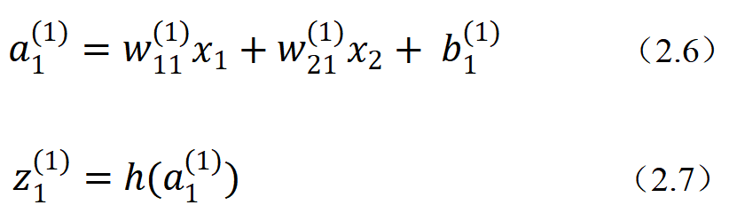   同样，对于第1层的第2个、第3个神经元，有：

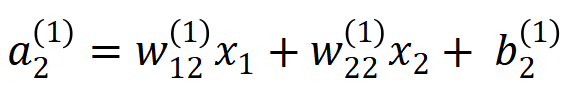

    我们可以直接写成矩阵乘法的形式：        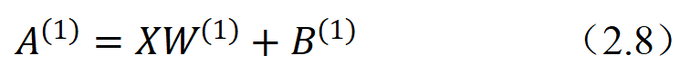

其中：

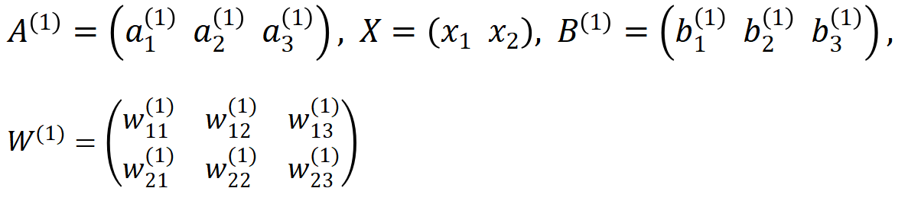        可以看到，由于有2个输入节点、3个第1层节点，所以全连接层的权重__W__就应该是一个2×3的矩阵。这样，我们就可以很容易地利用Numpy中的矩阵乘法计算出输出信号值了。

**（2）第1层 → 第2层**

第1层到第2层的处理类似，权重参数应该是一个3×2的矩阵。

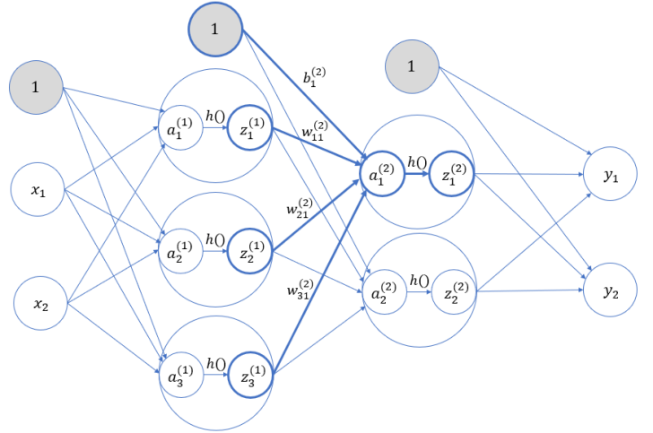

**（3）第2层 → 输出层（第3层）**

第2层到输出层的处理也类似，权重参数为2×2的矩阵；不过输出层的激活函数一般与隐藏层是不同的，这里用 $\delta ()$表示。

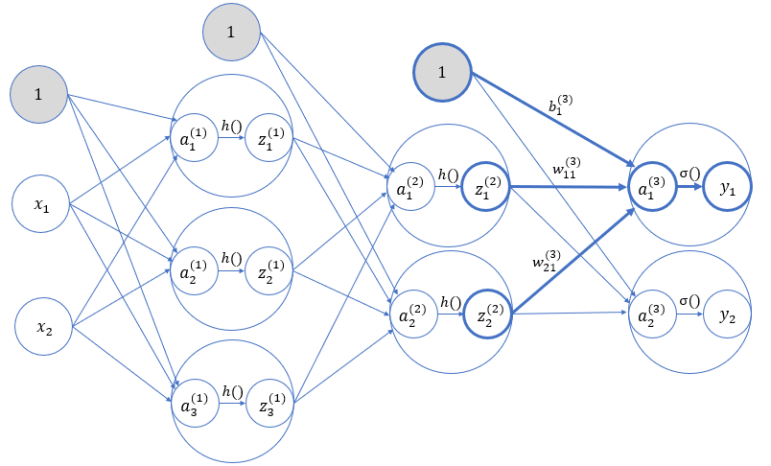

* * *

## 四 应用实战

简单神经网络实现

```python
import numpy as np
from common.functions import sigmoid, identity_function

def init_network():
    network = {}
    network['W1'] = np.array([[0.1, 0.3, 0.5], [0.2, 0.4, 0.6]])
    network['b1'] = np.array([0.1, 0.2, 0.3])
    network['W2'] = np.array([[0.1, 0.4], [0.2, 0.5], [0.3, 0.6]])
    network['b2'] = np.array([0.1, 0.2])
    network['W3'] = np.array([[0.1, 0.3], [0.2, 0.4]])
    network['b3'] = np.array([0.1, 0.2])

    return network

def forward(network, x):
    w1, w2, w3 = network['W1'], network['W2'], network['W3']
    b1, b2, b3 = network['b1'], network['b2'], network['b3']

    a1 = np.dot(x, w1) + b1
    z1 = sigmoid(a1)
    a2 = np.dot(z1, w2) + b2
    z2 = sigmoid(a2)
    a3 = np.dot(z2, w3) + b3
    y = identity_function(a3)

    return y

network = init_network()
x = np.array([1.0, 0.5])
y = forward(network, x)

print(y)
```

 **手写数字识别**

> 我们依然使用Digit Recognizer数据集来进行手写数字识别：[https://www.kaggle.com/competitions/digit-recognizer](https://www.kaggle.com/competitions/digit-recognizer "https://www.kaggle.com/competitions/digit-recognizer")。
> 
> 文件train.csv中包含手绘数字（从0到9）的灰度图像，每张图像为28×28像素，共784像素。每个像素有一个0到255的值表示该像素的亮度。
> 
> 文件第1列为标签，之后784列分别为784个像素的亮度值。
> 
> 我们的任务，就是要搭建一个神经网络，实现它的前向传播；也就是要根据输入的数据（28×28 = 784数据点表示的图像），推断出它到底是哪个数字，这个过程也被称为“****推理****”。
> 
> 这里，我们构建的也是一个三层神经网络，输入层应该有784个神经元，输出层有10个神经元（表示0~9的分类结果）；中间设置2个隐藏层，第一个隐藏层有50个神经元，第二个隐藏层有100个神经元。这里的参数是需要 ****学习**** 得到的。

train.py

```python
import numpy as np
import pandas as pd
import matplotlib.pyplot as plt
from model import NeuralNetwork

plt.rcParams['font.sans-serif'] = ['SimHei']
plt.rcParams['axes.unicode_minus'] = False

def load_and_preprocess_data(csv_path):
    """
    加载和预处理训练数据
    """
    print("正在加载训练数据...")
    data = pd.read_csv(csv_path)

    # 分离特征和标签
    labels = data['label'].values
    pixels = data.drop('label', axis=1).values

    # 数据归一化
    pixels = pixels.astype('float32') / 255.0

    print(f"数据加载完成: {len(labels)}个样本")
    return pixels, labels


def split_data(X, y, test_size=0.2, random_state=42):
    """
    分割训练集和验证集
    """
    np.random.seed(random_state)
    indices = np.random.permutation(len(X))

    split_point = int(len(X) * (1 - test_size))

    train_indices = indices[:split_point]
    val_indices = indices[split_point:]

    X_train, X_val = X[train_indices], X[val_indices]
    y_train, y_val = y[train_indices], y[val_indices]

    return X_train, X_val, y_train, y_val


def plot_training_history(history):
    """绘制训练历史"""
    plt.figure(figsize=(12, 4))

    plt.subplot(1, 2, 1)
    plt.plot(history['train_loss'], label='训练损失')
    plt.plot(history['val_loss'], label='验证损失')
    plt.title('训练和验证损失')
    plt.xlabel('迭代次数')
    plt.ylabel('损失')
    plt.legend()

    plt.subplot(1, 2, 2)
    plt.plot(history['train_accuracy'], label='训练准确率')
    plt.plot(history['val_accuracy'], label='验证准确率')
    plt.title('训练和验证准确率')
    plt.xlabel('迭代次数')
    plt.ylabel('准确率')
    plt.legend()

    plt.tight_layout()
    plt.savefig('training_history.png')
    plt.show()


def train_model():
    """主训练函数"""
    print("=" * 60)
    print("开始训练手写数字识别模型")
    print("=" * 60)

    # 1. 加载数据
    csv_path = "E:\\实验报告\\深度学习\\课程内容\\data\\D_number\\D_train.csv"
    try:
        X, y = load_and_preprocess_data(csv_path)
    except FileNotFoundError:
        print(" 数据文件未找到，请检查路径")
        return

    # 2. 分割数据集
    X_train, X_val, y_train, y_val = split_data(X, y, test_size=0.2)
    print(f"训练集: {X_train.shape[0]} 个样本")
    print(f"验证集: {X_val.shape[0]} 个样本")

    # 3. 创建模型
    model = NeuralNetwork(input_size=784, hidden1_size=50, hidden2_size=100, output_size=10)

    # 4. 训练参数
    epochs = 300
    learning_rate = 0.01
    batch_size = 32

    # 存储训练历史
    history = {
        'train_loss': [], 'val_loss': [],
        'train_accuracy': [], 'val_accuracy': []
    }

    print(f"\n 训练参数:")
    print(f"迭代次数: {epochs}")
    print(f"学习率: {learning_rate}")
    print(f"批次大小: {batch_size}")
    print("\n 开始训练...")

    # 5. 训练循环
    for epoch in range(epochs):
        # 随机打乱训练数据
        indices = np.random.permutation(len(X_train))
        X_train_shuffled = X_train[indices]
        y_train_shuffled = y_train[indices]

        total_loss = 0
        total_batches = 0

        # 批次训练
        for i in range(0, len(X_train), batch_size):
            # 获取当前批次
            X_batch = X_train_shuffled[i:i + batch_size]
            y_batch = y_train_shuffled[i:i + batch_size]

            # 前向传播
            model.forward_propagation(X_batch)

            # 计算损失
            batch_loss = model.compute_loss(y_batch)
            total_loss += batch_loss
            total_batches += 1

            # 反向传播
            model.backward_propagation(X_batch, y_batch, learning_rate)

        # 计算平均训练损失
        avg_train_loss = total_loss / total_batches

        # 验证集评估
        model.forward_propagation(X_val)
        val_loss = model.compute_loss(y_val)
        train_accuracy = np.mean(model.predict(X_train) == y_train)
        val_accuracy = np.mean(model.predict(X_val) == y_val)

        # 记录历史
        history['train_loss'].append(avg_train_loss)
        history['val_loss'].append(val_loss)
        history['train_accuracy'].append(train_accuracy)
        history['val_accuracy'].append(val_accuracy)

        # 每10个epoch打印一次进度
        if (epoch + 1) % 10 == 0:
            print(f"Epoch {epoch + 1}/{epochs} | "
                  f"训练损失: {avg_train_loss:.4f} | "
                  f"验证损失: {val_loss:.4f} | "
                  f"验证准确率: {val_accuracy:.4f}")

    # 6. 绘制训练历史
    plot_training_history(history)

    # 7. 保存模型参数
    model.save_parameters("nn_sample.npz")

    # 8. 最终评估
    final_train_accuracy = np.mean(model.predict(X_train) == y_train)
    final_val_accuracy = np.mean(model.predict(X_val) == y_val)

    print(f"\n 最终结果:")
    print(f"训练集准确率: {final_train_accuracy:.4f} ({final_train_accuracy * 100:.2f}%)")
    print(f"验证集准确率: {final_val_accuracy:.4f} ({final_val_accuracy * 100:.2f}%)")
    print(f"训练完成！模型参数已保存为 'nn_sample.npz'")


if __name__ == "__main__":
    train_model()
```

predict.py

```python
import numpy as np
import pandas as pd
import matplotlib.pyplot as plt
from model import NeuralNetwork

plt.rcParams['font.sans-serif'] = ['SimHei']
plt.rcParams['axes.unicode_minus'] = False

def load_and_preprocess_data(csv_path):
    """加载和预处理数据"""
    print("正在加载数据...")
    data = pd.read_csv(csv_path)

    if 'label' in data.columns:
        labels = data['label'].values
        pixels = data.drop('label', axis=1).values
    else:
        # 测试集可能没有标签
        labels = None
        pixels = data.values

    # 数据归一化
    pixels = pixels.astype('float32') / 255.0

    print(f"数据加载完成: {len(pixels)}个样本")
    return pixels, labels


def visualize_sample(pixels, labels=None, index=0, prediction=None, confidence=None):
    """可视化手写数字样本"""
    image = pixels[index].reshape(28, 28)

    plt.figure(figsize=(6, 6))
    plt.imshow(image, cmap='gray')

    if labels is not None and prediction is not None:
        title = f'真实: {labels[index]} | 预测: {prediction} | 置信度: {confidence:.3f}'
        color = 'green' if labels[index] == prediction else 'red'
    elif prediction is not None:
        title = f'预测: {prediction} | 置信度: {confidence:.3f}'
        color = 'blue'
    else:
        title = f'样本 {index}'
        color = 'black'

    plt.title(title, color=color, fontsize=12)
    plt.axis('off')
    plt.tight_layout()
    plt.show()


def evaluate_model(model, X, y, sample_size=1000):
    """评估模型性能"""
    if len(X) > sample_size:
        indices = np.random.choice(len(X), sample_size, replace=False)
        X_sample = X[indices]
        y_sample = y[indices]
    else:
        X_sample = X
        y_sample = y

    predictions = model.predict(X_sample)
    accuracy = np.mean(predictions == y_sample)

    print(f"模型评估结果:")
    print(f"样本数量: {len(X_sample)}")
    print(f"准确率: {accuracy:.4f} ({accuracy * 100:.2f}%)")

    # 显示混淆矩阵
    print(f"\ 详细预测结果:")
    print("索引 | 真实 | 预测 | 置信度 | 状态")
    print("-" * 45)

    for i in range(min(10, len(X_sample))):
        pred, conf = model.predict_with_confidence(X_sample[i:i + 1])
        status = "Right" if pred[0] == y_sample[i] else "Error"
        print(f"{i:4d} | {y_sample[i]:4d} | {pred[0]:4d} | {conf[0]:.3f}   | {status}")

    return accuracy


def predict_single_digit(model, pixel_data):
    """预测单个数字"""
    if len(pixel_data) == 784:
        # 如果是扁平化的数据，重塑为(1, 784)
        pixel_data = pixel_data.reshape(1, -1)

    prediction, confidence = model.predict_with_confidence(pixel_data)
    return prediction[0], confidence[0]


def main():
    """主推理函数"""
    print("=" * 60)
    print("手写数字识别 - 推理模式")
    print("=" * 60)

    # 1. 创建模型
    model = NeuralNetwork()

    # 2. 加载训练好的参数
    param_file = "nn_sample.npz"
    if not model.load_parameters(param_file):
        print("无法加载模型参数，请先运行 train.py 进行训练")
        return

    # 3. 加载数据
    csv_path = "E:\\实验报告\\深度学习\\课程内容\\data\\D_number\\D_test.csv"
    try:
        X, y = load_and_preprocess_data(csv_path)
    except FileNotFoundError:
        print("数据文件未找到")
        # 可以在这里添加手动输入数字的功能
        return

    # 4. 交互式推理演示
    while True:
        print(f"\n 选择操作:")
        print("1. 评估模型整体性能")
        print("2. 查看单个样本预测")
        print("3. 批量预测演示")
        print("4. 退出")

        choice = input("请输入选择 (1-4): ").strip()

        if choice == '1':
            # 整体评估
            evaluate_model(model, X, y, sample_size=1000)

        elif choice == '2':
            # 单个样本预测
            try:
                index = int(input("请输入样本索引 (0-{}): ".format(len(X) - 1)))
                if 0 <= index < len(X):
                    prediction, confidence = model.predict_with_confidence(X[index:index + 1])
                    visualize_sample(X, y, index, prediction[0], confidence[0])

                    print(f"\n 预测详情:")
                    print(f"样本索引: {index}")
                    print(f"预测数字: {prediction[0]}")
                    print(f"置信度: {confidence[0]:.3f}")
                else:
                    print("索引超出范围")
            except ValueError:
                print("请输入有效数字")

        elif choice == '3':
            # 批量演示
            print(f"\n 批量预测演示 :")
            for i in range(5):
                prediction, confidence = model.predict_with_confidence(X[i:i + 1])
                print(f"样本 {i}: 预测={prediction[0]}, 置信度={confidence[0]:.3f}")

        elif choice == '4':
            print("再见！")
            break
        else:
            print("无效选择，请重新输入")


if __name__ == "__main__":
    main()
```

model.py

```python
import numpy as np

class NeuralNetwork:
    """
    三层神经网络模型类
    结构: 输入层(784) → 隐藏层1(50) → 隐藏层2(100) → 输出层(10)
    """

    def __init__(self, input_size=784, hidden1_size=50, hidden2_size=100, output_size=10):
        """
        初始化神经网络
        参数:
        - input_size: 输入层大小 (28x28=784)
        - hidden1_size: 第一隐藏层大小
        - hidden2_size: 第二隐藏层大小
        - output_size: 输出层大小 (10个数字类别)
        """
        self.input_size = input_size
        self.hidden1_size = hidden1_size
        self.hidden2_size = hidden2_size
        self.output_size = output_size

        # 参数字典
        self.params = {}
        self._initialize_parameters()

    def _initialize_parameters(self, initialization='xavier'):
        """
        初始化网络参数
        参数:
        - initialization: 初始化方法 ('xavier' 或 'random')
        """
        if initialization == 'xavier':
            # Xavier初始化，有助于训练稳定性
            self.params['W1'] = np.random.randn(self.input_size, self.hidden1_size) * np.sqrt(1. / self.input_size)
            self.params['W2'] = np.random.randn(self.hidden1_size, self.hidden2_size) * np.sqrt(1. / self.hidden1_size)
            self.params['W3'] = np.random.randn(self.hidden2_size, self.output_size) * np.sqrt(1. / self.hidden2_size)
        else:
            # 随机初始化
            self.params['W1'] = np.random.randn(self.input_size, self.hidden1_size) * 0.01
            self.params['W2'] = np.random.randn(self.hidden1_size, self.hidden2_size) * 0.01
            self.params['W3'] = np.random.randn(self.hidden2_size, self.output_size) * 0.01

        # 偏置初始化为0
        self.params['b1'] = np.zeros((1, self.hidden1_size))
        self.params['b2'] = np.zeros((1, self.hidden2_size))
        self.params['b3'] = np.zeros((1, self.output_size))

    def relu(self, x):
        """ReLU激活函数"""
        return np.maximum(0, x)

    def relu_derivative(self, x):
        """ReLU导数，用于反向传播"""
        return (x > 0).astype(float)

    def softmax(self, x):
        """Softmax函数"""
        # 数值稳定性处理
        exp_x = np.exp(x - np.max(x, axis=1, keepdims=True))
        return exp_x / np.sum(exp_x, axis=1, keepdims=True)

    def forward_propagation(self, X):
        """
        前向传播
        参数:
        - X: 输入数据 (n_samples, 784)
        返回:
        - 输出层概率分布 (n_samples, 10)
        """
        # 输入层 → 隐藏层1
        self.z1 = np.dot(X, self.params['W1']) + self.params['b1']
        self.a1 = self.relu(self.z1)

        # 隐藏层1 → 隐藏层2
        self.z2 = np.dot(self.a1, self.params['W2']) + self.params['b2']
        self.a2 = self.relu(self.z2)

        # 隐藏层2 → 输出层
        self.z3 = np.dot(self.a2, self.params['W3']) + self.params['b3']
        self.a3 = self.softmax(self.z3)

        return self.a3

    def backward_propagation(self, X, y, learning_rate=0.01):
        """
        反向传播（用于训练）
        参数:
        - X: 输入数据
        - y: 真实标签
        - learning_rate: 学习率
        """
        m = X.shape[0]  # 样本数量

        # 将标签转换为one-hot编码
        y_one_hot = np.eye(self.output_size)[y]

        # 计算输出层误差
        dz3 = self.a3 - y_one_hot
        dw3 = np.dot(self.a2.T, dz3) / m
        db3 = np.sum(dz3, axis=0, keepdims=True) / m

        # 计算隐藏层2误差
        dz2 = np.dot(dz3, self.params['W3'].T) * self.relu_derivative(self.z2)
        dw2 = np.dot(self.a1.T, dz2) / m
        db2 = np.sum(dz2, axis=0, keepdims=True) / m

        # 计算隐藏层1误差
        dz1 = np.dot(dz2, self.params['W2'].T) * self.relu_derivative(self.z1)
        dw1 = np.dot(X.T, dz1) / m
        db1 = np.sum(dz1, axis=0, keepdims=True) / m

        # 更新参数
        self.params['W3'] -= learning_rate * dw3
        self.params['b3'] -= learning_rate * db3
        self.params['W2'] -= learning_rate * dw2
        self.params['b2'] -= learning_rate * db2
        self.params['W1'] -= learning_rate * dw1
        self.params['b1'] -= learning_rate * db1

    def compute_loss(self, y_true):
        """计算交叉熵损失"""
        y_one_hot = np.eye(self.output_size)[y_true]
        # 避免log(0)的情况
        epsilon = 1e-15
        a3_clipped = np.clip(self.a3, epsilon, 1. - epsilon)
        loss = -np.mean(np.sum(y_one_hot * np.log(a3_clipped), axis=1))
        return loss

    def predict(self, X):
        """预测数字类别"""
        probabilities = self.forward_propagation(X)
        return np.argmax(probabilities, axis=1)

    def predict_with_confidence(self, X):
        """预测数字类别及置信度"""
        probabilities = self.forward_propagation(X)
        predictions = np.argmax(probabilities, axis=1)
        confidences = np.max(probabilities, axis=1)
        return predictions, confidences

    def save_parameters(self, file_path):
        """保存模型参数到文件"""
        np.savez(file_path,
                 W1=self.params['W1'], b1=self.params['b1'],
                 W2=self.params['W2'], b2=self.params['b2'],
                 W3=self.params['W3'], b3=self.params['b3'])
        print(f"模型参数已保存到: {file_path}")

    def load_parameters(self, file_path):
        """从文件加载模型参数"""
        try:
            loaded_params = np.load(file_path)
            self.params = {
                'W1': loaded_params['W1'],
                'b1': loaded_params['b1'],
                'W2': loaded_params['W2'],
                'b2': loaded_params['b2'],
                'W3': loaded_params['W3'],
                'b3': loaded_params['b3']
            }
            print(f"模型参数已从 {file_path} 加载")
            return True
        except FileNotFoundError:
            print(f"参数文件 {file_path} 未找到")
            return False
        except Exception as e:
            print(f"加载参数时出错: {e}")
            return False
```

训练与预测结果

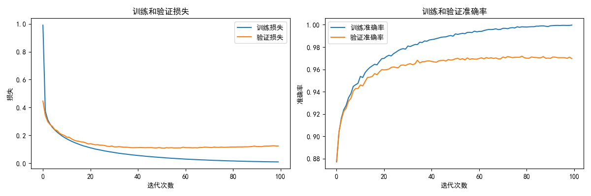

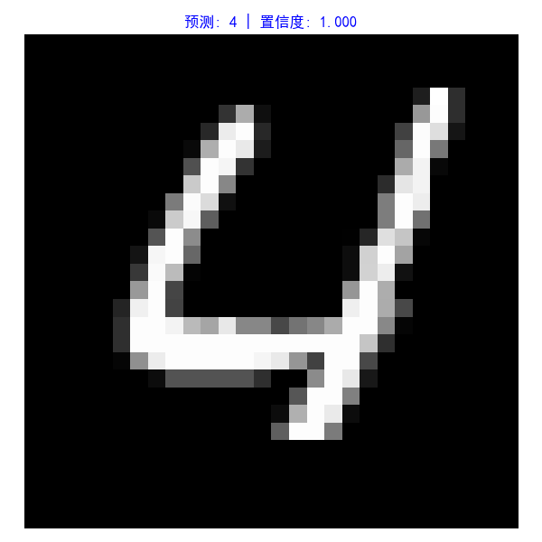

* * *

2026.01.23
