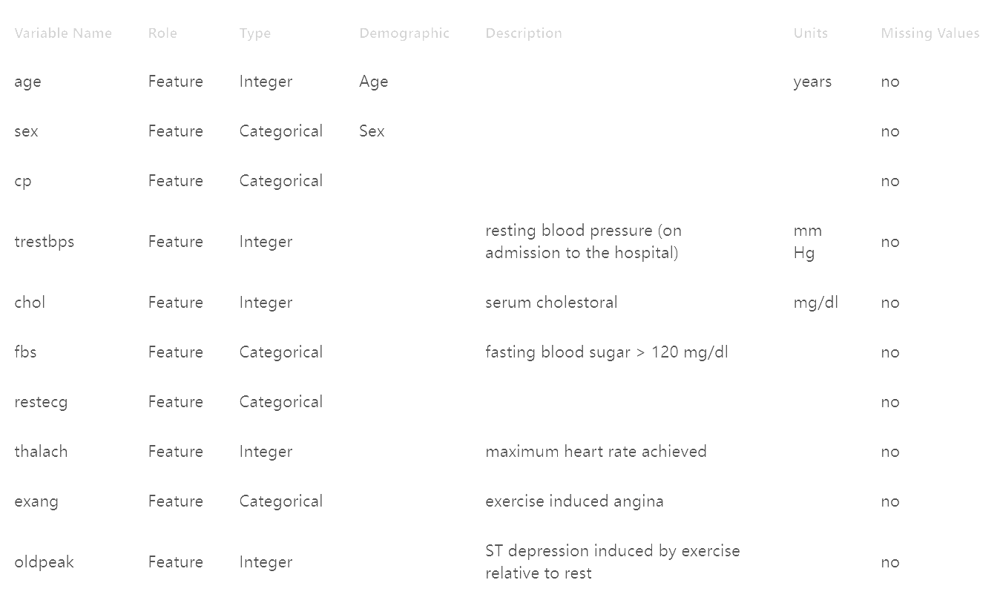
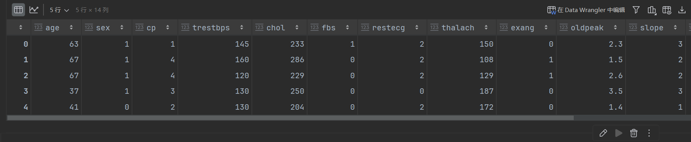
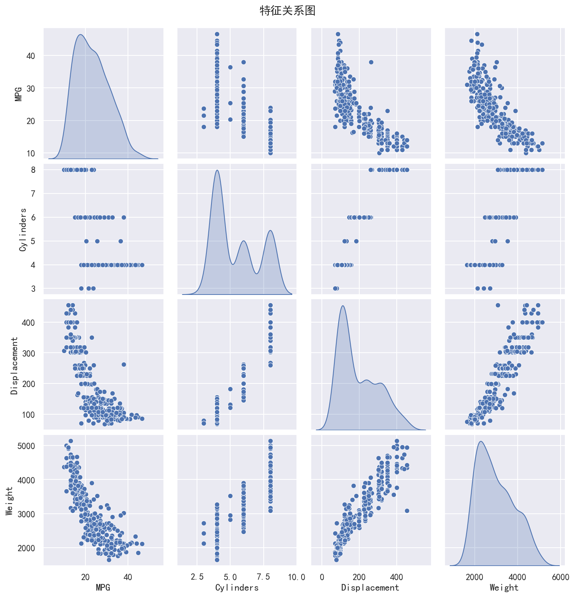
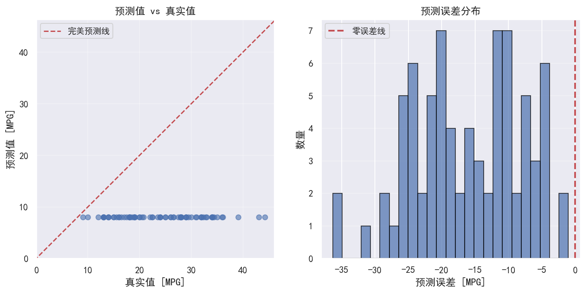
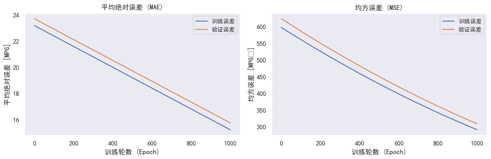

>         本文为第二章监督学习进行数据分类与回归相关实验部分的内容，第一章为相关环境配置说明，就不再赘述。文章将在线资源转换为静态离线资源加载。后续第四第五章过程中无法使用TensorFlow进行GPU加速，前面的学习过程中将在讲解完成后使用Pytorch框架进行重构。文章相关代码绑定文章已上传

## 1 数据分类-预测心脏病

        本教程演示如何对结构化数据（例如CSV中的表格数据）进行分类。我们将使用Keras来定义模型，并使用特征列作为桥梁，将CSV中的列映射到用于训练模型的特征。本教程包含完整的代码来：  
\* 使用Pandas加载CSV文件。  
\* 使用tf.data构建输入管道以批处理和打乱行数据。  
\* 使用特征列将CSV中的列映射到用于训练模型的特征。  
\* 使用Keras构建、训练和评估模型。

1.1 数据集

        我们将使用克利夫兰心脏病基金会提供的一个小型数据集。CSV文件中有数百行数据。每一行描述一个患者，每一列描述一个属性。我们将使用这些信息来预测患者是否患有心脏病，这在本数据集中是一个二分类任务。 以下是该数据集的描述。请注意，既有数值列也有分类列。

1.2 安装依赖

        下面是这部分所需要的依赖，对应版本对应下载即可。（后续内容不再提及依赖安装的内容）

```python
import numpy as np
import pandas as pd

import tensorflow as tf

from tensorflow import feature_column
from tensorflow.keras import layers
import sklearn.model_selection
```

1.3 加载数据

        使用Pandas创建数据框。pandas是一个Python库，提供了许多有用的工具来加载和处理结构化数据。我们将使用Pandas从URL下载数据集（此处直接下载好相关资源），并将其加载到数据框中。(为了方便查看数据，一般需要下载ExcelReader插件)

```python
URL = '..\\data\\2.1\\heart_disease_cleveland.csv'
dataframe = pd.read_csv(URL)
dataframe.head()
```



1.4 分割数据

        我们一般将数据框分割为训练集、验证集和测试集。我们下载的数据集是一个单独的CSV文件。我们将把它分割为训练集、验证集和测试集。

```python
train, test = train_test_split(dataframe, test_size=0.2)
train, val = train_test_split(train, test_size=0.2)
print(len(train), 'train examples')
print(len(val), 'validation examples')
print(len(test), 'test examples')
```

1.5 创建输入通道

        接下来，我们将使用tf.data包装数据框。这将使我们能够使用特征列作为桥梁，将Pandas数据框中的列映射到用于训练模型的特征。如果我们处理的是一个非常大的CSV文件（大到无法放入内存），我们将使用tf.data直接从磁盘读取它。本教程不涵盖这一点。

```python
# A utility method to create a tf.data dataset from a Pandas Dataframe
def df_to_dataset(dataframe, shuffle=True, batch_size=32):
  dataframe = dataframe.copy()
  labels = dataframe.pop('target')
  ds = tf.data.Dataset.from_tensor_slices((dict(dataframe), labels))
  if shuffle:
    ds = ds.shuffle(buffer_size=len(dataframe))
  ds = ds.batch(batch_size)
  return ds
```

```python
batch_size = 5 # A small batch sized is used for demonstration purposes
train_ds = df_to_dataset(train, batch_size=batch_size)
val_ds = df_to_dataset(val, shuffle=False, batch_size=batch_size)
test_ds = df_to_dataset(test, shuffle=False, batch_size=batch_size)
```

1.6 演示不同类型的特征列

```python
# A utility method to create a feature column
# and to transform a batch of data
def demo(feature_column):
  feature_layer = layers.DenseFeatures(feature_column)
  print(feature_layer(example_batch).numpy())
```

（1）数值列  
        特征列的输出成为模型的输入（使用上面定义的demo函数，我们将能够看到数据框中每一列是如何被转换的）。数值列是最简单的列类型。它用于表示实值特征。使用此列时，模型将接收来自数据框的列值，不做任何更改。在该数据集中，大部分数据都是数值型的。

```python
age = feature_column.numeric_column("age")
demo(age)
```

（2）分桶列

        通常，您不想直接将数字输入模型，而是根据数值范围将其值分割为不同的类别。考虑表示一个人年龄的原始数据。我们可以使用\[分桶列\]将年龄分割为几个桶，而不是将年龄表示为数值列。请注意下面的独热值描述了每一行匹配的年龄范围。

```python
age_buckets = feature_column.bucketized_column(age, boundaries=[18, 25, 30, 35, 40, 45, 50, 55, 60, 65])
demo(age_buckets)
```

(3)分类列

        在这个数据集中，thal被表示为字符串（例如'fixed'、'normal'或'reversible'）。我们不能直接将字符串输入模型。相反，我们必须首先将它们映射为数值。分类词汇列提供了一种将字符串表示为独热向量的方法（就像您在上面看到的年龄桶一样）。词汇表可以使用categorical\_column\_with\_vocabulary\_list作为列表传递，或使用categorical\_column\_with\_vocabulary\_file从文件加载。

        在更复杂的数据集中，许多列都是分类的（例如字符串）。在处理分类数据时，特征列最有价值。尽管此数据集中只有一个分类列，但我们将使用它来演示几种重要的特征列类型，您在处理其他数据集时可以使用这些类型。

```python
thal = feature_column.categorical_column_with_vocabulary_list(
      'thal', ['fixed', 'normal', 'reversible'])

thal_one_hot = feature_column.indicator_column(thal)
demo(thal_one_hot)
```

（4）嵌入列  
        假设每个类别不是只有几个可能的字符串，而是有数千个（或更多）值。由于多种原因，随着类别数量的增长，使用独热编码训练神经网络变得不可行。我们可以使用嵌入列来克服这个限制。与将数据表示为多维独热向量不同，\[嵌入列\]将数据表示为低维密集向量，其中每个单元格可以包含任何数字，而不仅仅是0或1。嵌入的大小（在下面的示例中为8）是一个必须调整的参数。

关键点：当分类列具有许多可能的值时，最好使用嵌入列。我们在这里使用一个是为了演示目的，这样您就有一个完整的示例，可以在将来为不同的数据集进行修改。

```python
# Notice the input to the embedding column is the categorical column
# we previously created
thal_embedding = feature_column.embedding_column(thal, dimension=8)
demo(thal_embedding)
```

（5）哈希特征列

         表示具有大量值的分类列的另一种方法是使用\[categorical\_column\_with\_hash\_bucket\]。此特征列计算输入的哈希值，然后选择\`hash\_bucket\_size\`个桶之一来编码字符串。使用此列时，您不需要提供词汇表，并且可以选择使hash\_buckets的数量明显小于实际类别的数量以节省空间。 关键点：此技术的一个重要缺点是可能存在冲突，其中不同的字符串被映射到同一个桶。在实践中，这对于某些数据集仍然可以很好地工作。

```python
thal_hashed = feature_column.categorical_column_with_hash_bucket(
      'thal', hash_bucket_size=1000)
demo(feature_column.indicator_column(thal_hashed))
```

（6）交叉特征列

         将特征组合成单个特征，更广为人知的是\[特征交叉\]，使模型能够为每个特征组合学习单独的权重。在这里，我们将创建一个新特征，它是年龄和thal的交叉。请注意，\`crossed\_column\`不会构建所有可能组合的完整表（这可能非常大）。相反，它由\`hashed\_column\`支持，因此您可以选择表的大小。

1.7 使用选择的列  
        我们已经看到了如何使用几种类型的特征列。现在我们将使用它们来训练模型。本教程的目标是向您展示使用特征列所需的完整代码（例如机制）。我们在下面任意选择了几列来训练模型。

关键点：如果您的目标是构建一个准确的模型，请尝试使用您自己的更大的数据集，并仔细考虑哪些特征最有意义，以及它们应该如何表示。

```python
eature_columns = []

# numeric cols
for header in ['age', 'trestbps', 'chol', 'thalach', 'oldpeak', 'slope', 'ca']:
  feature_columns.append(feature_column.numeric_column(header))

# bucketized cols
age_buckets = feature_column.bucketized_column(age, boundaries=[18, 25, 30, 35, 40, 45, 50, 55, 60, 65])
feature_columns.append(age_buckets)

# indicator cols
thal = feature_column.categorical_column_with_vocabulary_list(
      'thal', ['fixed', 'normal', 'reversible'])
thal_one_hot = feature_column.indicator_column(thal)
feature_columns.append(thal_one_hot)

# embedding cols
thal_embedding = feature_column.embedding_column(thal, dimension=8)
feature_columns.append(thal_embedding)

# crossed cols
crossed_feature = feature_column.crossed_column([age_buckets, thal], hash_bucket_size=1000)
crossed_feature = feature_column.indicator_column(crossed_feature)
feature_columns.append(crossed_feature)
```

1.8 特征层  
        现在我们已经定义了特征列，我们将使用\[DenseFeatures\]层将它们输入到我们的Keras模型中。

```python
feature_layer = tf.keras.layers.DenseFeatures(feature_columns)
```

进行模型的创建和设置

```python
model = tf.keras.Sequential([
  feature_layer,
  layers.Dense(128, activation='relu'),
  layers.Dense(128, activation='relu'),
  layers.Dense(1)
])

model.compile(optimizer='adam',
              loss=tf.keras.losses.BinaryCrossentropy(from_logits=True),
              metrics=['accuracy'])

model.fit(train_ds,
          validation_data=val_ds,
          epochs=5)
```

Pytorch重构实现

```python
"""
PyTorch版本的特征列处理代码
这是从TensorFlow版本转换而来的PyTorch实现

注意：PyTorch没有像TensorFlow的feature columns这样的内置功能，
需要手动实现特征处理逻辑。
"""
import numpy as np
import pandas as pd
import torch
import torch.nn as nn
import torch.optim as optim
from torch.utils.data import Dataset, DataLoader
from sklearn.model_selection import train_test_split
from sklearn.preprocessing import StandardScaler, LabelEncoder
import torch.nn.functional as F


class HeartDiseaseDataset(Dataset):
    """心脏病数据集类"""
    def __init__(self, dataframe, target_col=None):
        self.data = dataframe.copy()
        # 自动检测目标列名：优先使用'target'，如果不存在则使用'num'
        if target_col is None:
            if 'target' in self.data.columns:
                target_col = 'target'
            elif 'num' in self.data.columns:
                target_col = 'num'
            else:
                raise ValueError("未找到目标列，请检查数据框是否包含'target'或'num'列")
        self.target = self.data.pop(target_col).values
        self.features = self._process_features()
    
    def _process_features(self):
        """处理特征：数值型、分桶、独热编码、嵌入等"""
        features = []
        
        # 数值型特征（不包括age，因为age需要分桶）
        numeric_cols = ['trestbps', 'chol', 'thalach', 'oldpeak', 'slope', 'ca']
        numeric_features = self.data[numeric_cols].values.astype(np.float32)
        features.append(numeric_features)
        
        # 年龄分桶（需要先从数据中提取age）
        age = self.data['age'].values
        age_buckets = self._bucketize(age, boundaries=[18, 25, 30, 35, 40, 45, 50, 55, 60, 65])
        features.append(age_buckets)
        
        # Thal分类特征（独热编码）
        # 注意：thal列可能是浮点数，需要先转换为整数或字符串
        thal_col = self.data['thal'].copy()
        # 处理缺失值：将NaN替换为最常见的值或0
        if thal_col.isna().any():
            # 如果有缺失值，用众数填充，如果没有众数则用0
            mode_value = thal_col.mode()
            if len(mode_value) > 0:
                thal_col = thal_col.fillna(mode_value[0])
            else:
                thal_col = thal_col.fillna(0)
        
        # 转换为整数（如果是浮点数）
        thal_col = thal_col.astype(float).astype(int)
        
        # 使用LabelEncoder编码
        thal_encoder = LabelEncoder()
        thal_encoded = thal_encoder.fit_transform(thal_col.astype(str))  # 转换为字符串再编码
        
        # 获取唯一值的数量
        num_thal_classes = len(thal_encoder.classes_)
        thal_onehot = np.eye(num_thal_classes)[thal_encoded]
        features.append(thal_onehot)
        
        # Thal嵌入（简化版本：使用独热编码的线性变换）
        # 在实际应用中，可以使用nn.Embedding层
        thal_embedding = self._simple_embedding(thal_encoded, vocab_size=num_thal_classes, embed_dim=8)
        features.append(thal_embedding)
        
        # 交叉特征（年龄桶 x Thal）
        crossed = self._cross_features(age_buckets, thal_encoded, hash_bucket_size=1000)
        features.append(crossed)
        
        # 合并所有特征
        return np.concatenate(features, axis=1)
    
    def _bucketize(self, values, boundaries):
        """将数值分桶为独热编码"""
        buckets = np.zeros((len(values), len(boundaries) + 1))
        for i, val in enumerate(values):
            bucket_idx = np.searchsorted(boundaries, val)
            buckets[i, bucket_idx] = 1.0
        return buckets
    
    def _simple_embedding(self, indices, vocab_size, embed_dim):
        """简单的嵌入实现（实际应该使用nn.Embedding）"""
        # 这里使用随机初始化的嵌入矩阵
        embedding_matrix = np.random.randn(vocab_size, embed_dim).astype(np.float32)
        return embedding_matrix[indices]
    
    def _cross_features(self, age_buckets, thal_encoded, hash_bucket_size=1000):
        """特征交叉（使用哈希）"""
        # 简化版本：将两个特征组合并哈希
        # age_buckets是[batch_size, num_buckets]的独热编码
        # thal_encoded是[batch_size]的整数编码
        age_indices = age_buckets.argmax(axis=1)  # 获取每个样本的年龄桶索引
        combined = (age_indices * 10 + thal_encoded) % hash_bucket_size
        # 为了节省空间和避免内存问题，只使用前100个桶
        max_buckets = min(100, hash_bucket_size)
        crossed_onehot = np.zeros((len(combined), max_buckets), dtype=np.float32)
        for i, idx in enumerate(combined):
            if idx < max_buckets:
                crossed_onehot[i, idx] = 1.0
        return crossed_onehot
    
    def __len__(self):
        return len(self.target)
    
    def __getitem__(self, idx):
        # 返回特征和标签，标签保持为标量（0维张量）
        return torch.FloatTensor(self.features[idx]), torch.tensor(self.target[idx], dtype=torch.long)


class HeartDiseaseModel(nn.Module):
    """心脏病预测模型"""
    def __init__(self, input_dim):
        super(HeartDiseaseModel, self).__init__()
        self.fc1 = nn.Linear(input_dim, 128)
        self.fc2 = nn.Linear(128, 128)
        self.fc3 = nn.Linear(128, 1)
        self.dropout = nn.Dropout(0.2)
    
    def forward(self, x):
        x = F.relu(self.fc1(x))
        x = self.dropout(x)
        x = F.relu(self.fc2(x))
        x = self.dropout(x)
        x = self.fc3(x)
        return x


def main():
    # 加载数据
    import os
    # 尝试多个可能的路径
    possible_paths = [
        '../data/2.1/heart_disease_cleveland.csv',  # 从Chapter02/2.1/运行
        'data/2.1/heart_disease_cleveland.csv',  # 从Chapter02/运行
        'Chapter02/data/2.1/heart_disease_cleveland.csv',  # 从项目根目录运行
    ]
    
    dataframe = None
    for path in possible_paths:
        if os.path.exists(path):
            dataframe = pd.read_csv(path)
            print(f"成功加载数据: {path}")
            break
    
    if dataframe is None:
        raise FileNotFoundError(f"未找到数据文件，请检查以下路径之一是否存在:\n" + "\n".join(possible_paths))
    
    print(dataframe.head())
    
    # 分割数据集
    train, test = train_test_split(dataframe, test_size=0.2, random_state=22)
    train, val = train_test_split(train, test_size=0.2, random_state=22)
    print(f'训练集: {len(train)}, 验证集: {len(val)}, 测试集: {len(test)}')
    
    # 创建数据集
    train_dataset = HeartDiseaseDataset(train)
    val_dataset = HeartDiseaseDataset(val)
    test_dataset = HeartDiseaseDataset(test)
    
    # 创建数据加载器
    batch_size = 32
    train_loader = DataLoader(train_dataset, batch_size=batch_size, shuffle=True)
    val_loader = DataLoader(val_dataset, batch_size=batch_size, shuffle=False)
    test_loader = DataLoader(test_dataset, batch_size=batch_size, shuffle=False)
    
    # 创建模型
    input_dim = train_dataset.features.shape[1]
    model = HeartDiseaseModel(input_dim)
    print(f'模型输入维度: {input_dim}')
    print(model)
    
    # 定义损失函数和优化器
    criterion = nn.BCEWithLogitsLoss()
    optimizer = optim.Adam(model.parameters(), lr=0.001)
    
    # 训练
    num_epochs = 5
    device = torch.device('cuda' if torch.cuda.is_available() else 'cpu')
    model = model.to(device)
    
    for epoch in range(num_epochs):
        model.train()
        train_loss = 0.0
        train_correct = 0
        train_total = 0
        
        for features, labels in train_loader:
            features = features.to(device)
            labels = labels.float().to(device)  # [batch_size]
            
            optimizer.zero_grad()
            outputs = model(features).squeeze(-1)  # [batch_size, 1] -> [batch_size]
            # 确保outputs和labels形状匹配
            if outputs.dim() == 0:  # 如果是标量（batch_size=1时可能发生）
                outputs = outputs.unsqueeze(0)
            loss = criterion(outputs, labels)
            loss.backward()
            optimizer.step()
            
            train_loss += loss.item()
            preds = (torch.sigmoid(outputs) > 0.5).long()
            train_correct += (preds == labels.long()).sum().item()
            train_total += labels.size(0)
        
        # 验证
        model.eval()
        val_loss = 0.0
        val_correct = 0
        val_total = 0
        
        with torch.no_grad():
            for features, labels in val_loader:
                features = features.to(device)
                labels = labels.float().to(device)
                
                outputs = model(features).squeeze(-1)  # [batch_size, 1] -> [batch_size]
                if outputs.dim() == 0:  # 如果是标量
                    outputs = outputs.unsqueeze(0)
                loss = criterion(outputs, labels)
                
                val_loss += loss.item()
                preds = (torch.sigmoid(outputs) > 0.5).long()
                val_correct += (preds == labels.long()).sum().item()
                val_total += labels.size(0)
        
        print(f'Epoch {epoch+1}/{num_epochs}:')
        print(f'  训练 - Loss: {train_loss/len(train_loader):.4f}, Acc: {train_correct/train_total:.4f}')
        print(f'  验证 - Loss: {val_loss/len(val_loader):.4f}, Acc: {val_correct/val_total:.4f}')
    
    # 测试
    model.eval()
    test_correct = 0
    test_total = 0
    
    with torch.no_grad():
        for features, labels in test_loader:
            features = features.to(device)
            labels = labels.float().to(device)
            
            outputs = model(features).squeeze(-1)  # [batch_size, 1] -> [batch_size]
            if outputs.dim() == 0:  # 如果是标量
                outputs = outputs.unsqueeze(0)
            preds = (torch.sigmoid(outputs) > 0.5).long()
            test_correct += (preds == labels.long()).sum().item()
            test_total += labels.size(0)
    
    accuracy = test_correct / test_total
    print(f'\n测试集准确率: {accuracy:.4f}')


if __name__ == '__main__':
    main()
```

* * *

## 2 回归方法-预测燃油效率

TensorFlow实现（直接使用py脚本整合）

```python
"""
基础回归：预测燃油效率
从 regression.ipynb 重构的完整 Python 脚本

本脚本使用经典的 Auto MPG 数据集，构建了一个用来预测70年代末到80年代初汽车燃油效率的模型。
数据集包含：气缸数，排量，马力以及重量等特征。

本示例使用 TensorFlow/Keras API 实现。
"""
import pathlib
import os
import urllib.request

import matplotlib.pyplot as plt
import pandas as pd
import numpy as np

import tensorflow as tf
from tensorflow import keras
from tensorflow.keras import layers

# 设置matplotlib中文字体支持
plt.rcParams['font.sans-serif'] = ['SimHei', 'Microsoft YaHei', 'DejaVu Sans', 'Arial Unicode MS', 'sans-serif']
plt.rcParams['axes.unicode_minus'] = False  # 解决负号显示问题

# 设置随机种子
tf.random.set_seed(22)
np.random.seed(22)

print(f"TensorFlow 版本: {tf.__version__}")


def download_dataset():
    """下载 Auto MPG 数据集"""
    dataset_path = pathlib.Path("auto-mpg.data")
    if not dataset_path.exists():
        url = "http://archive.ics.uci.edu/ml/machine-learning-databases/auto-mpg/auto-mpg.data"
        print(f"正在下载数据集: {url}")
        urllib.request.urlretrieve(url, dataset_path)
        print(f"数据集已下载到: {dataset_path}")
    else:
        print(f"数据集已存在: {dataset_path}")
    return str(dataset_path)


def load_and_preprocess_data(dataset_path):
    """加载和预处理数据"""
    # 定义列名
    column_names = ['MPG', 'Cylinders', 'Displacement', 'Horsepower', 'Weight',
                    'Acceleration', 'Model Year', 'Origin']
    
    # 读取数据
    raw_dataset = pd.read_csv(
        dataset_path,
        names=column_names,
        na_values="?",
        comment='\t',
        sep=" ",
        skipinitialspace=True
    )
    
    dataset = raw_dataset.copy()
    
    # 显示数据基本信息
    print("\n数据集形状:", dataset.shape)
    print("\n数据集前5行:")
    print(dataset.head())
    print("\n数据集后5行:")
    print(dataset.tail())
    
    # 检查缺失值
    print("\n缺失值统计:")
    print(dataset.isna().sum())
    
    # 删除缺失值
    dataset = dataset.dropna()
    print(f"\n删除缺失值后，数据集形状: {dataset.shape}")
    
    # 处理 Origin 列（转换为独热编码）
    dataset['Origin'] = dataset['Origin'].map({1: 'USA', 2: 'Europe', 3: 'Japan'})
    dataset = pd.get_dummies(dataset, prefix='', prefix_sep='')
    
    print("\n处理后的数据集列名:")
    print(dataset.columns.tolist())
    
    return dataset


def visualize_data(train_dataset):
    """可视化数据（可选，需要 seaborn）"""
    try:
        import seaborn as sns
        # 设置seaborn的中文字体
        sns.set_style("whitegrid")
        sns.set(font='SimHei')  # 设置中文字体
        print("\n绘制特征关系图...")
        sns.pairplot(train_dataset[["MPG", "Cylinders", "Displacement", "Weight"]], 
                     diag_kind="kde")
        plt.suptitle('特征关系图', y=1.02, fontsize=14)
        plt.savefig('feature_pairplot.png', dpi=150, bbox_inches='tight')
        print("特征关系图已保存为 feature_pairplot.png")
        plt.close()
    except ImportError:
        print("注意: seaborn 未安装，跳过数据可视化")
    except Exception as e:
        print(f"可视化时出错: {e}")


def split_and_normalize_data(dataset):
    """分割数据并进行标准化"""
    # 分割训练集和测试集
    train_dataset = dataset.sample(frac=0.8, random_state=0)
    test_dataset = dataset.drop(train_dataset.index)
    
    print(f"\n训练集大小: {len(train_dataset)}")
    print(f"测试集大小: {len(test_dataset)}")
    
    # 计算训练集的统计信息（用于标准化）
    train_stats = train_dataset.describe()
    train_stats.pop("MPG")
    train_stats = train_stats.transpose()
    
    print("\n训练集统计信息:")
    print(train_stats)
    
    # 从标签中分离特征
    train_labels = train_dataset.pop('MPG')
    test_labels = test_dataset.pop('MPG')
    
    # 标准化函数
    def norm(x):
        return (x - train_stats['mean']) / train_stats['std']
    
    # 标准化数据
    normed_train_data = norm(train_dataset)
    normed_test_data = norm(test_dataset)
    
    return (normed_train_data, train_labels, 
            normed_test_data, test_labels, train_stats)


def build_model(input_shape):
    """构建模型"""
    model = keras.Sequential([
        layers.Dense(64, activation='relu', input_shape=[input_shape]),
        layers.Dense(64, activation='relu'),
        layers.Dense(1)
    ])
    
    optimizer = tf.keras.optimizers.RMSprop(0.001)
    
    model.compile(
        loss='mse',
        optimizer=optimizer,
        metrics=['mae', 'mse']
    )
    
    return model


class PrintDot(keras.callbacks.Callback):
    """打印训练进度的回调函数"""
    def on_epoch_end(self, epoch, logs):
        if epoch % 100 == 0:
            print('')
        print('.', end='')


def train_model(model, train_data, train_labels, epochs=1000, use_early_stop=True):
    """训练模型"""
    callbacks = []
    
    # 早停回调
    if use_early_stop:
        early_stop = keras.callbacks.EarlyStopping(
            monitor='val_loss',
            patience=10
        )
        callbacks.append(early_stop)
    
    # 打印进度回调
    callbacks.append(PrintDot())
    
    print("\n开始训练模型...")
    print("每个点代表100个epoch的训练进度")
    
    history = model.fit(
        train_data, train_labels,
        epochs=epochs,
        validation_split=0.2,
        verbose=0,
        callbacks=callbacks
    )
    
    print("\n训练完成!")
    
    return history


def plot_history(history):
    """绘制训练历史"""
    hist = pd.DataFrame(history.history)
    hist['epoch'] = history.epoch
    
    # 绘制损失
    plt.figure(figsize=(12, 4))
    
    plt.subplot(1, 2, 1)
    plt.xlabel('训练轮数 (Epoch)', fontsize=12)
    plt.ylabel('平均绝对误差 [MPG]', fontsize=12)
    plt.plot(hist['epoch'], hist['mae'], label='训练误差')
    plt.plot(hist['epoch'], hist['val_mae'], label='验证误差')
    plt.legend(fontsize=10)
    plt.title('平均绝对误差 (MAE)', fontsize=12)
    plt.grid(True, alpha=0.3)
    
    plt.subplot(1, 2, 2)
    plt.xlabel('训练轮数 (Epoch)', fontsize=12)
    plt.ylabel('均方误差 [MPG²]', fontsize=12)
    plt.plot(hist['epoch'], hist['mse'], label='训练误差')
    plt.plot(hist['epoch'], hist['val_mse'], label='验证误差')
    plt.legend(fontsize=10)
    plt.title('均方误差 (MSE)', fontsize=12)
    plt.grid(True, alpha=0.3)
    
    plt.tight_layout()
    plt.savefig('training_history.png', dpi=150, bbox_inches='tight')
    print("\n训练历史图已保存为 training_history.png")
    plt.close()


def evaluate_model(model, test_data, test_labels):
    """评估模型"""
    print("\n评估模型...")
    loss, mae, mse = model.evaluate(test_data, test_labels, verbose=2)
    
    print(f"\n测试集结果:")
    print(f"  平均绝对误差 (MAE): {mae:.2f} MPG")
    print(f"  均方误差 (MSE): {mse:.2f} MPG²")
    print(f"  损失 (Loss): {loss:.2f}")
    
    return loss, mae, mse


def plot_predictions(model, test_data, test_labels):
    """绘制预测结果"""
    test_predictions = model.predict(test_data, verbose=0).flatten()
    
    # 绘制预测值 vs 真实值
    plt.figure(figsize=(10, 5))
    
    plt.subplot(1, 2, 1)
    plt.scatter(test_labels, test_predictions, alpha=0.6)
    plt.xlabel('真实值 [MPG]', fontsize=12)
    plt.ylabel('预测值 [MPG]', fontsize=12)
    plt.axis('equal')
    plt.axis('square')
    plt.xlim([0, plt.xlim()[1]])
    plt.ylim([0, plt.ylim()[1]])
    _ = plt.plot([-100, 100], [-100, 100], 'r--', label='完美预测线')
    plt.legend(fontsize=10)
    plt.title('预测值 vs 真实值', fontsize=12)
    plt.grid(True, alpha=0.3)
    
    # 绘制误差分布
    plt.subplot(1, 2, 2)
    error = test_predictions - test_labels
    plt.hist(error, bins=25, alpha=0.7, edgecolor='black')
    plt.xlabel('预测误差 [MPG]', fontsize=12)
    plt.ylabel('数量', fontsize=12)
    plt.title('预测误差分布', fontsize=12)
    plt.axvline(x=0, color='r', linestyle='--', linewidth=2, label='零误差线')
    plt.legend(fontsize=10)
    plt.grid(True, alpha=0.3, axis='y')
    
    plt.tight_layout()
    plt.savefig('predictions.png', dpi=150, bbox_inches='tight')
    print("预测结果图已保存为 predictions.png")
    plt.close()
    
    return test_predictions


def main():
    """主函数"""
    print("=" * 60)
    print("基础回归：预测燃油效率")
    print("=" * 60)
    
    # 1. 下载数据集
    print("\n[步骤 1] 下载数据集")
    dataset_path = download_dataset()
    
    # 2. 加载和预处理数据
    print("\n[步骤 2] 加载和预处理数据")
    dataset = load_and_preprocess_data(dataset_path)
    
    # 3. 可视化数据（可选）
    print("\n[步骤 3] 数据可视化")
    # 先分割数据以便可视化训练集
    train_dataset_temp = dataset.sample(frac=0.8, random_state=0)
    visualize_data(train_dataset_temp)
    
    # 4. 分割和标准化数据
    print("\n[步骤 4] 分割和标准化数据")
    normed_train_data, train_labels, normed_test_data, test_labels, train_stats = \
        split_and_normalize_data(dataset)
    
    # 5. 构建模型
    print("\n[步骤 5] 构建模型")
    input_shape = len(normed_train_data.keys())
    model = build_model(input_shape)
    
    print("\n模型结构:")
    model.summary()
    
    # 测试模型（使用前10个样本）
    print("\n测试模型（前10个样本）:")
    example_batch = normed_train_data[:10]
    example_result = model.predict(example_batch, verbose=0)
    print("预测结果形状:", example_result.shape)
    print("前5个预测值:", example_result[:5].flatten())
    
    # 6. 训练模型
    print("\n[步骤 6] 训练模型")
    EPOCHS = 1000
    history = train_model(
        model, 
        normed_train_data, 
        train_labels, 
        epochs=EPOCHS,
        use_early_stop=True
    )
    
    # 7. 绘制训练历史
    print("\n[步骤 7] 绘制训练历史")
    plot_history(history)
    
    # 8. 评估模型
    print("\n[步骤 8] 评估模型")
    loss, mae, mse = evaluate_model(model, normed_test_data, test_labels)
    
    # 9. 绘制预测结果
    print("\n[步骤 9] 绘制预测结果")
    test_predictions = plot_predictions(model, normed_test_data, test_labels)
    
    # 10. 总结
    print("\n" + "=" * 60)
    print("训练完成总结:")
    print("=" * 60)
    print(f"最终测试集 MAE: {mae:.2f} MPG")
    print(f"最终测试集 MSE: {mse:.2f} MPG²")
    print(f"\n生成的图表文件:")
    print("  - feature_pairplot.png: 特征关系图")
    print("  - training_history.png: 训练历史图")
    print("  - predictions.png: 预测结果图")
    print("\n提示:")
    print("  - 均方误差（MSE）是用于回归问题的常见损失函数")
    print("  - 平均绝对误差（MAE）是常见的回归评估指标")
    print("  - 特征标准化有助于模型训练")
    print("  - 早停（Early Stopping）可以有效防止过拟合")
    print("=" * 60)


if __name__ == '__main__':
    main()
```

运行结果







Pytorch实现

```python
"""
PyTorch版本的回归预测代码（修正版）
这是从TensorFlow版本转换而来的PyTorch实现
"""
import pathlib
import matplotlib.pyplot as plt
import pandas as pd
import seaborn as sns
import torch
import torch.nn as nn
import torch.optim as optim
from torch.utils.data import Dataset, DataLoader
from sklearn.model_selection import train_test_split
from sklearn.preprocessing import StandardScaler
import numpy as np
import urllib.request
import gzip
import shutil


class AutoMPGDataset(Dataset):
    """Auto MPG数据集类"""
    def __init__(self, features, labels):
        self.features = torch.FloatTensor(features.values)
        self.labels = torch.FloatTensor(labels.values)
    
    def __len__(self):
        return len(self.features)
    
    def __getitem__(self, idx):
        return self.features[idx], self.labels[idx]


class RegressionModel(nn.Module):
    """回归模型"""
    def __init__(self, input_dim):
        super(RegressionModel, self).__init__()
        self.fc1 = nn.Linear(input_dim, 64)
        self.fc2 = nn.Linear(64, 64)
        self.fc3 = nn.Linear(64, 1)
    
    def forward(self, x):
        x = torch.relu(self.fc1(x))
        x = torch.relu(self.fc2(x))
        x = self.fc3(x)
        return x


def download_dataset():
    """下载Auto MPG数据集"""
    dataset_path = pathlib.Path("auto-mpg.data")
    if not dataset_path.exists():
        url = "http://archive.ics.uci.edu/ml/machine-learning-databases/auto-mpg/auto-mpg.data"
        print("正在下载数据集...")
        urllib.request.urlretrieve(url, dataset_path)
        print("下载完成")
    return str(dataset_path)


def main():
    # 下载数据集
    dataset_path = download_dataset()
    
    column_names = ['MPG', 'Cylinders', 'Displacement', 'Horsepower', 'Weight',
                    'Acceleration', 'Model Year', 'Origin']
    raw_dataset = pd.read_csv(dataset_path, names=column_names,
                              na_values="?", comment='\t',
                              sep=" ", skipinitialspace=True)
    
    dataset = raw_dataset.copy()
    dataset = dataset.dropna()
    
    # 处理Origin列（转换为独热编码）
    dataset['Origin'] = dataset['Origin'].map({1: 'USA', 2: 'Europe', 3: 'Japan'})
    dataset = pd.get_dummies(dataset, prefix='', prefix_sep='')
    
    # 分割数据
    train_dataset = dataset.sample(frac=0.8, random_state=0)
    test_dataset = dataset.drop(train_dataset.index)
    
    # 分离特征和标签
    train_features = train_dataset.copy()
    train_labels = train_features.pop('MPG')
    
    test_features = test_dataset.copy()
    test_labels = test_features.pop('MPG')
    
    # 标准化
    scaler = StandardScaler()
    train_features_scaled = pd.DataFrame(
        scaler.fit_transform(train_features),
        columns=train_features.columns,
        index=train_features.index)
    test_features_scaled = pd.DataFrame(
        scaler.transform(test_features),
        columns=test_features.columns,
        index=test_features.index)
    
    # 创建数据集和数据加载器
    train_ds = AutoMPGDataset(train_features_scaled, train_labels)
    test_ds = AutoMPGDataset(test_features_scaled, test_labels)
    
    train_loader = DataLoader(train_ds, batch_size=32, shuffle=True)
    test_loader = DataLoader(test_ds, batch_size=32, shuffle=False)
    
    # 分割验证集
    train_size = int(0.8 * len(train_ds))
    val_size = len(train_ds) - train_size
    train_subset, val_subset = torch.utils.data.random_split(train_ds, [train_size, val_size])
    val_loader = DataLoader(val_subset, batch_size=32, shuffle=False)
    
    # 构建模型
    input_dim = train_features_scaled.shape[1]
    model = RegressionModel(input_dim)
    print(model)
    
    # 训练模型
    device = torch.device('cuda' if torch.cuda.is_available() else 'cpu')
    model = model.to(device)
    
    criterion = nn.MSELoss()
    optimizer = optim.RMSprop(model.parameters(), lr=0.001)
    
    num_epochs = 1000
    best_val_loss = float('inf')
    patience = 10
    patience_counter = 0
    
    for epoch in range(num_epochs):
        # 训练
        model.train()
        train_loss = 0.0
        for features, labels in train_loader:
            features = features.to(device)
            labels = labels.to(device)
            
            optimizer.zero_grad()
            outputs = model(features).squeeze()
            loss = criterion(outputs, labels)
            loss.backward()
            optimizer.step()
            
            train_loss += loss.item()
        
        train_loss /= len(train_loader)
        
        # 验证
        model.eval()
        val_loss = 0.0
        with torch.no_grad():
            for features, labels in val_loader:
                features = features.to(device)
                labels = labels.to(device)
                
                outputs = model(features).squeeze()
                loss = criterion(outputs, labels)
                val_loss += loss.item()
        
        val_loss /= len(val_loader)
        
        if val_loss < best_val_loss:
            best_val_loss = val_loss
            patience_counter = 0
        else:
            patience_counter += 1
        
        if epoch % 100 == 0:
            print(f'Epoch {epoch}: Train Loss: {train_loss:.4f}, Val Loss: {val_loss:.4f}')
        
        if patience_counter >= patience:
            print(f'Early stopping at epoch {epoch}')
            break
    
    # 评估
    model.eval()
    test_loss = 0.0
    
    with torch.no_grad():
        for features, labels in test_loader:
            features = features.to(device)
            labels = labels.to(device)
            
            outputs = model(features).squeeze()
            loss = criterion(outputs, labels)
            test_loss += loss.item()
    
    test_loss /= len(test_loader)
    test_mae = np.sqrt(test_loss)  # RMSE
    print(f'\n测试集 RMSE: {test_mae:.4f}')


if __name__ == '__main__':
    main()
```

* * *

## 3 过拟合与欠拟合

TensorFlow实现

```python
"""
过拟合与欠拟合
从 overfit_and_underfit.ipynb 重构的完整 Python 脚本

本脚本演示了如何处理过拟合和欠拟合问题，通过训练不同大小的模型和
使用正则化技术来改进模型的泛化能力。

本示例使用 TensorFlow/Keras API 实现。
"""
import pathlib
import tempfile
import shutil
import gzip
import urllib.request

import matplotlib.pyplot as plt
import pandas as pd
import numpy as np

import tensorflow as tf
from tensorflow import keras
from tensorflow.keras import layers, regularizers

# 设置matplotlib中文字体支持
plt.rcParams['font.sans-serif'] = ['SimHei', 'Microsoft YaHei', 'DejaVu Sans', 'Arial Unicode MS', 'sans-serif']
plt.rcParams['axes.unicode_minus'] = False  # 解决负号显示问题

# 设置随机种子
tf.random.set_seed(22)
np.random.seed(22)

print(f"TensorFlow 版本: {tf.__version__}")

# 数据集参数
FEATURES = 28
N_VALIDATION = int(1e3)
N_TRAIN = int(1e4)
BUFFER_SIZE = int(1e4)
BATCH_SIZE = 500
STEPS_PER_EPOCH = N_TRAIN // BATCH_SIZE


def download_dataset():
    """下载 Higgs 数据集"""
    dataset_path = pathlib.Path("HIGGS.csv.gz")
    if not dataset_path.exists():
        url = "http://mlphysics.ics.uci.edu/data/higgs/HIGGS.csv.gz"
        print(f"正在下载数据集: {url}")
        print("注意: 数据集较大（约2.8GB），下载可能需要一些时间...")
        try:
            urllib.request.urlretrieve(url, dataset_path)
            print(f"数据集已下载到: {dataset_path}")
        except Exception as e:
            print(f"下载失败: {e}")
            print("将使用模拟数据代替")
            return None
    else:
        print(f"数据集已存在: {dataset_path}")
    return str(dataset_path)


def load_data(dataset_path=None):
    """加载数据"""
    if dataset_path is None or not pathlib.Path(dataset_path).exists():
        print("\n使用模拟数据（因为真实数据集未下载）...")
        # 创建模拟数据
        n_samples = N_TRAIN + N_VALIDATION
        features = np.random.randn(n_samples, FEATURES).astype(np.float32)
        labels = (np.random.rand(n_samples) > 0.5).astype(np.float32)
        
        # 转换为tf.data.Dataset
        ds = tf.data.Dataset.from_tensor_slices((features, labels))
        return ds
    
    print("\n加载真实数据集...")
    # 使用tf.data读取CSV文件
    ds = tf.data.experimental.CsvDataset(
        dataset_path,
        [float()] * (FEATURES + 1),
        compression_type="GZIP"
    )
    
    # 重新打包数据
    def pack_row(*row):
        label = row[0]
        features = tf.stack(row[1:], 1)
        return features, label
    
    # 批量处理以提高效率
    packed_ds = ds.batch(10000).map(pack_row).unbatch()
    
    return packed_ds


def prepare_datasets(ds):
    """准备训练集和验证集"""
    # 分割数据集
    validate_ds = ds.take(N_VALIDATION).cache()
    train_ds = ds.skip(N_VALIDATION).take(N_TRAIN).cache()
    
    # 批处理和打乱
    validate_ds = validate_ds.batch(BATCH_SIZE)
    train_ds = train_ds.shuffle(BUFFER_SIZE).repeat().batch(BATCH_SIZE)
    
    return train_ds, validate_ds


def get_optimizer():
    """获取优化器（带学习率衰减）"""
    lr_schedule = tf.keras.optimizers.schedules.InverseTimeDecay(
        0.001,
        decay_steps=STEPS_PER_EPOCH * 1000,
        decay_rate=1,
        staircase=False
    )
    return tf.keras.optimizers.Adam(lr_schedule)


def get_callbacks(name):
    """获取回调函数"""
    logdir = pathlib.Path(tempfile.mkdtemp()) / "tensorboard_logs" / name
    shutil.rmtree(logdir, ignore_errors=True)
    
    return [
        tf.keras.callbacks.EarlyStopping(
            monitor='val_binary_crossentropy',
            patience=200
        ),
        tf.keras.callbacks.TensorBoard(logdir),
    ]


def compile_and_fit(model, name, optimizer=None, max_epochs=10000):
    """编译并训练模型"""
    if optimizer is None:
        optimizer = get_optimizer()
    
    model.compile(
        optimizer=optimizer,
        loss=tf.keras.losses.BinaryCrossentropy(from_logits=True),
        metrics=[
            tf.keras.losses.BinaryCrossentropy(
                from_logits=True, name='binary_crossentropy'),
            'accuracy'
        ]
    )
    
    model.summary()
    
    history = model.fit(
        train_ds,
        steps_per_epoch=STEPS_PER_EPOCH,
        epochs=max_epochs,
        validation_data=validate_ds,
        callbacks=get_callbacks(name),
        verbose=0
    )
    return history


def plot_size_histories(size_histories):
    """绘制不同大小模型的训练历史"""
    plt.figure(figsize=(12, 8))
    
    # 绘制损失
    plt.subplot(2, 1, 1)
    for name, history in size_histories.items():
        plt.plot(history['epoch'], history['val_binary_crossentropy'],
                label=f'{name} 验证集')
    plt.xlabel('训练轮数 (Epoch)', fontsize=12)
    plt.ylabel('验证损失 (Binary Crossentropy)', fontsize=12)
    plt.legend(fontsize=10)
    plt.title('不同大小模型的验证损失', fontsize=14)
    plt.grid(True, alpha=0.3)
    
    # 绘制准确率
    plt.subplot(2, 1, 2)
    for name, history in size_histories.items():
        plt.plot(history['epoch'], history['val_accuracy'],
                label=f'{name} 验证集')
    plt.xlabel('训练轮数 (Epoch)', fontsize=12)
    plt.ylabel('验证准确率 (Accuracy)', fontsize=12)
    plt.legend(fontsize=10)
    plt.title('不同大小模型的验证准确率', fontsize=14)
    plt.grid(True, alpha=0.3)
    
    plt.tight_layout()
    plt.savefig('model_size_comparison.png', dpi=150, bbox_inches='tight')
    print("\n模型大小比较图已保存为 model_size_comparison.png")
    plt.close()


def create_regularized_model(l2_reg=0.001, dropout_rate=0.5):
    """创建带正则化的模型"""
    model = keras.Sequential([
        layers.Dense(512, activation='elu', 
                    input_shape=(FEATURES,),
                    kernel_regularizer=regularizers.l2(l2_reg)),
        layers.Dropout(dropout_rate),
        layers.Dense(512, activation='elu',
                    kernel_regularizer=regularizers.l2(l2_reg)),
        layers.Dropout(dropout_rate),
        layers.Dense(512, activation='elu',
                    kernel_regularizer=regularizers.l2(l2_reg)),
        layers.Dropout(dropout_rate),
        layers.Dense(512, activation='elu',
                    kernel_regularizer=regularizers.l2(l2_reg)),
        layers.Dropout(dropout_rate),
        layers.Dense(1)
    ])
    return model


def plot_regularization_comparison(size_histories, regularized_histories):
    """绘制正则化效果比较"""
    plt.figure(figsize=(12, 8))
    
    # 绘制损失
    plt.subplot(2, 1, 1)
    # 绘制大模型（无正则化）
    if 'Large' in size_histories:
        history = size_histories['Large']
        plt.plot(history['epoch'], history['val_binary_crossentropy'],
                label='大模型（无正则化）', linestyle='--')
    
    # 绘制正则化模型
    for name, history in regularized_histories.items():
        plt.plot(history['epoch'], history['val_binary_crossentropy'],
                label=name)
    
    plt.xlabel('训练轮数 (Epoch)', fontsize=12)
    plt.ylabel('验证损失 (Binary Crossentropy)', fontsize=12)
    plt.legend(fontsize=10)
    plt.title('正则化效果比较 - 验证损失', fontsize=14)
    plt.grid(True, alpha=0.3)
    plt.yscale('log')  # 使用对数刻度以便更好地观察
    
    # 绘制准确率
    plt.subplot(2, 1, 2)
    if 'Large' in size_histories:
        history = size_histories['Large']
        plt.plot(history['epoch'], history['val_accuracy'],
                label='大模型（无正则化）', linestyle='--')
    
    for name, history in regularized_histories.items():
        plt.plot(history['epoch'], history['val_accuracy'],
                label=name)
    
    plt.xlabel('训练轮数 (Epoch)', fontsize=12)
    plt.ylabel('验证准确率 (Accuracy)', fontsize=12)
    plt.legend(fontsize=10)
    plt.title('正则化效果比较 - 验证准确率', fontsize=14)
    plt.grid(True, alpha=0.3)
    
    plt.tight_layout()
    plt.savefig('regularization_comparison.png', dpi=150, bbox_inches='tight')
    print("\n正则化效果比较图已保存为 regularization_comparison.png")
    plt.close()


def main():
    """主函数"""
    print("=" * 60)
    print("过拟合与欠拟合演示")
    print("=" * 60)
    
    # 全局变量（用于compile_and_fit函数）
    global train_ds, validate_ds
    
    # 1. 下载数据集
    print("\n[步骤 1] 下载数据集")
    dataset_path = download_dataset()
    
    # 2. 加载数据
    print("\n[步骤 2] 加载数据")
    ds = load_data(dataset_path)
    
    # 3. 准备数据集
    print("\n[步骤 3] 准备训练集和验证集")
    train_ds, validate_ds = prepare_datasets(ds)
    print(f"训练集大小: {N_TRAIN}")
    print(f"验证集大小: {N_VALIDATION}")
    print(f"批次大小: {BATCH_SIZE}")
    print(f"每个epoch的步数: {STEPS_PER_EPOCH}")
    
    # 4. 训练不同大小的模型
    print("\n[步骤 4] 训练不同大小的模型")
    size_histories = {}
    
    # 4.1 小模型（Tiny）
    print("\n--- 训练小模型 (Tiny) ---")
    tiny_model = keras.Sequential([
        layers.Dense(16, activation='elu', input_shape=(FEATURES,)),
        layers.Dense(1)
    ])
    size_histories['Tiny'] = compile_and_fit(tiny_model, 'sizes/Tiny')
    
    # 4.2 中等模型（Small）
    print("\n--- 训练中等模型 (Small) ---")
    small_model = keras.Sequential([
        layers.Dense(16, activation='elu', input_shape=(FEATURES,)),
        layers.Dense(16, activation='elu'),
        layers.Dense(1)
    ])
    size_histories['Small'] = compile_and_fit(small_model, 'sizes/Small')
    
    # 4.3 中等模型（Medium）
    print("\n--- 训练中等模型 (Medium) ---")
    medium_model = keras.Sequential([
        layers.Dense(64, activation='elu', input_shape=(FEATURES,)),
        layers.Dense(64, activation='elu'),
        layers.Dense(64, activation='elu'),
        layers.Dense(1)
    ])
    size_histories['Medium'] = compile_and_fit(medium_model, 'sizes/Medium')
    
    # 4.4 大模型（Large）
    print("\n--- 训练大模型 (Large) ---")
    large_model = keras.Sequential([
        layers.Dense(512, activation='elu', input_shape=(FEATURES,)),
        layers.Dense(512, activation='elu'),
        layers.Dense(512, activation='elu'),
        layers.Dense(512, activation='elu'),
        layers.Dense(1)
    ])
    size_histories['Large'] = compile_and_fit(large_model, 'sizes/Large')
    
    # 5. 绘制模型大小比较图
    print("\n[步骤 5] 绘制模型大小比较图")
    plot_size_histories(size_histories)
    
    # 6. 训练带正则化的模型
    print("\n[步骤 6] 训练带正则化的模型")
    regularized_histories = {}
    
    # 6.1 L2正则化
    print("\n--- 训练带L2正则化的模型 ---")
    l2_model = keras.Sequential([
        layers.Dense(512, activation='elu',
                     input_shape=(FEATURES,),
                     kernel_regularizer=regularizers.l2(0.001)),
        layers.Dense(512, activation='elu',
                     kernel_regularizer=regularizers.l2(0.001)),
        layers.Dense(512, activation='elu',
                     kernel_regularizer=regularizers.l2(0.001)),
        layers.Dense(512, activation='elu',
                     kernel_regularizer=regularizers.l2(0.001)),
        layers.Dense(1)
    ])
    regularized_histories['L2正则化'] = compile_and_fit(l2_model, 'regularizers/l2')
    
    # 6.2 Dropout正则化
    print("\n--- 训练带Dropout正则化的模型 ---")
    dropout_model = create_regularized_model(l2_reg=0.001, dropout_rate=0.5)
    regularized_histories['Dropout + L2'] = compile_and_fit(dropout_model, 'regularizers/dropout')
    
    # 7. 绘制正则化效果比较图
    print("\n[步骤 7] 绘制正则化效果比较图")
    plot_regularization_comparison(size_histories, regularized_histories)
    
    # 8. 总结
    print("\n" + "=" * 60)
    print("训练完成总结:")
    print("=" * 60)
    print("\n关键发现:")
    print("1. 小模型（Tiny）通常能够避免过拟合")
    print("2. 大模型（Large）容易快速过拟合")
    print("3. 正则化技术（L2、Dropout）可以有效防止过拟合")
    print("\n生成的图表文件:")
    print("  - model_size_comparison.png: 不同大小模型的比较")
    print("  - regularization_comparison.png: 正则化效果比较")
    print("\n提示:")
    print("  - 模型容量（参数数量）需要与数据复杂度匹配")
    print("  - 如果验证指标停滞而训练指标继续改善，可能接近过拟合")
    print("  - 如果验证指标朝错误方向变化，模型明显过拟合")
    print("  - 使用正则化技术可以约束模型容量，提高泛化能力")
    print("=" * 60)


if __name__ == '__main__':
    main()
```

Pytorch实现

```python
"""
PyTorch版本的过拟合与欠拟合示例
这是从TensorFlow版本转换而来的PyTorch实现
"""
import torch
import torch.nn as nn
import torch.optim as optim
from torch.utils.data import Dataset, DataLoader, TensorDataset
from sklearn.model_selection import train_test_split
import numpy as np
import matplotlib.pyplot as plt
from pathlib import Path
import tempfile
import shutil


class HiggsDataset(Dataset):
    """Higgs数据集类（简化版本）"""
    def __init__(self, features, labels):
        self.features = torch.FloatTensor(features)
        self.labels = torch.FloatTensor(labels)
    
    def __len__(self):
        return len(self.features)
    
    def __getitem__(self, idx):
        return self.features[idx], self.labels[idx]


def create_model(input_dim, hidden_units, dropout_rate=0.0):
    """创建模型"""
    layers_list = []
    
    # 输入层
    layers_list.append(nn.Linear(input_dim, hidden_units[0]))
    layers_list.append(nn.ELU())
    if dropout_rate > 0:
        layers_list.append(nn.Dropout(dropout_rate))
    
    # 隐藏层
    for i in range(1, len(hidden_units)):
        layers_list.append(nn.Linear(hidden_units[i-1], hidden_units[i]))
        layers_list.append(nn.ELU())
        if dropout_rate > 0:
            layers_list.append(nn.Dropout(dropout_rate))
    
    # 输出层
    layers_list.append(nn.Linear(hidden_units[-1], 1))
    
    return nn.Sequential(*layers_list)


def train_model(model, train_loader, val_loader, epochs=500, verbose=True):
    """训练模型"""
    device = torch.device('cuda' if torch.cuda.is_available() else 'cpu')
    model = model.to(device)
    
    criterion = nn.BCEWithLogitsLoss()
    optimizer = optim.Adam(model.parameters())
    
    train_losses = []
    val_losses = []
    
    for epoch in range(epochs):
        # 训练
        model.train()
        train_loss = 0.0
        for features, labels in train_loader:
            features = features.to(device)
            labels = labels.to(device)
            
            optimizer.zero_grad()
            outputs = model(features).squeeze()
            loss = criterion(outputs, labels)
            loss.backward()
            optimizer.step()
            
            train_loss += loss.item()
        
        train_loss /= len(train_loader)
        train_losses.append(train_loss)
        
        # 验证
        model.eval()
        val_loss = 0.0
        with torch.no_grad():
            for features, labels in val_loader:
                features = features.to(device)
                labels = labels.to(device)
                
                outputs = model(features).squeeze()
                loss = criterion(outputs, labels)
                val_loss += loss.item()
        
        val_loss /= len(val_loader)
        val_losses.append(val_loss)
        
        if verbose and epoch % 50 == 0:
            print(f'Epoch {epoch}: Train Loss: {train_loss:.4f}, Val Loss: {val_loss:.4f}')
    
    return train_losses, val_losses


def main():
    # 注意：这里需要下载Higgs数据集
    # 由于数据集很大，这里提供一个简化版本
    
    print("注意：此示例需要Higgs数据集")
    print("可以从 http://mlphysics.ics.uci.edu/data/higgs/HIGGS.csv.gz 下载")
    print("\n这里提供一个使用模拟数据的示例：")
    
    # 创建模拟数据
    n_samples = 10000
    n_features = 28
    
    features = np.random.randn(n_samples, n_features).astype(np.float32)
    labels = (np.random.rand(n_samples) > 0.5).astype(np.float32)
    
    # 分割数据
    train_features, test_features, train_labels, test_labels = train_test_split(
        features, labels, test_size=0.2, random_state=22)
    train_features, val_features, train_labels, val_labels = train_test_split(
        train_features, train_labels, test_size=0.2, random_state=22)
    
    # 创建数据集
    train_dataset = HiggsDataset(train_features, train_labels)
    val_dataset = HiggsDataset(val_features, val_labels)
    test_dataset = HiggsDataset(test_features, test_labels)
    
    train_loader = DataLoader(train_dataset, batch_size=512, shuffle=True)
    val_loader = DataLoader(val_dataset, batch_size=512, shuffle=False)
    test_loader = DataLoader(test_dataset, batch_size=512, shuffle=False)
    
    # 创建不同大小的模型
    FEATURES = n_features
    
    # 小模型
    small_model = create_model(FEATURES, [16])
    print("\n小模型:")
    print(small_model)
    
    # 中等模型
    medium_model = create_model(FEATURES, [16, 16])
    print("\n中等模型:")
    print(medium_model)
    
    # 大模型
    large_model = create_model(FEATURES, [512, 512, 512, 512, 512, 512, 512, 512])
    print("\n大模型:")
    print(large_model)
    
    # 带正则化的大模型
    regularized_model = create_model(FEATURES, [512, 512, 512, 512, 512, 512, 512, 512], dropout_rate=0.5)
    print("\n带正则化的大模型:")
    print(regularized_model)
    
    # 训练模型
    print("\n训练小模型...")
    small_train_loss, small_val_loss = train_model(small_model, train_loader, val_loader, epochs=100)
    
    print("\n训练中等模型...")
    medium_train_loss, medium_val_loss = train_model(medium_model, train_loader, val_loader, epochs=100)
    
    print("\n训练大模型...")
    large_train_loss, large_val_loss = train_model(large_model, train_loader, val_loader, epochs=100)
    
    print("\n训练带正则化的大模型...")
    reg_train_loss, reg_val_loss = train_model(regularized_model, train_loader, val_loader, epochs=100)
    
    # 绘制结果
    plt.figure(figsize=(12, 8))
    epochs_range = range(len(small_train_loss))
    
    plt.subplot(1, 2, 1)
    plt.plot(epochs_range, small_train_loss, label='小模型-训练')
    plt.plot(epochs_range, small_val_loss, label='小模型-验证')
    plt.plot(epochs_range, medium_train_loss, label='中等模型-训练')
    plt.plot(epochs_range, medium_val_loss, label='中等模型-验证')
    plt.xlabel('Epoch')
    plt.ylabel('Loss')
    plt.title('模型大小比较')
    plt.legend()
    
    plt.subplot(1, 2, 2)
    plt.plot(epochs_range, large_train_loss, label='大模型-训练')
    plt.plot(epochs_range, large_val_loss, label='大模型-验证')
    plt.plot(epochs_range, reg_train_loss, label='正则化模型-训练')
    plt.plot(epochs_range, reg_val_loss, label='正则化模型-验证')
    plt.xlabel('Epoch')
    plt.ylabel('Loss')
    plt.title('正则化效果')
    plt.legend()
    
    plt.tight_layout()
    plt.savefig('overfit_comparison.png')
    print("\n图表已保存为 overfit_comparison.png")


if __name__ == '__main__':
    main()
```

* * *

## 4 保存与加载预训练模型

TensorFlow实现

```python
"""
保存和恢复模型
从 save_and_load.ipynb 重构的完整 Python 脚本

本脚本演示了如何保存和加载 TensorFlow/Keras 模型，包括：
1. 在训练期间保存检查点（checkpoints）
2. 手动保存和加载权重
3. 保存整个模型（SavedModel 和 HDF5 格式）
4. 加载保存的模型

本示例使用 TensorFlow/Keras API 实现。
"""
import os
import shutil

import tensorflow as tf
from tensorflow import keras

# 设置随机种子
tf.random.set_seed(22)

print(f"TensorFlow 版本: {tf.__version__}")


def create_model():
    """创建一个简单的序列模型"""
    model = tf.keras.models.Sequential([
        keras.layers.Dense(512, activation='relu', input_shape=(784,)),
        keras.layers.Dropout(0.2),
        keras.layers.Dense(10)
    ])
    
    model.compile(
        optimizer='adam',
        loss=tf.losses.SparseCategoricalCrossentropy(from_logits=True),
        metrics=['accuracy']
    )
    
    return model


def load_mnist_data():
    """加载MNIST数据集（只使用前1000个样本用于快速演示）"""
    print("\n加载MNIST数据集...")
    (train_images, train_labels), (test_images, test_labels) = \
        tf.keras.datasets.mnist.load_data()
    
    # 只使用前1000个样本用于快速演示
    train_labels = train_labels[:1000]
    test_labels = test_labels[:1000]
    
    train_images = train_images[:1000].reshape(-1, 28 * 28) / 255.0
    test_images = test_images[:1000].reshape(-1, 28 * 28) / 255.0
    
    print(f"训练集: {len(train_images)} 个样本")
    print(f"测试集: {len(test_images)} 个样本")
    
    return (train_images, train_labels), (test_images, test_labels)


def demo_checkpoint_during_training(train_images, train_labels, 
                                   test_images, test_labels):
    """演示在训练期间保存检查点"""
    print("\n" + "=" * 60)
    print("方法1: 在训练期间保存检查点（Checkpoints）")
    print("=" * 60)
    
    # 创建模型
    model = create_model()
    print("\n模型结构:")
    model.summary()
    
    # 设置检查点路径
    checkpoint_dir = "training_1"
    os.makedirs(checkpoint_dir, exist_ok=True)
    
    # 注意：新版本Keras要求save_weights_only=True时，路径必须以.weights.h5结尾
    # 或者使用TensorFlow checkpoint格式（不使用save_weights_only）
    checkpoint_path = os.path.join(checkpoint_dir, "cp.ckpt")
    
    # 创建保存模型权重的回调
    # 注意：新版本Keras中，save_weights_only=True时，路径必须以.weights.h5结尾
    # 如果要使用.ckpt格式，需要设置save_weights_only=False（保存完整checkpoint）
    # 这里我们使用.weights.h5格式来保存权重
    checkpoint_path_h5 = checkpoint_path.replace('.ckpt', '.weights.h5')
    
    cp_callback = tf.keras.callbacks.ModelCheckpoint(
        filepath=checkpoint_path_h5,
        save_weights_only=True,
        verbose=1
    )
    
    # 训练模型
    print("\n开始训练模型（每个epoch都会保存检查点）...")
    model.fit(
        train_images,
        train_labels,
        epochs=10,
        validation_data=(test_images, test_labels),
        callbacks=[cp_callback],
        verbose=1
    )
    
    # 列出检查点文件
    print(f"\n检查点文件保存在: {checkpoint_dir}")
    if os.path.exists(checkpoint_dir):
        files = os.listdir(checkpoint_dir)
        print("检查点文件:")
        for f in files:
            print(f"  - {f}")
    
    # 创建一个新的未训练模型并评估
    print("\n创建一个新的未训练模型...")
    new_model = create_model()
    loss, acc = new_model.evaluate(test_images, test_labels, verbose=2)
    print(f"未训练模型的准确率: {acc*100:.2f}%")
    
    # 从检查点加载权重
    print("\n从检查点加载权重...")
    new_model.load_weights(checkpoint_path_h5)
    
    # 重新评估模型
    loss, acc = new_model.evaluate(test_images, test_labels, verbose=2)
    print(f"恢复后的模型准确率: {acc*100:.2f}%")
    
    return checkpoint_path_h5


def demo_manual_save_weights(train_images, train_labels,
                             test_images, test_labels):
    """演示手动保存和加载权重"""
    print("\n" + "=" * 60)
    print("方法2: 手动保存和加载权重")
    print("=" * 60)
    
    # 创建并训练模型
    model = create_model()
    print("\n训练模型...")
    model.fit(train_images, train_labels, epochs=5, verbose=1)
    
    # 评估原始模型
    loss, acc = model.evaluate(test_images, test_labels, verbose=2)
    print(f"\n训练后的模型准确率: {acc*100:.2f}%")
    
    # 保存权重
    checkpoint_dir = './checkpoints'
    os.makedirs(checkpoint_dir, exist_ok=True)
    checkpoint_path = os.path.join(checkpoint_dir, 'my_checkpoint')
    
    print(f"\n保存权重到: {checkpoint_path}")
    # 使用HDF5格式保存权重（.weights.h5后缀）
    checkpoint_path_h5 = checkpoint_path + '.weights.h5'
    model.save_weights(checkpoint_path_h5)
    
    # 创建新模型实例
    print("\n创建新的模型实例...")
    new_model = create_model()
    
    # 评估未加载权重的模型
    loss, acc = new_model.evaluate(test_images, test_labels, verbose=2)
    print(f"未加载权重的模型准确率: {acc*100:.2f}%")
    
    # 恢复权重
    print("\n恢复权重...")
    # 加载HDF5格式的权重
    new_model.load_weights(checkpoint_path_h5)
    
    # 评估恢复后的模型
    loss, acc = new_model.evaluate(test_images, test_labels, verbose=2)
    print(f"恢复权重后的模型准确率: {acc*100:.2f}%")
    
    return checkpoint_path_h5


def demo_periodic_checkpoints(train_images, train_labels,
                              test_images, test_labels):
    """演示定期保存检查点（每N个epoch）"""
    print("\n" + "=" * 60)
    print("方法3: 定期保存检查点（每5个epoch）")
    print("=" * 60)
    
    # 创建模型
    model = create_model()
    
    # 设置检查点路径（包含epoch编号）
    checkpoint_dir = "training_2"
    os.makedirs(checkpoint_dir, exist_ok=True)
    # 注意：使用{epoch:04d}格式，在回调中会被替换为实际的epoch编号
    checkpoint_path = os.path.join(checkpoint_dir, "cp-{epoch:04d}.ckpt")
    
    # 创建自定义回调，每5个epoch保存一次
    class PeriodicCheckpoint(tf.keras.callbacks.Callback):
        """每N个epoch保存一次检查点的自定义回调"""
        def __init__(self, filepath, period=5):
            super().__init__()
            self.filepath = filepath
            self.period = period
        
        def on_epoch_end(self, epoch, logs=None):
            if (epoch + 1) % self.period == 0:
                # 格式化文件路径，包含epoch编号（使用04d格式，如0005）
                # 注意：filepath中的{epoch:04d}需要替换为实际的epoch编号
                epoch_str = f"{epoch+1:04d}"
                formatted_path = self.filepath.replace('{epoch:04d}', epoch_str)
                # 使用.weights.h5格式保存
                formatted_path_h5 = formatted_path.replace('.ckpt', '.weights.h5')
                self.model.save_weights(formatted_path_h5)
                print(f"\n检查点已保存: {formatted_path_h5}")
    
    # 创建检查点回调（每5个epoch保存一次）
    cp_callback = PeriodicCheckpoint(
        filepath=checkpoint_path,
        period=5
    )
    
    # 训练模型
    print("\n开始训练模型（每5个epoch保存一次检查点）...")
    model.fit(
        train_images,
        train_labels,
        epochs=50,
        validation_data=(test_images, test_labels),
        callbacks=[cp_callback],
        verbose=1  # 显示训练进度
    )
    
    # 列出所有检查点
    print(f"\n检查点保存在: {checkpoint_dir}")
    if os.path.exists(checkpoint_dir):
        # 查找所有.weights.h5文件
        checkpoint_files = [f for f in os.listdir(checkpoint_dir) 
                           if f.endswith('.weights.h5')]
        
        if checkpoint_files:
            print("保存的检查点:")
            for cp_file in sorted(checkpoint_files):
                print(f"  - {cp_file}")
        else:
            print("  (未找到检查点文件)")
    
    # 尝试加载最新的检查点（如果存在）
    if os.path.exists(checkpoint_dir):
        checkpoint_files = [f for f in os.listdir(checkpoint_dir) 
                           if f.startswith('cp-') and f.endswith('.weights.h5')]
        if checkpoint_files:
            # 提取epoch编号并找到最新的
            epochs = []
            for f in checkpoint_files:
                try:
                    # 从文件名中提取epoch编号，例如：cp-0005.weights.h5
                    epoch_num = int(f.split('-')[1].split('.')[0])
                    epochs.append((epoch_num, f))
                except:
                    pass
            
            if epochs:
                latest_epoch, latest_file = max(epochs, key=lambda x: x[0])
                latest_path = os.path.join(checkpoint_dir, latest_file)
                print(f"\n加载最新的检查点: {latest_path} (epoch {latest_epoch})")
                model = create_model()
                model.load_weights(latest_path)
                
                loss, acc = model.evaluate(test_images, test_labels, verbose=2)
                print(f"从检查点恢复的模型准确率: {acc*100:.2f}%")


def demo_save_entire_model_savedmodel(train_images, train_labels,
                                     test_images, test_labels):
    """演示保存整个模型（SavedModel格式）"""
    print("\n" + "=" * 60)
    print("方法4: 保存整个模型（SavedModel格式）")
    print("=" * 60)
    
    # 创建并训练模型
    model = create_model()
    print("\n训练模型...")
    model.fit(train_images, train_labels, epochs=5, verbose=1)
    
    # 评估模型
    loss, acc = model.evaluate(test_images, test_labels, verbose=2)
    print(f"\n训练后的模型准确率: {acc*100:.2f}%")
    
    # 保存整个模型（SavedModel格式）
    # 注意：新版本Keras需要使用model.export()来保存SavedModel格式
    # model.save()只接受.keras或.h5扩展名
    saved_model_path = 'saved_model/my_model'
    print(f"\n保存整个模型到: {saved_model_path} (SavedModel格式)")
    model.export(saved_model_path)
    
    # 加载保存的模型
    # SavedModel格式可以使用tf.keras.models.load_model()加载
    print("\n加载保存的模型...")
    new_model = tf.keras.models.load_model(saved_model_path)
    
    # 显示模型结构
    print("\n加载的模型结构:")
    new_model.summary()
    
    # 评估加载的模型
    loss, acc = new_model.evaluate(test_images, test_labels, verbose=2)
    print(f"\n加载的模型准确率: {acc*100:.2f}%")
    
    return saved_model_path


def demo_save_entire_model_h5(train_images, train_labels,
                             test_images, test_labels):
    """演示保存整个模型（HDF5格式）"""
    print("\n" + "=" * 60)
    print("方法5: 保存整个模型（HDF5格式）")
    print("=" * 60)
    
    # 创建并训练模型
    model = create_model()
    print("\n训练模型...")
    model.fit(train_images, train_labels, epochs=5, verbose=1)
    
    # 评估模型
    loss, acc = model.evaluate(test_images, test_labels, verbose=2)
    print(f"\n训练后的模型准确率: {acc*100:.2f}%")
    
    # 保存整个模型（HDF5格式）
    h5_path = 'my_model.h5'
    print(f"\n保存整个模型到: {h5_path} (HDF5格式)")
    model.save(h5_path)
    
    # 加载保存的模型
    print("\n加载保存的模型...")
    new_model = tf.keras.models.load_model(h5_path)
    
    # 显示模型结构
    print("\n加载的模型结构:")
    new_model.summary()
    
    # 评估加载的模型
    loss, acc = new_model.evaluate(test_images, test_labels, verbose=2)
    print(f"\n加载的模型准确率: {acc*100:.2f}%")
    
    return h5_path


def cleanup_files():
    """清理生成的文件（可选）"""
    print("\n" + "=" * 60)
    print("清理生成的文件")
    print("=" * 60)
    
    files_to_remove = [
        'training_1',
        'training_2',
        'checkpoints',
        'saved_model',
        'my_model.h5'
    ]
    
    print("\n生成的文件和目录:")
    for item in files_to_remove:
        if os.path.exists(item):
            print(f"  - {item}")
            if os.path.isdir(item):
                print(f"    (目录)")
            else:
                print(f"    (文件)")
    
    print("\n提示: 这些文件已保存，您可以手动删除或保留用于后续使用")


def main():
    """主函数"""
    print("=" * 60)
    print("保存和恢复模型演示")
    print("=" * 60)
    
    # 加载数据
    (train_images, train_labels), (test_images, test_labels) = load_mnist_data()
    
    # 方法1: 在训练期间保存检查点
    demo_checkpoint_during_training(
        train_images, train_labels, test_images, test_labels
    )
    
    # 方法2: 手动保存和加载权重
    demo_manual_save_weights(
        train_images, train_labels, test_images, test_labels
    )
    
    # 方法3: 定期保存检查点
    demo_periodic_checkpoints(
        train_images, train_labels, test_images, test_labels
    )
    
    # 方法4: 保存整个模型（SavedModel格式）
    demo_save_entire_model_savedmodel(
        train_images, train_labels, test_images, test_labels
    )
    
    # 方法5: 保存整个模型（HDF5格式）
    demo_save_entire_model_h5(
        train_images, train_labels, test_images, test_labels
    )
    
    # 总结
    print("\n" + "=" * 60)
    print("总结")
    print("=" * 60)
    print("\n演示了以下保存和加载模型的方法:")
    print("1. 在训练期间保存检查点（使用ModelCheckpoint回调）")
    print("2. 手动保存和加载权重（save_weights/load_weights）")
    print("3. 定期保存检查点（每N个epoch）")
    print("4. 保存整个模型（SavedModel格式，TF2.x默认格式）")
    print("5. 保存整个模型（HDF5格式，.h5文件）")
    
    print("\n文件说明:")
    print("  - Checkpoint文件: 包含模型权重，需要重新创建模型结构")
    print("  - SavedModel格式: 包含模型结构、权重和训练配置")
    print("  - HDF5格式: 包含模型结构、权重和训练配置（.h5文件）")
    
    print("\n使用建议:")
    print("  - 训练期间: 使用ModelCheckpoint回调自动保存")
    print("  - 仅保存权重: 使用save_weights/load_weights")
    print("  - 完整模型: 使用model.save()保存SavedModel或HDF5格式")
    print("  - 部署模型: 推荐使用SavedModel格式（TF2.x默认）")
    
    # 显示生成的文件
    cleanup_files()
    
    print("\n" + "=" * 60)


if __name__ == '__main__':
    main()
```

Pytorch实现

```python
"""
PyTorch版本的模型保存与加载示例
这是从TensorFlow版本转换而来的PyTorch实现
"""
import torch
import torch.nn as nn
import torch.optim as optim
from torch.utils.data import DataLoader, TensorDataset
from torchvision import datasets, transforms
import numpy as np


class SimpleModel(nn.Module):
    """简单的MNIST分类模型"""
    def __init__(self):
        super(SimpleModel, self).__init__()
        self.fc1 = nn.Linear(28 * 28, 512)
        self.fc2 = nn.Linear(512, 10)
        self.dropout = nn.Dropout(0.2)
    
    def forward(self, x):
        x = x.view(-1, 28 * 28)
        x = torch.relu(self.fc1(x))
        x = self.dropout(x)
        x = self.fc2(x)
        return x


def main():
    # 加载MNIST数据集（只使用前1000个样本用于快速演示）
    transform = transforms.Compose([transforms.ToTensor()])
    train_dataset = datasets.MNIST(root='./data', train=True, download=True, transform=transform)
    test_dataset = datasets.MNIST(root='./data', train=False, download=True, transform=transform)
    
    # 只使用前1000个样本
    train_indices = list(range(1000))
    test_indices = list(range(1000))
    
    train_subset = torch.utils.data.Subset(train_dataset, train_indices)
    test_subset = torch.utils.data.Subset(test_dataset, test_indices)
    
    train_loader = DataLoader(train_subset, batch_size=128, shuffle=True)
    test_loader = DataLoader(test_subset, batch_size=128, shuffle=False)
    
    # 创建模型
    model = SimpleModel()
    print("原始模型:")
    print(model)
    
    # 定义损失函数和优化器
    criterion = nn.CrossEntropyLoss()
    optimizer = optim.Adam(model.parameters(), lr=0.001)
    
    device = torch.device('cuda' if torch.cuda.is_available() else 'cpu')
    model = model.to(device)
    
    # 训练模型
    print("\n开始训练...")
    num_epochs = 10
    for epoch in range(num_epochs):
        model.train()
        train_loss = 0.0
        train_correct = 0
        train_total = 0
        
        for images, labels in train_loader:
            images = images.to(device)
            labels = labels.to(device)
            
            optimizer.zero_grad()
            outputs = model(images)
            loss = criterion(outputs, labels)
            loss.backward()
            optimizer.step()
            
            train_loss += loss.item()
            _, predicted = torch.max(outputs.data, 1)
            train_total += labels.size(0)
            train_correct += (predicted == labels).sum().item()
        
        print(f'Epoch {epoch+1}/{num_epochs}: Loss: {train_loss/len(train_loader):.4f}, '
              f'Acc: {train_correct/train_total:.4f}')
    
    # 方法1: 保存整个模型
    print("\n保存整个模型...")
    torch.save(model, 'model_complete.pth')
    print("模型已保存为 model_complete.pth")
    
    # 加载整个模型
    # 注意：PyTorch 2.6+ 默认 weights_only=True，加载完整模型需要设置 weights_only=False
    # 只有在信任文件来源时才使用 weights_only=False
    print("\n加载整个模型...")
    loaded_model = torch.load('model_complete.pth', weights_only=False)
    loaded_model.eval()
    print("模型已加载")
    
    # 方法2: 只保存模型参数（推荐方法）
    # 注意：state_dict 是纯字典，不包含类定义，使用默认的 weights_only=True 即可
    print("\n保存模型参数...")
    torch.save(model.state_dict(), 'model_weights.pth')
    print("模型参数已保存为 model_weights.pth")
    
    # 加载模型参数
    # state_dict 是安全的，可以使用默认的 weights_only=True（或显式设置）
    print("\n加载模型参数...")
    new_model = SimpleModel()
    new_model.load_state_dict(torch.load('model_weights.pth', weights_only=True))
    new_model = new_model.to(device)
    new_model.eval()
    print("模型参数已加载")
    
    # 方法3: 保存检查点（包含优化器状态等）
    print("\n保存检查点...")
    checkpoint = {
        'epoch': num_epochs,
        'model_state_dict': model.state_dict(),
        'optimizer_state_dict': optimizer.state_dict(),
        'loss': train_loss,
    }
    torch.save(checkpoint, 'checkpoint.pth')
    print("检查点已保存为 checkpoint.pth")
    
    # 加载检查点
    # 注意：PyTorch 2.6+ 默认 weights_only=True，加载检查点需要设置 weights_only=False
    # 只有在信任文件来源时才使用 weights_only=False
    print("\n加载检查点...")
    checkpoint = torch.load('checkpoint.pth', weights_only=False)
    resume_model = SimpleModel()
    resume_model.load_state_dict(checkpoint['model_state_dict'])
    resume_model = resume_model.to(device)
    resume_optimizer = optim.Adam(resume_model.parameters(), lr=0.001)
    resume_optimizer.load_state_dict(checkpoint['optimizer_state_dict'])
    epoch = checkpoint['epoch']
    print(f"检查点已加载，从epoch {epoch}继续")
    
    # 测试加载的模型
    print("\n测试加载的模型...")
    test_correct = 0
    test_total = 0
    
    with torch.no_grad():
        for images, labels in test_loader:
            images = images.to(device)
            labels = labels.to(device)
            
            outputs = new_model(images)
            _, predicted = torch.max(outputs.data, 1)
            test_total += labels.size(0)
            test_correct += (predicted == labels).sum().item()
    
    accuracy = test_correct / test_total
    print(f'测试集准确率: {accuracy:.4f}')
    
    print("\n所有保存和加载操作完成！")


if __name__ == '__main__':
    main()
```

> 原始模型:  
> SimpleModel(  
>   (fc1): Linear(in\_features=784, out\_features=512, bias=True)  
>   (fc2): Linear(in\_features=512, out\_features=10, bias=True)  
>   (dropout): Dropout(p=0.2, inplace=False)  
> )
> 
> 开始训练...  
> Epoch 1/10: Loss: 1.9960, Acc: 0.5060  
> Epoch 2/10: Loss: 1.2351, Acc: 0.7820  
> Epoch 3/10: Loss: 0.7360, Acc: 0.8400  
> Epoch 4/10: Loss: 0.5200, Acc: 0.8660  
> Epoch 5/10: Loss: 0.4080, Acc: 0.8860  
> Epoch 6/10: Loss: 0.3446, Acc: 0.9070  
> Epoch 7/10: Loss: 0.2894, Acc: 0.9200  
> Epoch 8/10: Loss: 0.2545, Acc: 0.9310  
> Epoch 9/10: Loss: 0.2201, Acc: 0.9390  
> Epoch 10/10: Loss: 0.2026, Acc: 0.9490
> 
> 保存整个模型...  
> 模型已保存为 model\_complete.pth

* * *

2026年01月24日
