>         神经网络的主要特点，就是可以从数据中进行“学习”。这个学习的过程，就是让训练数据自动决定最优的权重参数。
> 
>         神经网络（深度学习）也是机器学习的一种；跟传统机器学习方法相比，神经网络不需要人工设置 ****特征量****（如 SIFT、HOG等），这样就可以用同样的流程直接处理所有问题了。

## 1 损失函数

        神经网络中，需要以某个指标为线索来寻找最优权重参数；这个指标就是 ****损失函数（loss function）****。

### 1.1 常见损失函数

（1）均方误差（MSE）

        均方误差（Mean Squared Error ，MSE），也称L2 Loss：

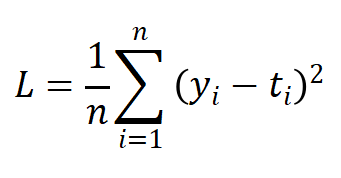

        其中，yi表示神经网络的输出，ti表示监督数据的标签（正确的解标签），n则是数据的“维度”。对于固定维度的网络，前面的系数n不重要，因此公式有时也可以写成：

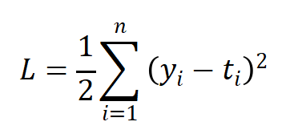

        L2 Loss对异常值敏感，遇到异常值时易发生梯度爆炸。

代码实现如下：

> def mean\_squared\_error(y, t):  
>     return 0.5 \* np.sum((y\-t)\*\*2)

（2）交叉熵误差

        除均方误差之外，交叉熵误差（Cross Entropy Error）也经常被用作损失函数：

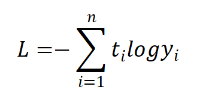

        其中，log表示自然对数，yi表示神经网络的输出，ti表示正确解标签；而且，ti中只有正确解标签对应的值为1，其它均为0（one-hot表示）。

        代码实现如下：

> def cross\_entropy\_error(y, t):  
>     if y.ndim == 1:  
>         t \= t.reshape(1, t.size)  
>         y \= y.reshape(1, y.size)  
>           
>     __\#__ __监督数据是____one-hot____向量的情况下，转换为正确解标签的索引__  
>     if t.size == y.size:  
>         t \= t.argmax(axis\=1)  
>                
>     batch\_size \= y.shape\[0\]  
>     return \-np.sum(np.log(y\[np.arange(batch\_size), t\] + 1e-7)) / batch\_size

### 1.2 分类任务损失函数

（1）二分类任务损失函数

        二分类任务常用二元交叉熵损失函数（Binary Cross-Entropy Loss）。

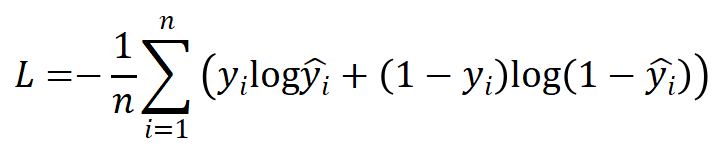

其中：

-   $y_{i}$为真实值（通常为0或1）
    
-   $\widehat{y_{i}}$为预测值（表示样本i为1的概率）
    

（2）多分类任务损失函数

        多分类任务常用多类交叉熵损失函数（Categorical Cross-Entropy Loss）。它是对每个类别的预测概率与真实标签之间差异的加权平均。

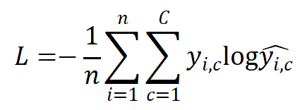

其中：

-   C是类别数
-   $y_{i,c}$为真实值（表示是否为类别c，通常为0或1）
-   $\widehat{y_{i,c}}$为预测值（表示样本i为类别c的概率）

### 1.3 回归任务损失函数

（1）MAE

        平均绝对误差（Mean Absolute Erro，MAE），也称L1 Loss：

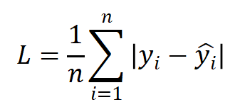

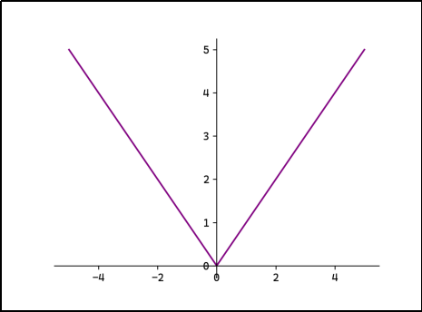

        L1 Loss对异常值鲁棒，但在0点处不可导。

（2）MSE

        均方误差（Mean Squared Error ，MSE），也称L2 Loss：

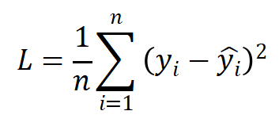

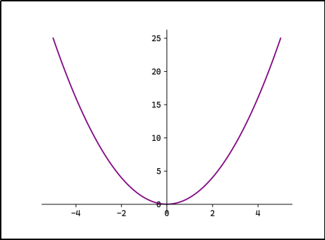

        L2 Loss对异常值敏感，遇到异常值时易发生梯度爆炸。

（3）Smooth L1

        平滑L1：

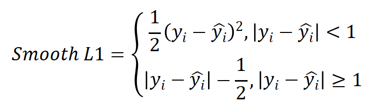

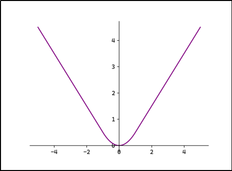

        当误差较小时（< 1）使用L2 Loss，使得损失函数平滑可导。当误差较大时（> 1）使用L1 Loss降低异常值的影响。

* * *

## 2 数值微分

        损失函数的值越小，代表我们选取的参数越适合；想要求得损失函数的最小值，最基本的想法就是对函数求导，解出导数值为0的点，并判断它是否为极小值/最小值。

        然而，实际的函数直接求导，不容易得到解析解。这时可以用数值微分的方式来求某点处的导数，这在工程上应用非常广泛。        

### 2.1 导数与数值微分

        在数学上，导数被定义为

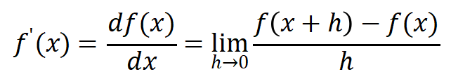

        这个定义中表达出了导数的本质。当__x__发生一个微小的变化__h__（或者Δ__x__）时，函数值__f(x)__也会发生变化；当__h__趋近于0时，此时__f(x)__的“变化率”就是__x__这一点的导数值。

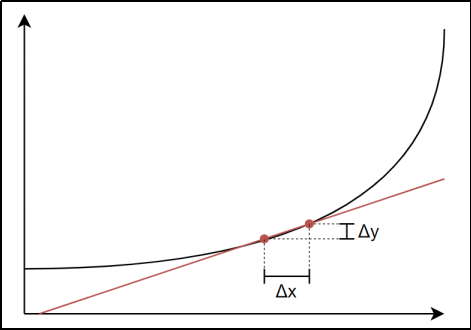

        利用这个定义，我们可以直接以数值计算的方式，利用微小的差分来求函数某点处的导数值，这种方法称为 ****数值微分****。

        数值微分可以用代码实现非常方便地实现：

> def numerial\_diff(f, x):  
>     h \= 1e-4  __\#__ __微小值__ __0.0001__  
>     return (f(x+h) - f(x\-h)) / (2 \* h)

        在这里，我们以__x__为中心，计算它两边各发生微小变化后的差分，可以避免只计算单向增大时的误差。这种方法称为 ****中心差分****。

        另外，取微小值__h__时不能太小，这会导致计算机浮点数表示的精度不够，出现舍入误差。

### 2.2 偏导数

        如果函数f的自变量并非单个元素，而是多个元素，例如：

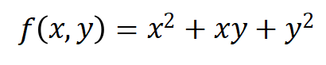

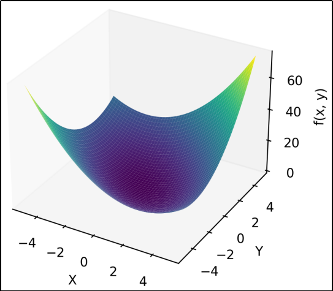

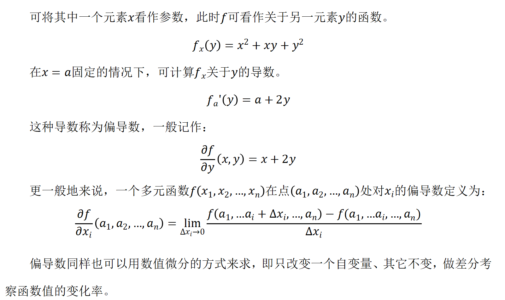

### 2.3 梯度

        多元函数$f\left (x_{1},...x_{n}\right )$关于每个变量$x_{i}$都有偏导数$\frac{\partial f }{\partial x_{i}}$，在点$a$处，这些偏导数定义了一个向量。

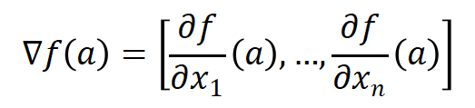

        这个向量称为f在点a的梯度。

例如：$f\left ({x,y}\right )=x^2&plus;xy&plus;y^2$在(1,1)处的梯度为\[3,3\]。

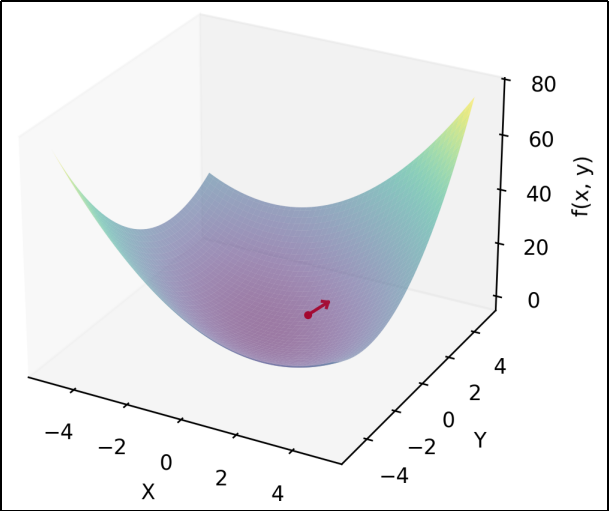

在函数的极小值、极大值和鞍点处，梯度为0。

        需要注意的是，梯度代表的其实是函数值增大最快的方向；在实际应用中，我们需要寻找损失函数的最小值，所以一般选择 ****负梯度**** 向量。同样地，负梯度代表的是函数值减小最快的方向，并不一定直接指向函数图像的最低点。

        利用数值微分，我们可以在代码中实现梯度的计算：

> def \_numerical\_gradient(f, x):  
>     h \= 1e-4 __\# 0.0001__  
>     grad \= np.zeros\_like(x)  
>       
>     for idx in range(x.size):  
>         tmp\_val \= x\[idx\]  
>         x\[idx\] = float(tmp\_val) + h  
>         fxh1 \= f(x) __\# f(x+h)__  
>           
>         x\[idx\] = tmp\_val \- h  
>         fxh2 \= f(x) __\# f(x-h)__  
>         grad\[idx\] = (fxh1 \- fxh2) / (2\*h)  
>           
>         x\[idx\] = tmp\_val __\#__ __还原值__  
>           
>     return grad

* * *

## 3 神经网络的梯度计算

        在神经网络的学习中，梯度的计算非常重要。神经网络中的梯度，指的就是损失函数关于权重参数的梯度。

        我们以一个单层的简单网络为例，形状为2×3，权重参数为__W__，损失函数记为__L__。那么它的权重参数和梯度为：

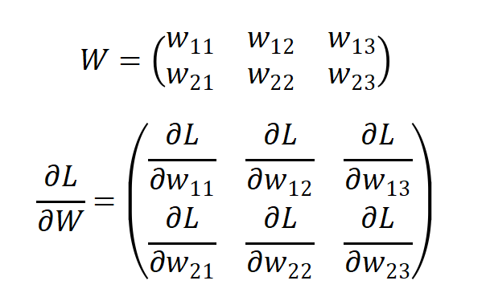

        这里，梯度 $\frac{\partial L}{\partial w}$ 也是一个2×3的矩阵，其中各个元素由__L__关于__W__中各元素的偏导数构成。

计算这个简单网络的梯度，可以用代码实现如下：

> class simpleNet:  
>     def \_\_init\_\_(self):  
>         self.W = np.random.randn(2,3)  
>   
>     def predict(self, x):  
>         return np.dot(x, self.W)  
>   
>     def loss(self, x, t):  
>         z \= self.predict(x)  
>         y \= softmax(z)  
>         loss \= cross\_entropy\_error(y, t)  
>   
>         return loss  
>   
> x = np.array(\[0.6, 0.9\])  
> t = np.array(\[0, 0, 1\])  
>   
> net = simpleNet()  
>   
> f = lambda w: net.loss(x, t)  
> dW = numerical\_gradient(f, net.W)  
>   
> print(dW)

* * *

## 4 随机梯度下降法

### 4.1 梯度下降法

        ****梯度下降法（Gradient Descent）****是一种用于最小化目标函数的迭代优化算法。核心是沿着目标函数（如损失函数）的负梯度方向逐步调整参数，从而逼近函数的最小值。梯度方向指示了函数增长最快的方向，因此负梯度方向是函数下降最快的方向。

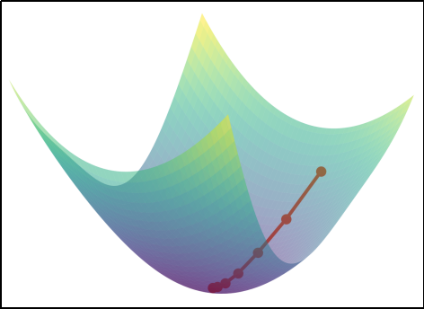

具体来说，我们初始找到函数__f__(__x__1__,x__2)的一个点(__x__1__,x__2)，按下式进行更新：

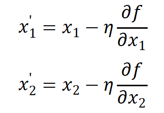

        这样就可以沿着负梯度方向，找到一个新的点(x1,x2)，让函数值更小。

        这里的η表示每次的更新量，在神经网络的学习过程中，就代表了一次学习的步长（一次学习多少、多大程度去更新参数），称为 ****学习率（learning rate）****。学习率需要预先设定好，过大或过小都会导致学习效果不佳。

        梯度下降法可以代码实现如下：

> def gradient\_descent(f, init\_x, lr\=0.01, step\_num\=100):  
>     x \= init\_x  
>     x\_history \= \[\]  
>   
>     for i in range(step\_num):  
>         x\_history.append( x.copy() )  
>   
>         grad \= numerical\_gradient(f, x)  
>         x \-= lr \* grad  
>   
>     return x, np.array(x\_history)

### 4.2 模型的训练相关概念

****（1）Epoch**** 

        1个Epoch表示模型完整遍历一次整个训练数据集的过程。例如，训练10个Epoch表示模型将整个数据集反复学习10次。

        模型需要多次遍历数据集（多个Epoch）才能逐步学习数据中的模式，单次遍历数据集（1个Epoch）通常不足以让模型收敛，多次遍历可以逐步优化模型参数。

​​​​​​​（2）****Batch Size****

        Batch Size是每次训练时输入的样本数量。例如，Batch Size=32 表示每次用32个样本计算一次梯度并更新模型参数。

        小批量数据计算梯度比单样本（Batch Size=1）更稳定，比全批量（Batch Size=全体数据）更高效。并且较小的Batch Size可能带来更多噪声，有助于模型泛化。

​​​​​​​（3）****Iteration****

        一次Iteration表示完成一个Batch数据的正向传播（预测）和反向传播（更新参数）的过程。

例如，数据集现有2000个样本，对其训练10个Epoch，选择Batch Size=64：

        Batch个数为2000//64+1=31+1=32个（最后一个Batch仅有16个样本）。

每个Epoch中迭代次数Itreation=32次。总迭代次数为10×32=320次。总训练样本数为10×2000=20000。

​​​​​​​（4）**SGD**

        在神经网络的学习过程中，可以使用梯度下降法来更新参数，目标就是减小损失函数的值。

        实际操作时，一般会从训练数据中随机选择一个小批量数据（mini-batch），然后用梯度下降法迭代多个轮次（iteration）；这种“对随机选择的数据进行的梯度下降法”，被称作 ****随机梯度下降法（stochastic gradient descent，SGD）****。

具体过程如下：

****1）随机选择批数据（mini-batch）****

从训练数据中随机选出一部分数据，学习的目标就是要减少这个mini-batch数据的损失函数值。

****2）计算梯度****

对当前的各权重参数，计算出梯度的值，负梯度就表示了损失函数减小最多的方向。

****3）更新参数****

按照3.4.1节中梯度下降法的公式，对权重参数沿负梯度方向进行微小更新。

****4）重复迭代****

重复上面的步骤1）2）3），直到完成预定的总迭代次数。

* * *

## 5 代码实现

使用梯度下降训练的手写数字识别

modeL.py

```python
"""
================================================================================
神经网络模型定义文件 - model.py
================================================================================

【文件功能】
这个文件定义了一个三层神经网络模型，用于手写数字识别任务（0-9）

【什么是神经网络？】
神经网络是模仿人脑神经元工作方式的计算模型：
- 人脑有很多神经元，它们通过连接传递信号
- 神经网络也有很多"节点"（神经元），通过"权重"连接
- 信号从输入层进入，经过隐藏层处理，最后从输出层输出结果

【本模型的结构】
输入层(784个神经元) → 隐藏层1(50个神经元) → 隐藏层2(100个神经元) → 输出层(10个神经元)

为什么是784？因为手写数字图片是28x28像素，28×28=784

为什么输出是10？因为数字有0-9共10个类别

【SGD (随机梯度下降) 优化器说明】
SGD是最基础的优化算法：
1. 随机选取一小批数据（batch）
2. 计算这批数据的损失
3. 计算梯度（损失对每个参数的导数）
4. 按照梯度的反方向更新参数
5. 重复以上步骤

公式：新参数 = 旧参数 - 学习率 × 梯度

================================================================================
"""

# ==================== 导入必要的库 ====================
import numpy as np  # NumPy是Python的数值计算库，用于矩阵运算


class NeuralNetwork:
    """
    三层神经网络模型类
    
    【类的作用】
    这个类封装了神经网络的所有功能：
    1. 初始化网络参数（权重和偏置）
    2. 前向传播（从输入计算输出）
    3. 反向传播（计算梯度并更新参数）
    4. 预测（给定输入，预测数字类别）
    5. 保存/加载模型参数
    
    【网络结构详解】
    ┌─────────────┐     ┌─────────────┐     ┌─────────────┐     ┌─────────────┐
    │   输入层     │     │  隐藏层1     │     │  隐藏层2    │     │   输出层    │
    │  784个节点   │ ──→ │  50个节点    │ ──→ │  100个节点  │ ──→ │  10个节点   │
    │ (28x28像素)  │     │ (ReLU激活)  │     │ (ReLU激活)  │     │(Softmax激活)│
    └─────────────┘     └─────────────┘     └─────────────┘     └─────────────┘
          ↑                   ↑                   ↑                   ↑
        W1,b1               W2,b2               W3,b3             概率分布
    
    【参数说明】
    - W1: 形状(784, 50)  - 输入层到隐藏层1的权重矩阵
    - b1: 形状(1, 50)    - 隐藏层1的偏置向量
    - W2: 形状(50, 100)  - 隐藏层1到隐藏层2的权重矩阵
    - b2: 形状(1, 100)   - 隐藏层2的偏置向量
    - W3: 形状(100, 10)  - 隐藏层2到输出层的权重矩阵
    - b3: 形状(1, 10)    - 输出层的偏置向量
    """

    def __init__(self, input_size=784, hidden1_size=50, hidden2_size=100, output_size=10):
        """
        初始化神经网络
        
        【__init__是什么？】
        这是Python类的"构造函数"，当你创建这个类的实例时会自动调用
        例如：model = NeuralNetwork() 时就会执行这个函数
        
        【参数解释】
        - input_size: 输入层的神经元数量，默认784（28×28像素的图片）
        - hidden1_size: 第一个隐藏层的神经元数量，默认50
        - hidden2_size: 第二个隐藏层的神经元数量，默认100
        - output_size: 输出层的神经元数量，默认10（0-9共10个数字）
        
        【为什么要设置这些参数？】
        - 输入层大小必须匹配图片像素数
        - 隐藏层大小可以调整，影响模型的"学习能力"
        - 输出层大小必须匹配类别数量
        """
        # -------------------- 保存网络结构参数 --------------------
        self.input_size = input_size      # 保存输入层大小
        self.hidden1_size = hidden1_size  # 保存隐藏层1大小
        self.hidden2_size = hidden2_size  # 保存隐藏层2大小
        self.output_size = output_size    # 保存输出层大小

        # -------------------- 创建参数字典 --------------------
        # params字典用于存储所有的权重(W)和偏置(b)
        # 权重(W): 连接两层神经元的"强度"
        # 偏置(b): 每个神经元的"基础激活值"
        self.params = {}
        
        # 调用参数初始化函数
        self._initialize_parameters()

    def _initialize_parameters(self, initialization='xavier'):
        """
        初始化网络参数（权重和偏置）
        
        【为什么需要初始化？】
        神经网络开始训练前，需要给权重和偏置一个初始值
        如果初始化不好，网络可能：
        1. 无法学习（梯度消失）
        2. 学习不稳定（梯度爆炸）
        
        【Xavier初始化是什么？】
        Xavier初始化是一种聪明的初始化方法：
        - 让每层的输出方差保持一致
        - 公式：权重 ~ N(0, 1/n)，其中n是输入的神经元数量
        - 这样可以让信号在网络中平稳传递，避免梯度问题
        
        【参数解释】
        - initialization: 初始化方法，'xavier'或'random'
        """
        if initialization == 'xavier':
            # ==================== Xavier初始化 ====================
            # 这种初始化方法考虑了输入的维度，使训练更稳定
            
            # W1: 输入层(784) → 隐藏层1(50)
            # 形状: (784, 50)，即784行50列的矩阵
            # np.random.randn生成标准正态分布的随机数
            # 乘以 sqrt(1/输入维度) 来缩放
            self.params['W1'] = np.random.randn(self.input_size, self.hidden1_size) * np.sqrt(1. / self.input_size)
            
            # W2: 隐藏层1(50) → 隐藏层2(100)
            # 形状: (50, 100)
            self.params['W2'] = np.random.randn(self.hidden1_size, self.hidden2_size) * np.sqrt(1. / self.hidden1_size)
            
            # W3: 隐藏层2(100) → 输出层(10)
            # 形状: (100, 10)
            self.params['W3'] = np.random.randn(self.hidden2_size, self.output_size) * np.sqrt(1. / self.hidden2_size)
        else:
            # ==================== 简单随机初始化 ====================
            # 用很小的随机数初始化（乘以0.01）
            self.params['W1'] = np.random.randn(self.input_size, self.hidden1_size) * 0.01
            self.params['W2'] = np.random.randn(self.hidden1_size, self.hidden2_size) * 0.01
            self.params['W3'] = np.random.randn(self.hidden2_size, self.output_size) * 0.01

        # ==================== 偏置初始化为0 ====================
        # 偏置通常初始化为0
        # 形状都是(1, 该层神经元数量)，方便广播运算
        self.params['b1'] = np.zeros((1, self.hidden1_size))   # (1, 50)
        self.params['b2'] = np.zeros((1, self.hidden2_size))   # (1, 100)
        self.params['b3'] = np.zeros((1, self.output_size))    # (1, 10)

    def relu(self, x):
        """
        ReLU激活函数 (Rectified Linear Unit，修正线性单元)
        
        【什么是激活函数？】
        激活函数给神经网络引入"非线性"
        没有激活函数，多层神经网络等价于单层（因为线性的组合还是线性）
        有了激活函数，网络才能学习复杂的模式
        
        【ReLU函数】
        公式：f(x) = max(0, x)
        - 如果x > 0，输出x
        - 如果x ≤ 0，输出0
        
        图示：
                   ↑ 输出
                   │     ╱
                   │    ╱
                   │   ╱
         ──────────┼──╱─────→ 输入
                   │
                   
        【为什么用ReLU？】
        1. 计算简单快速
        2. 减少梯度消失问题（正数区域梯度恒为1）
        3. 让神经元输出更稀疏（很多输出为0）
        
        【参数和返回值】
        - x: 输入数据（numpy数组）
        - 返回: 应用ReLU后的结果
        """
        return np.maximum(0, x)  # np.maximum逐元素取较大值

    def relu_derivative(self, x):
        """
        ReLU函数的导数，用于反向传播
        
        【为什么需要导数？】
        反向传播需要计算损失函数对每个参数的梯度
        根据链式法则，需要知道每一步操作的导数
        
        【ReLU的导数】
        - 当x > 0时，导数 = 1
        - 当x ≤ 0时，导数 = 0
        
        图示：
                   ↑ 导数
               1 ──┼────────
                   │
                   ├────────→ 输入
                   │
               0 ──┘
        
        【代码解释】
        (x > 0) 返回一个布尔数组，True在x>0处
        .astype(float) 将True转为1.0，False转为0.0
        """
        return (x > 0).astype(float)

    def softmax(self, x):
        """
        Softmax函数 - 将原始分数转换为概率分布
        
        【什么是Softmax？】
        Softmax把任意实数向量转换为"概率分布"：
        - 所有输出值在0到1之间
        - 所有输出值加起来等于1
        
        【公式】
        softmax(x_i) = exp(x_i) / Σ exp(x_j)
        
        【例子】
        输入: [2.0, 1.0, 0.1]
        exp后: [7.39, 2.72, 1.11]
        总和: 11.22
        输出: [0.66, 0.24, 0.10]  ← 这就是概率分布！
        
        【数值稳定性处理】
        如果x很大，exp(x)会溢出（变成无穷大）
        技巧：先减去最大值，不影响结果但避免溢出
        因为 softmax(x) = softmax(x - max(x))
        
        【参数和返回值】
        - x: 输入数据，形状(n_samples, 10)，每行是一个样本的10个类别分数
        - 返回: 概率分布，形状(n_samples, 10)，每行的和为1
        """
        # 减去每行的最大值，保持数值稳定
        # keepdims=True保持维度，方便广播
        exp_x = np.exp(x - np.max(x, axis=1, keepdims=True))
        
        # 除以每行的和，得到概率
        return exp_x / np.sum(exp_x, axis=1, keepdims=True)

    def forward_propagation(self, X):
        """
        前向传播 - 从输入计算输出
        
        【什么是前向传播？】
        数据从输入层"向前"流动，经过每一层的计算，最终得到输出
        就像水流经过一系列处理器，最后得到结果
        
        【计算流程】
        第1步：输入 → 隐藏层1
               z1 = X × W1 + b1    (线性变换)
               a1 = ReLU(z1)       (激活函数)
               
        第2步：隐藏层1 → 隐藏层2
               z2 = a1 × W2 + b2   (线性变换)
               a2 = ReLU(z2)       (激活函数)
               
        第3步：隐藏层2 → 输出
               z3 = a2 × W3 + b3   (线性变换)
               a3 = Softmax(z3)    (转为概率)
        
        【符号说明】
        - z: 线性变换的结果（加权求和）
        - a: 激活后的结果
        - 下标1,2,3表示第几层
        
        【参数和返回值】
        - X: 输入数据，形状(n_samples, 784)
             n_samples是样本数量，784是每个样本的特征数
        - 返回: 输出概率分布，形状(n_samples, 10)
        """
        # ==================== 第一层：输入层 → 隐藏层1 ====================
        # 线性变换：z1 = X × W1 + b1
        # X的形状: (n_samples, 784)
        # W1的形状: (784, 50)
        # 矩阵乘法结果: (n_samples, 50)
        # b1的形状: (1, 50)，会自动广播到(n_samples, 50)
        self.z1 = np.dot(X, self.params['W1']) + self.params['b1']
        
        # 激活函数：a1 = ReLU(z1)
        # 把负数变成0，正数保持不变
        self.a1 = self.relu(self.z1)

        # ==================== 第二层：隐藏层1 → 隐藏层2 ====================
        # 线性变换：z2 = a1 × W2 + b2
        # a1的形状: (n_samples, 50)
        # W2的形状: (50, 100)
        # 结果形状: (n_samples, 100)
        self.z2 = np.dot(self.a1, self.params['W2']) + self.params['b2']
        
        # 激活函数：a2 = ReLU(z2)
        self.a2 = self.relu(self.z2)

        # ==================== 第三层：隐藏层2 → 输出层 ====================
        # 线性变换：z3 = a2 × W3 + b3
        # a2的形状: (n_samples, 100)
        # W3的形状: (100, 10)
        # 结果形状: (n_samples, 10)
        self.z3 = np.dot(self.a2, self.params['W3']) + self.params['b3']
        
        # Softmax激活：将分数转换为概率分布
        # 每个样本的10个输出值加起来等于1
        self.a3 = self.softmax(self.z3)

        # 返回最终的概率分布
        return self.a3

    def backward_propagation(self, X, y, learning_rate=0.01):
        """
        反向传播 - 使用SGD（随机梯度下降）更新参数
        
        【什么是反向传播？】
        反向传播是神经网络的"学习"过程：
        1. 计算预测结果与真实答案的"误差"
        2. 把误差从输出层"反向"传播到每一层
        3. 根据每层的误差，计算如何调整参数
        4. 更新参数，让下次预测更准确
        
        【SGD更新公式】
        参数_new = 参数_old - 学习率 × 梯度
        
        【链式法则】
        反向传播使用微积分的链式法则：
        如果 y = f(g(x))，那么 dy/dx = dy/dg × dg/dx
        
        【各符号说明】
        - dz: 损失对z的梯度
        - dw: 损失对W的梯度
        - db: 损失对b的梯度
        - 下标1,2,3表示第几层
        
        【参数解释】
        - X: 输入数据，形状(n_samples, 784)
        - y: 真实标签，形状(n_samples,)，值为0-9的整数
        - learning_rate: 学习率，控制每次更新的步长
                        太大可能不稳定，太小学习太慢
        """
        # -------------------- 获取样本数量 --------------------
        m = X.shape[0]  # 样本数量，用于计算平均梯度

        # -------------------- 将标签转换为one-hot编码 --------------------
        # 什么是one-hot编码？
        # 把类别标签转换为向量形式
        # 例如：数字3 → [0,0,0,1,0,0,0,0,0,0]
        # 只有第3个位置是1，其他都是0
        # np.eye(10)创建10×10的单位矩阵，用y索引选取对应行
        y_one_hot = np.eye(self.output_size)[y]

        # ==================== 输出层的梯度计算 ====================
        # 对于交叉熵损失 + Softmax激活，输出层梯度有简洁公式：
        # dL/dz3 = a3 - y_one_hot
        #
        # 如果真实标签是3，y_one_hot在位置3是1
        # 如果预测概率a3在位置3接近1，误差就小
        # 如果预测概率a3在位置3远离1，误差就大
        dz3 = self.a3 - y_one_hot  # 形状: (n_samples, 10)
        
        # 计算W3的梯度：dL/dW3 = a2^T × dz3 / m
        # a2^T的形状: (100, n_samples)
        # dz3的形状: (n_samples, 10)
        # 结果形状: (100, 10)，与W3形状相同
        # 除以m是取平均
        dw3 = np.dot(self.a2.T, dz3) / m
        
        # 计算b3的梯度：dL/db3 = sum(dz3) / m
        # 在样本维度求和，保持形状(1, 10)
        db3 = np.sum(dz3, axis=0, keepdims=True) / m

        # ==================== 隐藏层2的梯度计算 ====================
        # 误差反向传播：dz2 = dz3 × W3^T × ReLU导数(z2)
        # 
        # dz3 × W3^T 把输出层的误差传回隐藏层2
        # 乘以ReLU导数处理激活函数的影响
        dz2 = np.dot(dz3, self.params['W3'].T) * self.relu_derivative(self.z2)
        
        # 计算W2的梯度
        dw2 = np.dot(self.a1.T, dz2) / m
        
        # 计算b2的梯度
        db2 = np.sum(dz2, axis=0, keepdims=True) / m

        # ==================== 隐藏层1的梯度计算 ====================
        # 继续反向传播误差
        dz1 = np.dot(dz2, self.params['W2'].T) * self.relu_derivative(self.z1)
        
        # 计算W1的梯度
        dw1 = np.dot(X.T, dz1) / m
        
        # 计算b1的梯度
        db1 = np.sum(dz1, axis=0, keepdims=True) / m

        # ==================== SGD参数更新 ====================
        # 更新公式：参数 = 参数 - 学习率 × 梯度
        # 
        # 为什么是减法？
        # 梯度指向损失增加最快的方向
        # 我们要让损失减小，所以往梯度的反方向走
        # 
        # 学习率的作用？
        # 控制每次走多远
        # 太大可能"跨过"最优点
        # 太小学习太慢
        
        # 更新第三层参数
        self.params['W3'] -= learning_rate * dw3
        self.params['b3'] -= learning_rate * db3
        
        # 更新第二层参数
        self.params['W2'] -= learning_rate * dw2
        self.params['b2'] -= learning_rate * db2
        
        # 更新第一层参数
        self.params['W1'] -= learning_rate * dw1
        self.params['b1'] -= learning_rate * db1

    def compute_loss(self, y_true):
        """
        计算交叉熵损失函数
        
        【什么是损失函数？】
        损失函数衡量预测结果与真实答案的"差距"
        训练的目标就是让损失函数尽可能小
        
        【什么是交叉熵损失？】
        交叉熵是分类问题最常用的损失函数
        公式：L = -Σ y_true × log(y_pred)
        
        【直觉解释】
        - 如果真实标签是3，我们只关心位置3的预测概率
        - 如果预测概率接近1，-log(1) ≈ 0，损失小
        - 如果预测概率接近0，-log(0) → ∞，损失大
        - 这鼓励模型在正确类别上给出高概率
        
        【参数和返回值】
        - y_true: 真实标签，形状(n_samples,)
        - 返回: 平均损失值（一个标量）
        """
        # 将标签转换为one-hot编码
        y_one_hot = np.eye(self.output_size)[y_true]
        
        # 数值稳定性处理
        # 避免log(0)导致的-inf
        # epsilon是一个很小的数
        epsilon = 1e-15
        
        # 将预测概率裁剪到[epsilon, 1-epsilon]范围内
        a3_clipped = np.clip(self.a3, epsilon, 1. - epsilon)
        
        # 计算交叉熵损失
        # y_one_hot * np.log(a3_clipped): 只保留正确类别的log概率
        # np.sum(..., axis=1): 对每个样本求和（实际上每个样本只有一项非零）
        # np.mean: 对所有样本取平均
        loss = -np.mean(np.sum(y_one_hot * np.log(a3_clipped), axis=1))
        
        return loss

    def predict(self, X):
        """
        预测数字类别
        
        【功能说明】
        给定输入图片，返回预测的数字（0-9）
        
        【处理流程】
        1. 前向传播得到概率分布
        2. 取概率最大的类别作为预测结果
        
        【参数和返回值】
        - X: 输入数据，形状(n_samples, 784)
        - 返回: 预测类别，形状(n_samples,)，每个值是0-9的整数
        """
        # 前向传播得到每个类别的概率
        probabilities = self.forward_propagation(X)
        
        # np.argmax返回最大值的索引
        # axis=1表示在每行中找最大值
        return np.argmax(probabilities, axis=1)

    def predict_with_confidence(self, X):
        """
        预测数字类别及置信度
        
        【功能说明】
        除了返回预测结果，还返回模型的"置信度"
        置信度就是预测类别的概率
        
        【置信度的意义】
        - 置信度高（如0.95）：模型很确定
        - 置信度低（如0.3）：模型不太确定，结果可能不可靠
        
        【参数和返回值】
        - X: 输入数据，形状(n_samples, 784)
        - 返回: (预测类别数组, 置信度数组)
        """
        # 前向传播得到概率分布
        probabilities = self.forward_propagation(X)
        
        # 获取预测类别（概率最大的索引）
        predictions = np.argmax(probabilities, axis=1)
        
        # 获取置信度（最大概率值）
        confidences = np.max(probabilities, axis=1)
        
        return predictions, confidences

    def save_parameters(self, file_path):
        """
        保存模型参数到文件
        
        【为什么要保存？】
        训练需要很长时间，保存参数后：
        - 不需要重新训练
        - 可以直接加载用于预测
        - 可以分享给别人使用
        
        【文件格式】
        .npz是NumPy的压缩格式，可以保存多个数组
        
        【参数】
        - file_path: 保存文件的路径
        """
        np.savez(file_path,
                 W1=self.params['W1'], b1=self.params['b1'],
                 W2=self.params['W2'], b2=self.params['b2'],
                 W3=self.params['W3'], b3=self.params['b3'])
        print(f"模型参数已保存到: {file_path}")

    def load_parameters(self, file_path):
        """
        从文件加载模型参数
        
        【功能说明】
        读取之前保存的参数，恢复模型状态
        
        【参数】
        - file_path: 参数文件路径
        
        【返回】
        - True: 加载成功
        - False: 加载失败
        """
        try:
            # 加载npz文件
            loaded_params = np.load(file_path)
            
            # 将加载的参数放入params字典
            self.params = {
                'W1': loaded_params['W1'],
                'b1': loaded_params['b1'],
                'W2': loaded_params['W2'],
                'b2': loaded_params['b2'],
                'W3': loaded_params['W3'],
                'b3': loaded_params['b3']
            }
            print(f"模型参数已从 {file_path} 加载")
            return True
            
        except FileNotFoundError:
            # 文件不存在
            print(f"参数文件 {file_path} 未找到")
            return False
            
        except Exception as e:
            # 其他错误
            print(f"加载参数时出错: {e}")
            return False
```

predict.py

```python
"""
================================================================================
神经网络推理脚本 - predict.py
================================================================================

【文件功能】
这个脚本用于：
1. 加载训练好的模型参数
2. 对新的手写数字图片进行预测
3. 评估模型的整体性能
4. 可视化预测结果

【什么是推理（Inference）？】
推理是使用训练好的模型进行预测的过程：
- 训练阶段：学习参数（需要标签，需要反向传播）
- 推理阶段：使用参数预测（不需要标签，只需前向传播）

打个比方：
- 训练 = 学生学习知识
- 推理 = 学生用学到的知识答题

【推理流程】
┌──────────────────┐
│   加载模型参数   │ ← 训练好的权重和偏置
└────────┬─────────┘
         ↓
┌──────────────────┐
│  加载测试数据    │
└────────┬─────────┘
         ↓
┌──────────────────┐
│   前向传播       │ ← 只有这一步，不需要反向传播
└────────┬─────────┘
         ↓
┌──────────────────┐
│   获取预测结果   │
└────────┬─────────┘
         ↓
┌──────────────────┐
│  输出/可视化     │
└──────────────────┘

================================================================================
"""

# ==================== 导入必要的库 ====================
import numpy as np            # NumPy：数值计算库
import pandas as pd           # Pandas：数据处理库
import matplotlib.pyplot as plt  # Matplotlib：绑图库
from model import NeuralNetwork  # 导入神经网络模型类

# ==================== 中文显示配置 ====================
plt.rcParams['font.sans-serif'] = ['SimHei']  # 使用黑体显示中文
plt.rcParams['axes.unicode_minus'] = False     # 解决负号显示问题


def load_and_preprocess_data(csv_path):
    """
    加载和预处理数据
    
    【函数功能】
    读取CSV文件中的手写数字数据，并进行预处理
    
    【与train.py的区别】
    这个函数需要处理两种情况：
    1. 带标签的数据（有'label'列）：用于评估模型
    2. 不带标签的数据（没有'label'列）：用于真正的预测
    
    【参数】
    - csv_path: CSV文件路径
    
    【返回】
    - pixels: 归一化后的像素数据
    - labels: 标签数据（如果有的话，否则为None）
    """
    print("正在加载数据...")
    
    # 读取CSV文件
    data = pd.read_csv(csv_path)

    # -------------------- 检查是否有标签 --------------------
    if 'label' in data.columns:
        # 有标签的情况（训练集或带标签的测试集）
        labels = data['label'].values
        pixels = data.drop('label', axis=1).values
    else:
        # 没有标签的情况（真正的预测任务）
        labels = None
        pixels = data.values

    # -------------------- 数据归一化 --------------------
    # 将像素值从0-255缩放到0-1
    pixels = pixels.astype('float32') / 255.0

    print(f"数据加载完成: {len(pixels)}个样本")
    return pixels, labels


def visualize_sample(pixels, labels=None, index=0, prediction=None, confidence=None):
    """
    可视化手写数字样本
    
    【函数功能】
    将一维像素数据（784个值）恢复为二维图片（28×28）并显示
    
    【为什么需要可视化？】
    1. 检查数据是否正确加载
    2. 直观地看到预测结果
    3. 分析模型的错误情况
    
    【参数说明】
    - pixels: 所有样本的像素数据
    - labels: 真实标签（可选）
    - index: 要显示的样本索引
    - prediction: 模型预测结果（可选）
    - confidence: 模型置信度（可选）
    """
    # -------------------- 重塑图片 --------------------
    # 将784维向量重塑为28×28的图片
    # reshape(28, 28)改变数组形状
    image = pixels[index].reshape(28, 28)

    # -------------------- 创建图表 --------------------
    plt.figure(figsize=(6, 6))
    
    # 显示图片
    # cmap='gray'使用灰度色彩映射
    plt.imshow(image, cmap='gray')

    # -------------------- 设置标题 --------------------
    if labels is not None and prediction is not None:
        # 有真实标签和预测结果：显示对比
        title = f'真实: {labels[index]} | 预测: {prediction} | 置信度: {confidence:.3f}'
        # 根据预测是否正确设置颜色
        color = 'green' if labels[index] == prediction else 'red'
    elif prediction is not None:
        # 只有预测结果：显示预测
        title = f'预测: {prediction} | 置信度: {confidence:.3f}'
        color = 'blue'
    else:
        # 都没有：只显示索引
        title = f'样本 {index}'
        color = 'black'

    plt.title(title, color=color, fontsize=12)
    
    # 隐藏坐标轴（看图片不需要坐标）
    plt.axis('off')
    
    # 自动调整布局
    plt.tight_layout()
    
    # 显示图表
    plt.show()


def evaluate_model(model, X, y, sample_size=1000):
    """
    评估模型性能
    
    【函数功能】
    在测试数据上评估模型的准确率
    并显示详细的预测结果
    
    【评估指标】
    准确率(Accuracy) = 预测正确的样本数 / 总样本数
    
    【参数说明】
    - model: 训练好的神经网络模型
    - X: 测试数据的特征（像素）
    - y: 测试数据的标签
    - sample_size: 评估时使用的样本数量（默认1000）
    
    【返回】
    - accuracy: 模型的准确率
    """
    # -------------------- 采样（如果数据太多）--------------------
    # 如果数据量很大，随机抽取一部分进行评估
    # 这样速度更快，结果也具有代表性
    if len(X) > sample_size:
        # 随机选择sample_size个不重复的索引
        indices = np.random.choice(len(X), sample_size, replace=False)
        X_sample = X[indices]
        y_sample = y[indices]
    else:
        X_sample = X
        y_sample = y

    # -------------------- 批量预测 --------------------
    # 使用模型预测所有样本的类别
    predictions = model.predict(X_sample)
    
    # -------------------- 计算准确率 --------------------
    # predictions == y_sample：创建布尔数组，True表示预测正确
    # np.mean()：True算1，False算0，平均值就是正确率
    accuracy = np.mean(predictions == y_sample)

    # -------------------- 打印结果 --------------------
    print(f"模型评估结果:")
    print(f"样本数量: {len(X_sample)}")
    print(f"准确率: {accuracy:.4f} ({accuracy * 100:.2f}%)")

    # -------------------- 显示详细预测结果 --------------------
    print(f"\n详细预测结果:")
    print("索引 | 真实 | 预测 | 置信度 | 状态")
    print("-" * 45)

    # 显示前10个样本的预测详情
    for i in range(min(10, len(X_sample))):
        # 获取单个样本的预测结果和置信度
        pred, conf = model.predict_with_confidence(X_sample[i:i + 1])
        
        # 判断预测是否正确
        status = "正确" if pred[0] == y_sample[i] else "错误"
        
        # 打印详情
        print(f"{i:4d} | {y_sample[i]:4d} | {pred[0]:4d} | {conf[0]:.3f}   | {status}")

    return accuracy


def predict_single_digit(model, pixel_data):
    """
    预测单个数字
    
    【函数功能】
    对单个手写数字图片进行预测
    
    【参数说明】
    - model: 训练好的神经网络模型
    - pixel_data: 单个样本的像素数据（784个值或已经是二维的）
    
    【返回】
    - prediction: 预测的数字（0-9）
    - confidence: 置信度（0-1）
    """
    # -------------------- 确保数据形状正确 --------------------
    # 模型需要输入形状为(n_samples, 784)
    # 如果输入是一维的(784,)，需要重塑为(1, 784)
    if len(pixel_data) == 784:
        pixel_data = pixel_data.reshape(1, -1)  # -1表示自动计算

    # -------------------- 进行预测 --------------------
    prediction, confidence = model.predict_with_confidence(pixel_data)
    
    return prediction[0], confidence[0]


def main():
    """
    主推理函数 - 交互式演示程序
    
    【函数功能】
    提供一个交互式界面，让用户可以：
    1. 评估模型整体性能
    2. 查看单个样本的预测
    3. 批量预测演示
    
    【流程说明】
    1. 加载训练好的模型参数
    2. 加载测试数据
    3. 进入交互循环，等待用户选择操作
    """
    print("=" * 60)
    print("手写数字识别 - 推理模式")
    print("=" * 60)

    # ==================== 第1步：创建模型 ====================
    # 创建一个新的神经网络实例
    # 此时参数是随机的，需要加载训练好的参数
    model = NeuralNetwork()

    # ==================== 第2步：加载训练好的参数 ====================
    # 参数文件是训练时保存的
    param_file = "nn_sample.npz"
    
    # 尝试加载参数
    if not model.load_parameters(param_file):
        print("无法加载模型参数，请先运行 train.py 进行训练")
        return

    # ==================== 第3步：加载测试数据 ====================
    csv_path = "E:\\实验报告\\深度学习\\课程内容\\data\\D_number\\D_test.csv"
    
    try:
        X, y = load_and_preprocess_data(csv_path)
    except FileNotFoundError:
        print("数据文件未找到")
        return

    # ==================== 第4步：交互式推理演示 ====================
    # 进入一个循环，让用户选择不同的操作
    while True:
        # -------------------- 显示菜单 --------------------
        print(f"\n选择操作:")
        print("1. 评估模型整体性能")
        print("2. 查看单个样本预测")
        print("3. 批量预测演示")
        print("4. 退出")

        # 获取用户输入
        choice = input("请输入选择 (1-4): ").strip()

        # -------------------- 处理用户选择 --------------------
        if choice == '1':
            # 选项1：整体评估
            # 在测试集上计算准确率
            evaluate_model(model, X, y, sample_size=1000)

        elif choice == '2':
            # 选项2：单个样本预测
            try:
                # 获取用户输入的索引
                index = int(input("请输入样本索引 (0-{}): ".format(len(X) - 1)))
                
                # 检查索引是否有效
                if 0 <= index < len(X):
                    # 进行预测
                    prediction, confidence = model.predict_with_confidence(X[index:index + 1])
                    
                    # 可视化显示
                    visualize_sample(X, y, index, prediction[0], confidence[0])

                    # 打印预测详情
                    print(f"\n预测详情:")
                    print(f"样本索引: {index}")
                    print(f"预测数字: {prediction[0]}")
                    print(f"置信度: {confidence[0]:.3f}")
                else:
                    print("索引超出范围")
            except ValueError:
                print("请输入有效数字")

        elif choice == '3':
            # 选项3：批量演示
            print(f"\n批量预测演示:")
            
            # 预测前5个样本
            for i in range(5):
                prediction, confidence = model.predict_with_confidence(X[i:i + 1])
                print(f"样本 {i}: 预测={prediction[0]}, 置信度={confidence[0]:.3f}")

        elif choice == '4':
            # 选项4：退出
            print("再见！")
            break
        else:
            # 无效输入
            print("无效选择，请重新输入")


# ==================== 程序入口 ====================
# 当直接运行这个脚本时，执行main函数
if __name__ == "__main__":
    main()
```

train.py

```python
"""
================================================================================
神经网络训练脚本 - train.py（使用SGD随机梯度下降）
================================================================================

【文件功能】
这个脚本用于训练手写数字识别的神经网络模型
使用的优化方法是：SGD（Stochastic Gradient Descent，随机梯度下降）

【什么是训练？】
训练就是让神经网络"学习"的过程：
1. 给网络看很多带标签的数据（比如数字图片和对应的数字）
2. 网络根据数据调整自己的参数（权重和偏置）
3. 调整的目标是让预测越来越准确

【SGD（随机梯度下降）是什么？】
SGD是最经典的神经网络优化算法：

1. 梯度下降（Gradient Descent）：
   - 想象你站在山上，想下到山谷（最低点）
   - 梯度就像指南针，告诉你"最陡峭"的方向
   - 你往梯度的反方向走，就能下山

2. "随机"的含义：
   - 不用全部数据计算梯度（太慢）
   - 每次只用一小批数据（mini-batch）
   - 这个小批是"随机"选取的
   
3. 更新公式：
   参数_new = 参数_old - 学习率 × 梯度

【训练流程图】
┌──────────────────┐
│   加载训练数据   │
└────────┬─────────┘
         ↓
┌──────────────────┐
│   分割训练/验证  │
└────────┬─────────┘
         ↓
┌──────────────────┐
│   创建神经网络   │
└────────┬─────────┘
         ↓
    ┌────────────┐
    │ 开始循环训练│←──────────┐
    └─────┬──────┘            │
          ↓                   │
    ┌────────────┐            │
    │  取一批数据 │            │
    └─────┬──────┘            │
          ↓                   │
    ┌────────────┐            │
    │  前向传播   │            │
    └─────┬──────┘            │
          ↓                   │
    ┌────────────┐            │
    │  计算损失   │            │
    └─────┬──────┘            │
          ↓                   │
    ┌────────────┐            │
    │  反向传播   │            │
    │ (SGD更新)   │            │
    └─────┬──────┘            │
          ↓                   │
    ┌────────────┐            │
    │ 还有数据？  │──是────────┘
    └─────┬──────┘
          │否
          ↓
    ┌────────────┐
    │  保存模型   │
    └────────────┘

================================================================================
"""

# ==================== 导入必要的库 ====================
import numpy as np            # NumPy：数值计算库，用于矩阵运算
import pandas as pd           # Pandas：数据处理库，用于读取CSV文件
import matplotlib.pyplot as plt  # Matplotlib：绑图库，用于可视化
from model import NeuralNetwork  # 导入我们定义的神经网络模型

# ==================== 中文显示配置 ====================
# 默认情况下，matplotlib不支持中文
# 这两行代码让图表可以显示中文
plt.rcParams['font.sans-serif'] = ['SimHei']  # 使用黑体字体
plt.rcParams['axes.unicode_minus'] = False     # 解决负号显示问题


def load_and_preprocess_data(csv_path):
    """
    加载和预处理训练数据
    
    【函数功能】
    1. 从CSV文件读取数据
    2. 分离标签（数字0-9）和像素值
    3. 将像素值归一化到0-1范围
    
    【为什么要归一化？】
    原始像素值范围是0-255
    归一化到0-1有以下好处：
    - 数值更小，计算更稳定
    - 不同特征的尺度一致
    - 梯度下降更容易收敛
    
    【参数】
    - csv_path: CSV文件的路径
    
    【返回】
    - pixels: 归一化后的像素数据，形状(样本数, 784)
    - labels: 标签数据，形状(样本数,)
    """
    print("正在加载训练数据...")
    
    # -------------------- 读取CSV文件 --------------------
    # pd.read_csv自动解析CSV格式
    # CSV是"逗号分隔值"格式，每行一个样本
    data = pd.read_csv(csv_path)

    # -------------------- 分离特征和标签 --------------------
    # 第一列是'label'（标签），其他列是像素值
    
    # 提取标签列，转换为NumPy数组
    # .values把Pandas Series转换为NumPy array
    labels = data['label'].values
    
    # 删除标签列，剩下的就是像素数据
    # axis=1表示删除列（axis=0是删除行）
    pixels = data.drop('label', axis=1).values

    # -------------------- 数据归一化 --------------------
    # 原始像素值：0（黑）到255（白）
    # 归一化后：0.0 到 1.0
    # 
    # astype('float32')：转换为浮点数类型
    # / 255.0：除以最大值进行归一化
    pixels = pixels.astype('float32') / 255.0

    print(f"数据加载完成: {len(labels)}个样本")
    return pixels, labels


def split_data(X, y, test_size=0.2, random_state=42):
    """
    分割训练集和验证集
    
    【为什么要分割？】
    我们需要两部分数据：
    1. 训练集：用来训练模型，调整参数
    2. 验证集：用来评估模型，检测是否过拟合
    
    不能用训练数据来评估，因为模型可能只是"记住"了训练数据
    而不是真正"学会"了识别数字
    
    【什么是过拟合？】
    过拟合就像死记硬背：
    - 考试时只会做见过的原题
    - 遇到新题就不会了
    验证集就是用来检测这种情况的
    
    【参数】
    - X: 特征数据（像素值）
    - y: 标签数据
    - test_size: 验证集比例，默认0.2（20%）
    - random_state: 随机种子，保证每次分割结果一致
    
    【返回】
    - X_train, X_val: 训练集和验证集的特征
    - y_train, y_val: 训练集和验证集的标签
    """
    # -------------------- 设置随机种子 --------------------
    # 随机种子让随机结果可重复
    # 同样的种子会产生同样的"随机"序列
    np.random.seed(random_state)
    
    # -------------------- 生成随机索引 --------------------
    # np.random.permutation：生成一个打乱顺序的索引数组
    # 例如：原来是[0,1,2,3,4]，打乱后可能是[3,1,4,0,2]
    indices = np.random.permutation(len(X))

    # -------------------- 计算分割点 --------------------
    # 如果有100个样本，test_size=0.2
    # 分割点 = 100 × (1 - 0.2) = 80
    # 前80个用于训练，后20个用于验证
    split_point = int(len(X) * (1 - test_size))

    # -------------------- 分割索引 --------------------
    train_indices = indices[:split_point]    # 训练集索引
    val_indices = indices[split_point:]      # 验证集索引

    # -------------------- 根据索引获取数据 --------------------
    X_train, X_val = X[train_indices], X[val_indices]
    y_train, y_val = y[train_indices], y[val_indices]

    return X_train, X_val, y_train, y_val


def plot_training_history(history):
    """
    绘制训练历史曲线
    
    【函数功能】
    可视化训练过程中的损失和准确率变化
    通过曲线可以判断：
    - 模型是否在学习（损失下降？准确率上升？）
    - 是否过拟合（训练好但验证差？）
    - 是否需要更多训练（曲线还在下降？）
    
    【参数】
    - history: 字典，包含训练过程中记录的数据
        - train_loss: 训练损失列表
        - val_loss: 验证损失列表
        - train_accuracy: 训练准确率列表
        - val_accuracy: 验证准确率列表
    """
    # 创建画布，包含两个子图
    # figsize=(12, 4)：宽12英寸，高4英寸
    plt.figure(figsize=(12, 4))

    # ==================== 第一个子图：损失曲线 ====================
    plt.subplot(1, 2, 1)  # 1行2列的第1个
    
    # 绘制训练损失曲线
    plt.plot(history['train_loss'], label='训练损失')
    
    # 绘制验证损失曲线
    plt.plot(history['val_loss'], label='验证损失')
    
    # 设置图表标题和标签
    plt.title('训练和验证损失')
    plt.xlabel('迭代次数')
    plt.ylabel('损失')
    
    # 显示图例
    plt.legend()

    # ==================== 第二个子图：准确率曲线 ====================
    plt.subplot(1, 2, 2)  # 1行2列的第2个
    
    # 绘制训练准确率曲线
    plt.plot(history['train_accuracy'], label='训练准确率')
    
    # 绘制验证准确率曲线
    plt.plot(history['val_accuracy'], label='验证准确率')
    
    # 设置图表标题和标签
    plt.title('训练和验证准确率')
    plt.xlabel('迭代次数')
    plt.ylabel('准确率')
    
    # 显示图例
    plt.legend()

    # 调整子图间距
    plt.tight_layout()
    
    # 保存图片到文件
    plt.savefig('training_history.png')
    
    # 显示图表
    plt.show()


def train_model():
    """
    主训练函数 - 使用SGD优化器
    
    【函数功能】
    这是程序的主函数，执行完整的训练流程：
    1. 加载数据
    2. 数据预处理
    3. 创建模型
    4. 训练循环
    5. 保存模型
    
    【SGD训练流程详解】
    
    对于每个epoch（遍历一次全部数据）：
        对于每个mini-batch（一小批数据）：
            1. 前向传播：输入 → 预测
            2. 计算损失：预测和真实值的差距
            3. 反向传播：计算梯度
            4. SGD更新：参数 = 参数 - 学习率 × 梯度
    """
    print("=" * 60)
    print("开始训练手写数字识别模型（SGD优化器）")
    print("=" * 60)

    # ==================== 第1步：加载数据 ====================
    # 设置数据文件路径
    csv_path = "E:\\实验报告\\深度学习\\课程内容\\data\\D_number\\D_train.csv"
    
    try:
        # 调用数据加载函数
        X, y = load_and_preprocess_data(csv_path)
    except FileNotFoundError:
        print("数据文件未找到，请检查路径")
        return

    # ==================== 第2步：分割数据集 ====================
    # 80%用于训练，20%用于验证
    X_train, X_val, y_train, y_val = split_data(X, y, test_size=0.2)
    
    print(f"训练集: {X_train.shape[0]} 个样本")
    print(f"验证集: {X_val.shape[0]} 个样本")

    # ==================== 第3步：创建模型 ====================
    # 实例化神经网络类
    # 参数含义：
    # - input_size=784: 输入是28×28=784像素
    # - hidden1_size=50: 第一隐藏层50个神经元
    # - hidden2_size=100: 第二隐藏层100个神经元
    # - output_size=10: 输出是10个类别（0-9）
    model = NeuralNetwork(
        input_size=784, 
        hidden1_size=50, 
        hidden2_size=100, 
        output_size=10
    )

    # ==================== 第4步：设置训练参数 ====================
    # 
    # 【epochs（迭代次数/轮数）】
    # 一个epoch = 用全部训练数据训练一遍
    # 300个epoch意味着模型会看到每个样本300次
    epochs = 300
    
    # 【learning_rate（学习率）】
    # 控制每次参数更新的步长
    # 太大：可能不稳定，跳过最优解
    # 太小：学习太慢
    # 0.01是常用的初始值
    learning_rate = 0.01
    
    # 【batch_size（批次大小）】
    # 每次用多少样本计算梯度
    # 32是常用的batch size
    # 太大：内存占用高，更新次数少
    # 太小：梯度估计不准确，训练不稳定
    batch_size = 32

    # ==================== 第5步：初始化训练历史记录 ====================
    # 用字典存储每个epoch的训练指标
    # 后续用于绘制训练曲线
    history = {
        'train_loss': [],      # 训练损失
        'val_loss': [],        # 验证损失
        'train_accuracy': [],  # 训练准确率
        'val_accuracy': []     # 验证准确率
    }

    # 打印训练配置
    print(f"\n训练参数:")
    print(f"迭代次数(epochs): {epochs}")
    print(f"学习率(learning_rate): {learning_rate}")
    print(f"批次大小(batch_size): {batch_size}")
    print(f"优化器: SGD（随机梯度下降）")
    print("\n开始训练...")

    # ==================== 第6步：训练循环 ====================
    # 外层循环：每个epoch遍历一次全部数据
    for epoch in range(epochs):
        
        # -------------------- 打乱数据顺序 --------------------
        # 每个epoch开始时随机打乱数据
        # 这样每次epoch中的mini-batch组成都不同
        # 有助于模型泛化，减少过拟合
        indices = np.random.permutation(len(X_train))
        X_train_shuffled = X_train[indices]
        y_train_shuffled = y_train[indices]

        # 初始化本epoch的损失累加器
        total_loss = 0
        total_batches = 0

        # -------------------- 批次训练（Mini-batch SGD核心部分）--------------------
        # 内层循环：按batch_size切分数据，逐批训练
        for i in range(0, len(X_train), batch_size):
            # 获取当前批次的数据
            # i:i+batch_size 是Python切片，获取从i开始的batch_size个样本
            X_batch = X_train_shuffled[i:i + batch_size]
            y_batch = y_train_shuffled[i:i + batch_size]

            # ---------- SGD第1步：前向传播 ----------
            # 将输入数据送入网络，得到预测结果
            # 这会计算每一层的输出，存储在model内部
            model.forward_propagation(X_batch)

            # ---------- SGD第2步：计算损失 ----------
            # 计算预测结果与真实标签的差距
            batch_loss = model.compute_loss(y_batch)
            total_loss += batch_loss
            total_batches += 1

            # ---------- SGD第3&4步：反向传播+参数更新 ----------
            # backward_propagation内部会：
            # 1. 计算损失对每个参数的梯度
            # 2. 使用SGD公式更新参数：
            #    参数 = 参数 - learning_rate × 梯度
            model.backward_propagation(X_batch, y_batch, learning_rate)

        # -------------------- 计算本epoch的指标 --------------------
        
        # 计算平均训练损失
        avg_train_loss = total_loss / total_batches

        # 在验证集上评估
        # 前向传播得到验证集的预测
        model.forward_propagation(X_val)
        val_loss = model.compute_loss(y_val)
        
        # 计算训练集和验证集的准确率
        # np.mean(predictions == labels) 计算预测正确的比例
        train_accuracy = np.mean(model.predict(X_train) == y_train)
        val_accuracy = np.mean(model.predict(X_val) == y_val)

        # -------------------- 记录历史 --------------------
        history['train_loss'].append(avg_train_loss)
        history['val_loss'].append(val_loss)
        history['train_accuracy'].append(train_accuracy)
        history['val_accuracy'].append(val_accuracy)

        # -------------------- 打印训练进度 --------------------
        # 每10个epoch打印一次，避免输出太多
        if (epoch + 1) % 10 == 0:
            print(f"Epoch {epoch + 1}/{epochs} | "
                  f"训练损失: {avg_train_loss:.4f} | "
                  f"验证损失: {val_loss:.4f} | "
                  f"验证准确率: {val_accuracy:.4f}")

    # ==================== 第7步：绘制训练历史曲线 ====================
    plot_training_history(history)

    # ==================== 第8步：保存模型参数 ====================
    # 将训练好的参数保存到文件
    # 下次可以直接加载使用，不需要重新训练
    model.save_parameters("nn_sample.npz")

    # ==================== 第9步：最终评估 ====================
    # 显示最终的训练结果
    final_train_accuracy = np.mean(model.predict(X_train) == y_train)
    final_val_accuracy = np.mean(model.predict(X_val) == y_val)

    print(f"\n最终结果:")
    print(f"训练集准确率: {final_train_accuracy:.4f} ({final_train_accuracy * 100:.2f}%)")
    print(f"验证集准确率: {final_val_accuracy:.4f} ({final_val_accuracy * 100:.2f}%)")
    print(f"训练完成！模型参数已保存为 'nn_sample.npz'")


# ==================== 程序入口 ====================
# 当直接运行这个脚本时，执行train_model函数
# 如果是被其他脚本导入，不会自动执行
if __name__ == "__main__":
    train_model()
```

训练结果

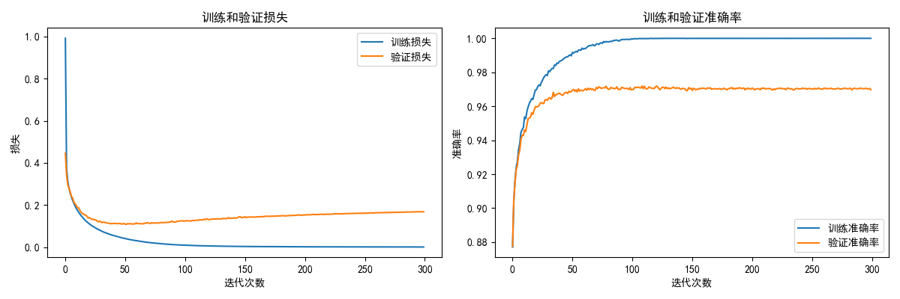
