>         本文为第三章图像分类与数据增广和第四章图像高阶应用相关实验部分的内容，本章依然使用Pytorch框架进行了重构。文章相关代码和数据体积较大，后续考虑上传到网盘后在后续的文章中公开链接。TensorFlow部分代码进行了修改，主要是由于依赖版本的问题。  
>         后续还会有一个数字图像的专题再去讲解说明。

## 1 图像分类与数据增广

### 1.1 图像变换实战

>         通过对图像施加随机且合理的变换（如旋转、翻转、缩放等），增加训练集多样性，提升模型泛化能力。尺寸调整、像素归一化、随机翻转/旋转，并演示在数据管道中应用增广。

TensorFlow实现

```python
# -*- coding: utf-8 -*-
"""
第三章 3.1：数据增广之图像变换实战

本脚本演示数据增广：通过对图像施加随机且合理的变换（如旋转、翻转等），
增加训练集的多样性，从而提升模型泛化能力。

使用 TensorFlow 2 / Keras 的预处理层实现：
- 图像尺寸调整（Resizing）与像素归一化（Rescaling）
- 随机翻转（RandomFlip）、随机旋转（RandomRotation）等数据增广
- 将增广应用于数据集并可视化效果

"""
import os
os.environ['TF_CPP_MIN_LOG_LEVEL'] = '2'

import matplotlib
matplotlib.use('Agg')
import matplotlib.pyplot as plt
import numpy as np
import tensorflow as tf
from tensorflow import keras
from tensorflow.keras import layers
from tensorflow.keras.datasets import cifar10

# 图像统一缩放尺寸（像素）
IMG_SIZE = 64


def main():
    print('TensorFlow 版本:', tf.__version__)

    # ------------------------- 加载示例数据 -------------------------
    # 使用 CIFAR-10 取一张图做演示
    print('\n正在加载 CIFAR-10 示例数据...')
    (x_train, _), (_, _) = cifar10.load_data()
    # 取第一张图，形状 (32, 32, 3)，像素 [0, 255]
    image = x_train[0].astype(np.float32) / 255.0
    print('原始图像形状:', image.shape)

    # ------------------------- 尺寸调整与归一化 -------------------------
    # 使用 Keras 预处理层：Resizing + Rescaling（此处已事先除以 255，层内可再乘 1.0）
    resize_and_rescale = keras.Sequential([
        layers.Resizing(IMG_SIZE, IMG_SIZE),
        layers.Rescaling(1.0),  # 保持 [0,1]，若输入未归一化可写 1./255
    ])
    img_resized = resize_and_rescale(image)
    if len(img_resized.shape) == 3:
        img_resized = tf.expand_dims(img_resized, 0)
    img_resized = tf.squeeze(img_resized)
    print('变换后张量形状:', img_resized.shape,
          '像素范围: [{:.2f}, {:.2f}]'.format(
              float(tf.reduce_min(img_resized).numpy()),
              float(tf.reduce_max(img_resized).numpy())))

    # 保存：Resize 后的图像
    plt.imshow(img_resized.numpy())
    plt.title('Resize + Rescaling 后的图像 (TF)')
    plt.axis('off')
    plt.savefig('data_augmentation_resize_tf.png', bbox_inches='tight', dpi=100)
    plt.close()
    print('已保存 data_augmentation_resize_tf.png')

    # ------------------------- 数据增广组合 -------------------------
    # 随机水平+垂直翻转、随机旋转（factor 为 2π 的比例，0.2 约 72 度内）
    data_augmentation = keras.Sequential([
        layers.RandomFlip('horizontal_and_vertical'),
        layers.RandomRotation(0.2),
    ])
    # 对单张图做：先 resize，再增广（多次调用得到不同结果）
    full_preprocess = keras.Sequential([
        layers.Resizing(IMG_SIZE, IMG_SIZE),
        data_augmentation,
        layers.Rescaling(1.0),
    ])

    # 对同一张原图应用 9 次增广并保存（需 4D 输入 [b,h,w,c]）
    image_batch = tf.expand_dims(tf.constant(image), 0)
    plt.figure(figsize=(10, 10))
    for i in range(9):
        augmented = full_preprocess(image_batch, training=True)
        aug_img = tf.squeeze(augmented).numpy()
        plt.subplot(3, 3, i + 1)
        plt.imshow(np.clip(aug_img, 0, 1))
        plt.axis('off')
    plt.suptitle('同一张图的 9 次随机数据增广结果 (TensorFlow)')
    plt.tight_layout()
    plt.savefig('data_augmentation_9samples_tf.png', bbox_inches='tight', dpi=100)
    plt.close()
    print('已保存 data_augmentation_9samples_tf.png')

    # ------------------------- 构建带增广的 tf.data 管道 -------------------------
    # 训练集：归一化 + Resize + 随机翻转/旋转
    train_augment = keras.Sequential([
        layers.Resizing(IMG_SIZE, IMG_SIZE),
        layers.RandomFlip('horizontal'),
        layers.RandomRotation(0.1),
        layers.Rescaling(1.0),
    ])
    (x_train, y_train), (x_test, y_test) = cifar10.load_data()
    x_train = x_train.astype(np.float32) / 255.0
    x_test = x_test.astype(np.float32) / 255.0

    batch_size = 32
    resize_layer = layers.Resizing(IMG_SIZE, IMG_SIZE)
    train_ds = tf.data.Dataset.from_tensor_slices((x_train, y_train))
    train_ds = train_ds.shuffle(1024).batch(batch_size).map(
        lambda x, y: (train_augment(x, training=True), y),
        num_parallel_calls=tf.data.AUTOTUNE
    ).prefetch(tf.data.AUTOTUNE)

    val_ds = tf.data.Dataset.from_tensor_slices((x_test, y_test))
    val_ds = val_ds.batch(batch_size).map(
        lambda x, y: (resize_layer(x), y),
        num_parallel_calls=tf.data.AUTOTUNE
    ).prefetch(tf.data.AUTOTUNE)

    train_steps = len(x_train) // batch_size
    val_steps = len(x_test) // batch_size
    print('训练批次数:', train_steps, '验证批次数:', val_steps)
    print('\n小结：数据增广只应在训练集上使用，验证/测试集保持固定变换。')
    print('Keras 还支持 RandomZoom、RandomContrast、RandomCrop 等，可按任务组合。')


if __name__ == '__main__':
    main()
```

Pytorch实现

```python
# -*- coding: utf-8 -*-
"""
第三章 3.1：数据增广之图像变换实战

本脚本演示数据增广：通过对图像施加随机且合理的变换（如旋转、翻转等），
增加训练集的多样性，从而提升模型泛化能力。

使用 PyTorch 的 torchvision.transforms 实现：
- 图像尺寸调整与像素归一化
- 随机翻转、随机旋转等数据增广
- 将增广应用于数据集并可视化效果

"""
import matplotlib
matplotlib.use('Agg')
import matplotlib.pyplot as plt
import torch
from torchvision import datasets, transforms
from torch.utils.data import DataLoader


# 图像统一缩放尺寸（像素）
IMG_SIZE = 64


def main():
    # ------------------------- 环境检查 -------------------------
    print('PyTorch 版本:', torch.__version__)
    device = torch.device('cuda' if torch.cuda.is_available() else 'cpu')
    print('使用设备:', device)

    # ------------------------- 加载示例数据 -------------------------
    # 使用 CIFAR-10 取一张图做演示（不归一化，便于可视化）
    print('\n正在加载 CIFAR-10 示例数据...')
    train_data_raw = datasets.CIFAR10(root='./data', train=True, download=True)
    image, label = train_data_raw[0]
    # PIL Image，尺寸 32x32
    print('原始图像尺寸:', image.size, '类别:', label)

    # ------------------------- 尺寸调整与归一化 -------------------------
    # Resize 到固定尺寸，ToTensor 将像素从 [0,255] 缩放到 [0,1]
    resize_and_rescale = transforms.Compose([
        transforms.Resize((IMG_SIZE, IMG_SIZE)),
        transforms.ToTensor()
    ])
    img_tensor = resize_and_rescale(image)
    print('变换后张量形状:', img_tensor.shape,
          '像素范围: [{:.2f}, {:.2f}]'.format(img_tensor.min().item(), img_tensor.max().item()))

    # 保存：Resize + ToTensor 后的图像
    plt.imshow(img_tensor.permute(1, 2, 0))
    plt.title('Resize + ToTensor 后的图像')
    plt.axis('off')
    plt.savefig('data_augmentation_resize.png', bbox_inches='tight', dpi=100)
    plt.close()
    print('已保存 data_augmentation_resize.png')

    # ------------------------- 数据增广组合 -------------------------
    # 组合多种随机变换，对同一张图多次应用会得到不同结果
    data_augmentation = transforms.Compose([
        transforms.RandomHorizontalFlip(p=0.5),
        transforms.RandomVerticalFlip(p=0.5),
        transforms.RandomRotation(20),  # 随机旋转 ±20 度
    ])
    full_transform = transforms.Compose([
        transforms.Resize((IMG_SIZE, IMG_SIZE)),
        data_augmentation,
        transforms.ToTensor(),
    ])

    # 对同一张原图应用 9 次增广并保存
    plt.figure(figsize=(10, 10))
    for i in range(9):
        augmented = full_transform(image)
        ax = plt.subplot(3, 3, i + 1)
        plt.imshow(augmented.permute(1, 2, 0))
        plt.axis('off')
    plt.suptitle('同一张图的 9 次随机数据增广结果')
    plt.tight_layout()
    plt.savefig('data_augmentation_9samples.png', bbox_inches='tight', dpi=100)
    plt.close()
    print('已保存 data_augmentation_9samples.png')

    # ------------------------- 构建带增广的 DataLoader -------------------------
    # 训练集：Resize + 随机翻转/旋转 + ToTensor + 标准化
    batch_size = 32
    train_transform = transforms.Compose([
        transforms.Resize((IMG_SIZE, IMG_SIZE)),
        transforms.RandomHorizontalFlip(p=0.5),
        transforms.RandomRotation(15),
        transforms.ToTensor(),
        transforms.Normalize((0.5, 0.5, 0.5), (0.5, 0.5, 0.5))
    ])
    train_dataset = datasets.CIFAR10(
        root='./data', train=True, download=True, transform=train_transform
    )
    train_loader = DataLoader(
        train_dataset, batch_size=batch_size, shuffle=True, num_workers=0
    )

    # 验证集：不做随机增广，仅 Resize + ToTensor + 标准化
    val_transform = transforms.Compose([
        transforms.Resize((IMG_SIZE, IMG_SIZE)),
        transforms.ToTensor(),
        transforms.Normalize((0.5, 0.5, 0.5), (0.5, 0.5, 0.5))
    ])
    val_dataset = datasets.CIFAR10(
        root='./data', train=False, download=True, transform=val_transform
    )
    val_loader = DataLoader(
        val_dataset, batch_size=batch_size, shuffle=False, num_workers=0
    )

    print('训练批次数:', len(train_loader), '验证批次数:', len(val_loader))
    print('\n小结：')
    print('- 数据增广只应在训练集上使用，验证/测试集保持固定变换。')
    print('- torchvision.transforms 还支持 RandomCrop、ColorJitter、RandomResizedCrop 等，可按任务组合。')
    print('- 将 transform 传入 datasets 即可在读取时自动应用，无需在训练循环里手写预处理。')


if __name__ == '__main__':
    main()
```

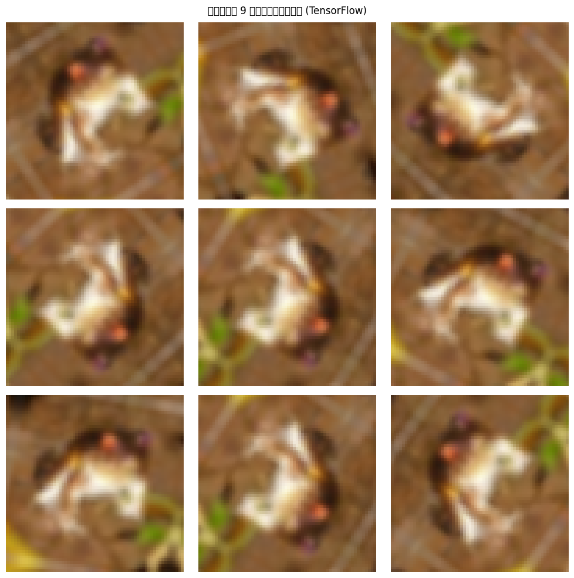

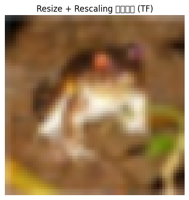

* * *

### 1.2 图像分类实战

>         在 CIFAR-10 数据集上使用 VGG-16 网络进行 10 类图像分类，理解深度卷积网络与梯度裁剪。  
>         数据归一化（零均值、单位方差）、VGG16 网络结构（卷积块 + 全连接）、训练与验证循环。

TensorFlow实现

main脚本

```python
# -*- coding: utf-8 -*-
"""
第三章 3.2：在 CIFAR-10 上应用 VGGNet 实现图像分类（TensorFlow 版）

功能：加载 CIFAR-10、零均值单位方差归一化、VGG16 网络训练与验证，
训练时使用梯度裁剪（max_norm=15）以加速收敛、避免发散。

运行方式：在 Chapter03/3.2/06-CIFAR-VGG 目录下执行
    python main.py

可选：有 GPU 时会自动使用并开启显存增长；无 GPU 时在 CPU 上运行（较慢）。
"""
import os
os.environ['TF_CPP_MIN_LOG_LEVEL'] = '2'

import argparse
import numpy as np
import tensorflow as tf
from tensorflow import keras
from tensorflow.keras import datasets, optimizers
from network import VGG16

# GPU 可选：有则使用并设置显存增长，无则用 CPU
physical_devices = tf.config.experimental.list_physical_devices('GPU')
if len(physical_devices) > 0:
    tf.config.experimental.set_memory_growth(physical_devices[0], True)
    print('使用 GPU:', physical_devices[0])
else:
    print('未检测到 GPU，使用 CPU 运行。')

argparser = argparse.ArgumentParser()


argparser.add_argument('--train_dir', type=str, default='/tmp/cifar10_train',
                           help="写入事件日志和检查点的目录。")
argparser.add_argument('--max_steps', type=int, default=1000000,
                            help="""运行的批次数。""")
argparser.add_argument('--log_device_placement', action='store_true',
                            help="是否记录设备放置信息。")
argparser.add_argument('--log_frequency', type=int, default=10,
                            help="向控制台输出结果的频率。")


def normalize(X_train, X_test):
    # 此函数将输入归一化为零均值和单位方差
    # 在训练模型时使用
    # 输入：训练集和测试集
    # 输出：根据训练集统计信息归一化的训练集和测试集
    X_train = X_train / 255.
    X_test = X_test / 255.

    mean = np.mean(X_train, axis=(0, 1, 2, 3))
    std = np.std(X_train, axis=(0, 1, 2, 3))
    print('mean:', mean, 'std:', std)
    X_train = (X_train - mean) / (std + 1e-7)
    X_test = (X_test - mean) / (std + 1e-7)
    return X_train, X_test

def prepare_cifar(x, y):

    x = tf.cast(x, tf.float32)
    y = tf.cast(y, tf.int32)
    return x, y


def compute_loss(logits, labels):
  return tf.reduce_mean(
      tf.nn.sparse_softmax_cross_entropy_with_logits(
          logits=logits, labels=labels))

def main():

    tf.random.set_seed(22)

    print('loading data...')
    (x,y), (x_test, y_test) = datasets.cifar10.load_data()
    x, x_test = normalize(x, x_test)
    print(x.shape, y.shape, x_test.shape, y_test.shape)
    # x = tf.convert_to_tensor(x)
    # y = tf.convert_to_tensor(y)
    train_loader = tf.data.Dataset.from_tensor_slices((x,y))
    train_loader = train_loader.map(prepare_cifar).shuffle(50000).batch(256)

    test_loader = tf.data.Dataset.from_tensor_slices((x_test, y_test))
    test_loader = test_loader.map(prepare_cifar).shuffle(10000).batch(256)
    print('done.')


    model = VGG16([32, 32, 3])


    # 必须指定 from_logits=True！
    criteon = keras.losses.CategoricalCrossentropy(from_logits=True)
    metric = keras.metrics.CategoricalAccuracy()

    optimizer = optimizers.Adam(learning_rate=0.0001)


    for epoch in range(50):

        for step, (x, y) in enumerate(train_loader):
            # [b, 1] => [b]
            y = tf.squeeze(y, axis=1)
            # [b, 10]
            y = tf.one_hot(y, depth=10)

            with tf.GradientTape() as tape:
                logits = model(x)
                loss = criteon(y, logits)
                # loss2 = compute_loss(logits, tf.argmax(y, axis=1))
                # mse_loss = tf.reduce_sum(tf.square(y-logits))
                # print(y.shape, logits.shape)
                metric.update_state(y, logits)

            grads = tape.gradient(loss, model.trainable_variables)
            # 必须在此处裁剪梯度，否则会发散！
            grads = [ tf.clip_by_norm(g, 15) for g in grads]
            optimizer.apply_gradients(zip(grads, model.trainable_variables))

            if step % 40 == 0:
                # for g in grads:
                #     print(tf.norm(g).numpy())
                print(epoch, step, 'loss:', float(loss), 'acc:', metric.result().numpy())
                with open("test.txt","a") as f:
                    s = str(float(loss))+','+str(metric.result().numpy())+'\n'
                    f.write(s) 
                metric.reset_state()


        if epoch % 1 == 0:

            metric = keras.metrics.CategoricalAccuracy()
            for x, y in test_loader:
                # [b, 1] => [b]
                y = tf.squeeze(y, axis=1)
                # [b, 10]
                y = tf.one_hot(y, depth=10)

                logits = model.predict(x)
                # 注意：这些函数可以接受 [b] 形状的 y 而不发出警告
                metric.update_state(y, logits)
            print(metric.result().numpy())
            s = str(metric.result().numpy())+'\n'
            with open("test2.txt","a") as f:
                    f.write(s) 
            metric.reset_state()


if __name__ == '__main__':
    main()
```

netWork

```python
# -*- coding: utf-8 -*-
"""
第三章 3.2：VGG16 网络定义（TensorFlow 版）

用于 CIFAR-10 图像分类。输入形状 [32, 32, 3]，输出 10 类 logits。
结构：5 个卷积块（Conv2D + Activation + BatchNorm + Dropout + MaxPool）+ Flatten + Dense(512) + Dense(10)。
"""
import tensorflow as tf
from tensorflow.keras import layers, models, regularizers


class VGG16(models.Model):

    def __init__(self, input_shape):
        """
        :param input_shape: 输入图像形状 [高, 宽, 通道]，如 [32, 32, 3]
        """
        super(VGG16, self).__init__()

        weight_decay = 0.000
        self.num_classes = 10

        model = models.Sequential()
        # Keras 3 推荐用 Input 作为第一层，不再在 Conv2D 上写 input_shape
        model.add(layers.Input(shape=input_shape))
        model.add(layers.Conv2D(64, (3, 3), padding='same',
                         kernel_regularizer=regularizers.l2(weight_decay)))
        model.add(layers.Activation('relu'))
        model.add(layers.BatchNormalization())
        model.add(layers.Dropout(0.3))

        model.add(layers.Conv2D(64, (3, 3), padding='same',kernel_regularizer=regularizers.l2(weight_decay)))
        model.add(layers.Activation('relu'))
        model.add(layers.BatchNormalization())

        model.add(layers.MaxPooling2D(pool_size=(2, 2)))

        model.add(layers.Conv2D(128, (3, 3), padding='same',kernel_regularizer=regularizers.l2(weight_decay)))
        model.add(layers.Activation('relu'))
        model.add(layers.BatchNormalization())
        model.add(layers.Dropout(0.4))

        model.add(layers.Conv2D(128, (3, 3), padding='same',kernel_regularizer=regularizers.l2(weight_decay)))
        model.add(layers.Activation('relu'))
        model.add(layers.BatchNormalization())

        model.add(layers.MaxPooling2D(pool_size=(2, 2)))

        model.add(layers.Conv2D(256, (3, 3), padding='same',kernel_regularizer=regularizers.l2(weight_decay)))
        model.add(layers.Activation('relu'))
        model.add(layers.BatchNormalization())
        model.add(layers.Dropout(0.4))

        model.add(layers.Conv2D(256, (3, 3), padding='same',kernel_regularizer=regularizers.l2(weight_decay)))
        model.add(layers.Activation('relu'))
        model.add(layers.BatchNormalization())
        model.add(layers.Dropout(0.4))

        model.add(layers.Conv2D(256, (3, 3), padding='same',kernel_regularizer=regularizers.l2(weight_decay)))
        model.add(layers.Activation('relu'))
        model.add(layers.BatchNormalization())

        model.add(layers.MaxPooling2D(pool_size=(2, 2)))


        model.add(layers.Conv2D(512, (3, 3), padding='same',kernel_regularizer=regularizers.l2(weight_decay)))
        model.add(layers.Activation('relu'))
        model.add(layers.BatchNormalization())
        model.add(layers.Dropout(0.4))

        model.add(layers.Conv2D(512, (3, 3), padding='same',kernel_regularizer=regularizers.l2(weight_decay)))
        model.add(layers.Activation('relu'))
        model.add(layers.BatchNormalization())
        model.add(layers.Dropout(0.4))

        model.add(layers.Conv2D(512, (3, 3), padding='same',kernel_regularizer=regularizers.l2(weight_decay)))
        model.add(layers.Activation('relu'))
        model.add(layers.BatchNormalization())

        model.add(layers.MaxPooling2D(pool_size=(2, 2)))


        model.add(layers.Conv2D(512, (3, 3), padding='same',kernel_regularizer=regularizers.l2(weight_decay)))
        model.add(layers.Activation('relu'))
        model.add(layers.BatchNormalization())
        model.add(layers.Dropout(0.4))

        model.add(layers.Conv2D(512, (3, 3), padding='same',kernel_regularizer=regularizers.l2(weight_decay)))
        model.add(layers.Activation('relu'))
        model.add(layers.BatchNormalization())
        model.add(layers.Dropout(0.4))

        model.add(layers.Conv2D(512, (3, 3), padding='same',kernel_regularizer=regularizers.l2(weight_decay)))
        model.add(layers.Activation('relu'))
        model.add(layers.BatchNormalization())

        model.add(layers.MaxPooling2D(pool_size=(2, 2)))
        model.add(layers.Dropout(0.5))

        model.add(layers.Flatten())
        model.add(layers.Dense(512,kernel_regularizer=regularizers.l2(weight_decay)))
        model.add(layers.Activation('relu'))
        model.add(layers.BatchNormalization())

        model.add(layers.Dropout(0.5))
        model.add(layers.Dense(self.num_classes))
        # model.add(layers.Activation('softmax'))


        self.model = model


    def call(self, x):

        x = self.model(x)

        return x
```

Pytorch实现

main

```python
"""
第三章 3.2：在 CIFAR-10 上应用 VGGNet 实现图像分类（PyTorch 版）

从 TensorFlow 版本转换而来的 PyTorch 实现。功能包括：
- 加载 CIFAR-10 并做零均值、单位方差归一化
- 使用 VGG16 网络进行 10 类分类
- 训练时使用梯度裁剪（max_norm=15）以加速收敛、避免发散
- 每个 epoch 在验证集上评估准确率

运行方式：在 Chapter03/3.2/06-CIFAR-VGG 目录下执行
    python main_pytorch.py
"""
import os
import torch
import torch.nn as nn
import torch.optim as optim
import torch.nn.functional as F
from torch.utils.data import DataLoader, TensorDataset
from torchvision import datasets, transforms
import numpy as np
import argparse

from network_pytorch import VGG16

# 设置设备
device = torch.device('cuda' if torch.cuda.is_available() else 'cpu')
print(f'使用设备: {device}')

# 设置随机种子
torch.manual_seed(22)
np.random.seed(22)
if torch.cuda.is_available():
    torch.cuda.manual_seed(22)

argparser = argparse.ArgumentParser()
argparser.add_argument('--train_dir', type=str, default='/tmp/cifar10_train',
                       help="写入事件日志和检查点的目录。")
argparser.add_argument('--max_steps', type=int, default=1000000,
                       help="运行的批次数。")
argparser.add_argument('--log_device_placement', action='store_true',
                       help="是否记录设备放置信息。")
argparser.add_argument('--log_frequency', type=int, default=10,
                       help="向控制台输出结果的频率。")

def normalize(X_train, X_test):
    """
    此函数将输入归一化为零均值和单位方差
    在训练模型时使用
    输入：训练集和测试集
    输出：根据训练集统计信息归一化的训练集和测试集
    """
    X_train = X_train / 255.0
    X_test = X_test / 255.0
    
    mean = np.mean(X_train, axis=(0, 1, 2, 3))
    std = np.std(X_train, axis=(0, 1, 2, 3))
    print('mean:', mean, 'std:', std)
    X_train = (X_train - mean) / (std + 1e-7)
    X_test = (X_test - mean) / (std + 1e-7)
    return X_train, X_test

def main():
    print('loading data...')
    # 加载CIFAR-10数据集
    train_dataset = datasets.CIFAR10(root='./data', train=True, download=True)
    test_dataset = datasets.CIFAR10(root='./data', train=False, download=True)
    
    # 获取numpy数组
    x = np.array([np.array(img) for img, _ in train_dataset])
    y = np.array([label for _, label in train_dataset])
    x_test = np.array([np.array(img) for img, _ in test_dataset])
    y_test = np.array([label for _, label in test_dataset])
    
    # 转换数据格式: (N, H, W, C) -> (N, C, H, W) for PyTorch
    x = np.transpose(x, (0, 3, 1, 2))
    x_test = np.transpose(x_test, (0, 3, 1, 2))
    
    x, x_test = normalize(x, x_test)
    print(x.shape, y.shape, x_test.shape, y_test.shape)
    
    # 转换为PyTorch张量
    x_tensor = torch.FloatTensor(x)
    y_tensor = torch.LongTensor(y)
    x_test_tensor = torch.FloatTensor(x_test)
    y_test_tensor = torch.LongTensor(y_test)
    
    # 创建数据加载器
    train_dataset = TensorDataset(x_tensor, y_tensor)
    train_loader = DataLoader(train_dataset, batch_size=256, shuffle=True)
    
    test_dataset = TensorDataset(x_test_tensor, y_test_tensor)
    test_loader = DataLoader(test_dataset, batch_size=256, shuffle=False)
    print('done.')
    
    # 创建模型
    model = VGG16(num_classes=10).to(device)
    
    # 定义损失函数和优化器
    criterion = nn.CrossEntropyLoss()
    optimizer = optim.Adam(model.parameters(), lr=0.0001)
    
    # 训练循环
    for epoch in range(50):
        model.train()  # 设置为训练模式
        correct = 0
        total = 0
        
        for step, (x_batch, y_batch) in enumerate(train_loader):
            x_batch = x_batch.to(device)
            y_batch = y_batch.to(device)
            
            # 前向传播
            optimizer.zero_grad()
            logits = model(x_batch)
            loss = criterion(logits, y_batch)
            
            # 反向传播
            loss.backward()
            
            # 梯度裁剪（必须在此处裁剪梯度，否则会发散！）
            torch.nn.utils.clip_grad_norm_(model.parameters(), max_norm=15)
            
            optimizer.step()
            
            # 计算准确率
            _, predicted = torch.max(logits.data, 1)
            total += y_batch.size(0)
            correct += (predicted == y_batch).sum().item()
            acc = correct / total
            
            if step % 40 == 0:
                print(f'epoch {epoch}, step {step}, loss: {loss.item():.4f}, acc: {acc:.4f}')
                with open("test.txt", "a") as f:
                    s = str(loss.item()) + ',' + str(acc) + '\n'
                    f.write(s)
        
        # 验证
        if epoch % 1 == 0:
            model.eval()  # 设置为评估模式
            correct = 0
            total = 0
            
            with torch.no_grad():
                for x_batch, y_batch in test_loader:
                    x_batch = x_batch.to(device)
                    y_batch = y_batch.to(device)
                    
                    logits = model(x_batch)
                    _, predicted = torch.max(logits.data, 1)
                    total += y_batch.size(0)
                    correct += (predicted == y_batch).sum().item()
            
            acc = correct / total
            print(f'epoch {epoch}, test acc: {acc:.4f}')
            with open("test2.txt", "a") as f:
                f.write(str(acc) + '\n')

if __name__ == '__main__':
    main()
```

network

```python
"""
第三章 3.2：VGG16 网络定义
从 TensorFlow 版本转换而来。结构为 5 个卷积块 + 2 个全连接层，
每块含 Conv2d、BatchNorm2d、ReLU、Dropout（部分）、MaxPool2d，
用于 CIFAR-10 的 32x32 输入，输出 10 类 logits。
"""
import torch
import torch.nn as nn
import torch.nn.functional as F


class VGG16(nn.Module):
    def __init__(self, num_classes=10):
        """
        :param num_classes: 分类数量，默认10（CIFAR-10）
        """
        super(VGG16, self).__init__()
        
        weight_decay = 0.000
        self.num_classes = num_classes
        
        # 第一个卷积块
        self.conv1_1 = nn.Conv2d(3, 64, kernel_size=3, padding=1)
        self.bn1_1 = nn.BatchNorm2d(64)
        self.conv1_2 = nn.Conv2d(64, 64, kernel_size=3, padding=1)
        self.bn1_2 = nn.BatchNorm2d(64)
        self.dropout1 = nn.Dropout(0.3)
        self.pool1 = nn.MaxPool2d(kernel_size=2, stride=2)
        
        # 第二个卷积块
        self.conv2_1 = nn.Conv2d(64, 128, kernel_size=3, padding=1)
        self.bn2_1 = nn.BatchNorm2d(128)
        self.conv2_2 = nn.Conv2d(128, 128, kernel_size=3, padding=1)
        self.bn2_2 = nn.BatchNorm2d(128)
        self.dropout2 = nn.Dropout(0.4)
        self.pool2 = nn.MaxPool2d(kernel_size=2, stride=2)
        
        # 第三个卷积块
        self.conv3_1 = nn.Conv2d(128, 256, kernel_size=3, padding=1)
        self.bn3_1 = nn.BatchNorm2d(256)
        self.conv3_2 = nn.Conv2d(256, 256, kernel_size=3, padding=1)
        self.bn3_2 = nn.BatchNorm2d(256)
        self.conv3_3 = nn.Conv2d(256, 256, kernel_size=3, padding=1)
        self.bn3_3 = nn.BatchNorm2d(256)
        self.dropout3 = nn.Dropout(0.4)
        self.pool3 = nn.MaxPool2d(kernel_size=2, stride=2)
        
        # 第四个卷积块
        self.conv4_1 = nn.Conv2d(256, 512, kernel_size=3, padding=1)
        self.bn4_1 = nn.BatchNorm2d(512)
        self.conv4_2 = nn.Conv2d(512, 512, kernel_size=3, padding=1)
        self.bn4_2 = nn.BatchNorm2d(512)
        self.conv4_3 = nn.Conv2d(512, 512, kernel_size=3, padding=1)
        self.bn4_3 = nn.BatchNorm2d(512)
        self.dropout4 = nn.Dropout(0.4)
        self.pool4 = nn.MaxPool2d(kernel_size=2, stride=2)
        
        # 第五个卷积块
        self.conv5_1 = nn.Conv2d(512, 512, kernel_size=3, padding=1)
        self.bn5_1 = nn.BatchNorm2d(512)
        self.conv5_2 = nn.Conv2d(512, 512, kernel_size=3, padding=1)
        self.bn5_2 = nn.BatchNorm2d(512)
        self.conv5_3 = nn.Conv2d(512, 512, kernel_size=3, padding=1)
        self.bn5_3 = nn.BatchNorm2d(512)
        self.dropout5 = nn.Dropout(0.5)
        self.pool5 = nn.MaxPool2d(kernel_size=2, stride=2)
        
        # 全连接层
        self.fc1 = nn.Linear(512, 512)
        self.bn_fc1 = nn.BatchNorm1d(512)
        self.dropout_fc = nn.Dropout(0.5)
        self.fc2 = nn.Linear(512, self.num_classes)
    
    def forward(self, x):
        # 第一个卷积块
        x = F.relu(self.bn1_1(self.conv1_1(x)))
        x = self.dropout1(x)
        x = F.relu(self.bn1_2(self.conv1_2(x)))
        x = self.pool1(x)
        
        # 第二个卷积块
        x = F.relu(self.bn2_1(self.conv2_1(x)))
        x = self.dropout2(x)
        x = F.relu(self.bn2_2(self.conv2_2(x)))
        x = self.pool2(x)
        
        # 第三个卷积块
        x = F.relu(self.bn3_1(self.conv3_1(x)))
        x = self.dropout3(x)
        x = F.relu(self.bn3_2(self.conv3_2(x)))
        x = F.relu(self.bn3_3(self.conv3_3(x)))
        x = self.pool3(x)
        
        # 第四个卷积块
        x = F.relu(self.bn4_1(self.conv4_1(x)))
        x = self.dropout4(x)
        x = F.relu(self.bn4_2(self.conv4_2(x)))
        x = F.relu(self.bn4_3(self.conv4_3(x)))
        x = self.pool4(x)
        
        # 第五个卷积块
        x = F.relu(self.bn5_1(self.conv5_1(x)))
        x = self.dropout5(x)
        x = F.relu(self.bn5_2(self.conv5_2(x)))
        x = F.relu(self.bn5_3(self.conv5_3(x)))
        x = self.pool5(x)
        
        # 展平
        x = x.view(x.size(0), -1)
        
        # 全连接层
        x = F.relu(self.bn_fc1(self.fc1(x)))
        x = self.dropout_fc(x)
        x = self.fc2(x)
        
        return x
```

运行结果：

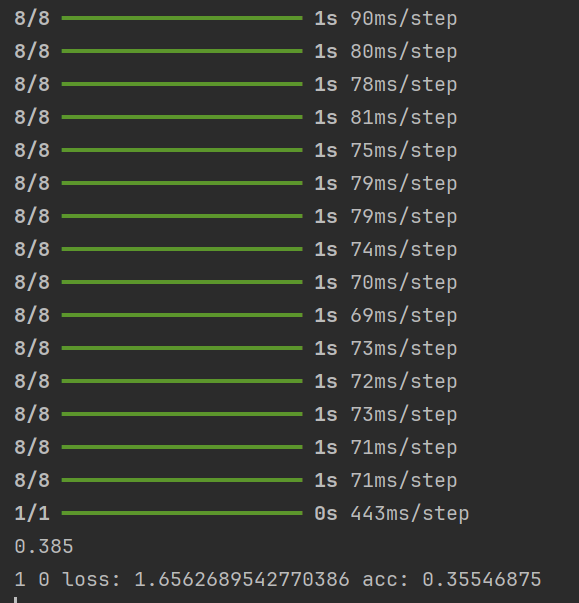

训练后的结果

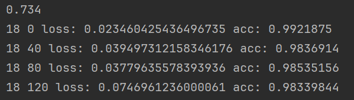

* * *

### 1.3 猫狗图像分类

>         从图像中分类猫与狗，掌握小样本下的数据增广、Dropout 与过拟合的应对方法。使用 Kaggle 猫狗过滤数据集；构建数据管道（含旋转、平移、翻转、缩放等增广）；搭建小型 CNN（卷积 + 池化 + Dropout + 全连接）；二分类训练与验证。

TensorFlow实现

```python
# -*- coding: utf-8 -*-
"""
第三章 3.3：图像识别之猫狗分类（TensorFlow 版）

本脚本演示如何用 TensorFlow 2 / Keras 从图像中分类猫与狗。
对应原教程的完整流程：下载数据、ImageDataGenerator 数据管道与增广、
Sequential 模型（3 个卷积块 + Dropout + 全连接）、训练与验证。

你将学会：
- 使用 tf.keras.utils.get_file 下载并解压猫狗数据集
- 使用 ImageDataGenerator 做 rescale 与数据增广（旋转、平移、翻转、缩放）
- 搭建小型 CNN 并加入 Dropout 缓解过拟合
- model.fit 使用 generator 进行训练与验证

"""
import os
os.environ['TF_CPP_MIN_LOG_LEVEL'] = '2'

import tensorflow as tf
from tensorflow.keras.models import Sequential
from tensorflow.keras.layers import Dense, Conv2D, Flatten, Dropout, MaxPooling2D
from tensorflow.keras.preprocessing.image import ImageDataGenerator

# 数据集下载地址（与官方教程一致）
_DATA_URL = 'https://storage.googleapis.com/mledu-datasets/cats_and_dogs_filtered.zip'


def get_data_paths(data_dir=None):
    """
    下载并解压猫狗数据集，返回训练与验证目录。
    若已存在解压目录则直接使用。
    :param data_dir: 可选，指定下载根目录；默认使用 Keras 缓存目录
    :return: (train_dir, validation_dir)
    """
    path_to_zip = tf.keras.utils.get_file(
        'cats_and_dogs.zip', origin=_DATA_URL, extract=True, cache_dir=data_dir
    )
    base = os.path.join(os.path.dirname(path_to_zip), 'cats_and_dogs_filtered')
    train_dir = os.path.join(base, 'train')
    validation_dir = os.path.join(base, 'validation')
    return train_dir, validation_dir


def build_model(img_height, img_width, num_classes=1):
    """
    构建猫狗二分类 CNN：3 个卷积块 + 2 处 Dropout(0.2) + 全连接 512 -> 1。
    与教程中「加入 Dropout 后的模型」一致。
    """
    model = Sequential([
        Conv2D(16, 3, padding='same', activation='relu',
               input_shape=(img_height, img_width, 3)),
        MaxPooling2D(),
        Dropout(0.2),
        Conv2D(32, 3, padding='same', activation='relu'),
        MaxPooling2D(),
        Conv2D(64, 3, padding='same', activation='relu'),
        MaxPooling2D(),
        Dropout(0.2),
        Flatten(),
        Dense(512, activation='relu'),
        Dense(num_classes),
    ])
    return model


def main():
    # 超参数（与教程一致）
    batch_size = 128
    epochs = 15
    IMG_HEIGHT = 150
    IMG_WIDTH = 150

    # 下载并获取路径（可传入 data_dir 指定下载位置，默认在用户目录下）
    print('正在准备猫狗数据集...')
    train_dir, validation_dir = get_data_paths()
    num_train = sum(len(files) for _, _, files in os.walk(train_dir) if files)
    num_val = sum(len(files) for _, _, files in os.walk(validation_dir) if files)
    print('训练样本数:', num_train, '验证样本数:', num_val)

    # 训练集：数据增广（仅对训练集做）
    train_datagen = ImageDataGenerator(
        rescale=1.0 / 255,
        rotation_range=45,
        width_shift_range=0.15,
        height_shift_range=0.15,
        horizontal_flip=True,
        zoom_range=0.5,
    )
    train_generator = train_datagen.flow_from_directory(
        train_dir,
        target_size=(IMG_HEIGHT, IMG_WIDTH),
        batch_size=batch_size,
        class_mode='binary',
        shuffle=True,
    )

    # 验证集：仅 rescale，不做随机增广
    val_datagen = ImageDataGenerator(rescale=1.0 / 255)
    val_generator = val_datagen.flow_from_directory(
        validation_dir,
        target_size=(IMG_HEIGHT, IMG_WIDTH),
        batch_size=batch_size,
        class_mode='binary',
        shuffle=False,
    )

    # 构建模型并编译
    model = build_model(IMG_HEIGHT, IMG_WIDTH)
    model.compile(
        optimizer='adam',
        loss=tf.keras.losses.BinaryCrossentropy(from_logits=True),
        metrics=['accuracy'],
    )
    model.summary()

    # 训练（使用 generator）
    steps_per_epoch = train_generator.samples // batch_size
    validation_steps = val_generator.samples // batch_size
    history = model.fit(
        train_generator,
        steps_per_epoch=steps_per_epoch,
        epochs=epochs,
        validation_data=val_generator,
        validation_steps=validation_steps,
    )

    # 最终在验证集上评估
    val_loss, val_acc = model.evaluate(val_generator, steps=validation_steps)
    print('验证集 loss: %.4f, accuracy: %.4f' % (val_loss, val_acc))
    print('小结：数据增广与 Dropout 有助于在小样本上减轻过拟合。')


if __name__ == '__main__':
    main()
```

PyTorch实现

```python
# Visual Transformer with Linformer

Training Visual Transformer on *Dogs vs Cats Data*

* Dogs vs. Cats Redux: Kernels Edition - https://www.kaggle.com/c/dogs-vs-cats-redux-kernels-edition
* Base Code - https://www.kaggle.com/reukki/pytorch-cnn-tutorial-with-cats-and-dogs/
* Efficient Attention Implementation - https://github.com/lucidrains/vit-pytorch#efficient-attention
!pip -q install vit_pytorch linformer
## Import Libraries
from __future__ import print_function
from itertools import chain

import glob
import pandas as pd
import zipfile
import torch.nn.functional as F

import os
import random
import matplotlib.pyplot as plt
import numpy as np

import torch
import torch.nn as nn
import torch.optim as optim
from linformer import Linformer
from PIL import Image
from sklearn.model_selection import train_test_split
from torch.optim.lr_scheduler import StepLR
from torch.utils.data import DataLoader, Dataset
from torchvision import datasets, transforms
from tqdm.notebook import tqdm

from vit_pytorch.efficient import ViT

print(f"Torch: {torch.__version__}") #
# Training settings
batch_size = 64
epochs = 5
lr = 3e-5
gamma = 0.7
seed = 42
def seed_everything(seed):
    random.seed(seed)
    os.environ['PYTHONHASHSEED'] = str(seed)
    np.random.seed(seed)
    torch.manual_seed(seed)
    torch.cuda.manual_seed(seed)
    torch.cuda.manual_seed_all(seed)
    torch.backends.cudnn.deterministic = True

seed_everything(seed)
device = 'cuda'
## Load Data
os.makedirs('data', exist_ok=True)
train_dir = r'data\train'
test_dir = r'data\test'
# with zipfile.ZipFile('train.zip') as train_zip:
#     train_zip.extractall('data')
#
# with zipfile.ZipFile('test.zip') as test_zip:
#     test_zip.extractall('data')
train_list = glob.glob(os.path.join(train_dir,'*.jpg'))
test_list = glob.glob(os.path.join(test_dir, '*.jpg'))
print(f"Train Data: {len(train_list)}")
print(f"Test Data: {len(test_list)}")
labels = [path.split('\\')[-1].split('.')[0] for path in train_list]
labels
## Random Plots
random_idx = np.random.randint(1, len(train_list), size=9)
fig, axes = plt.subplots(3, 3, figsize=(16, 12))

for idx, ax in enumerate(axes.ravel()):
    img = Image.open(train_list[idx])
    ax.set_title(labels[idx])
    ax.imshow(img)

## Split
train_list, valid_list = train_test_split(train_list, 
                                          test_size=0.2,
                                          stratify=labels,
                                          random_state=seed)
print(f"Train Data: {len(train_list)}")
print(f"Validation Data: {len(valid_list)}")
print(f"Test Data: {len(test_list)}")
## Image Augmentation
train_transforms = transforms.Compose(
    [
        transforms.Resize((224, 224)),
        transforms.RandomResizedCrop(224),
        transforms.RandomHorizontalFlip(),
        transforms.ToTensor(),
    ]
)

val_transforms = transforms.Compose(
    [
        transforms.Resize(256),
        transforms.CenterCrop(224),
        transforms.ToTensor(),
    ]
)


test_transforms = transforms.Compose(
    [
        transforms.Resize(256),
        transforms.CenterCrop(224),
        transforms.ToTensor(),
    ]
)

## Load Datasets
class CatsDogsDataset(Dataset):
    def __init__(self, file_list, transform=None):
        self.file_list = file_list
        self.transform = transform

    def __len__(self):
        self.filelength = len(self.file_list)
        return self.filelength

    def __getitem__(self, idx):
        img_path = self.file_list[idx]
        img = Image.open(img_path)
        img_transformed = self.transform(img)

        label = img_path.split("\\")[-1].split(".")[0]
        label = 1 if label == "dog" else 0

        return img_transformed, label

train_data = CatsDogsDataset(train_list, transform=train_transforms)
valid_data = CatsDogsDataset(valid_list, transform=test_transforms)
test_data = CatsDogsDataset(test_list, transform=test_transforms)
train_loader = DataLoader(dataset = train_data, batch_size=batch_size, shuffle=True )
valid_loader = DataLoader(dataset = valid_data, batch_size=batch_size, shuffle=False)
test_loader = DataLoader(dataset = test_data, batch_size=batch_size, shuffle=False)
print(len(train_data), len(train_loader))
print(len(valid_data), len(valid_loader))
## Efficient Attention
### Linformer
efficient_transformer = Linformer(
    dim=128,
    seq_len=49+1,  # 7x7 patches + 1 cls-token
    depth=12,
    heads=8,
    k=64
)
### Visual Transformer
device ='cuda' if torch.cuda.is_available() else 'cpu'
model = ViT(
    dim=128,
    image_size=224,
    patch_size=32,
    num_classes=2,
    transformer=efficient_transformer,
    channels=3,
).to(device)
### Training
# loss function
criterion = nn.CrossEntropyLoss()
# optimizer
optimizer = optim.Adam(model.parameters(), lr=lr)
# scheduler
scheduler = StepLR(optimizer, step_size=1, gamma=gamma)
from PIL import Image, UnidentifiedImageError
import warnings

class CatsDogsDataset(Dataset):
    def __getitem__(self, idx):
        img_path = self.file_list[idx]
        try:
            # 尝试打开图像
            img = Image.open(img_path)
            img.load()  # 验证图像完整性
        except (UnidentifiedImageError, OSError) as e:
            warnings.warn(f"损坏文件已跳过: {img_path} - {str(e)}")
            # 返回空白图像代替损坏文件
            img = Image.new('RGB', (224, 224))  # 尺寸需匹配您的模型

        img_transformed = self.transform(img)
        label = 0 if 'cat' in img_path.split('\\')[-1] else 1  # 修复标签提取逻辑
        return img_transformed, label
import torch

# 训练过程
for epoch in range(epochs):
    epoch_loss = 0
    epoch_accuracy = 0

    for data, label in tqdm(train_loader):
        data = data.to(device)
        label = label.to(device)

        output = model(data)
        loss = criterion(output, label)

        optimizer.zero_grad()
        loss.backward()
        optimizer.step()

        acc = (output.argmax(dim=1) == label).float().mean()
        epoch_accuracy += acc / len(train_loader)
        epoch_loss += loss / len(train_loader)

    # 验证过程
    with torch.no_grad():
        epoch_val_accuracy = 0
        epoch_val_loss = 0
        for data, label in valid_loader:
            data = data.to(device)
            label = label.to(device)

            val_output = model(data)
            val_loss = criterion(val_output, label)

            acc = (val_output.argmax(dim=1) == label).float().mean()
            epoch_val_accuracy += acc / len(valid_loader)
            epoch_val_loss += val_loss / len(valid_loader)

    # 打印当前轮次的结果
    print(
        f"Epoch : {epoch+1} - loss : {epoch_loss:.4f} - acc: {epoch_accuracy:.4f} - val_loss : {epoch_val_loss:.4f} - val_acc: {epoch_val_accuracy:.4f}\n"
    )

    # 保存模型权重
    torch.save(model.state_dict(), f'model_epoch_{epoch+1}.pth')
# 加载模型进行推理单张图片
model.load_state_dict(torch.load('model_epoch_3.pth'))  # 替换 X 为要加载的轮次
model.eval()  # 设置模型为评估模式

# 定义图像预处理步骤
transform = transforms.Compose(
    [
        transforms.Resize(256),
        transforms.CenterCrop(224),
        transforms.ToTensor(),
    ]
)

# 加载单张图片进行推理
def predict_image(image_path):
    image = Image.open(image_path).convert('RGB')  # 打开并转换为RGB模式
    image = transform(image).unsqueeze(0)  # 预处理并增加一个批次维度
    image = image.to(device)  # 移动到指定设备

    with torch.no_grad():
        output = model(image)  # 进行推理
        prediction = output.argmax(dim=1)  # 获取预测结果
        return prediction.item()  # 返回预测类别

# 示例：对单张图片进行推理
image_path = r'D:\Study Note\Python_note\vit-pytorch\examples\data\test\2580.jpg'
predicted_class = predict_image(image_path)

# 可视化结果
# 显示图像和预测结果
image = Image.open(image_path)
plt.imshow(image)
plt.title('Predicted class: ' + ('Cat' if predicted_class == 0 else 'Dog'))  # 0为猫，1为狗
plt.axis('off')  # 关闭坐标轴
plt.show()
```

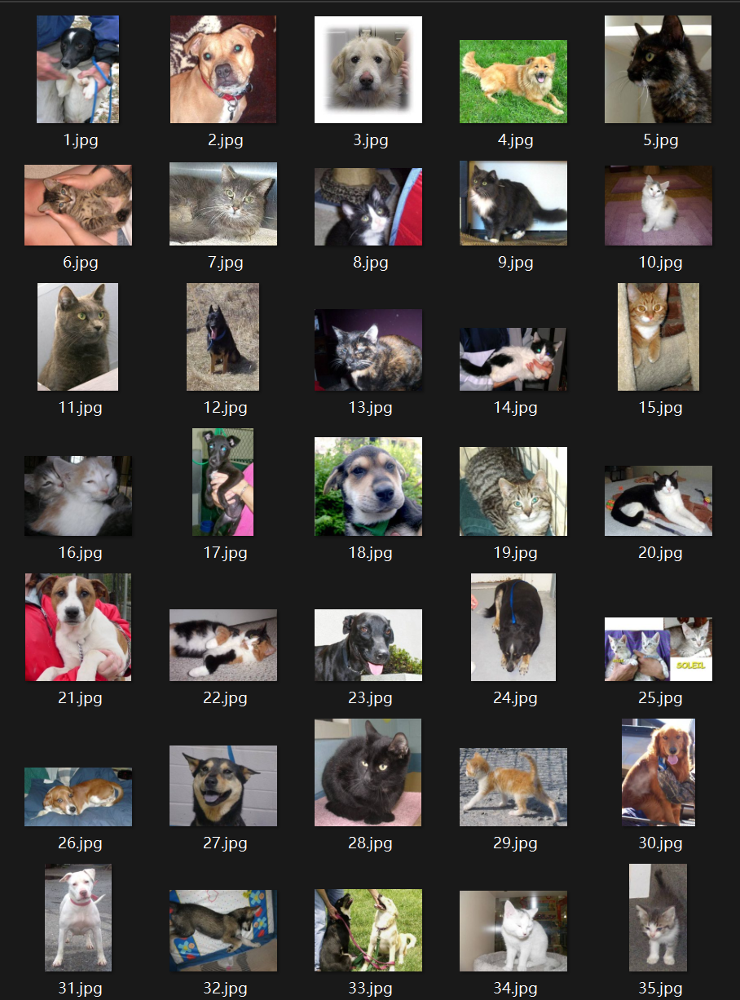

数据集精要展示

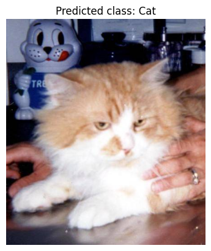

预测效果

* * *

## 2 图像高阶应用

### 2.1 提高图像分辨率

**基于深度神经网络的单图像超分辨率**

        本文介绍单图像超分辨率（Single Image Super-Resolution），并概述近年一些重要进展及其在 TensorFlow 2.0 中的实现。重点包括：专用残差网络结构，以及用生成对抗网络（GAN）对超分模型进行微调。

        超分辨率是指从低分辨率（LR）图像恢复高分辨率（HR）图像的过程，得到的 HR 图像称为_超分图像_或_SR 图像_。超分辨率是病态问题，因为一个 LR 像素可对应多种 HR 解。双线性或双三次插值等简单方法仅利用 LR 图像的局部信息计算 SR 像素。

        监督学习方法则从大量样本中学习从 LR 到 HR 的映射。超分模型以 LR 为输入、HR 为目标进行训练，学到的映射相当于"降质"函数的逆。降质函数可以是已知或未知的。

        已知降质（如双三次下采样）常用于图像处理流程，可从 HR 自动得到 LR，从而利用大量公开 HR 图像构建训练集，实现自监督学习。若降质未知，监督训练需要现成的 LR-HR 配对数据（较难获取），或可采用从非配对 LR/HR 学习降质近似的无监督方法。本文使用已知降质（双三次下采样）并采用监督学习。

**整体结构**

        许多先进超分模型在 LR 空间学习大部分映射，再在网络末端接一个或多个上采样层，即图 1 中的_后上采样 SR_。上采样层可学习，并与前面卷积层端到端训练。

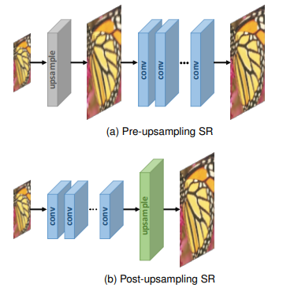

图 1. 上采样层位置。

        早期方法先用预设上采样得到 HR 再在 HR 空间学习（_前上采样 SR_），缺点是需要更多参数、计算量更大且难以做深。残差设计使超分模型主要学习 LR 与 HR 之间的残差；恒等信息通过跳跃连接传递，高频细节在主路径上重建。图 2 为跨多层的全局跳跃连接，这些层常为 ResNet 或专用残差块（见 EDSR 与 WDSR）。上采样层采用子像素卷积：先卷积得到 H×W×s2C，再 reshape 为 sH×sW×C。图 3 示意。

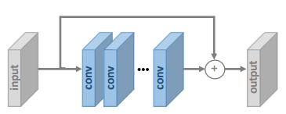

图 2. 全局跳跃连接。

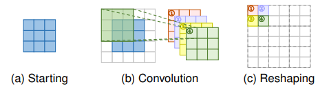

图 3. 子像素卷积。

**超分模型 EDSR**

        EDSR 采用上述结构，为 NTIRE 2017 超分冠军。其残差块去掉批归一化与末尾 ReLU（图 5 右），保留尺度灵活性并减少显存，便于训练更大模型。×2/×3 用单层上采样，×4 用两层。下方代码为 TensorFlow 2.0 实现。

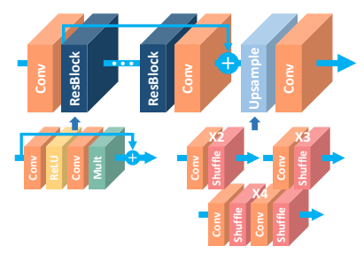

图 4. EDSR 结构。

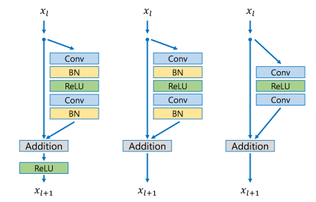

图 5. ResNet（左）与 EDSR（右）残差块

```python
import numpy as np
import tensorflow as tf

from tensorflow.keras.layers import Add, Conv2D, Input, Lambda
from tensorflow.keras.models import Model

DIV2K_RGB_MEAN = np.array([0.4488, 0.4371, 0.4040]) * 255


def edsr(scale, num_filters=64, num_res_blocks=8, res_block_scaling=None):
    """Creates an EDSR model."""
    x_in = Input(shape=(None, None, 3))
    x = Lambda(normalize)(x_in)

    x = b = Conv2D(num_filters, 3, padding='same')(x)
    for i in range(num_res_blocks):
        b = res_block(b, num_filters, res_block_scaling)
    b = Conv2D(num_filters, 3, padding='same')(b)
    x = Add()([x, b])

    x = upsample(x, scale, num_filters)
    x = Conv2D(3, 3, padding='same')(x)

    x = Lambda(denormalize)(x)
    return Model(x_in, x, name="edsr")


def res_block(x_in, filters, scaling):
    """Creates an EDSR residual block."""
    x = Conv2D(filters, 3, padding='same', activation='relu')(x_in)
    x = Conv2D(filters, 3, padding='same')(x)
    if scaling:
        x = Lambda(lambda t: t * scaling)(x)
    x = Add()([x_in, x])
    return x


def upsample(x, scale, num_filters):
    def upsample_1(x, factor, **kwargs):
        """Sub-pixel convolution."""
        x = Conv2D(num_filters * (factor ** 2), 3, padding='same', **kwargs)(x)
        return Lambda(pixel_shuffle(scale=factor))(x)

    if scale == 2:
        x = upsample_1(x, 2, name='conv2d_1_scale_2')
    elif scale == 3:
        x = upsample_1(x, 3, name='conv2d_1_scale_3')
    elif scale == 4:
        x = upsample_1(x, 2, name='conv2d_1_scale_2')
        x = upsample_1(x, 2, name='conv2d_2_scale_2')

    return x


def pixel_shuffle(scale):
    return lambda x: tf.nn.depth_to_space(x, scale)


def normalize(x):
    return (x - DIV2K_RGB_MEAN) / 127.5


def denormalize(x):
    return x * 127.5 + DIV2K_RGB_MEAN
```

**WDSR**

        WDSR 为 NTIRE 2018 真实赛道冠军。其创新点在于残差块设计：减少恒等路径的通道数，同时在块内增加通道数以提升表达能力，且不增加总参数量；此外，模型采用权重归一化，便于训练，允许使用比 EDSR 高一个数量级的学习率。图 6 展示了 EDSR、WDSR-A 与 WDSR-B 的残差块对比，具体实现可参见 `wdsr.py`。

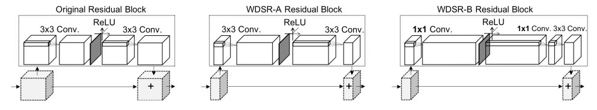

图 6. EDSR（左）、WDSR-A（中）、WDSR-B（右）残差块。

**模型训练**

        若不想在本节运行训练，可直接下载预训练权重，在后续部分直接用于从低分辨率（LR）图像生成超分辨率（SR）图像。

**数据**

        使用 DIV2K 数据集：包含 800 张训练用高分辨率（HR）图像、100 张验证用 HR 图像，其对应的低分辨率（LR）图像由多种降质方法生成。本文示例使用双三次下采样（bicubic）。数据增强方式包括：随机裁剪、水平翻转与旋转。DIV2K 数据加载器会根据指定的放大倍数（scale）与降质类型自动下载数据，并返回 `tf.data.Dataset`对象。

```python
from data import DIV2K

train = DIV2K(scale=4, downgrade='bicubic', subset='train')
train_ds = train.dataset(batch_size=16, random_transform=True)
```

**像素损失**        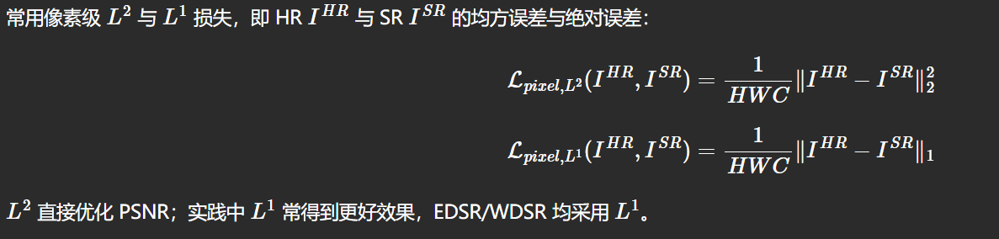

```python
import os

from tensorflow.keras.optimizers import Adam
from tensorflow.keras.optimizers.schedules import PiecewiseConstantDecay

# Create directory for saving model weights
weights_dir = 'weights/article'
os.makedirs(weights_dir, exist_ok=True)

# EDSR baseline as described in the EDSR paper (1.52M parameters)
model_edsr = edsr(scale=4, num_res_blocks=16)

# Adam optimizer with a scheduler that halfs learning rate after 200,000 steps
optim_edsr = Adam(learning_rate=PiecewiseConstantDecay(boundaries=[200000], values=[1e-4, 5e-5]))

# Compile and train model for 300,000 steps with L1 pixel loss
model_edsr.compile(optimizer=optim_edsr, loss='mean_absolute_error')
model_edsr.fit(train_ds, epochs=300, steps_per_epoch=1000)

# Save model weights
model_edsr.save_weights(os.path.join(weights_dir, 'weights-edsr-16-x4.h5'))
#%%
from model.wdsr import wdsr_b

# Custom WDSR B model (0.62M parameters)
model_wdsr = wdsr_b(scale=4, num_res_blocks=32)

# Adam optimizer with a scheduler that halfs learning rate after 200,000 steps
optim_wdsr = Adam(learning_rate=PiecewiseConstantDecay(boundaries=[200000], values=[1e-3, 5e-4]))

# Compile and train model for 300,000 steps with L1 pixel loss
model_wdsr.compile(optimizer=optim_wdsr, loss='mean_absolute_error')
model_wdsr.fit(train_ds, epochs=300, steps_per_epoch=1000)

# Save weights
model_wdsr.save_weights(os.path.join(weights_dir, 'weights-wdsr-b-32-x4.h5'))
```

**感知损失的组成**

在SRGAN中，感知损失由两部分组成：

1.  **内容损失**：基于预训练的VGG网络（记作φ）提取高分辨率（HR）图像和超分辨率（SR）图像的特征，并在特定层l比较它们的特征表示。公式如下：
    
    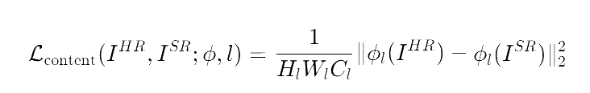
    
    其中，Hl​、Wl​和 Cl​分别是特征图的高度、宽度和通道数，ϕl​(⋅)表示VGG网络在第l层的输出。
    
2.  **对抗损失**：来自生成对抗网络（GAN）框架。生成器G试图生成逼真的SR图像以欺骗判别器D，生成器损失定义为 −logD(G(ILR))，其中 ILR是低分辨率输入图像。
    

感知损失是内容损失和对抗损失的加权和：

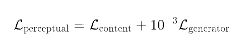

其中，Lpenerator​即对抗损失，权重因子 10−3用于平衡两部分。

**训练策略**

SRGAN采用两阶段训练：

-   首先，使用像素损失（如L1损失）预训练生成器，以获得较好的初始SR结果。
    
-   然后，使用感知损失进行微调（fine-tuning），引入对抗损失以提升纹理细节和感知质量。
    

实践中，这种微调策略也适用于其他模型如EDSR或WDSR。例如，可以对已用L1损失预训练的EDSR模型进行SRGAN风格的微调，从而结合EDSR的准确性和SRGAN的感知优势。

**代码参考**

        判别器的具体实现可参考GitHub代码库中的srgan.py文件，其中定义了生成器（基于SRResNet）和判别器的网络结构。代码使用TensorFlow/Keras，包括残差块、上采样模块和VGG特征提取器。

        通过这种方式，感知损失有效解决了像素损失的局限性，生成了更自然、细节丰富的超分辨率图像。

```python
from model import srgan

# Used in content_loss
mean_squared_error = tf.keras.losses.MeanSquaredError()

# Used in generator_loss and discriminator_loss
binary_cross_entropy = tf.keras.losses.BinaryCrossentropy(from_logits=False)

# Model that computes the feature map after the 4th convolution 
# before the 5th max-pooling layer in VGG19. This is layer 20 in
# the corresponding Keras model.
vgg = srgan.vgg_54()

# EDSR model used as generator in SRGAN
generator = edsr(scale=4, num_res_blocks=16)
generator.load_weights(os.path.join(weights_dir, 'weights-edsr-16-x4.h5'))

# SRGAN discriminator
discriminator = srgan.discriminator()

# Optmizers for generator and discriminator. SRGAN will be trained for
# 200,000 steps and learning rate is reduced from 1e-4 to 1e-5 after
# 100,000 steps
schedule = PiecewiseConstantDecay(boundaries=[100000], values=[1e-4, 1e-5])
generator_optimizer = Adam(learning_rate=schedule)
discriminator_optimizer = Adam(learning_rate=schedule)

def generator_loss(sr_out):
    return binary_cross_entropy(tf.ones_like(sr_out), sr_out)

def discriminator_loss(hr_out, sr_out):
    hr_loss = binary_cross_entropy(tf.ones_like(hr_out), hr_out)
    sr_loss = binary_cross_entropy(tf.zeros_like(sr_out), sr_out)
    return hr_loss + sr_loss

@tf.function
def content_loss(hr, sr):
    sr = tf.keras.applications.vgg19.preprocess_input(sr)
    hr = tf.keras.applications.vgg19.preprocess_input(hr)
    sr_features = vgg(sr) / 12.75
    hr_features = vgg(hr) / 12.75
    return mean_squared_error(hr_features, sr_features)

@tf.function
def train_step(lr, hr):
    """SRGAN training step.
    
    Takes an LR and an HR image batch as input and returns
    the computed perceptual loss and discriminator loss.
    """
    with tf.GradientTape() as gen_tape, tf.GradientTape() as disc_tape:
        lr = tf.cast(lr, tf.float32)
        hr = tf.cast(hr, tf.float32)

        # Forward pass
        sr = generator(lr, training=True)
        hr_output = discriminator(hr, training=True)
        sr_output = discriminator(sr, training=True)

        # Compute losses
        con_loss = content_loss(hr, sr)
        gen_loss = generator_loss(sr_output)
        perc_loss = con_loss + 0.001 * gen_loss
        disc_loss = discriminator_loss(hr_output, sr_output)

    # Compute gradient of perceptual loss w.r.t. generator weights 
    gradients_of_generator = gen_tape.gradient(perc_loss, generator.trainable_variables)
    # Compute gradient of discriminator loss w.r.t. discriminator weights 
    gradients_of_discriminator = disc_tape.gradient(disc_loss, discriminator.trainable_variables)

    # Update weights of generator and discriminator
    generator_optimizer.apply_gradients(zip(gradients_of_generator, generator.trainable_variables))
    discriminator_optimizer.apply_gradients(zip(gradients_of_discriminator, discriminator.trainable_variables))

    return perc_loss, disc_loss

pls_metric = tf.keras.metrics.Mean()
dls_metric = tf.keras.metrics.Mean()

steps = 200000
step = 0

# Train SRGAN for 200,000 steps.
for lr, hr in train_ds.take(steps):
    step += 1

    pl, dl = train_step(lr, hr)
    pls_metric(pl)
    dls_metric(dl)

    if step % 50 == 0:
        print(f'{step}/{steps}, perceptual loss = {pls_metric.result():.4f}, discriminator loss = {dls_metric.result():.4f}')
        pls_metric.reset_states()
        dls_metric.reset_states()
        
generator.save_weights(os.path.join(weights_dir, 'weights-edsr-16-x4-fine-tuned.h5'))
```

**结果**

```python
import os

from tensorflow.keras.optimizers import Adam
from tensorflow.keras.optimizers.schedules import PiecewiseConstantDecay

# Create directory for saving model weights
weights_dir = 'weights/article'
os.makedirs(weights_dir, exist_ok=True)

# EDSR baseline as described in the EDSR paper (1.52M parameters)
model_edsr = edsr(scale=4, num_res_blocks=16)

# Adam optimizer with a scheduler that halfs learning rate after 200,000 steps
optim_edsr = Adam(learning_rate=PiecewiseConstantDecay(boundaries=[200000], values=[1e-4, 5e-5]))

# Compile and train model for 300,000 steps with L1 pixel loss
model_edsr.compile(optimizer=optim_edsr, loss='mean_absolute_error')
model_edsr.fit(train_ds, epochs=300, steps_per_epoch=1000)

# Save model weights
model_edsr.save_weights(os.path.join(weights_dir, 'weights-edsr-16-x4.h5'))
```

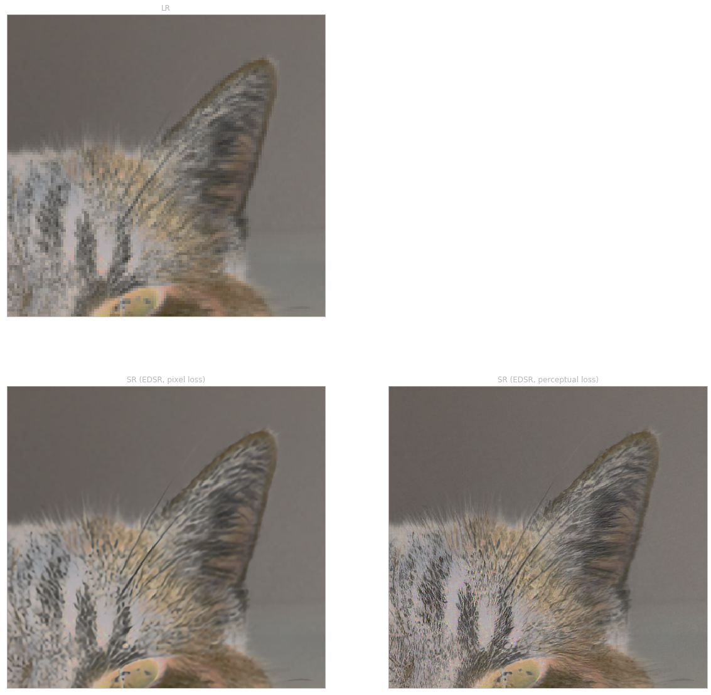

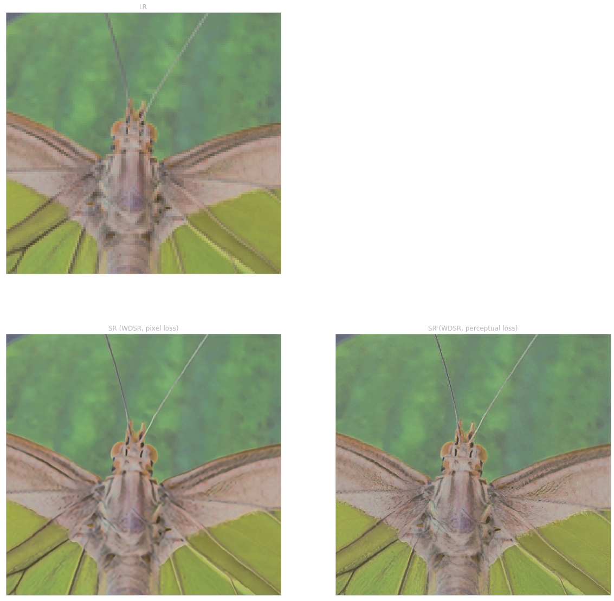

#### 2.1.1 EDSR

```python
# 残差块数量、倍率、降质方式与权重路径
import os
import matplotlib.pyplot as plt

from data import DIV2K
from model.edsr import edsr
from train import EdsrTrainer

%matplotlib inline
#%%
# Number of residual blocks
depth = 16

# Super-resolution factor
scale = 4

# Downgrade operator
downgrade = 'bicubic'
#%%
# Location of model weights (needed for demo)
weights_dir = f'weights/edsr-{depth}-x{scale}'
weights_file = os.path.join(weights_dir, 'weights.h5')

os.makedirs(weights_dir, exist_ok=True)
```

训练

```python
#%%
# 恢复最优 checkpoint
div2k_train = DIV2K(scale=scale, subset='train', downgrade=downgrade)
div2k_valid = DIV2K(scale=scale, subset='valid', downgrade=downgrade)
#%%
# 验证集 PSNR
train_ds = div2k_train.dataset(batch_size=16, random_transform=True)
valid_ds = div2k_valid.dataset(batch_size=1, random_transform=False, repeat_count=1)
#%% md
# 恢复最优 checkpoint 并在完整验证集上评估 PSNR
```

评估

```python
# 保存权重
trainer = EdsrTrainer(model=edsr(scale=scale, num_res_blocks=depth), 
                      checkpoint_dir=f'.ckpt/edsr-{depth}-x{scale}')
#%%
# Train EDSR model for 300,000 steps and evaluate model
# every 1000 steps on the first 10 images of the DIV2K
# validation set. Save a checkpoint only if evaluation
# PSNR has improved.
trainer.train(train_ds,
              valid_ds.take(10),
              steps=300000, 
              evaluate_every=1000, 
              save_best_only=True)
#%%
# Restore from checkpoint with highest PSNR
trainer.restore()
#%%
# Evaluate model on full validation set
psnrv = trainer.evaluate(valid_ds)
print(f'PSNR = {psnrv.numpy():3f}')
#%%
# Save weights to separate location (needed for demo)
trainer.model.save_weights(weights_file)
```

测试

```python
# EDSR 示例代码
model = edsr(scale=scale, num_res_blocks=depth)
model.load_weights(weights_file)
#%%
# EDSR 示例代码
from model import resolve_single
from utils import load_image, plot_sample

def resolve_and_plot(lr_image_path):
    lr = load_image(lr_image_path)
    sr = resolve_single(model, lr)
    plot_sample(lr, sr)
#%%
# EDSR 示例代码
resolve_and_plot('demo/0869x4-crop.png')
```

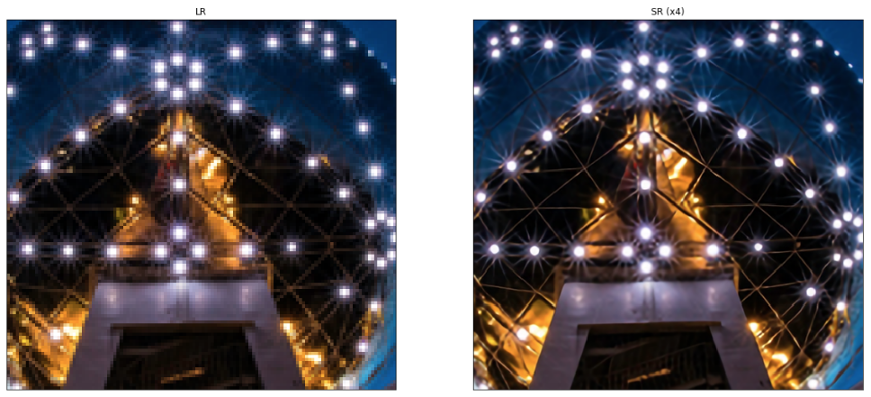

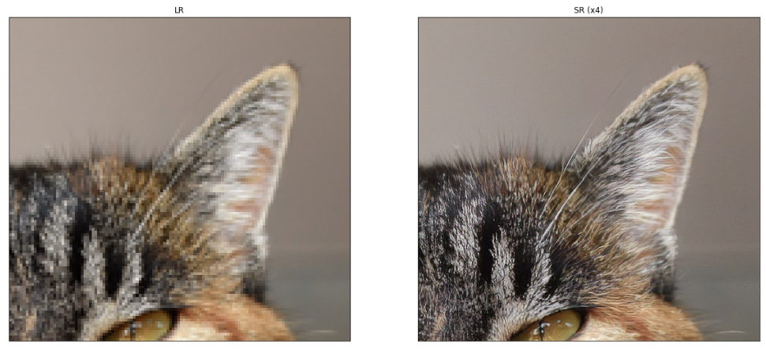

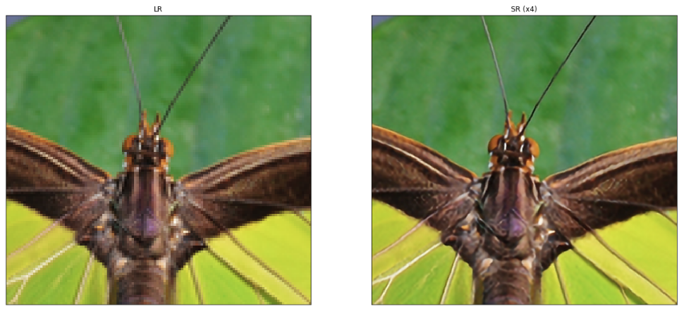

#### 2.1.2 SRGAN

```python
# SRGAN 参数与路径
import os
import matplotlib.pyplot as plt

from data import DIV2K
from model.srgan import generator, discriminator
from train import SrganTrainer, SrganGeneratorTrainer

%matplotlib inline
#%%
# Location of model weights (needed for demo)
weights_dir = 'weights/srgan'
weights_file = lambda filename: os.path.join(weights_dir, filename)

os.makedirs(weights_dir, exist_ok=True)
```

生成器预训练

> 使用像素级 MSE 对 SRResNet 生成器预训练约 100 万步。

```python
#%%
# GAN 联合训练
div2k_train = DIV2K(scale=4, subset='train', downgrade='bicubic')
div2k_valid = DIV2K(scale=4, subset='valid', downgrade='bicubic')
#%%
# 恢复权重
train_ds = div2k_train.dataset(batch_size=16, random_transform=True)
valid_ds = div2k_valid.dataset(batch_size=16, random_transform=True, repeat_count=1)
#%% md
# 2）GAN 联合训练

加载预训练生成器，与判别器一起训练约 20 万步，使用感知损失（内容损失 + 对抗损失）。
```

GAN预训练

> 加载预训练生成器，与判别器一起训练约 20 万步，使用感知损失（内容损失 + 对抗损失）  
>  

```python
# 验证集 PSNR
pre_trainer = SrganGeneratorTrainer(model=generator(), checkpoint_dir=f'.ckpt/pre_generator')
pre_trainer.train(train_ds,
                  valid_ds.take(10),
                  steps=1000000, 
                  evaluate_every=1000, 
                  save_best_only=False)

pre_trainer.model.save_weights(weights_file('pre_generator.h5'))
```

评估  
 

```python
# 演示
gan_generator = generator()
gan_generator.load_weights(weights_file('pre_generator.h5'))

gan_trainer = SrganTrainer(generator=gan_generator, discriminator=discriminator())
gan_trainer.train(train_ds, steps=200000)
#%%
# SRGAN 示例代码
gan_trainer.generator.save_weights(weights_file('gan_generator.h5'))
gan_trainer.discriminator.save_weights(weights_file('gan_discriminator.h5'))
```

演示

```python
# SRGAN 示例代码
pre_generator = generator()
gan_generator = generator()

pre_generator.load_weights(weights_file('pre_generator.h5'))
gan_generator.load_weights(weights_file('gan_generator.h5'))
#%%
# SRGAN 示例代码
from model import resolve_single
from utils import load_image

def resolve_and_plot(lr_image_path):
    lr = load_image(lr_image_path)
    
    pre_sr = resolve_single(pre_generator, lr)
    gan_sr = resolve_single(gan_generator, lr)
    
    plt.figure(figsize=(20, 20))
    
    images = [lr, pre_sr, gan_sr]
    titles = ['LR', 'SR (PRE)', 'SR (GAN)']
    positions = [1, 3, 4]
    
    for i, (img, title, pos) in enumerate(zip(images, titles, positions)):
        plt.subplot(2, 2, pos)
        plt.imshow(img)
        plt.title(title)
        plt.xticks([])
        plt.yticks([])
```

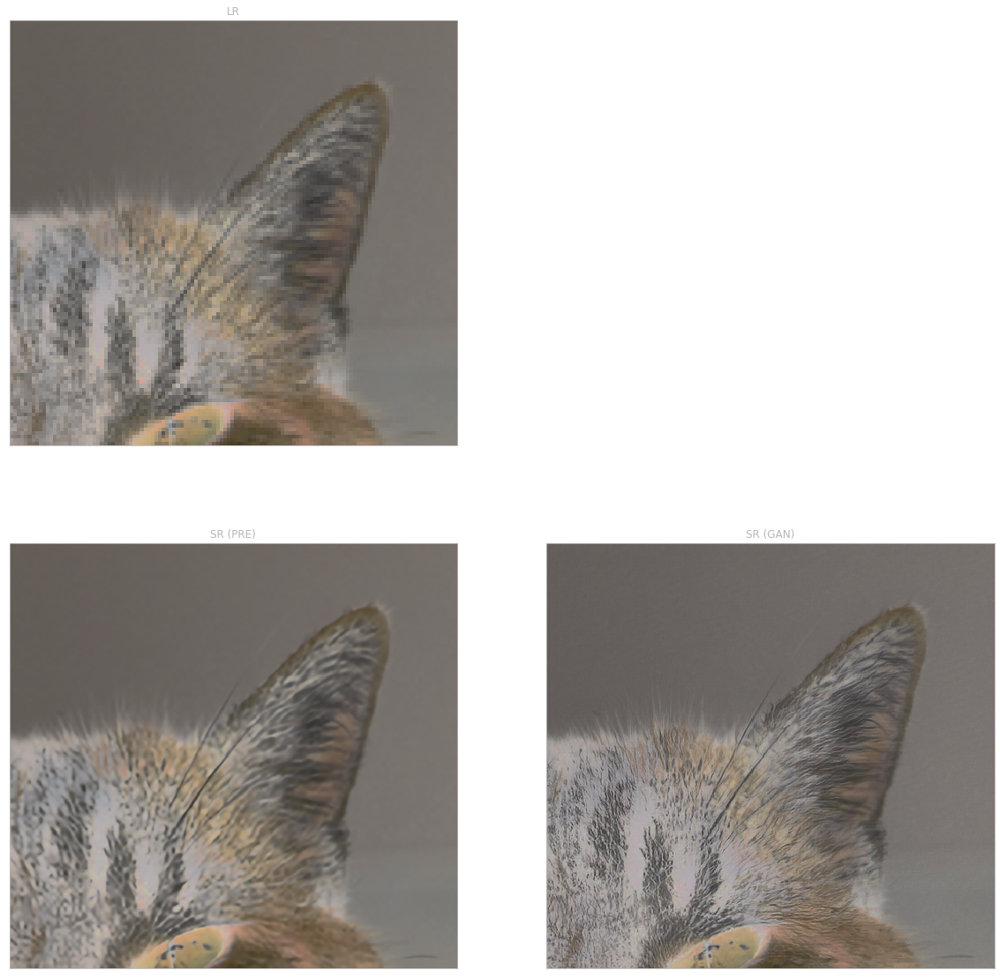

#### 2.1.3 WDER

```python
# WDSR B 参数与路径
import os
import matplotlib.pyplot as plt

from data import DIV2K
from model.wdsr import wdsr_b
from train import WdsrTrainer

%matplotlib inline
#%%
# Number of residual blocks
depth = 32

# Super-resolution factor
scale = 4

# Downgrade operator
downgrade = 'bicubic'
#%%
# Location of model weights (needed for demo)
weights_dir = f'weights/wdsr-b-{depth}-x{scale}'
weights_file = os.path.join(weights_dir, 'weights.h5')

os.makedirs(weights_dir, exist_ok=True)
#%% md
# 训练 WDSR B 模型

设置与 EDSR 类似，每 1000 步评估，仅保存 PSNR 最优。

#%%
# 恢复与评估
div2k_train = DIV2K(scale=scale, subset='train', downgrade=downgrade)
div2k_valid = DIV2K(scale=scale, subset='valid', downgrade=downgrade)
#%%
# 保存权重
train_ds = div2k_train.dataset(batch_size=16, random_transform=True)
valid_ds = div2k_valid.dataset(batch_size=1, random_transform=False, repeat_count=1)
#%% md
# 恢复最优 checkpoint 并在完整验证集上评估

#%%
# 演示
trainer = WdsrTrainer(model=wdsr_b(scale=scale, num_res_blocks=depth), 
                      checkpoint_dir=f'.ckpt/wdsr-b-{depth}-x{scale}')
#%%
# Train WDSR B model for 300,000 steps and evaluate model
# every 1000 steps on the first 10 images of the DIV2K
# validation set. Save a checkpoint only if evaluation
# PSNR has improved.
trainer.train(train_ds,
              valid_ds.take(10),
              steps=300000, 
              evaluate_every=1000, 
              save_best_only=True)
#%%
# Restore from checkpoint with highest PSNR
trainer.restore()
#%%
# Evaluate model on full validation set
psnr = trainer.evaluate(valid_ds)
print(f'PSNR = {psnr.numpy():3f}')
#%%
# Save weights to separate location (needed for demo)
trainer.model.save_weights(weights_file)
#%% md
# 保存权重并演示：对示例 LR 图像做超分并绘图

#%%
# WDSR 示例代码
model = wdsr_b(scale=scale, num_res_blocks=depth)
model.load_weights(weights_file)
#%%
# WDSR 示例代码
from model import resolve_single
from utils import load_image, plot_sample

def resolve_and_plot(lr_image_path):
    lr = load_image(lr_image_path)
    sr = resolve_single(model, lr)
    plot_sample(lr, sr)
```

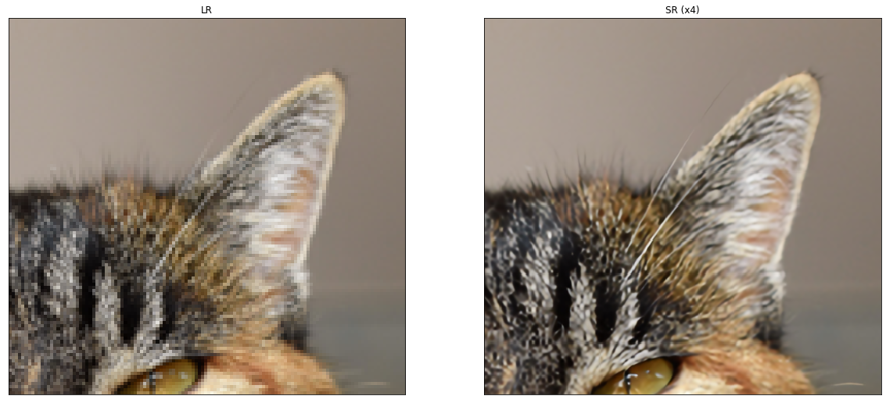

* * *

### 2.2  长短期记忆机器人识别色彩

TensorFlow实现

mian

```python
# -*- coding: utf-8 -*-
"""
第四章 4.2：长短期记忆机器人识别色彩（TensorFlow 版）

根据颜色名称文本（如 "red"、"blue"）使用堆叠 LSTM 回归出 RGB 值。
数据来自 ColorBot（train/test CSV），自动下载到 ./data。训练约 40 个 epoch 后可交互输入颜色名得到 RGB 与色块图。

运行方式：在 Chapter04/4.2 目录下执行
    python main.py
"""
import os
import time
import numpy as np
import tensorflow as tf
from tensorflow import keras
from matplotlib import pyplot as plt

from utils import load_dataset, parse
from model import RNNColorbot

tf.random.set_seed(22)
np.random.seed(22)
os.environ['TF_CPP_MIN_LOG_LEVEL'] = '2'


def test(model, eval_data):
    """
    计算eval_data上的平均损失，eval_data应该是一个Dataset。
    """
    avg_loss = keras.metrics.Mean()

    for (labels, chars, sequence_length) in eval_data:

        predictions = model((chars, sequence_length), training=False)
        avg_loss.update_state(keras.losses.mean_squared_error(labels, predictions))

    print("eval/loss: %.6f" % avg_loss.result().numpy())


def train_one_epoch(model, optimizer, train_data, log_interval, epoch):
    """
    使用优化器在train_data上训练模型。
    """

    for step, (labels, chars, sequence_length) in enumerate(train_data):

        with tf.GradientTape() as tape:
            predictions = model((chars, sequence_length), training=True)
            loss = keras.losses.mean_squared_error(labels, predictions)
            loss = tf.reduce_mean(loss)

        grads = tape.gradient(loss, model.trainable_variables)
        optimizer.apply_gradients(zip(grads, model.trainable_variables))


        if step % 100 == 0:
            print(epoch, step, 'loss:', float(loss))


SOURCE_TRAIN_URL = "https://raw.githubusercontent.com/random-forests/tensorflow-workshop/master/archive/extras/colorbot/data/train.csv"
SOURCE_TEST_URL = "https://raw.githubusercontent.com/random-forests/tensorflow-workshop/master/archive/extras/colorbot/data/test.csv"


def main():

    batchsz = 64
    rnn_cell_sizes = [256, 128]
    epochs = 40

    data_dir = os.path.join('.', "data")
    train_data = load_dataset(
        data_dir=data_dir, url=SOURCE_TRAIN_URL, batch_size=batchsz)
    eval_data = load_dataset(
        data_dir=data_dir, url=SOURCE_TEST_URL, batch_size=batchsz)

    model = RNNColorbot(
        rnn_cell_sizes=rnn_cell_sizes,
        label_dimension=3,
        keep_prob=0.5)
    optimizer = keras.optimizers.Adam(0.01)


    for epoch in range(epochs):

        start = time.time()
        train_one_epoch(model, optimizer, train_data, 50, epoch)
        end = time.time()
        # print("train/time for epoch #%d: %.2f" % (epoch, end - start))

        if epoch % 10 == 0:
            test(model, eval_data)

    print("颜色机器人已准备好生成颜色！")
    while True:
        try:
            color_name = input("请输入颜色名称（或按回车键退出）：")
        except EOFError:
            return

        if not color_name:
            return

        _, chars, length = parse(color_name)

        (chars, length) = (tf.identity(chars), tf.identity(length))
        chars = tf.expand_dims(chars, 0)
        length = tf.expand_dims(length, 0)
        preds = tf.unstack(model((chars, length), training=False)[0])

        # 预测值不能为负，因为它们是由ReLU层生成的；
        # 但是，它们可能大于1。
        clipped_preds = tuple(min(float(p), 1.0) for p in preds)
        rgb = tuple(int(p * 255) for p in clipped_preds)
        print("rgb:", rgb)
        data = [[clipped_preds]]

        plt.imshow(data)
        plt.title(color_name)
        plt.savefig(color_name+'.png')


if __name__ == "__main__":
    main()
```

model

```python
import  tensorflow as tf
from    tensorflow import keras


class RNNColorbot(keras.Model):
    """
    多层 LSTM RNN，根据颜色名称字符序列回归 RGB 向量。
    """

    def __init__(self, rnn_cell_sizes, label_dimension, keep_prob):
        """
        参数:
          rnn_cell_sizes: 各层 LSTM 单元大小列表
          label_dimension: 回归标签长度（3 表示 RGB）
          keep_prob: 1 - dropout 概率，应用于每层 LSTM 输出
        """
        super(RNNColorbot, self).__init__(name="")

        self.rnn_cell_sizes = rnn_cell_sizes
        self.label_dimension = label_dimension
        self.keep_prob = keep_prob

        self.cells = [keras.layers.LSTMCell(size) for size in rnn_cell_sizes]
        self.relu = keras.layers.Dense(label_dimension, activation=tf.nn.relu)

    def call(self, inputs, training=None):
        """
        Implements the RNN logic and prediction generation.
        Args:
          inputs: A tuple (chars, sequence_length), where chars is a batch of
            one-hot encoded color names represented as a Tensor with dimensions
            [batch_size, time_steps, 256] and sequence_length holds the length
            of each character sequence (color name) as a Tensor with dimension
            [batch_size].
          training: whether the invocation is happening during training
        Returns:
          A tensor of dimension [batch_size, label_dimension] that is produced by
          passing chars through a multi-layer RNN and applying a ReLU to the final
          hidden state.
        """
        (chars, sequence_length) = inputs
        # Transpose the first and second dimensions so that chars is of shape
        # [time_steps, batch_size, dimension].
        chars = tf.transpose(chars, [1, 0, 2])
        # The outer loop cycles through the layers of the RNN; the inner loop
        # executes the time steps for a particular layer.
        batch_size = int(chars.shape[1])
        for l in range(len(self.cells)): # for each layer
            cell = self.cells[l]
            outputs = []
            # h_zero, c_zero
            state = (tf.zeros((batch_size, self.rnn_cell_sizes[l])),
                     tf.zeros((batch_size, self.rnn_cell_sizes[l])))
            # Unstack the inputs to obtain a list of batches, one for each time step.
            chars = tf.unstack(chars, axis=0)
            for ch in chars: # for each time stamp
                output, state = cell(ch, state)
                outputs.append(output)
            # The outputs of this layer are the inputs of the subsequent layer.
            # [t, b, h]
            chars = tf.stack(outputs, axis=0)
            if training:
                chars = tf.nn.dropout(chars, self.keep_prob)
        # Extract the correct output (i.e., hidden state) for each example. All the
        # character sequences in this batch were padded to the same fixed length so
        # that they could be easily fed through the above RNN loop. The
        # `sequence_length` vector tells us the true lengths of the character
        # sequences, letting us obtain for each sequence the hidden state that was
        # generated by its non-padding characters.
        batch_range = [i for i in range(batch_size)]
        # stack [64] with [64] => [64, 2]
        indices = tf.stack([sequence_length - 1, batch_range], axis=1)
        # [t, b, h]
        # print(chars.shape)
        hidden_states = tf.gather_nd(chars, indices)
        # print(hidden_states.shape)
        return self.relu(hidden_states)
```

utils

```python
# -*- coding: utf-8 -*-
"""
第四章 4.2：ColorBot 数据加载与解析（TensorFlow 版）

提供 parse（解析 CSV 行）、maybe_download（下载 CSV）、load_dataset（构建 tf.data 管道）。
"""
import os
import tensorflow as tf
import urllib.request


def parse(line):
    """
    解析颜色数据集中的一行。每行格式为：color_name, r, g, b（逗号分隔）。
    返回：rgb [3], chars [seq_len, 256], length (标量)
    """
    # TF2 使用 tf.strings.split，不再使用 compat.v1.string_split
    parts = tf.strings.split(line, ',')
    color_name = parts[0]
    rgb = tf.strings.to_number(tf.stack([parts[1], parts[2], parts[3]]), out_type=tf.float32) / 255.0
    # 将颜色名称表示为字符的 one-hot 序列（按字节）
    chars = tf.one_hot(tf.io.decode_raw(color_name, tf.uint8), depth=256)
    length = tf.cast(tf.shape(chars)[0], dtype=tf.int64)
    return rgb, chars, length


def maybe_download(filename, work_directory, source_url):
    """
    从 source_url 下载数据到 work_directory，若文件已存在则跳过。
    返回结果文件路径。
    """
    if not tf.io.gfile.exists(work_directory):
        tf.io.gfile.makedirs(work_directory)
    filepath = os.path.join(work_directory, filename)
    if not tf.io.gfile.exists(filepath):
        temp_file_name, _ = urllib.request.urlretrieve(source_url)
        tf.io.gfile.copy(temp_file_name, filepath)
        if os.path.exists(temp_file_name):
            try:
                os.remove(temp_file_name)
            except OSError:
                pass
        with tf.io.gfile.GFile(filepath) as f:
            size = f.size()
            print("Successfully downloaded", filename, size, "bytes.")
    return filepath


def load_dataset(data_dir, url, batch_size):
    """
    将 ColorBot 数据加载为 tf.data 管道：跳过表头、解析行、打乱、按 padded_batch 组批。
    """
    path = maybe_download(os.path.basename(url), data_dir, url)
    dataset = tf.data.TextLineDataset(path).skip(1).map(parse).shuffle(
                buffer_size=10000).padded_batch(
                batch_size, padded_shapes=([3], [None, 256], []))
    return dataset
```

PyTorch实现

main

```python
"""
PyTorch版本的颜色识别机器人主程序
这是从TensorFlow版本转换而来的PyTorch实现
"""
import os
import time
import torch
import torch.nn as nn
import torch.optim as optim
import numpy as np
from matplotlib import pyplot as plt

from utils_pytorch import load_dataset, parse
from model_pytorch import RNNColorbot

# 设置随机种子
torch.manual_seed(22)
np.random.seed(22)
if torch.cuda.is_available():
    torch.cuda.manual_seed(22)

# 设置设备
device = torch.device('cuda' if torch.cuda.is_available() else 'cpu')
print(f'使用设备: {device}')


def test(model, eval_data):
    """
    计算eval_data上的平均损失，eval_data应该是一个DataLoader。
    """
    model.eval()
    total_loss = 0.0
    num_batches = 0
    
    with torch.no_grad():
        for (labels, chars, sequence_length) in eval_data:
            labels = labels.to(device)
            chars = chars.to(device)
            sequence_length = sequence_length.to(device)
            
            predictions = model((chars, sequence_length), training=False)
            loss = nn.functional.mse_loss(predictions, labels, reduction='mean')
            total_loss += loss.item()
            num_batches += 1
    
    avg_loss = total_loss / num_batches if num_batches > 0 else 0.0
    print("eval/loss: %.6f" % avg_loss)


def train_one_epoch(model, optimizer, train_data, log_interval, epoch):
    """
    使用优化器在train_data上训练模型。
    """
    model.train()
    
    for step, (labels, chars, sequence_length) in enumerate(train_data):
        labels = labels.to(device)
        chars = chars.to(device)
        sequence_length = sequence_length.to(device)
        
        # 前向传播
        predictions = model((chars, sequence_length), training=True)
        loss = nn.functional.mse_loss(predictions, labels, reduction='mean')
        
        # 反向传播
        optimizer.zero_grad()
        loss.backward()
        optimizer.step()
        
        if step % 100 == 0:
            print(epoch, step, 'loss:', loss.item())


SOURCE_TRAIN_URL = "https://raw.githubusercontent.com/random-forests/tensorflow-workshop/master/archive/extras/colorbot/data/train.csv"
SOURCE_TEST_URL = "https://raw.githubusercontent.com/random-forests/tensorflow-workshop/master/archive/extras/colorbot/data/test.csv"


def main():
    batchsz = 64
    rnn_cell_sizes = [256, 128]
    epochs = 40
    
    data_dir = os.path.join('.', "data")
    train_data = load_dataset(
        data_dir=data_dir, url=SOURCE_TRAIN_URL, batch_size=batchsz)
    eval_data = load_dataset(
        data_dir=data_dir, url=SOURCE_TEST_URL, batch_size=batchsz)
    
    model = RNNColorbot(
        rnn_cell_sizes=rnn_cell_sizes,
        label_dimension=3,
        keep_prob=0.5).to(device)
    optimizer = optim.Adam(model.parameters(), lr=0.01)
    
    for epoch in range(epochs):
        start = time.time()
        train_one_epoch(model, optimizer, train_data, 50, epoch)
        end = time.time()
        
        if epoch % 10 == 0:
            test(model, eval_data)
    
    print("颜色机器人已准备好生成颜色！")
    while True:
        try:
            color_name = input("请输入颜色名称（或按回车键退出）：")
        except EOFError:
            return
        
        if not color_name:
            return
        
        _, chars, length = parse(color_name)
        
        # 转换为张量并移到设备上
        chars = chars.unsqueeze(0).to(device)  # [1, seq_len, 256]
        length = length.unsqueeze(0).to(device)  # [1]
        
        model.eval()
        with torch.no_grad():
            preds = model((chars, length), training=False)[0]  # [3]
        
        # 预测值不能为负，因为它们是由ReLU层生成的；
        # 但是，它们可能大于1。
        preds_cpu = preds.cpu().numpy()
        clipped_preds = tuple(min(float(p), 1.0) for p in preds_cpu)
        rgb = tuple(int(p * 255) for p in clipped_preds)
        print("rgb:", rgb)
        data = [[clipped_preds]]
        
        plt.imshow(data)
        plt.title(color_name)
        plt.savefig(color_name + '.png')
        plt.close()


if __name__ == "__main__":
    main()
```

model

```python
"""
PyTorch版本的RNN颜色识别模型
这是从TensorFlow版本转换而来的PyTorch实现
"""
import torch
import torch.nn as nn
import torch.nn.functional as F


class RNNColorbot(nn.Module):
    """
    多层（LSTM）RNN，用于回归实值向量标签。
    """

    def __init__(self, rnn_cell_sizes, label_dimension, keep_prob):
        """
        构造一个RNNColorbot。
        
        Args:
          rnn_cell_sizes: 整数列表，表示RNN中每个LSTM单元的大小；
            rnn_cell_sizes[i]是第i层单元的大小
          label_dimension: 要回归的标签长度
          keep_prob: (1 - dropout概率)；dropout应用于每个LSTM层的输出
        """
        super(RNNColorbot, self).__init__()
        
        self.rnn_cell_sizes = rnn_cell_sizes
        self.label_dimension = label_dimension
        self.keep_prob = keep_prob
        
        # 创建多层LSTM
        self.lstm_layers = nn.ModuleList([
            nn.LSTM(input_size=256 if i == 0 else rnn_cell_sizes[i-1],
                   hidden_size=size,
                   num_layers=1,
                   batch_first=False,
                   dropout=0 if i == len(rnn_cell_sizes) - 1 else 0)
            for i, size in enumerate(rnn_cell_sizes)
        ])
        
        # 输出层（ReLU激活）
        self.relu = nn.Linear(rnn_cell_sizes[-1], label_dimension)
    
    def forward(self, inputs, training=None):
        """
        实现RNN逻辑和预测生成。
        
        Args:
          inputs: 元组 (chars, sequence_length)，其中chars是一批
            独热编码的颜色名称，表示为维度为[batch_size, time_steps, 256]的张量，
            sequence_length保存每个字符序列（颜色名称）的长度，维度为[batch_size]。
          training: 调用是否发生在训练期间
        
        Returns:
          维度为[batch_size, label_dimension]的张量，通过将chars通过多层RNN
          并对最终隐藏状态应用ReLU而产生。
        """
        (chars, sequence_length) = inputs
        
        # 转置第一和第二维度，使chars的形状为[time_steps, batch_size, dimension]
        chars = chars.transpose(0, 1)  # [time_steps, batch_size, 256]
        
        # 通过每一层LSTM
        for i, lstm in enumerate(self.lstm_layers):
            # LSTM前向传播
            output, (h_n, c_n) = lstm(chars)
            
            # 应用dropout（如果训练）
            if training and self.keep_prob < 1.0:
                output = F.dropout(output, p=1.0 - self.keep_prob, training=True)
            
            # 这一层的输出是下一层的输入
            chars = output
        
        # 提取每个示例的正确输出（即隐藏状态）
        # 所有字符序列都被填充到相同的固定长度，以便可以轻松地通过上述RNN循环。
        # `sequence_length`向量告诉我们字符序列的真实长度，让我们能够获得
        # 每个序列由其非填充字符生成的隐藏状态。
        batch_size = chars.size(1)
        batch_range = torch.arange(batch_size, device=chars.device)
        
        # 获取每个序列最后一个有效时间步的隐藏状态
        # sequence_length - 1 是每个序列的最后一个有效索引
        indices = sequence_length - 1
        hidden_states = chars[indices, batch_range]  # [batch_size, hidden_size]
        
        # 通过ReLU层
        return F.relu(self.relu(hidden_states))
```

utils

```python
"""
PyTorch版本的工具函数
这是从TensorFlow版本转换而来的PyTorch实现
"""
import os
import torch
import numpy as np
import urllib.request
from torch.utils.data import Dataset, DataLoader
import torch.nn.functional as F


def parse(line):
    """
    解析颜色数据集中的一行。
    """
    # 每行数据集是逗号分隔的，格式为
    #    color_name, r, g, b
    # 所以`items`是一个列表[color_name, r, g, b]。
    items = line.strip().split(',')
    rgb = torch.tensor([float(x) / 255.0 for x in items[1:4]], dtype=torch.float32)
    
    # 将颜色名称表示为独热编码的字符序列
    color_name = items[0]
    # 将字符串转换为字节，然后转换为独热编码
    chars_bytes = color_name.encode('utf-8')
    chars_indices = torch.tensor(list(chars_bytes), dtype=torch.long)
    chars = F.one_hot(chars_indices, num_classes=256).float()  # [seq_len, 256]
    
    # 序列长度是RNN所需要的
    length = torch.tensor(len(chars), dtype=torch.long)
    return rgb, chars, length


def maybe_download(filename, work_directory, source_url):
    """
    从源URL下载数据，除非它已经存在。
    
    Args:
      filename: 字符串，目录中的文件名。
      work_directory: 字符串，工作目录的路径。
      source_url: 如果文件不存在，要下载的URL。
    
    Returns:
      结果文件的路径。
    """
    if not os.path.exists(work_directory):
        os.makedirs(work_directory)
    filepath = os.path.join(work_directory, filename)
    if not os.path.exists(filepath):
        print(f"正在下载 {filename}...")
        urllib.request.urlretrieve(source_url, filepath)
        size = os.path.getsize(filepath)
        print(f"成功下载 {filename}，{size} 字节。")
    return filepath


class ColorDataset(Dataset):
    """颜色数据集类"""
    def __init__(self, data_dir, url, batch_size=None):
        """
        加载颜色数据。
        
        Args:
          data_dir: 数据目录
          url: 数据URL
          batch_size: 批次大小（用于兼容性，实际在DataLoader中设置）
        """
        path = maybe_download(os.path.basename(url), data_dir, url)
        
        # 读取所有行
        self.data = []
        with open(path, 'r', encoding='utf-8') as f:
            next(f)  # 跳过标题行
            for line in f:
                if line.strip():
                    self.data.append(line.strip())
    
    def __len__(self):
        return len(self.data)
    
    def __getitem__(self, idx):
        return parse(self.data[idx])


def collate_fn(batch):
    """
    自定义collate函数，用于处理变长序列的批处理。
    """
    # 分离rgb、chars和lengths
    rgbs, chars_list, lengths = zip(*batch)
    
    # 转换为张量
    rgbs = torch.stack(rgbs)  # [batch_size, 3]
    lengths = torch.stack(lengths)  # [batch_size]
    
    # 找到最大序列长度
    max_len = max(lengths).item()
    
    # 填充chars到相同长度
    padded_chars = []
    for chars in chars_list:
        # chars是[seq_len, 256]
        seq_len = chars.size(0)
        if seq_len < max_len:
            # 填充
            padding = torch.zeros(max_len - seq_len, 256, dtype=chars.dtype)
            chars = torch.cat([chars, padding], dim=0)
        padded_chars.append(chars)
    
    chars = torch.stack(padded_chars)  # [batch_size, max_len, 256]
    
    return rgbs, chars, lengths


def load_dataset(data_dir, url, batch_size):
    """
    将路径处的颜色数据加载到DataLoader中。
    """
    dataset = ColorDataset(data_dir, url, batch_size)
    dataloader = DataLoader(
        dataset,
        batch_size=batch_size,
        shuffle=True,
        collate_fn=collate_fn,
        num_workers=0  # Windows上可能需要设置为0
    )
    return dataloader
```

* * *

### 2.3  使用注意力机制给图像取标题

TensorFlow实现

```python
# -*- coding: utf-8 -*-
"""
第四章 4.3：使用注意力机制给图像取标题（TensorFlow 版）

输入一张图像，输出一句描述该图像的英文标题（Image Captioning）。
结构对应官方教程：MS-COCO 数据 -> InceptionV3 特征 -> CNN 编码器 + 带 Bahdanau 注意力的 GRU 解码器。

完整运行需下载 MS-COCO 标注与 train2014 图像（体积较大）。可通过 NUM_EXAMPLES 限制样本数以快速试跑。

运行方式：在 Chapter04/4.3 目录下执行
    python image_captioning.py
"""
import os
import re
import time
import json
import pickle
import numpy as np
import tensorflow as tf
from tensorflow import keras
from sklearn.utils import shuffle

os.environ['TF_CPP_MIN_LOG_LEVEL'] = '2'

# ---------- 可调参数 ----------
NUM_EXAMPLES = 3000   # 使用的标题数量（可改为 30000 做完整训练；改小可加快试跑）
BATCH_SIZE = 64
BUFFER_SIZE = 1000
EPOCHS = 5
embedding_dim = 256
units = 512
top_k = 5000
attention_features_shape = 64
features_shape = 2048

# 路径（脚本所在目录）
SCRIPT_DIR = os.path.dirname(os.path.abspath(__file__))
annotation_file = None
PATH = None
image_features_extract_model = None
tokenizer = None
max_length = None
encoder = None
decoder = None
optimizer = None
loss_object = None
vocab_size = None


def load_image(image_path):
    """加载并预处理单张图像：解码、缩放到 299x299、InceptionV3 预处理。"""
    img = tf.io.read_file(image_path)
    img = tf.image.decode_jpeg(img, channels=3)
    img = tf.image.resize(img, (299, 299))
    img = keras.applications.inception_v3.preprocess_input(img)
    return img, image_path


def calc_max_length(tensor_list):
    return max(len(t) for t in tensor_list)


class BahdanauAttention(keras.Model):
    """Bahdanau 注意力：根据当前解码器隐状态对编码器输出加权求和得到 context vector。"""

    def __init__(self, units):
        super(BahdanauAttention, self).__init__()
        self.W1 = keras.layers.Dense(units)
        self.W2 = keras.layers.Dense(units)
        self.V = keras.layers.Dense(1)

    def call(self, features, hidden):
        hidden_with_time_axis = tf.expand_dims(hidden, 1)
        score = tf.nn.tanh(self.W1(features) + self.W2(hidden_with_time_axis))
        attention_weights = tf.nn.softmax(self.V(score), axis=1)
        context_vector = attention_weights * features
        context_vector = tf.reduce_sum(context_vector, axis=1)
        return context_vector, attention_weights


class CNN_Encoder(keras.Model):
    """CNN 编码器：将 InceptionV3 特征 (64, 2048) 通过全连接映射为 (64, embedding_dim)。"""

    def __init__(self, embedding_dim):
        super(CNN_Encoder, self).__init__()
        self.fc = keras.layers.Dense(embedding_dim)

    def call(self, x):
        x = self.fc(x)
        x = tf.nn.relu(x)
        return x


class RNN_Decoder(keras.Model):
    """RNN 解码器：Embedding + 注意力 + GRU + 全连接，逐步预测词。"""

    def __init__(self, embedding_dim, units, vocab_size):
        super(RNN_Decoder, self).__init__()
        self.units = units
        self.embedding = keras.layers.Embedding(vocab_size, embedding_dim)
        self.gru = keras.layers.GRU(
            self.units, return_sequences=True, return_state=True,
            recurrent_initializer='glorot_uniform'
        )
        self.fc1 = keras.layers.Dense(self.units)
        self.fc2 = keras.layers.Dense(vocab_size)
        self.attention = BahdanauAttention(self.units)

    def call(self, x, features, hidden):
        context_vector, attention_weights = self.attention(features, hidden)
        x = self.embedding(x)
        x = tf.concat([tf.expand_dims(context_vector, 1), x], axis=-1)
        output, state = self.gru(x)
        x = self.fc1(output)
        x = tf.reshape(x, (-1, x.shape[2]))
        x = self.fc2(x)
        return x, state, attention_weights

    def reset_state(self, batch_size):
        return tf.zeros((batch_size, self.units))


def loss_function(real, pred):
    """对非 padding 位置计算交叉熵，padding(0) 不参与 loss。"""
    mask = tf.math.logical_not(tf.math.equal(real, 0))
    loss_ = loss_object(real, pred)
    mask = tf.cast(mask, dtype=loss_.dtype)
    loss_ *= mask
    return tf.reduce_mean(loss_)


@tf.function
def train_step(img_tensor, target, batch_size):
    hidden = decoder.reset_state(batch_size=batch_size)
    dec_input = tf.expand_dims([tokenizer.word_index['<start>']] * batch_size, 1)
    loss = 0
    with tf.GradientTape() as tape:
        features = encoder(img_tensor)
        for i in range(1, target.shape[1]):
            predictions, hidden, _ = decoder(dec_input, features, hidden)
            loss += loss_function(target[:, i], predictions)
            dec_input = tf.expand_dims(target[:, i], 1)
    total_loss = loss / int(target.shape[1])
    trainable_variables = encoder.trainable_variables + decoder.trainable_variables
    gradients = tape.gradient(loss, trainable_variables)
    optimizer.apply_gradients(zip(gradients, trainable_variables))
    return loss, total_loss


def main():
    global annotation_file, PATH, image_features_extract_model, tokenizer
    global max_length, encoder, decoder, optimizer, loss_object, vocab_size

    # ---------- 1. 下载 MS-COCO 标注与图像 ----------
    annotation_folder = '/annotations/'
    image_folder = '/train2014/'
    base_dir = SCRIPT_DIR
    if not os.path.exists(base_dir + annotation_folder):
        print('正在下载 COCO 标注...')
        ann_zip = keras.utils.get_file(
            'captions.zip',
            cache_subdir=base_dir,
            origin='http://images.cocodataset.org/annotations/annotations_trainval2014.zip',
            extract=True
        )
        if os.path.isfile(ann_zip):
            try:
                os.remove(ann_zip)
            except OSError:
                pass
    annotation_file = os.path.join(base_dir, 'annotations', 'captions_train2014.json')

    if not os.path.exists(base_dir + image_folder):
        print('正在下载 COCO train2014 图像（体积较大，请耐心等待）...')
        img_zip = keras.utils.get_file(
            'train2014.zip',
            cache_subdir=base_dir,
            origin='http://images.cocodataset.org/zips/train2014.zip',
            extract=True
        )
        if os.path.isfile(img_zip):
            try:
                os.remove(img_zip)
            except OSError:
                pass
    PATH = os.path.join(base_dir, 'train2014')

    # ---------- 2. 读取标注并限制样本数 ----------
    with open(annotation_file, 'r') as f:
        annotations = json.load(f)
    all_captions = []
    all_img_name_vector = []
    for annot in annotations['annotations']:
        caption = '<start> ' + annot['caption'] + ' <end>'
        full_path = os.path.join(PATH, 'COCO_train2014_%012d.jpg' % annot['image_id'])
        if not os.path.isfile(full_path):
            continue
        all_img_name_vector.append(full_path)
        all_captions.append(caption)
    train_captions, img_name_vector = shuffle(all_captions, all_img_name_vector, random_state=1)
    train_captions = train_captions[:NUM_EXAMPLES]
    img_name_vector = img_name_vector[:NUM_EXAMPLES]
    print('使用样本数:', len(train_captions))

    # ---------- 3. InceptionV3 特征提取模型 ----------
    image_model = keras.applications.InceptionV3(include_top=False, weights='imagenet')
    image_features_extract_model = keras.Model(
        image_model.input, image_model.layers[-1].output
    )

    # ---------- 4. 缓存特征到 .npy（若已存在可跳过） ----------
    encode_train = sorted(set(img_name_vector))
    cache_dir = os.path.join(base_dir, 'caption_features')
    os.makedirs(cache_dir, exist_ok=True)
    for img_path in encode_train:
        npy_path = img_path + '.npy'
        if os.path.isfile(npy_path):
            continue
        img, _ = load_image(img_path)
        img = tf.expand_dims(img, 0)
        batch_features = image_features_extract_model(img)
        batch_features = tf.reshape(
            batch_features, (batch_features.shape[0], -1, batch_features.shape[3])
        )
        np.save(npy_path, batch_features.numpy()[0])
    print('特征缓存完成。')

    # ---------- 5. 文本预处理与 Tokenizer ----------
    tokenizer = keras.preprocessing.text.Tokenizer(
        num_words=top_k, oov_token='<unk>',
        filters='!"#$%&()*+.,-/:;=?@[\\]^_`{|}~ '
    )
    tokenizer.fit_on_texts(train_captions)
    train_seqs = tokenizer.texts_to_sequences(train_captions)
    tokenizer.word_index['<pad>'] = 0
    tokenizer.index_word[0] = '<pad>'
    cap_vector = keras.preprocessing.sequence.pad_sequences(train_seqs, padding='post')
    max_length = calc_max_length(train_seqs)
    vocab_size = top_k + 1

    # ---------- 6. 划分训练/验证并构建 tf.data ----------
    from sklearn.model_selection import train_test_split
    img_name_train, img_name_val, cap_train, cap_val = train_test_split(
        img_name_vector, cap_vector, test_size=0.2, random_state=0
    )

    def map_func(img_name, cap):
        img_tensor = np.load(img_name.decode('utf-8') + '.npy')
        return img_tensor.astype(np.float32), cap.astype(np.int32)

    dataset = tf.data.Dataset.from_tensor_slices((img_name_train, cap_train))
    dataset = dataset.map(
        lambda item1, item2: tf.numpy_function(
            map_func, [item1, item2], [tf.float32, tf.int32]
        ),
        num_parallel_calls=tf.data.AUTOTUNE
    )
    dataset = dataset.shuffle(BUFFER_SIZE).batch(BATCH_SIZE).prefetch(tf.data.AUTOTUNE)
    num_steps = len(img_name_train) // BATCH_SIZE

    # ---------- 7. 构建编码器、解码器与优化器 ----------
    encoder = CNN_Encoder(embedding_dim)
    decoder = RNN_Decoder(embedding_dim, units, vocab_size)
    optimizer = keras.optimizers.Adam()
    loss_object = keras.losses.SparseCategoricalCrossentropy(from_logits=True, reduction='none')

    # ---------- 8. 训练 ----------
    for epoch in range(EPOCHS):
        start = time.time()
        total_loss = 0
        for (batch, (img_tensor, target)) in enumerate(dataset):
            batch_loss, t_loss = train_step(img_tensor, target, target.shape[0])
            total_loss += t_loss
            if batch % 50 == 0:
                print('Epoch %d Batch %d Loss %.4f' % (
                    epoch + 1, batch, batch_loss.numpy() / int(target.shape[1])))
        print('Epoch %d Loss %.6f, time %.1f s' % (
            epoch + 1, total_loss / num_steps, time.time() - start))

    print('训练结束。完整推理可参考 evaluate() 与 notebook 中的 plot_attention。')


if __name__ == '__main__':
    main()
```

PyTorch实现

```python
# -*- coding: utf-8 -*-
"""
第四章 4.3：使用注意力机制给图像取标题（PyTorch 版）

输入一张图像，输出一句描述该图像的英文标题（Image Captioning）。
结构对应 TensorFlow 教程：MS-COCO 数据 -> InceptionV3 特征 -> CNN 编码器 + 带 Bahdanau 注意力的 GRU 解码器。

完整运行需下载 MS-COCO 标注与 train2014 图像。可通过 NUM_EXAMPLES 限制样本数以快速试跑。

运行方式：在 Chapter04/4.3 目录下执行
    python image_captioning_pytorch.py
"""
import os
import time
import json
import numpy as np
import torch
import torch.nn as nn
from torch.utils.data import Dataset, DataLoader
from sklearn.utils import shuffle
from sklearn.model_selection import train_test_split

# ---------- 可调参数 ----------
NUM_EXAMPLES = 3000
BATCH_SIZE = 64
EPOCHS = 5
embedding_dim = 256
units = 512
top_k = 5000
attention_features_shape = 64
features_shape = 2048

SCRIPT_DIR = os.path.dirname(os.path.abspath(__file__))


class BahdanauAttention(nn.Module):
    """Bahdanau 注意力：根据当前解码器隐状态对编码器输出加权求和。"""

    def __init__(self, units, embedding_dim):
        super().__init__()
        self.W1 = nn.Linear(embedding_dim, units)
        self.W2 = nn.Linear(units, units)
        self.V = nn.Linear(units, 1)

    def forward(self, features, hidden):
        # features: (B, 64, embed_dim) -> (B, 64, units)
        hidden_ = hidden.unsqueeze(1)
        score = torch.tanh(self.W1(features) + self.W2(hidden_))
        attention_weights = torch.softmax(self.V(score), dim=1)
        context = (attention_weights * features).sum(dim=1)
        return context, attention_weights


class CNN_Encoder(nn.Module):
    """CNN 编码器：将 (B, 64, 2048) 映射为 (B, 64, embedding_dim)。"""

    def __init__(self, embedding_dim):
        super().__init__()
        self.fc = nn.Linear(features_shape, embedding_dim)

    def forward(self, x):
        return torch.relu(self.fc(x))


class RNN_Decoder(nn.Module):
    """RNN 解码器：Embedding + 注意力 + GRU + 全连接。"""

    def __init__(self, embedding_dim, units, vocab_size):
        super().__init__()
        self.units = units
        self.embedding = nn.Embedding(vocab_size, embedding_dim)
        self.attention = BahdanauAttention(units, embedding_dim)
        self.gru = nn.GRU(embedding_dim + units, units, batch_first=True)
        self.fc = nn.Linear(units, vocab_size)

    def forward(self, x, features, hidden):
        context, _ = self.attention(features, hidden)
        x = self.embedding(x)
        x = torch.cat([context.unsqueeze(1), x], dim=-1)
        output, state = self.gru(x, hidden.unsqueeze(0))
        state = state.squeeze(0)
        out = self.fc(output.squeeze(1))
        return out, state

    def reset_state(self, batch_size, device):
        return torch.zeros(batch_size, self.units, device=device)


class CaptionDataset(Dataset):
    """图像特征 + 标题序列数据集。"""

    def __init__(self, img_paths, cap_vectors):
        self.img_paths = img_paths
        self.cap_vectors = cap_vectors

    def __len__(self):
        return len(self.img_paths)

    def __getitem__(self, idx):
        npy_path = self.img_paths[idx] + '.npy'
        feat = np.load(npy_path).astype(np.float32)
        cap = self.cap_vectors[idx].astype(np.int64)
        return torch.from_numpy(feat), torch.from_numpy(cap)


def main():
    device = torch.device('cuda' if torch.cuda.is_available() else 'cpu')
    print('使用设备:', device)

    # ---------- 1. 下载与路径（与 TF 脚本一致，需先运行 TF 脚本或 notebook 生成数据与特征） ----------
    annotation_folder = os.path.join(SCRIPT_DIR, 'annotations')
    image_folder = os.path.join(SCRIPT_DIR, 'train2014')
    annotation_file = os.path.join(annotation_folder, 'captions_train2014.json')

    if not os.path.isfile(annotation_file):
        print('请先运行 image_captioning.py 完成 COCO 下载与特征提取，或从 notebook 生成。')
        return

    PATH = image_folder
    with open(annotation_file, 'r') as f:
        annotations = json.load(f)
    all_captions = []
    all_img_name_vector = []
    for annot in annotations['annotations']:
        caption = '<start> ' + annot['caption'] + ' <end>'
        full_path = os.path.join(PATH, 'COCO_train2014_%012d.jpg' % annot['image_id'])
        if not os.path.isfile(full_path):
            continue
        all_img_name_vector.append(full_path)
        all_captions.append(caption)
    train_captions, img_name_vector = shuffle(all_captions, all_img_name_vector, random_state=1)
    train_captions = train_captions[:NUM_EXAMPLES]
    img_name_vector = img_name_vector[:NUM_EXAMPLES]
    print('使用样本数:', len(train_captions))

    # ---------- 2. Tokenizer（使用 Keras 兼容的简单实现） ----------
    try:
        from tensorflow import keras
        tokenizer = keras.preprocessing.text.Tokenizer(
            num_words=top_k, oov_token='<unk>',
            filters='!"#$%&()*+.,-/:;=?@[\\]^_`{|}~ '
        )
        tokenizer.fit_on_texts(train_captions)
        train_seqs = tokenizer.texts_to_sequences(train_captions)
        tokenizer.word_index['<pad>'] = 0
        tokenizer.index_word[0] = '<pad>'
        cap_vector = keras.preprocessing.sequence.pad_sequences(train_seqs, padding='post')
    except Exception:
        print('PyTorch 脚本依赖 tensorflow 仅用于 Tokenizer；可安装 tensorflow 或复用 TF 脚本生成的 cap_vector。')
        return

    vocab_size = top_k + 1
    img_name_train, img_name_val, cap_train, cap_val = train_test_split(
        img_name_vector, cap_vector, test_size=0.2, random_state=0
    )

    # ---------- 3. 检查特征 .npy 是否存在 ----------
    if not os.path.isfile(img_name_train[0] + '.npy'):
        print('请先运行 image_captioning.py 完成 InceptionV3 特征提取（生成 .npy 文件）。')
        return

    train_ds = CaptionDataset(img_name_train, cap_train)
    train_loader = DataLoader(
        train_ds, batch_size=BATCH_SIZE, shuffle=True, num_workers=0
    )
    num_steps = len(train_ds) // BATCH_SIZE

    encoder = CNN_Encoder(embedding_dim).to(device)
    decoder = RNN_Decoder(embedding_dim, units, vocab_size).to(device)
    optimizer = torch.optim.Adam(
        list(encoder.parameters()) + list(decoder.parameters()), lr=1e-3
    )
    criterion = nn.CrossEntropyLoss(ignore_index=0)

    # ---------- 4. 训练 ----------
    for epoch in range(EPOCHS):
        encoder.train()
        decoder.train()
        total_loss = 0
        start = time.time()
        for batch, (img_tensor, target) in enumerate(train_loader):
            img_tensor = img_tensor.to(device)
            target = target.to(device)
            batch_size = img_tensor.size(0)
            hidden = decoder.reset_state(batch_size, device)
            dec_input = torch.full(
                (batch_size, 1), tokenizer.word_index['<start>'],
                dtype=torch.long, device=device
            )
            optimizer.zero_grad()
            features = encoder(img_tensor)
            loss = 0
            for i in range(1, target.size(1)):
                pred, hidden = decoder(dec_input, features, hidden)
                loss += criterion(pred, target[:, i])
                dec_input = target[:, i].unsqueeze(1)
            loss = loss / (target.size(1) - 1)
            loss.backward()
            optimizer.step()
            total_loss += loss.item()
            if batch % 50 == 0:
                print('Epoch %d Batch %d Loss %.4f' % (epoch + 1, batch, loss.item()))
        print('Epoch %d Loss %.6f, time %.1f s' % (
            epoch + 1, total_loss / num_steps, time.time() - start))

    print('训练结束。')


if __name__ == '__main__':
    main()
```

* * *
