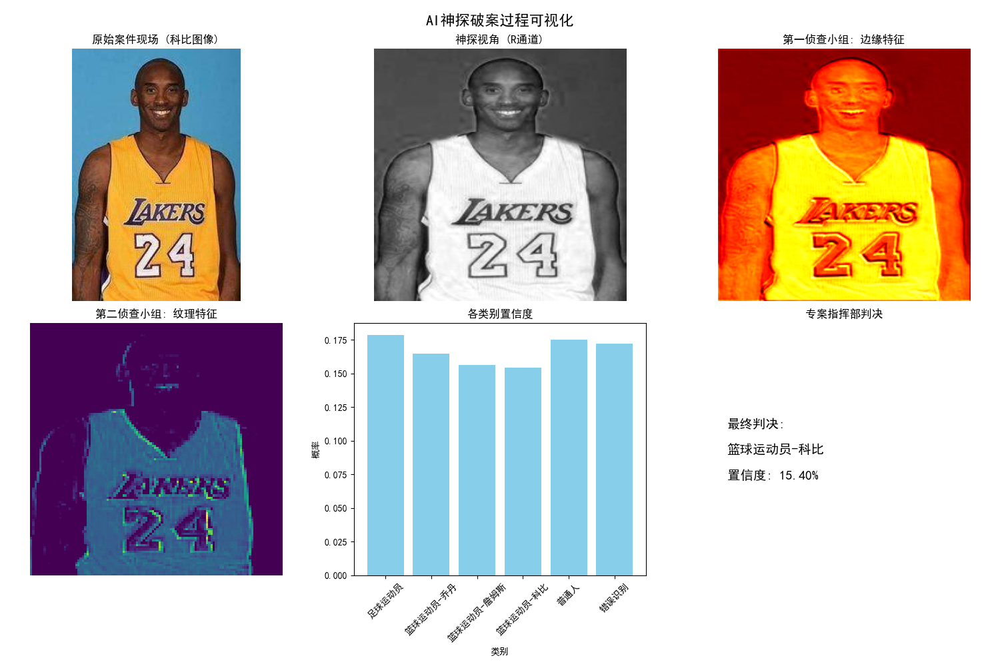
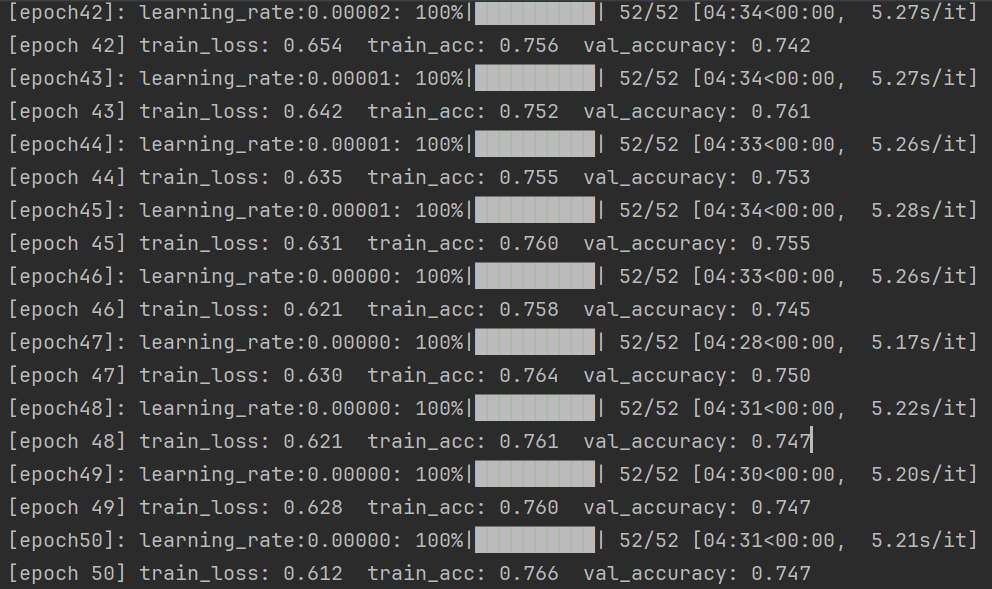
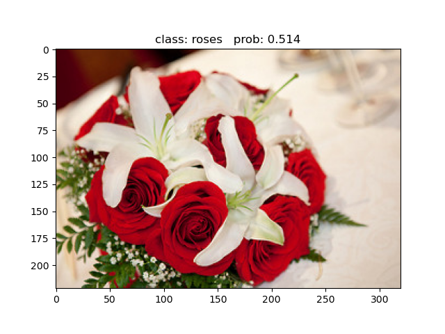

## 1 卷积神经网络CNN

### 1.1 简介与应用

        卷积神经网络（CNN）是一种深受生物视觉皮层启发而设计的深度学习模型，特别适合处理图像、语音等网格状数据。CNN通过卷积层、池化层和全连接层等组件，能够自动从原始像素中学习层次化的特征表示，从而完成图像分类、目标检测等任务。其核心思想是**局部感知**（每个神经元只响应局部区域）和**权值共享**（同一组权重在不同位置检测相同模式），这大幅减少了参数数量并增强了模型的泛化能力。

        想象一下，我们要打造一位“AI神探”，它的任务是从海量的监控视频中快速准确地找出嫌疑人。这位神探的破案过程分为三步：


1.  **现场勘察（卷积层）**：用不同的“特征放大镜”（卷积核）仔细查看每个局部区域，提取蛛丝马迹（如边缘、纹理、颜色等）。
    
2.  **线索整理（池化层）**：把勘察到的海量线索进行归纳摘要，去掉冗余细节，保留最核心的证据。
    
3.  **综合研判（全连接层）**：将所有关键线索汇总，进行综合推理判断，最终锁定嫌疑人。
    

这位AI神探的绝技在于：**一次只看一小块（局部感知）**，并且**用同一套标准审视全场（参数共享）**，这使得它既高效又准确。

* * *

环境配置

```python
import torch
import torch.nn as nn
import torch.nn.functional as F
import numpy as np

# 检查设备
device = torch.device("cuda" if torch.cuda.is_available() else "cpu")
print(f"AI神探将在 {device} 上展开调查！")
```

* * *

### 1.2  核心组件

#### 1.2.1 卷积层

> 卷积层是CNN的核心，由多个可学习的**卷积核** 构成。每个卷积核在输入数据上滑动，进行**卷积运算**以提取特定特征。输出结果是多个**特征图（Feature Map）**，每个图记录了原始输入中某种特征的强度和位置。

卷积层就像神探派出的多个**专项勘察小组**。每个小组配备一种独特的“特征放大镜”（卷积核）：

-   **小组A（竖线放大镜）**：专门探测门框、栅栏等竖直线条。
    
-   **小组B（横线放大镜）**：专门探测地平线、桌面等水平线条。
    
-   **小组C（斜线放大镜）**：专门探测屋顶、衣领等斜向特征。
    

每个小组用各自的放大镜**扫描（滑动）**​ 整个区域。扫描完成后，会生成一张“线索热力图”（特征图），图上亮度高的点，就代表该位置发现了其负责寻找的强烈特征。**参数共享**意味着，整个区域都使用**同一把**放大镜，保证了检测标准的一致性。

```python
class FeatureExtractor(nn.Module):
    """特征提取器 - AI神探的侦查小组"""

    def __init__(self):
        super(FeatureExtractor, self).__init__()

        # 第一侦查小组：提取低级特征（边缘、纹理）
        self.team1 = nn.Sequential(
            nn.Conv2d(3, 16, kernel_size=3, padding=1),  # 3通道RGB -> 16个特征图
            nn.ReLU(inplace=True),
            nn.MaxPool2d(2, 2)
        )

        # 第二侦查小组：提取中级特征（形状、部件）
        self.team2 = nn.Sequential(
            nn.Conv2d(16, 32, kernel_size=3, padding=1),
            nn.ReLU(inplace=True),
            nn.MaxPool2d(2, 2)
        )

        # 第三侦查小组：提取高级特征（完整对象）
        self.team3 = nn.Sequential(
            nn.Conv2d(32, 64, kernel_size=3, padding=1),
            nn.ReLU(inplace=True),
            nn.MaxPool2d(2, 2)
        )

    def forward(self, x):
        print(f"\n侦查小组开始工作...")

        # 第一小组勘察
        clues1 = self.team1(x)
        print(f"   第一小组报告: 发现 {clues1.size(1)} 种初级线索，线索图尺寸: {clues1.shape[2:]} (宽x高)")

        # 第二小组深入勘察
        clues2 = self.team2(clues1)
        print(f"   第二小组报告: 发现 {clues2.size(1)} 种中级线索，线索图尺寸: {clues2.shape[2:]}")

        # 第三小组高级勘察
        clues3 = self.team3(clues2)
        print(f"   第三小组报告: 发现 {clues3.size(1)} 种高级线索，线索图尺寸: {clues3.shape[2:]}")

        return clues3
```

* * *

#### 1.2.2 池化层

> 池化层（Pooling Layer）对特征图进行**下采样（Downsampling）**，主要目的是：
> 
> 1.  **减少数据量和计算复杂度**。
>     
> 2.  **保持特征的平移、旋转不变性**。
>     
> 3.  **突出最显著的特征响应**。
>     
> 
> 最常见的是**最大池化（Max Pooling）**，它在局部区域（如2x2）内只保留最大值。

池化层就是神探的**情报分析科**。勘察小组送来的线索图太详细了，包含大量冗余信息。分析科的工作就是**做摘要**：

-   他们把线索图分成多个小区域（如2x2的格子）。
    
-   对于每个小区域，只记录**最醒目、最确凿的那条线索**（最大值），忽略其他次要信息。
    
-   例如，一个2x2区域内的线索强度为`[0.9, 0.2, 0.8, 0.1]`，分析科只记录`0.9`。
    

这样做的好处是：报告体积大大缩小，只留下精华，使得后续的研判部能更专注于关键证据，而不会因为嫌疑人换了个站姿或光线稍有变化就做出误判。

```python
class CaseAnalyzer(nn.Module):
    """案件分析器 - AI神探的情报分析科"""

    def __init__(self, input_features, hidden_size=128):
        super(CaseAnalyzer, self).__init__()

        # 展平线索：将所有线索整理成档案
        self.flatten = nn.Flatten()

        # 分析团队：理解线索之间的关系
        self.analyst_team = nn.Sequential(
            nn.Linear(input_features, hidden_size),
            nn.ReLU(inplace=True),
            nn.Dropout(0.3),
            nn.Linear(hidden_size, hidden_size // 2),
            nn.ReLU(inplace=True),
        )

    def forward(self, x):
        print(f"\n 情报分析科开始整理线索...")

        # 展平所有线索
        flat_clues = self.flatten(x)
        print(f"   线索档案长度: {flat_clues.size(1)} 个关键点")

        # 分析线索
        analyzed = self.analyst_team(flat_clues)
        print(f"   分析完成，生成 {analyzed.size(1)} 条核心情报")

        return analyzed
```

* * *

#### 1.2.3 全连接层

> 全连接层（Fully Connected Layer）通常位于网络末端。它将前面所有卷积和池化层提取的**分布式局部特征**“综合”起来，映射到最终的样本标记空间（如分类类别）。每个神经元都与前一层的所有神经元相连，通过学习到的权重来组合特征，完成最终的分类或回归任务。

全连接层就是**专案指挥部**。当所有关键线索（经过卷积和池化后的高级特征）都汇总到这里后，指挥部的**专家团（神经元）**​ 开始工作：

1.  **线索汇总**：首先，所有二维的线索图会被展平成一个长清单（Flatten操作）。
    
2.  **专家会商**：每一位专家都会审视清单上的所有线索，并基于自己的专业知识（权重）给出一个综合判断分数。
    
3.  **民主决策**：多位专家的意见通过加权组合，传递到最终决策层。
    
4.  **最终裁决**：决策层（通常是Softmax函数）根据专家团的综合意见，计算出各种可能性（如“是嫌疑人A的概率为80%，是路人B的概率为15%...”），并做出最终裁决。
    

```python
class VerdictCommittee(nn.Module):
    """判决委员会 - AI神探的专案指挥部"""

    def __init__(self, input_size, num_classes):
        super(VerdictCommittee, self).__init__()

        # 专家团：综合所有情报做出判断
        self.expert_panel = nn.Sequential(
            nn.Linear(input_size, 64),
            nn.ReLU(inplace=True),
            nn.Dropout(0.2),
            nn.Linear(64, num_classes)
        )

        # 定义可能的嫌疑人类型
        self.suspect_classes = [
            "足球运动员",
            "篮球运动员-乔丹",
            "篮球运动员-詹姆斯",
            "篮球运动员-科比",
            "普通人",
            "错误识别"
        ]

    def forward(self, x):
        print(f"\n 专案指挥部召开专家会议...")

        # 专家讨论并投票
        raw_verdict = self.expert_panel(x)
        print(f"   专家团原始评分: {raw_verdict.tolist()}")

        # 计算概率分布（使用Softmax）
        probabilities = F.softmax(raw_verdict, dim=1)
        print(f"   标准化概率分布: {probabilities.tolist()}")

        # 做出最终判决
        final_decision = torch.argmax(probabilities, dim=1)

        return raw_verdict, probabilities, final_decision
```



* * *

### 1.3 激活函数与训练

> 激活函数（Activation Function）为神经网络引入了**非线性因素**。如果没有它，多层网络就等价于一个单层线性网络，无法学习复杂模式。**ReLU（Rectified Linear Unit）**​ 是CNN中最常用的激活函数，因其能有效缓解梯度消失问题且计算简单。
> 
> **训练过程**就是让“AI神探”通过大量案例（带标签的数据）自我学习和优化的过程，使用**反向传播算法**和**梯度下降优化器**来调整网络中的所有参数（卷积核权重、全连接层权重等），目标是让网络的预测结果与真实标签之间的**损失（Loss）**​ 最小化。

-   **激活函数是神探的“判断原则”**：以ReLU为例，它的原则是“**低于门槛的线索一律无视（输出0），高于门槛的才予以重视（原样输出）**”。这个简单的原则让神探的判断非常高效。
    
-   **训练是神探的“实习期”**：
    
    1.  给神探看一张已知答案的监控图片（训练样本）。
        
    2.  神探根据当前能力做出判断（前向传播）。
        
    3.  教练（优化算法）对比神探的判断和正确答案，计算出“失误程度”（损失函数）。
        
    4.  教练将失误原因反向传达给每一个勘察小组和指挥部专家，告诉他们应该如何调整各自的“放大镜”标准和“研判准则”（反向传播更新权重）。
        
    5.  经过成千上万张图片的反复练习，神探的破案能力（模型精度）越来越强。
        

```python
def training(model):

    # 切换到训练模式
    model.train()

    # 数据加载
    batch_size = 4
    data_load(simulated_images, simulated_labels)

    # 定义损失函数和优化器
    criterion = nn.CrossEntropyLoss()
    optimizer = torch.optim.Adam(model.parameters(), lr=0.001)

    # 训练周期
    for epoch in range(3):
        optimizer.zero_grad()  # 清零梯度

        # 前向传播
        raw_scores, _, _ = model(simulated_images)

        # 计算损失
        loss = criterion(raw_scores, simulated_labels)

        # 反向传播
        loss.backward()

        # 优化器更新参数
        optimizer.step()

        print(f"  训练周期 {epoch + 1}: 损失值 = {loss.item():.4f}")

    print(" 训练完成！")
    model.eval()  # 切换回评估模式
```

* * *

## 2\*基于CNN花朵识别

        我们通过上述简单了解了一下CNN的基本知识和内容，下面来完成一个比较复杂的案列进行学习。并将多个常用模型结合学习和使用。

### 2.1 任务目标

本项目的任务目标是：使用深度学习模型对花朵图像进行多分类。

| 项目 | 说明 |
| --- | --- |
| 任务类型 | 图像分类（Image Classification） |
| 分类类别 | 默认 5 类：daisy（雏菊）、dandelion（蒲公英）、roses（玫瑰）、sunflowers（向日葵）、tulips（郁金香） |
| 输入 | 单张 RGB 图像（训练/推理时统一缩放到 224×224） |
| 输出 | 类别标签 + 各类别概率（推理时） |
| 模型来源 | 从 `classic_models` 中选择一种网络（如 AlexNet、VGG、ResNet 等），替换最后一层为 `num_classes=5`，在花朵数据上训练 |

完成本任务需要经历：  
① 准备花朵数据集（按 train/val、每类一个文件夹组织）  
② 选择模型并训练（得到最佳权重 `.pth`）  
③ 使用训练好的权重对单张图片做推理，得到预测类别与概率

* * *

### 2.2 模型训练

        模型训练指：在花朵数据集上训练所选网络，得到在验证集上表现最好的权重文件，供后续推理使用。

简单训练脚本实现

```python
"""
train_sample.py —— 最简训练脚本

本文件实现「花朵五分类」的完整训练流程：加载数据 → 构建模型 → 逐 epoch 训练与验证 → 保存验证集上
准确率最高的权重。没有命令行参数，所有路径和超参数在代码里写死，适合初学者先跑通再改。

使用前请修改 data_path 为你的花朵数据集根目录（其下需有 train/ 和 val/ 子目录，每类一个文件夹）。
运行方式：python train_sample.py
"""

import os 
import sys
import json 
import torch
import torch.nn as nn
from torchvision import transforms, datasets 
import torch.optim as optim 
from tqdm import tqdm  
from classic_models.alexnet import AlexNet

def main():

    # 判断可用设备
    device = torch.device("cuda:0" if torch.cuda.is_available() else "cpu")
    print("using {} device.".format(device))

    data_path = '/dataload/flower'
    assert os.path.exists(data_path), "{} path does not exist.".format(data_path) 

    # 数据预处理与增强
    """ 
    ToTensor()能够把灰度范围从0-255变换到0-1之间的张量.
    transform.Normalize()则把0-1变换到(-1,1). 具体地说, 对每个通道而言, Normalize执行以下操作: image=(image-mean)/std
    其中mean和std分别通过(0.5,0.5,0.5)和(0.5,0.5,0.5)进行指定。原来的0-1最小值0则变成(0-0.5)/0.5=-1; 而最大值1则变成(1-0.5)/0.5=1. 
    也就是一个均值为0, 方差为1的正态分布. 这样的数据输入格式可以使神经网络更快收敛。
    """
    data_transform = {
        "train": transforms.Compose([transforms.Resize(224),
                                     transforms.CenterCrop(224),
                                     transforms.ToTensor(),
                                     transforms.Normalize((0.5, 0.5, 0.5), (0.5, 0.5, 0.5))]),

        "val": transforms.Compose([transforms.Resize((224, 224)),  # val不需要任何数据增强
                                   transforms.ToTensor(),
                                   transforms.Normalize((0.5, 0.5, 0.5), (0.5, 0.5, 0.5))])}


    # 使用ImageFlolder加载数据集中的图像，并使用指定的预处理操作来处理图像， ImageFlolder会同时返回图像和对应的标签。 (image path, class_index) tuples
    train_dataset = datasets.ImageFolder(root=os.path.join(data_path, "train"), transform=data_transform["train"])
    validate_dataset = datasets.ImageFolder(root=os.path.join(data_path, "val"), transform=data_transform["val"])
    train_num = len(train_dataset)
    val_num = len(validate_dataset)

    # 使用class_to_idx给类别一个index，作为训练时的标签： {'daisy':0, 'dandelion':1, 'roses':2, 'sunflower':3, 'tulips':4}
    flower_list = train_dataset.class_to_idx
    # 创建一个字典，存储index和类别的对应关系，在模型推理阶段会用到。
    cla_dict = dict((val, key) for key, val in flower_list.items())
    # 将字典写成一个json文件
    json_str = json.dumps(cla_dict, indent=4)
    with open( os.path.join(data_path, 'class_indices.json') , 'w') as json_file:
        json_file.write(json_str)

    # batch_size大小，是超参，可调，如果模型跑不起来，尝试调小batch_size
    batch_size = 64

    # 使用 DataLoader 将 ImageFloder 加载的数据集处理成批量（batch）加载模式
    train_loader = torch.utils.data.DataLoader(train_dataset, batch_size=batch_size, shuffle=True )
    validate_loader = torch.utils.data.DataLoader(validate_dataset, batch_size=4, shuffle=False ) # 注意，验证集不需要shuffle
    print("using {} images for training, {} images for validation.".format(train_num, val_num))
    
    # 实例化模型，并送进设备
    net = AlexNet(num_classes=5 )
    net.to(device)

    # 指定损失函数用于计算损失；指定优化器用于更新模型参数；指定训练迭代的轮数，训练权重的存储地址
    loss_function = nn.CrossEntropyLoss() # MSE
    optimizer = optim.Adam(net.parameters(), lr=0.0002)
    epochs = 70
    save_path = os.path.abspath(os.path.join(os.getcwd(), './results/weights/alexnet')) 
    if not os.path.exists(save_path):    
        os.makedirs(save_path)

    # 初始化验证集上最好的准确率，以便后面用该指标筛选模型最优参数。
    best_acc = 0.0
    for epoch in range(epochs):

        net.train() 
        acc_num = torch.zeros(1).to(device)    # 初始化，用于计算训练过程中预测正确的数量
        sample_num = 0                         # 初始化，用于记录当前迭代中，已经计算了多少个样本
        # tqdm是一个进度条显示器，可以在终端打印出现在的训练进度
        train_bar = tqdm(train_loader, file=sys.stdout, ncols=100)

        for data in train_bar :
            images, labels = data 
            sample_num += images.shape[0] #[64, 3, 224, 224]
            optimizer.zero_grad()
            outputs = net(images.to(device)) # output_shape: [batch_size, num_classes]
            pred_class = torch.max(outputs, dim=1)[1] # torch.max 返回值是一个tuple，第一个元素是max值，第二个元素是max值的索引。
            acc_num += torch.eq(pred_class, labels.to(device)).sum() 
            loss = loss_function(outputs, labels.to(device)) # 求损失
            loss.backward() # 自动求导
            optimizer.step() # 梯度下降

            # print statistics 
            train_acc = acc_num.item() / sample_num 
            # .desc是进度条tqdm中的成员变量，作用是描述信息
            train_bar.desc = "train epoch[{}/{}] loss:{:.3f}".format(epoch + 1,  epochs, loss)

        # validate
        net.eval()
        acc_num = 0.0  # accumulate accurate number per epoch
        with torch.no_grad(): 
            for val_data in validate_loader:
                val_images, val_labels = val_data
                outputs = net(val_images.to(device)) 
                predict_y = torch.max(outputs, dim=1)[1] 
                acc_num += torch.eq(predict_y, val_labels.to(device)).sum().item() 

        val_accurate = acc_num / val_num
        print('[epoch %d] train_loss: %.3f  train_acc: %.3f  val_accuracy: %.3f' %  (epoch + 1, loss, train_acc, val_accurate))   
        # 判断当前验证集的准确率是否是最大的，如果是，则更新之前保存的权重
        if val_accurate > best_acc:
            best_acc = val_accurate
            torch.save(net.state_dict(), os.path.join(save_path, "AlexNet.pth") )

        # 每次迭代后清空这些指标，重新计算 
        train_acc = 0.0
        val_accurate = 0.0

    print('Finished Training')

 
if __name__ == '__main__':
     main()
```

AlexNet

```python
"""
【文件说明】alexnet.py —— AlexNet 模型定义

经典 CNN 结构：5 层卷积 + 3 层全连接，输入 224×224 RGB，输出 num_classes 维 logits。
提供类 AlexNet 与工厂函数 alexnet(num_classes)，供训练/推理使用。
"""

import torch.nn as nn
import torch

class AlexNet(nn.Module):
    """AlexNet：卷积特征提取 + 全连接分类头。"""

    def __init__(self, num_classes=1000, init_weights=False):
        """
        传参:
            num_classes (int, 可选): 分类数，默认 1000（ImageNet）。
            init_weights (bool, 可选): 是否用 Kaiming/Normal 初始化权重，默认 False。

        返回值:
            无（构造器）。
        """
        super(AlexNet, self).__init__()
        self.features = nn.Sequential(
            nn.Conv2d(3, 96, kernel_size=11, stride=4, padding=2),  # input[3, 224, 224]  output[96, 55, 55]
            nn.ReLU(inplace=True),
            nn.MaxPool2d(kernel_size=3, stride=2),                  # output[96, 27, 27]

            nn.Conv2d(96, 256, kernel_size=5, padding=2),           # output[256, 27, 27]
            nn.ReLU(inplace=True),
            nn.MaxPool2d(kernel_size=3, stride=2),                  # output[256, 13, 13]

            nn.Conv2d(256, 384, kernel_size=3, padding=1),          # output[384, 13, 13]
            nn.ReLU(inplace=True),

            nn.Conv2d(384, 384, kernel_size=3, padding=1),          # output[384, 13, 13]
            nn.ReLU(inplace=True),

            nn.Conv2d(384, 256, kernel_size=3, padding=1),          # output[256, 13, 13]
            nn.ReLU(inplace=True),
            nn.MaxPool2d(kernel_size=3, stride=2),                  # output[256, 6, 6]
        )
        self.classifier = nn.Sequential(
            nn.Dropout(p=0.5),
            nn.Linear(256 * 6 * 6, 4096),
            nn.ReLU(inplace=True),

            nn.Dropout(p=0.5),
            nn.Linear(4096, 4096),
            nn.ReLU(inplace=True),
            
            nn.Linear(4096, num_classes),
        )
        if init_weights:
            self._initialize_weights()

    def forward(self, x):
        """
        传参:
            x (torch.Tensor): 输入图像，形状 (N, 3, 224, 224)。

        返回值:
            torch.Tensor: logits，形状 (N, num_classes)。
        """
        x = self.features(x)
        x = torch.flatten(x, start_dim=1)
        x = self.classifier(x)
        return x

    def _initialize_weights(self):
        for m in self.modules():
            if isinstance(m, nn.Conv2d):
                nn.init.kaiming_normal_(m.weight, mode='fan_out', nonlinearity='relu')
                if m.bias is not None:
                    nn.init.constant_(m.bias, 0)
            elif isinstance(m, nn.Linear):
                nn.init.normal_(m.weight, 0, 0.01)
                nn.init.constant_(m.bias, 0)

def alexnet(num_classes):
    """
    工厂函数：构造 AlexNet 模型。

    传参:
        num_classes (int): 分类类别数。

    返回值:
        AlexNet: 已实例化的模型。
    """
    model = AlexNet(num_classes=num_classes)
    return model
```

优化训练实现

```python

############################################################################################################
# 相较于简单版本的训练脚本 train_sample 增添了以下功能：
# 1. 使用argparse类实现可以在训练的启动命令中指定超参数
# 2. 可以通过在启动命令中指定 --seed 来固定网络的初始化方式，以达到结果可复现的效果
# 3. 使用了更高级的学习策略 cosine warm up：在训练的第一轮使用一个较小的lr（warm_up），从第二个epoch开始，随训练轮数逐渐减小lr。 
# 4. 可以通过在启动命令中指定 --model 来选择使用的模型 
# 5. 使用amp包实现半精度训练，在保证准确率的同时尽可能的减小训练成本
# 6. 实现了数据加载类的自定义实现
# 7. 可以通过在启动命令中指定 --tensorboard 来进行tensorboard可视化, 默认不启用。
#    注意，使用tensorboad之前需要使用命令 "tensorboard --logdir= log_path"来启动，结果通过网页 http://localhost:6006/'查看可视化结果
############################################################################################################
import os 
import argparse 
import math 
import random
import numpy as np
import torch
import torch.optim as optim
from torchvision import transforms
import torch.optim.lr_scheduler as lr_scheduler 

import classic_models 
from utils.lr_methods import warmup 
from dataload.dataload_five_flower import Five_Flowers_Load
from utils.train_engin import train_one_epoch, evaluate 

parser = argparse.ArgumentParser()
parser.add_argument('--num_classes', type=int, default=5, help='the number of classes')
parser.add_argument('--epochs', type=int, default=50, help='the number of training epoch')
parser.add_argument('--batch_size', type=int, default=64, help='batch_size for training')
parser.add_argument('--lr', type=float, default=0.0002, help='star learning rate')
parser.add_argument('--lrf', type=float, default=0.0001, help='end learning rate') 
parser.add_argument('--seed', default=False, action='store_true', help='fix the initialization of parameters') 
parser.add_argument('--use_amp', default=False, action='store_true', help=' training with mixed precision') 
parser.add_argument('--data_path', type=str, default="/mnt/d/Datasets/flower")
parser.add_argument('--model', type=str, default="vgg", help=' select a model for training') 
parser.add_argument('--device', default='cuda', help='device id (i.e. 0 or 0,1 or cpu)')

opt = parser.parse_args()  

if opt.seed:
    def seed_torch(seed=7):
        random.seed(seed) # Python random module.	
        os.environ['PYTHONHASHSEED'] = str(seed) # 为了禁止hash随机化，使得实验可复现
        np.random.seed(seed) # Numpy module.
        torch.manual_seed(seed)  # 为CPU设置随机种子
        torch.cuda.manual_seed(seed) # 为当前GPU设置随机种子
        torch.cuda.manual_seed_all(seed) # if you are using multi-GPU.
        # 设置cuDNN：cudnn中对卷积操作进行了优化，牺牲了精度来换取计算效率。如果需要保证可重复性，可以使用如下设置:
        # torch.backends.cudnn.benchmark = False
        # torch.backends.cudnn.deterministic = True
        # 实际上这个设置对精度影响不大，仅仅是小数点后几位的差别。所以如果不是对精度要求极高，其实不太建议修改，因为会使计算效率降低。
        print('random seed has been fixed')
    seed_torch() 

def main(args):
    """
    主函数：根据命令行参数完成训练（数据加载、模型构建、train_one_epoch + evaluate、保存最佳权重）。

    传参:
        args: 解析后的命令行参数对象。常用属性：num_classes, epochs, batch_size, lr, lrf, data_path,
              model, device, use_amp, seed 等。

    返回值:
        无。最佳权重保存到 results/weights/<args.model>/AlexNet.pth，日志追加到同目录 AlexNet_log.txt。
    """
    device = torch.device(args.device if torch.cuda.is_available() else "cpu")
    print(args)
 

    data_transform = {
        "train": transforms.Compose([transforms.RandomResizedCrop(224),
                                     transforms.RandomHorizontalFlip(),
                                     transforms.ToTensor(),
                                     transforms.Normalize([0.485, 0.456, 0.406], [0.229, 0.224, 0.225])]),
        "val": transforms.Compose([transforms.Resize(256),
                                   transforms.CenterCrop(224),
                                   transforms.ToTensor(),
                                   transforms.Normalize([0.485, 0.456, 0.406], [0.229, 0.224, 0.225])])} 
 
    # 对标pytorch封装好的ImageFlolder，我们自己实现了一个数据加载类 Five_Flowers_Load，并使用指定的预处理操作来处理图像，结果会同时返回图像和对应的标签。  
    train_dataset = Five_Flowers_Load(os.path.join(args.data_path , 'train'), transform=data_transform["train"])
    val_dataset = Five_Flowers_Load(os.path.join(args.data_path , 'val'), transform=data_transform["val"]) 
 
    if args.num_classes != train_dataset.num_class:
        raise ValueError("dataset have {} classes, but input {}".format(train_dataset.num_class, args.num_classes))
 
    nw = min([os.cpu_count(), args.batch_size if args.batch_size > 1 else 0, 8])  # number of workers
    print('Using {} dataloader workers every process'.format(nw))

    # 使用 DataLoader 将加载的数据集处理成批量（batch）加载模式
    train_loader = torch.utils.data.DataLoader(train_dataset, batch_size=args.batch_size, shuffle=True, pin_memory=True, num_workers=nw, collate_fn=train_dataset.collate_fn)
    val_loader = torch.utils.data.DataLoader(val_dataset, batch_size=args.batch_size, shuffle=False, pin_memory=True,  num_workers=nw, collate_fn=val_dataset.collate_fn)
 
    # create model
    model = classic_models.find_model_using_name(opt.model, num_classes=opt.num_classes).to(device) 

    pg = [p for p in model.parameters() if p.requires_grad] 
    optimizer = optim.Adam(pg, lr=args.lr)

    # Scheduler https://arxiv.org/pdf/1812.01187.pdf
    lf = lambda x: ((1 + math.cos(x * math.pi / args.epochs)) / 2) * (1 - args.lrf) + args.lrf  # cosine
    scheduler = lr_scheduler.LambdaLR(optimizer, lr_lambda=lf)
    best_acc = 0.
    
    # save parameters path
    save_path = os.path.join(os.getcwd(), 'results/weights', args.model)
    if os.path.exists(save_path) is False:
        os.makedirs(save_path)

    for epoch in range(args.epochs):
        # train
        mean_loss, train_acc = train_one_epoch(model=model, optimizer=optimizer, data_loader=train_loader, device=device, epoch=epoch, use_amp=args.use_amp, lr_method= warmup)
        scheduler.step()
        # validate
        val_acc = evaluate(model=model, data_loader=val_loader, device=device)

 
        print('[epoch %d] train_loss: %.3f  train_acc: %.3f  val_accuracy: %.3f' %  (epoch + 1, mean_loss, train_acc, val_acc))   
        with open(os.path.join(save_path, "AlexNet_log.txt"), 'a') as f: 
                f.writelines('[epoch %d] train_loss: %.3f  train_acc: %.3f  val_accuracy: %.3f' %  (epoch + 1, mean_loss, train_acc, val_acc) + '\n')
 

        # 判断当前验证集的准确率是否是最大的，如果是，则更新之前保存的权重
        if val_acc > best_acc:
            best_acc = val_acc
            torch.save(model.state_dict(), os.path.join(save_path, "AlexNet.pth")) 

        
if __name__ == '__main__':         
    main(opt)

```

输出分析



* * *

### 2.3 模型推理

```python
"""
【文件说明】test.py —— 推理脚本（用训练好的模型预测单张图片）

本文件实现：加载一张图片 → 做与训练时一致的预处理 → 加载模型权重 → 前向推理得到各类别概率 →
在窗口显示原图并打印类别与概率。运行前需在代码中修改：图片路径 img_path、类别索引文件 json_path、
权重路径 weights_path。

运行方式：python test.py
"""

import os
import json

import torch
from PIL import Image
from torchvision import transforms
import matplotlib.pyplot as plt

from classic_models.alexnet import AlexNet 

def main():
    """
    主函数：加载一张图片和训练好的模型，输出预测类别与概率，并弹窗显示图片和标题。

    传参:
        无。需在函数内修改 img_path、json_path、weights_path 为你的路径。

    返回值:
        无。会打印各类别概率，并调用 plt.show() 显示带预测结果的图片。
    """
    device = torch.device("cuda:0" if torch.cuda.is_available() else "cpu")

    data_transform = transforms.Compose(
        [transforms.Resize((224, 224)),
         transforms.ToTensor(),
         transforms.Normalize((0.5, 0.5, 0.5), (0.5, 0.5, 0.5))])

    # load image
    img_path = "/data/haowen_yu/code/dataset/flowers/val/daisy/3640845041_80a92c4205_n.jpg"
    assert os.path.exists(img_path), "file: '{}' dose not exist.".format(img_path)
    img = Image.open(img_path)

    plt.imshow(img)
    # [N, C, H, W]
    img = data_transform(img)
    # expand batch dimension
    img = torch.unsqueeze(img, dim=0)

    # read class_indict
    json_path = '/data/haowen_yu/code/dataset/flowers/class_indices.json'
    assert os.path.exists(json_path), "file: '{}' dose not exist.".format(json_path)

    json_file = open(json_path, "r")
    class_indict = json.load(json_file)

    # create model
    model = AlexNet(num_classes=5).to(device)

    # load model weights
    weights_path = "/data/haowen_yu/code/results/weights/alexnet/AlexNet.pth"
    assert os.path.exists(weights_path), "file: '{}' dose not exist.".format(weights_path)
    model.load_state_dict(torch.load(weights_path))

    model.eval()
    with torch.no_grad():
        # predict class
        output = torch.squeeze(model(img.to(device))).cpu()
        predict = torch.softmax(output, dim=0)
        predict_cla = torch.argmax(predict).numpy()

    print_res = "class: {}   prob: {:.3}".format(class_indict[str(predict_cla)],
                                                 predict[predict_cla].numpy())
    plt.title(print_res)
    for i in range(len(predict)):
        print("class: {:10}   prob: {:.3}".format(class_indict[str(i)],
                                                  predict[i].numpy()))
    plt.show()


if __name__ == '__main__':
    main()
```



* * *

### 2.4 模型介绍

#### 2.4.1 DLA

```python
"""
【文件说明】dla.py —— DLA (Deep Layer Aggregation) 模型

支持层级聚合的骨干网络。对外接口：dla34(num_classes, **kwargs)。
"""

import math  
import torch
from torch import nn  

class BasicBlock(nn.Module):
    def __init__(self, inplanes, planes, stride=1 ):
        super(BasicBlock, self).__init__()
        self.conv1 = nn.Conv2d(inplanes, planes, kernel_size=3,  stride=stride, padding=1,  bias=False )
        self.bn1 = nn.BatchNorm2d(planes)
        self.relu = nn.ReLU(inplace=True)
        self.conv2 = nn.Conv2d(planes, planes, kernel_size=3, stride=1, padding=1, bias=False)
        self.bn2 = nn.BatchNorm2d(planes)
        self.stride = stride

    def forward(self, x, residual=None):
        if residual is None:
            residual = x 
        out = self.conv1(x) 
        out = self.bn1(out)
        out = self.relu(out) 
        out = self.conv2(out)
        out = self.bn2(out)

        out += residual
        out = self.relu(out)

        return out
 
class Root(nn.Module):
    def __init__(self, in_channels, out_channels, kernel_size, residual):
        super(Root, self).__init__()
        self.conv = nn.Conv2d( in_channels, out_channels, kernel_size, stride=1, bias=False, padding=(kernel_size - 1) // 2)
        self.bn = nn.BatchNorm2d(out_channels)
        self.relu = nn.ReLU(inplace=True)
        self.residual = residual

    def forward(self, *x):
        children = x
        x = self.conv(torch.cat(x, 1))
        x = self.bn(x)
        if self.residual:
            x += children[0]
        x = self.relu(x)

        return x


class Tree(nn.Module):
    def __init__(self, levels, block, in_channels, out_channels, stride=1,
                 level_root=False, root_dim=0, root_kernel_size=1,  root_residual=False):
        super(Tree, self).__init__()

        self.level_root = level_root
        self.levels = levels
        self.root_dim = root_dim
        self.downsample = None
        self.project = None


        if root_dim == 0:
            root_dim = 2 * out_channels

        if level_root:
            root_dim += in_channels

        if levels == 1:
            self.tree1 = block(in_channels, out_channels, stride)
            self.tree2 = block(out_channels, out_channels, stride=1)
            self.root = Root(root_dim, out_channels, root_kernel_size,  root_residual)
        else:
            self.tree1 = Tree(levels - 1, block, in_channels, out_channels, stride, 
                              root_dim=0, 
                              root_kernel_size=root_kernel_size, 
                              root_residual=root_residual)
            self.tree2 = Tree(levels - 1, block, out_channels, out_channels,
                              root_dim=root_dim + out_channels,
                              root_kernel_size=root_kernel_size, 
                              root_residual=root_residual)
        if stride > 1:
            self.downsample = nn.MaxPool2d(stride, stride=stride)

        if in_channels != out_channels:
            self.project = nn.Sequential(
                nn.Conv2d(in_channels, out_channels, kernel_size=1, stride=1, bias=False),
                nn.BatchNorm2d(out_channels)
            )

    def forward(self, x, residual=None, children=None):
        children = [] if children is None else children
        bottom = self.downsample(x) if self.downsample else x
        residual = self.project(bottom) if self.project else bottom

        if self.level_root:
            children.append(bottom)

        x1 = self.tree1(x, residual)

        if self.levels == 1:
            x2 = self.tree2(x1)
            out = self.root(x2, x1, *children)
        else:
            children.append(x1)
            out = self.tree2(x1, children=children)
        return out


class DLA(nn.Module):
    def __init__(self, layers, channels, num_classes=1000, block=BasicBlock, residual_root=False, pool_size=7 ):
        super().__init__()
        self.channels = channels 
        self.num_classes = num_classes

        self.patchfy_stem = nn.Sequential(
            nn.Conv2d(3, channels[0], kernel_size=7, stride=1, padding=3, bias=False),
            nn.BatchNorm2d(channels[0]),
            nn.ReLU(inplace=True))

        self.stage_0 = self._make_conv_level(channels[0], channels[0], layers[0])

        self.stage_1 = self._make_conv_level(channels[0], channels[1], layers[1], stride=2)

        self.stage_2 = Tree(layers[2], block, channels[1], channels[2], stride=2,
                           level_root=False, root_residual=residual_root)
        self.stage_3 = Tree(layers[3], block, channels[2], channels[3], stride=2,
                           level_root=True, root_residual=residual_root)
        self.stage_4 = Tree(layers[4], block, channels[3], channels[4], stride=2,
                           level_root=True, root_residual=residual_root)
        self.stage_5 = Tree(layers[5], block, channels[4], channels[5], stride=2,
                           level_root=True, root_residual=residual_root)

        self.avgpool = nn.AvgPool2d(pool_size)
        self.fc = nn.Conv2d(channels[-1], num_classes, kernel_size=1, stride=1, padding=0, bias=True)

        for m in self.modules():
            if isinstance(m, nn.Conv2d):
                n = m.kernel_size[0] * m.kernel_size[1] * m.out_channels
                m.weight.data.normal_(0, math.sqrt(2. / n))
            elif isinstance(m, nn.BatchNorm2d):
                m.weight.data.fill_(1)
                m.bias.data.zero_()
 

    def _make_conv_level(self, inplanes, planes, num_layers, stride=1 ):
        modules = []
        for i in range(num_layers):
            modules.extend([
                nn.Conv2d(inplanes, planes, kernel_size=3,
                          stride=stride if i == 0 else 1,
                          padding=1, bias=False ),
                nn.BatchNorm2d(planes),
                nn.ReLU(inplace=True)])
            inplanes = planes
        return nn.Sequential(*modules)

    def forward(self, x):
        stages_features_list = []
        x = self.patchfy_stem(x)
        for i in range(6):
            x = getattr(self, 'stage_{}'.format(i))(x)
            stages_features_list.append(x) 
            
        x = self.avgpool(x)
        x = self.fc(x)
        x = x.view(x.size(0), -1)
        
        return x
 

def dla34(num_classes, **kwargs):
    """传参: num_classes (int), **kwargs 可选。返回值: DLA 模型实例。"""
    model = DLA(layers=[1, 1, 1, 2, 2, 1],
                channels=[16, 32, 64, 128, 256, 512],
                block=BasicBlock, num_classes=num_classes, **kwargs)
 
    return model

# net = dla34(5)
# summary(net.to('cuda'), (3, 224,224))
```

#### 2.4.2 RESNET

```python
"""
【文件说明】resnet.py —— ResNet / ResNeXt 系列模型

包含 BasicBlock、Bottleneck、ResNet 及工厂函数：resnet34、resnet50、resnet101、
resnext50_32x4d、resnext101_32x8d。输入 224×224，输出 num_classes 维 logits。
"""

import torch.nn as nn
import torch


class BasicBlock(nn.Module):
    expansion = 1

    def __init__(self, in_channel, out_channel, stride=1, downsample=None, **kwargs):
        super(BasicBlock, self).__init__()
        self.conv1 = nn.Conv2d(in_channels=in_channel, out_channels=out_channel, kernel_size=3, stride=stride, padding=1, bias=False)
        self.bn1 = nn.BatchNorm2d(out_channel)
        self.relu = nn.ReLU()
        self.conv2 = nn.Conv2d(in_channels=out_channel, out_channels=out_channel, kernel_size=3, stride=1, padding=1, bias=False)
        self.bn2 = nn.BatchNorm2d(out_channel)
        self.downsample = downsample

    def forward(self, x):
        identity = x
        if self.downsample is not None:
            identity = self.downsample(x)

        out = self.conv1(x)
        out = self.bn1(out)
        out = self.relu(out)

        out = self.conv2(out)
        out = self.bn2(out)

        out += identity
        out = self.relu(out)

        return out


class Bottleneck(nn.Module):
    """
    注意:原论文中,在虚线残差结构的主分支上,第一个1x1卷积层的步距是2,第二个3x3卷积层步距是1。
    但在pytorch官方实现过程中是第一个1x1卷积层的步距是1,第二个3x3卷积层步距是2,
    这么做的好处是能够在top1上提升大概0.5%的准确率。
    可参考Resnet v1.5 https://ngc.nvidia.com/catalog/model-scripts/nvidia:resnet_50_v1_5_for_pytorch
    """
    expansion = 4

    def __init__(self, in_channel, out_channel, stride=1, downsample=None,
                 groups=1, width_per_group=64):
        super(Bottleneck, self).__init__()

        width = int(out_channel * (width_per_group / 64.)) * groups

        self.conv1 = nn.Conv2d(in_channels=in_channel, out_channels=width,  kernel_size=1, stride=1, bias=False)  # squeeze channels
        self.bn1 = nn.BatchNorm2d(width)
        # -----------------------------------------
        self.conv2 = nn.Conv2d(in_channels=width, out_channels=width, groups=groups, kernel_size=3, stride=stride, bias=False, padding=1)
        self.bn2 = nn.BatchNorm2d(width)
        # -----------------------------------------
        self.conv3 = nn.Conv2d(in_channels=width, out_channels=out_channel*self.expansion, kernel_size=1, stride=1, bias=False)  # unsqueeze channels
        self.bn3 = nn.BatchNorm2d(out_channel*self.expansion)
        self.relu = nn.ReLU(inplace=True)
        self.downsample = downsample

    def forward(self, x):
        identity = x
        if self.downsample is not None:
            identity = self.downsample(x)

        out = self.conv1(x)
        out = self.bn1(out)
        out = self.relu(out)

        out = self.conv2(out)
        out = self.bn2(out)
        out = self.relu(out)

        out = self.conv3(out)
        out = self.bn3(out)

        out += identity
        out = self.relu(out)

        return out


class ResNet(nn.Module):

    def __init__(self,
                 block,
                 blocks_num,
                 num_classes=1000,
                 include_top=True,
                 groups=1,
                 width_per_group=64):
        super(ResNet, self).__init__()
        self.include_top = include_top
        self.in_channel = 64

        self.groups = groups
        self.width_per_group = width_per_group

        self.conv1 = nn.Conv2d(3, self.in_channel, kernel_size=7, stride=2,  padding=3, bias=False)
        self.bn1 = nn.BatchNorm2d(self.in_channel)
        self.relu = nn.ReLU(inplace=True)
        self.maxpool = nn.MaxPool2d(kernel_size=3, stride=2, padding=1)
        self.layer1 = self._make_layer(block, 64, blocks_num[0])
        self.layer2 = self._make_layer(block, 128, blocks_num[1], stride=2)
        self.layer3 = self._make_layer(block, 256, blocks_num[2], stride=2)
        self.layer4 = self._make_layer(block, 512, blocks_num[3], stride=2)
        if self.include_top:
            self.avgpool = nn.AdaptiveAvgPool2d((1, 1))  # output size = (1, 1)
            self.fc = nn.Linear(512 * block.expansion, num_classes)

        for m in self.modules():
            if isinstance(m, nn.Conv2d):
                nn.init.kaiming_normal_(m.weight, mode='fan_out', nonlinearity='relu')

    def _make_layer(self, block, channel, block_num, stride=1):
        downsample = None
        if stride != 1 or self.in_channel != channel * block.expansion:
            downsample = nn.Sequential(
                nn.Conv2d(self.in_channel, channel * block.expansion, kernel_size=1, stride=stride, bias=False),
                nn.BatchNorm2d(channel * block.expansion))

        layers = []
        layers.append(block(self.in_channel,
                            channel,
                            downsample=downsample,
                            stride=stride,
                            groups=self.groups,
                            width_per_group=self.width_per_group))
        self.in_channel = channel * block.expansion

        for _ in range(1, block_num):
            layers.append(block(self.in_channel,
                                channel,
                                groups=self.groups,
                                width_per_group=self.width_per_group))

        return nn.Sequential(*layers)

    def forward(self, x):
        x = self.conv1(x)
        x = self.bn1(x)
        x = self.relu(x)
        x = self.maxpool(x)

        x = self.layer1(x)
        x = self.layer2(x)
        x = self.layer3(x)
        x = self.layer4(x)

        if self.include_top:
            x = self.avgpool(x)
            x = torch.flatten(x, 1)
            x = self.fc(x)

        return x

# # resnet34  pre-train parameters https://download.pytorch.org/models/resnet34-333f7ec4.pth
# def resnet_samll(num_classes=1000, include_top=True):
   
#     return ResNet(BasicBlock, [3, 4, 6, 3], num_classes=num_classes, include_top=include_top)

# # resnet50  pre-train parameters https://download.pytorch.org/models/resnet50-19c8e357.pth
# def resnet(num_classes=1000, include_top=True): 
#     return ResNet(Bottleneck, [3, 4, 6, 3], num_classes=num_classes, include_top=include_top)

# # resnet101 pre-train parameters https://download.pytorch.org/models/resnet101-5d3b4d8f.pth
# def resnet_big(num_classes=1000, include_top=True):
#     return ResNet(Bottleneck, [3, 4, 23, 3], num_classes=num_classes, include_top=include_top)

# # resneXt pre-train parameters https://download.pytorch.org/models/resnext50_32x4d-7cdf4587.pth
# def resnext(num_classes=1000, include_top=True): 
#     groups = 32
#     width_per_group = 4
#     return ResNet(Bottleneck, [3, 4, 6, 3],
#                   num_classes=num_classes,
#                   include_top=include_top,
#                   groups=groups,
#                   width_per_group=width_per_group)

# # resneXt_big pre-train parameters https://download.pytorch.org/models/resnext101_32x8d-8ba56ff5.pth
# def resnext_big(num_classes=1000, include_top=True): 
#     groups = 32
#     width_per_group = 8
#     return ResNet(Bottleneck, [3, 4, 23, 3],
#                   num_classes=num_classes,
#                   include_top=include_top,
#                   groups=groups,
#                   width_per_group=width_per_group)

def resnet34(num_classes=1000, include_top=True):
    """传参: num_classes (int), include_top (bool)。返回值: ResNet 模型实例。"""
    return ResNet(BasicBlock, [3, 4, 6, 3], num_classes=num_classes, include_top=include_top)


def resnet50(num_classes=1000, include_top=True):
    """传参: num_classes (int), include_top (bool)。返回值: ResNet 模型实例。"""
    return ResNet(Bottleneck, [3, 4, 6, 3], num_classes=num_classes, include_top=include_top)


def resnet101(num_classes=1000, include_top=True):
    """传参: num_classes (int), include_top (bool)。返回值: ResNet 模型实例。"""
    return ResNet(Bottleneck, [3, 4, 23, 3], num_classes=num_classes, include_top=include_top)


def resnext50_32x4d(num_classes=1000, include_top=True):
    """传参: num_classes (int), include_top (bool)。返回值: ResNet 模型实例。"""
    groups = 32
    width_per_group = 4
    return ResNet(Bottleneck, [3, 4, 6, 3],
                  num_classes=num_classes,
                  include_top=include_top,
                  groups=groups,
                  width_per_group=width_per_group)


def resnext101_32x8d(num_classes=1000, include_top=True):
    """传参: num_classes (int), include_top (bool)。返回值: ResNet 模型实例。"""
    groups = 32
    width_per_group = 8
    return ResNet(Bottleneck, [3, 4, 23, 3],
                  num_classes=num_classes,
                  include_top=include_top,
                  groups=groups,
                  width_per_group=width_per_group)
```

#### 2.4.3 VAN

```python
import torch
import torch.nn as nn
import torch.nn.functional as F
from functools import partial

from timm.models.layers import DropPath, to_2tuple, trunc_normal_ 
import math

class DWConv(nn.Module):
    def __init__(self, dim=768):
        super(DWConv, self).__init__()
        self.dwconv = nn.Conv2d(dim, dim, 3, 1, 1, bias=True, groups=dim)

    def forward(self, x):
        x = self.dwconv(x)
        return x

class Mlp(nn.Module):
    def __init__(self, in_features, hidden_features=None, out_features=None, act_layer=nn.GELU, drop=0.):
        super().__init__()
        out_features = out_features or in_features
        hidden_features = hidden_features or in_features
        self.fc1 = nn.Conv2d(in_features, hidden_features, 1)
        self.dwconv = DWConv(hidden_features)
        self.act = act_layer()
        self.fc2 = nn.Conv2d(hidden_features, out_features, 1)
        self.drop = nn.Dropout(drop)
        self.apply(self._init_weights)

    def _init_weights(self, m):
        if isinstance(m, nn.Linear):
            trunc_normal_(m.weight, std=.02)
            if isinstance(m, nn.Linear) and m.bias is not None:
                nn.init.constant_(m.bias, 0)
        elif isinstance(m, nn.LayerNorm):
            nn.init.constant_(m.bias, 0)
            nn.init.constant_(m.weight, 1.0)
        elif isinstance(m, nn.Conv2d):
            fan_out = m.kernel_size[0] * m.kernel_size[1] * m.out_channels
            fan_out //= m.groups
            m.weight.data.normal_(0, math.sqrt(2.0 / fan_out))
            if m.bias is not None:
                m.bias.data.zero_()

    def forward(self, x):
        x = self.fc1(x)
        x = self.dwconv(x)
        x = self.act(x)
        x = self.drop(x)
        x = self.fc2(x)
        x = self.drop(x)
        return x
 

class LKA(nn.Module):
    def __init__(self, dim):
        super().__init__()
        self.conv0 = nn.Conv2d(dim, dim, 5, padding=2, groups=dim)
        self.conv_spatial = nn.Conv2d(dim, dim, 7, stride=1, padding=9, groups=dim, dilation=3)
        self.conv1 = nn.Conv2d(dim, dim, 1)


    def forward(self, x):
        u = x.clone()        
        attn = self.conv0(x)
        attn = self.conv_spatial(attn)
        attn = self.conv1(attn)

        return u * attn
 
class Attention(nn.Module):
    def __init__(self, d_model):
        super().__init__()

        self.proj_1 = nn.Conv2d(d_model, d_model, 1)
        self.activation = nn.GELU()
        self.spatial_gating_unit = LKA(d_model)
        self.proj_2 = nn.Conv2d(d_model, d_model, 1)

    def forward(self, x):
        shorcut = x.clone()
        x = self.proj_1(x)
        x = self.activation(x)
        x = self.spatial_gating_unit(x)
        x = self.proj_2(x)
        x = x + shorcut
        return x
 
class Block(nn.Module):
    def __init__(self, dim, mlp_ratio=4., drop=0.,drop_path=0., act_layer=nn.GELU):
        super().__init__()
        self.norm1 = nn.BatchNorm2d(dim)
        self.attn = Attention(dim)
        self.drop_path = DropPath(drop_path) if drop_path > 0. else nn.Identity()

        self.norm2 = nn.BatchNorm2d(dim)
        mlp_hidden_dim = int(dim * mlp_ratio)
        self.mlp = Mlp(in_features=dim, hidden_features=mlp_hidden_dim, act_layer=act_layer, drop=drop)
        layer_scale_init_value = 1e-2            
        self.layer_scale_1 = nn.Parameter(
            layer_scale_init_value * torch.ones((dim)), requires_grad=True)
        self.layer_scale_2 = nn.Parameter(
            layer_scale_init_value * torch.ones((dim)), requires_grad=True) 
        self.apply(self._init_weights)

    def _init_weights(self, m):
        if isinstance(m, nn.Linear):
            trunc_normal_(m.weight, std=.02)
            if isinstance(m, nn.Linear) and m.bias is not None:
                nn.init.constant_(m.bias, 0)
        elif isinstance(m, nn.LayerNorm):
            nn.init.constant_(m.bias, 0)
            nn.init.constant_(m.weight, 1.0)
        elif isinstance(m, nn.Conv2d):
            fan_out = m.kernel_size[0] * m.kernel_size[1] * m.out_channels
            fan_out //= m.groups
            m.weight.data.normal_(0, math.sqrt(2.0 / fan_out))
            if m.bias is not None:
                m.bias.data.zero_()

    def forward(self, x):
        x = x + self.drop_path(self.layer_scale_1.unsqueeze(-1).unsqueeze(-1) * self.attn(self.norm1(x)))
        x = x + self.drop_path(self.layer_scale_2.unsqueeze(-1).unsqueeze(-1) * self.mlp(self.norm2(x)))
        return x


class OverlapPatchEmbed(nn.Module):
    """ Image to Patch Embedding
    """ 
    def __init__(self, img_size=224, patch_size=7, stride=4, in_chans=3, embed_dim=768):
        super().__init__()
        patch_size = to_2tuple(patch_size)
        self.proj = nn.Conv2d(in_chans, embed_dim, kernel_size=patch_size, stride=stride,
                              padding=(patch_size[0] // 2, patch_size[1] // 2))
        self.norm = nn.BatchNorm2d(embed_dim)

        self.apply(self._init_weights)

    def _init_weights(self, m):
        if isinstance(m, nn.Linear):
            trunc_normal_(m.weight, std=.02)
            if isinstance(m, nn.Linear) and m.bias is not None:
                nn.init.constant_(m.bias, 0)
        elif isinstance(m, nn.LayerNorm):
            nn.init.constant_(m.bias, 0)
            nn.init.constant_(m.weight, 1.0)
        elif isinstance(m, nn.Conv2d):
            fan_out = m.kernel_size[0] * m.kernel_size[1] * m.out_channels
            fan_out //= m.groups
            m.weight.data.normal_(0, math.sqrt(2.0 / fan_out))
            if m.bias is not None:
                m.bias.data.zero_()

    def forward(self, x):
        x = self.proj(x)
        _, _, H, W = x.shape
        x = self.norm(x)        
        return x, H, W


class VAN(nn.Module):
    def __init__(self, img_size=224, in_chans=3, num_classes=1000, embed_dims=[64, 128, 256, 512],
                mlp_ratios=[4, 4, 4, 4], drop_rate=0., drop_path_rate=0., norm_layer=nn.LayerNorm,
                 depths=[3, 4, 6, 3], num_stages=4, flag=False):
        super().__init__()
        if flag == False:
            self.num_classes = num_classes
        self.depths = depths
        self.num_stages = num_stages

        dpr = [x.item() for x in torch.linspace(0, drop_path_rate, sum(depths))]  # stochastic depth decay rule
        cur = 0

        for i in range(num_stages):
            patch_embed = OverlapPatchEmbed(img_size=img_size if i == 0 else img_size // (2 ** (i + 1)),
                                            patch_size=7 if i == 0 else 3,
                                            stride=4 if i == 0 else 2,
                                            in_chans=in_chans if i == 0 else embed_dims[i - 1],
                                            embed_dim=embed_dims[i])

            block = nn.ModuleList([Block(
                dim=embed_dims[i], mlp_ratio=mlp_ratios[i], drop=drop_rate, drop_path=dpr[cur + j])
                for j in range(depths[i])])
            norm = norm_layer(embed_dims[i])
            cur += depths[i]

            setattr(self, f"patch_embed{i + 1}", patch_embed)
            setattr(self, f"block{i + 1}", block)
            setattr(self, f"norm{i + 1}", norm)

        # classification head
        self.head = nn.Linear(embed_dims[3], num_classes) if num_classes > 0 else nn.Identity()

        self.apply(self._init_weights)

    def _init_weights(self, m):
        if isinstance(m, nn.Linear):
            trunc_normal_(m.weight, std=.02)
            if isinstance(m, nn.Linear) and m.bias is not None:
                nn.init.constant_(m.bias, 0)
        elif isinstance(m, nn.LayerNorm):
            nn.init.constant_(m.bias, 0)
            nn.init.constant_(m.weight, 1.0)
        elif isinstance(m, nn.Conv2d):
            fan_out = m.kernel_size[0] * m.kernel_size[1] * m.out_channels
            fan_out //= m.groups
            m.weight.data.normal_(0, math.sqrt(2.0 / fan_out))
            if m.bias is not None:
                m.bias.data.zero_()
 
    def forward_features(self, x):
        B = x.shape[0]

        for i in range(self.num_stages):
            patch_embed = getattr(self, f"patch_embed{i + 1}")
            block = getattr(self, f"block{i + 1}")
            norm = getattr(self, f"norm{i + 1}")
            x, H, W = patch_embed(x)
            for blk in block:
                x = blk(x)
            x = x.flatten(2).transpose(1, 2)
            x = norm(x)
            if i != self.num_stages - 1:
                x = x.reshape(B, H, W, -1).permute(0, 3, 1, 2).contiguous() 
        return x.mean(dim=1)

    def forward(self, x):
        x = self.forward_features(x)
        x = self.head(x) 
        return x
```

#### 2.4.4 VGG

```python
"""
【文件说明】vggnet.py —— VGG 系列模型（VGG11/13/16/19）

通过 make_features(cfg) 与 VGG 分类头组成网络，输入 224×224，输出 num_classes 维 logits。
对外接口：vgg11(num_classes)、vgg13(num_classes)、vgg16(num_classes)、vgg19(num_classes)。
"""

import torch.nn as nn
import torch

# official pretrain weights
model_urls = {
    'vgg11': 'https://download.pytorch.org/models/vgg11-bbd30ac9.pth',
    'vgg13': 'https://download.pytorch.org/models/vgg13-c768596a.pth',
    'vgg16': 'https://download.pytorch.org/models/vgg16-397923af.pth',
    'vgg19': 'https://download.pytorch.org/models/vgg19-dcbb9e9d.pth'
}
 
class VGG(nn.Module):
    def __init__(self, features, num_classes=1000, init_weights=False):
        super(VGG, self).__init__()
        self.features = features
        self.classifier = nn.Sequential(
            nn.Linear(512*7*7, 4096),
            nn.ReLU(True),
            nn.Dropout(p=0.5),
            nn.Linear(4096, 4096),
            nn.ReLU(True),
            nn.Dropout(p=0.5),
            nn.Linear(4096, num_classes)
        )
        if init_weights:
            self._initialize_weights()

    def forward(self, x):
        # N x 3 x 224 x 224
        x = self.features(x)
        # N x 512 x 7 x 7
        x = torch.flatten(x, start_dim=1)
        # N x 512*7*7
        x = self.classifier(x)
        return x

    def _initialize_weights(self):
        for m in self.modules():
            if isinstance(m, nn.Conv2d):
                # nn.init.kaiming_normal_(m.weight, mode='fan_out', nonlinearity='relu')
                nn.init.xavier_uniform_(m.weight)
                if m.bias is not None:
                    nn.init.constant_(m.bias, 0)
            elif isinstance(m, nn.Linear):
                nn.init.xavier_uniform_(m.weight)
                # nn.init.normal_(m.weight, 0, 0.01)
                nn.init.constant_(m.bias, 0)


def make_features(cfg: list):
    layers = []
    in_channels = 3
    for v in cfg:
        if v == "M":
            layers += [nn.MaxPool2d(kernel_size=2, stride=2)]
        else:
            conv2d = nn.Conv2d(in_channels, v, kernel_size=3, padding=1)
            layers += [conv2d, nn.ReLU(True)]
            in_channels = v
    return nn.Sequential(*layers)

# vgg_tiny(VGG11), vgg_small(VGG13), vgg(VGG16), vgg_big(VGG19)
cfgs = {
    'vgg11': [64, 'M', 128, 'M', 256, 256, 'M', 512, 512, 'M', 512, 512, 'M'],   
    'vgg13': [64, 64, 'M', 128, 128, 'M', 256, 256, 'M', 512, 512, 'M', 512, 512, 'M'],
    'vgg16': [64, 64, 'M', 128, 128, 'M', 256, 256, 256, 'M', 512, 512, 512, 'M', 512, 512, 512, 'M'],
    'vgg19': [64, 64, 'M', 128, 128, 'M', 256, 256, 256, 256, 'M', 512, 512, 512, 512, 'M', 512, 512, 512, 512, 'M'],
}


def vgg11(num_classes):
    """传参: num_classes (int)。返回值: VGG 模型实例。"""
    cfg = cfgs["vgg11"]
    model = VGG(make_features(cfg), num_classes=num_classes)
    return model

def vgg13(num_classes):
    """传参: num_classes (int)。返回值: VGG 模型实例。"""
    cfg = cfgs["vgg13"]
    model = VGG(make_features(cfg), num_classes=num_classes)
    return model

def vgg16(num_classes):
    """传参: num_classes (int)。返回值: VGG 模型实例。"""
    cfg = cfgs["vgg16"]
    model = VGG(make_features(cfg), num_classes=num_classes)
    return model

def vgg19(num_classes):
    """传参: num_classes (int)。返回值: VGG 模型实例。"""
    cfg = cfgs['vgg19']
    model = VGG(make_features(cfg), num_classes=num_classes)
    return model
```

* * *

### 2.5 \*完整代码资源

**数据加载模块**

```python
"""
【文件说明】dataload_five_flower.py —— 五类花朵数据集（PyTorch Dataset）

本文件定义 Five_Flowers_Load，按「每个类别一个子文件夹」的目录结构读取图片，支持自定义
transform，可与 DataLoader 配合使用。要求目录下为若干子文件夹，文件夹名为类别名，其内为 .jpg/.png 等图片。

使用示例：
    dataset = Five_Flowers_Load("/path/to/flower/train", transform=my_transform)
    loader = DataLoader(dataset, batch_size=64, shuffle=True, collate_fn=Five_Flowers_Load.collate_fn)
"""

from PIL import Image
from matplotlib.cbook import ls_mapper
import torch
from torch.utils.data import Dataset
import random
import os

class Five_Flowers_Load(Dataset):
    """
    五类花朵数据集。按子文件夹名作为类别，收集所有支持后缀的图片路径与标签。
    """

    def __init__(self, data_path: str, transform=None):
        """
        初始化：扫描 data_path 下每个子文件夹，记录每张图片路径与类别索引。

        传参:
            data_path (str): 数据集根目录，其下每个子文件夹名为一类（如 daisy, dandelion）。
            transform (callable, 可选): 对 PIL 图像做的变换，如 transforms.Compose([...])；为 None 时 __getitem__ 会报错要求必须预处理。

        返回值:
            无。实例属性包括：data_path, transform, num_class, images_path, images_label, images_num。
        """
        self.data_path = data_path 
        self.transform = transform

        random.seed(0)  # 保证随机结果可复现
        assert os.path.exists(data_path), "dataset root: {} does not exist.".format(data_path)

        # 遍历文件夹，一个文件夹对应一个类别
        flower_class = [cla for cla in os.listdir(os.path.join(data_path))] 
        self.num_class = len(flower_class)
        # 排序，保证顺序一致
        flower_class.sort()
        # 生成类别名称以及对应的数字索引  {'daisy':0, 'dandelion':1, 'roses':2, 'sunflower':3, 'tulips':4}
        class_indices = dict((cla, idx) for idx, cla in enumerate(flower_class)) 

        self.images_path = []  # 存储训练集的所有图片路径
        self.images_label = []  # 存储训练集图片对应索引信息 
        self.images_num = []  # 存储每个类别的样本总数
        supported = [".jpg", ".JPG", ".png", ".PNG"]  # 支持的文件后缀类型
        # 遍历每个文件夹下的文件
        for cla in flower_class:
            cla_path = os.path.join(data_path, cla)
            # 遍历获取supported支持的所有文件路径
            images = [os.path.join(data_path, cla, i) for i in os.listdir(cla_path) if os.path.splitext(i)[-1] in supported]
            # 获取该类别对应的索引
            image_class = class_indices[cla]
            # 记录该类别的样本数量
            self.images_num.append(len(images)) 
            # 写入列表
            for img_path in images: 
                self.images_path.append(img_path)
                self.images_label.append(image_class)

        print("{} images were found in the dataset.".format(sum(self.images_num))) 

 

    def __len__(self):
        """
        返回数据集中样本总数。

        传参: 无（使用 self）。
        返回值: int，即 sum(self.images_num)。
        """
        return sum(self.images_num)
    
    def __getitem__(self, idx):
        """
        返回第 idx 个样本的（图像张量, 标签）。

        传参:
            idx (int): 样本索引，范围 [0, len(self)-1]。

        返回值:
            tuple: (img, label)。img 为经 self.transform 处理后的张量；label 为 int，类别索引。
        """
        img = Image.open(self.images_path[idx])
        label = self.images_label[idx]
        if img.mode != 'RGB':
            raise ValueError("image: {} isn't RGB mode.".format(self.images_path[idx]))
        if self.transform is not None:
            img = self.transform(img)
        else:
            raise ValueError('Image is not preprocessed')
        return img, label
    
    # 非必须实现，torch里有默认实现；该函数的作用是: 决定一个batch的数据以什么形式来返回数据和标签
    # 官方实现的default_collate可以参考
    # https://github.com/pytorch/pytorch/blob/67b7e751e6b5931a9f45274653f4f653a4e6cdf6/torch/utils/data/_utils/collate.py
    @staticmethod
    def collate_fn(batch):
        """
        将 DataLoader 采样的一个 batch 的 list[(img, label)] 整理成 (images, labels) 张量。

        传参:
            batch (list of tuple): 每个元素为 (img_tensor, label)，长度为 batch_size。

        返回值:
            tuple: (images, labels)。images 形状 (B, C, H, W)；labels 形状 (B,) 的 LongTensor。
        """
        images, labels = tuple(zip(*batch))
        images = torch.stack(images, dim=0) 
        labels = torch.as_tensor(labels)  
        return images, labels
 
```

**学习率调节**

```python
"""
【文件说明】lr_methods.py —— 学习率调度方法

提供 warmup：在训练前若干 step 内，学习率从 base_lr * warm_up_factor 线性增加到 base_lr，
之后保持 1 倍。返回的调度器需在每 step 或每 epoch 调用 .step()。
"""

import torch 

def warmup(optimizer, warm_up_iters, warm_up_factor):
    """
    构造一个 warmup 学习率调度器：前 warm_up_iters 步内 lr 倍率从 warm_up_factor 线性增至 1。

    传参:
        optimizer (Optimizer): 优化器，其 param_groups[0]['lr'] 为 base 学习率。
        warm_up_iters (int): warmup 步数，超过后倍率为 1。
        warm_up_factor (float): 起始倍率，通常取较小值如 1/1000。

    返回值:
        LambdaLR: 调度器，每调用 .step() 一次即一步；实际 lr = base_lr * lr_lambda(step)。
    """
    def f(x):
        """根据 step 数 x 返回学习率倍率因子。"""
        if x >= warm_up_iters:
            return 1
        alpha = float(x) / warm_up_iters
        return warm_up_factor * (1 - alpha) + alpha
    return torch.optim.lr_scheduler.LambdaLR(optimizer, lr_lambda=f)
```

**特征图绘制**

```python
"""
【文件说明】visualization.py —— 特征图可视化示例

本文件内含一个「可输出中间特征图」的 AlexNet 变体（仅 features 部分前若干层输出 list），以及
使用示例：加载权重、读图、前向得到特征图并画图保存。与 classic_models/alexnet 中的 AlexNet 不同，
此处用于可视化而非训练/推理。直接运行本脚本会执行示例代码。
"""

import torch.nn as nn
import torch 
import torch 
import matplotlib.pyplot as plt
import numpy as np
from PIL import Image
from torchvision import transforms

class AlexNet(nn.Module):
    """
    用于可视化的 AlexNet：forward 返回指定层的特征图 list，便于画图。
    """

    def __init__(self, num_classes=5, init_weights=False):
        """
        传参: num_classes (int)，init_weights (bool)。此处 classifier 仍存在但示例中未用到完整分类。
        返回值: 无。
        """
        super().__init__()
        self.features = nn.Sequential(
            nn.Conv2d(3, 96, kernel_size=11, stride=4, padding=2),  # input[3, 224, 224]  output[96, 55, 55]
            nn.ReLU(inplace=True),
            nn.MaxPool2d(kernel_size=3, stride=2),                  # output[96, 27, 27]

            nn.Conv2d(96, 256, kernel_size=5, padding=2),           # output[256, 27, 27]
            nn.ReLU(inplace=True),
            nn.MaxPool2d(kernel_size=3, stride=2),                  # output[256, 13, 13]

            nn.Conv2d(256, 384, kernel_size=3, padding=1),          # output[384, 13, 13]
            nn.ReLU(inplace=True),

            nn.Conv2d(384, 384, kernel_size=3, padding=1),          # output[384, 13, 13]
            nn.ReLU(inplace=True),

            nn.Conv2d(384, 256, kernel_size=3, padding=1),          # output[256, 13, 13]
            nn.ReLU(inplace=True),
            nn.MaxPool2d(kernel_size=3, stride=2),                  # output[256, 6, 6]
        )
        self.classifier = nn.Sequential(
            nn.Dropout(p=0.5),
            nn.Linear(256 * 6 * 6, 4096),
            nn.ReLU(inplace=True),

            nn.Dropout(p=0.5),
            nn.Linear(4096, 4096),
            nn.ReLU(inplace=True),
            
            nn.Linear(4096, num_classes),
        )

        if init_weights:
            self._initialize_weights()
            
 
    def forward(self, x):
        """
        传参: x (torch.Tensor)，形状 (N, 3, H, W)。
        返回值: list of Tensor，仅包含指定层（如 "0"）的特征图，用于可视化。
        """
        outputs = []
        for name, module in self.features.named_children():
            x = module(x)
            if name in ["0"]:
                outputs.append(x)

        return outputs


    def _initialize_weights(self):
        for m in self.modules():
            if isinstance(m, nn.Conv2d):
                nn.init.kaiming_normal_(m.weight, mode='fan_out', nonlinearity='relu')
                if m.bias is not None:
                    nn.init.constant_(m.bias, 0)
            elif isinstance(m, nn.Linear):
                nn.init.normal_(m.weight, 0, 0.01)
                nn.init.constant_(m.bias, 0)


data_transform = transforms.Compose(
    [transforms.Resize((224, 224)),
     transforms.ToTensor(),
     transforms.Normalize((0.5, 0.5, 0.5), (0.5, 0.5, 0.5))])
 
# create model
model = AlexNet(num_classes=5) 
# load model weights
model_weight_path = "../results/weights/alexnet/AlexNet.pth"   
model.load_state_dict(torch.load(model_weight_path))
print(model)

# load image
img = Image.open("./sunflower.jpg")
# [N, C, H, W]
img = data_transform(img)
# expand batch dimension
img = torch.unsqueeze(img, dim=0)

# forward
out_put = model(img)
for feature_map in out_put:
    # [N, C, H, W] -> [C, H, W]
    im = np.squeeze(feature_map.detach().numpy())
    # [C, H, W] -> [H, W, C]
    im = np.transpose(im, [1, 2, 0])

    # show top 12 feature maps
    plt.figure()
    for i in range(12):
        ax = plt.subplot(3, 4, i+1)
        # [H, W, C]
        plt.imshow(im[:, :, i], cmap='gray')
    plt.show()
    plt.savefig("./AelxNet_vis.jpg")
```

* * *

2026.02.08
