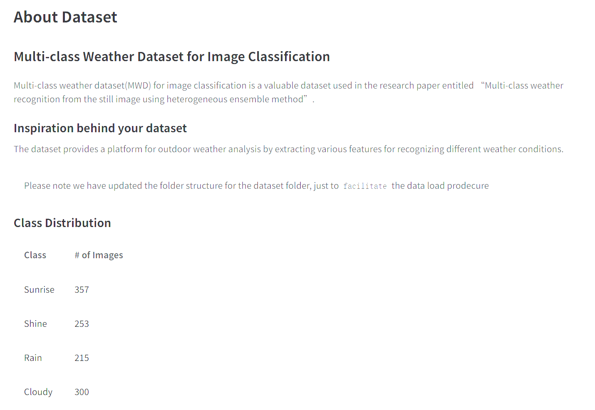

> 我们在上一篇数据类型和使用中学习了**张量**的基本概念和使用，接下来我们继续学习PyTorch关于神经网络搭建的内容。如果Tensor是**乐高积木块**，Autograd是**积木间的连接规则**，那么nn.Module就是**现成的积木模型套装说明书**，让你不再需要从零开始思考每块积木怎么拼。

* * *

## 1 动态计算图

### 1.1 概念解释

**动态计算图（Dynamic Computation Graph）**​ 是PyTorch的“灵魂”。每个对`requires_grad=True`的张量的操作都会立即被一个由`autograd.Function`对象代表的节点记录到图中。这些节点通过边（张量依赖关系）连接，形成一个有向无环图（DAG），它记录了完整的计算历史，以便在反向传播时自动计算梯度与TensorFlow早期的静态图不同，PyTorch的计算图是在代码运行时**动态创建**的。这意味着：

1.  **图随代码动**：每次前向传播都会创建一个新的计算图。
    
2.  **调试友好**：可以使用常规Python调试工具。
    
3.  **条件控制灵活**：可以轻松在图中使用if、for等控制流语句。
    

**Autograd（自动求导）**​ 系统则负责记录这个动态图上的所有操作，并在反向传播时自动计算梯度。

### 1.2 关键API

| 
API

 | 

作用

 | 

解释

 |
| --- | --- | --- |
| 

`tensor.requires_grad = True`

 | 

标记该Tensor需要跟踪梯度

 | 

给积木贴上"可追踪"标签

 |
| 

`tensor.backward()`

 | 

自动计算所有梯度并累积

 | 

自动计算每个积木的影响

 |
| 

`torch.no_grad()`

 | 

上下文管理器，禁用梯度跟踪

 | 

暂时关闭"对积木的追踪"

 |
| 

`tensor.detach()`

 | 

返回一个不需要梯度的新Tensor

 | 

复制一份"只读"的积木

 |
| 

`tensor.grad`

 | 

查看该Tensor的梯度值

 | 

查看积木被调整的方向和力度

 |

### 1.3 代码实现

```python
import torch

# 创建需要梯度的参数
C = torch.tensor([0., 10., 20., 30.], requires_grad=False)  # 输入数据通常不需要梯度
w = torch.tensor(2.0, requires_grad=True)  # 需要学习的参数
b = torch.tensor(32.0, requires_grad=True)  # 需要学习的参数

# 前向传播（动态创建计算图）
F_pred = w * C + b
F_true = torch.tensor([32., 50., 68., 86.])

# 计算损失
loss = ((F_pred - F_true) ** 2).mean()
print(f"初始损失: {loss.item():.4f}")

# 反向传播（自动计算梯度）
loss.backward()

# 查看梯度
print(f"w的梯度: {w.grad.item():.4f}")
print(f"b的梯度: {b.grad.item():.4f}")
```

### 1.4 输出分析

```XML
初始损失: 14.0000 # 因为初始w=2.0, b=32并非是正确公式
w的梯度: 140.0000  # 负数表示需要减少w来减少损失
b的梯度: 6.0000    # 负数表示需要减少b来减少损失
```

梯度告诉我们：如果**稍微增加**w和b的值，损失函数会下降。这就是优化器调整参数的依据。

### 1.5 注意事项

1.  **梯度累积**：多次`.backward()`调用会导致梯度累积，通常需要在每次优化前`zero_grad()`
    
2.  **内存开销**：保留计算图会占用内存，评估时应用`with torch.no_grad():`
    

* * *

## 2 神经网络构建

### 2.1 概念解释

`nn.Module`是所有神经网络模块的基类。它提供了：

1.  **参数管理**：自动跟踪所有`nn.Parameter（定义和管理模型内部需要学习的参数的一种张量）`
    
2.  **层次化组织**：可以将模块嵌套使用
    
3.  **设备移动**：`.to(device)`一键移动所有参数到GPU/CPU
    
4.  **状态管理**：`.train()`和`.eval()`模式切换
    

### 2.2 关键API

| 
API

 | 

作用

 | 

对应上一章的实现

 |
| --- | --- | --- |
| 

`nn.Linear(in, out)`

 | 

全连接层

 | 

手动实现的`w1*x + b1`

 |
| 

`nn.ReLU()`

 | 

激活函数

 | 

手动实现的`F.relu()`

 |
| 

`nn.Sequential()`

 | 

顺序容器

 | 

手动串联的层

 |
| 

`nn.Conv2d()`

 | 

卷积层

 | 

\-

 |
| 

`nn.MaxPool2d()`

 | 

池化层

 | 

\-

 |
| 

`model.parameters()`

 | 

获取所有参数

 | 

手动管理的w1,b1,w2,b2

 |
| 

`model.to(device)`

 | 

移动模型到设备

 | 

手动移动每个Tensor

 |

### 2.3 代码实现

假设我们要识别图片是"猫"还是"狗"，图片简化成4x4=16像素：

```python
import torch
import torch.nn as nn
import torch.nn.functional as F

# 方法1：使用nn.Sequential（快速原型）
MiniNet1 = nn.Sequential(
    nn.Linear(16, 8),  # 16像素输入 -> 8个神经元
    nn.ReLU(),
    nn.Linear(8, 2)  # 8神经元 -> 2类输出（猫/狗）
)

# 方法2：继承nn.Module
class MiniNet2(nn.Module):
    def __init__(self):
        super().__init__()  # 必须调用父类初始化
        # 定义网络层
        self.fc1 = nn.Linear(16, 8)  # 全连接层1
        self.fc2 = nn.Linear(8, 2)  # 全连接层2
        # 注意：ReLU没有需要学习的参数，可以不用定义为属性

    def forward(self, x):
        """定义数据如何流过网络"""
        x = self.fc1(x)  # [batch, 16] -> [batch, 8]
        x = F.relu(x)  # 激活函数
        x = self.fc2(x)  # [batch, 8] -> [batch, 2]
        return x

# 创建网络实例
model = MiniNet2()
print("网络结构:")
print(model)

# 查看参数
print("\n参数统计:")
total_params = sum(p.numel() for p in model.parameters())
print(f"总参数量: {total_params}")  # (16 * 8+8) + (8 * 2+2) = 136+18 = 154

batch_size = 4
dummy_input = torch.randn(batch_size, 16)  # 4张16像素的"图片"
output = model(dummy_input)
print(f"\n输入形状: {dummy_input.shape}")
print(f"输出形状: {output.shape}")
```

### 2.4 输出分析

```XML
网络结构:
MiniNet2(
  (fc1): Linear(in_features=16, out_features=8, bias=True)
  (fc2): Linear(in_features=8, out_features=2, bias=True)
)

参数统计:
总参数量: 154

输入形状: torch.Size([4, 16])
输出形状: torch.Size([4, 2])
```

可以看到：

1.  `nn.Module`自动管理了所有层的参数
    
2.  前向传播只需要调用`model(x)`，不再需要手动写计算步骤
    
3.  输出形状符合预期，可以直接用于计算损失
    

### 2.5 注意事项

1.  **必须调用`super().__init__()`**：否则无法正确初始化
    
2.  **参数命名规范**：使用`self.xxx`定义的层会被自动识别为子模块
    
3.  **forward是覆盖不是调用**：定义执行逻辑，不直接调用`model.forward(x)`，而是`model(x)`
    

* * *

## 3 训练循环

### 3.1 概念解释

训练神经网络需要三个核心组件：

1.  **损失函数（Loss Function）**：衡量预测与真实的差距
    
2.  **优化器（Optimizer）**：根据梯度调整参数
    
3.  **学习率（Learning Rate）**：每次参数调整的步长
    

### 3.2 关键API

| 
API

 | 

作用

 | 

数学含义

 |
| --- | --- | --- |
| 

`nn.CrossEntropyLoss`

 | 

分类损失

 | 

交叉熵损失

 |
| 

`nn.MSELoss`

 | 

回归损失

 | 

均方误差

 |
| 

`optim.SGD`

 | 

随机梯度下降

 | 

`w = w - lr * grad`

 |
| 

`optim.Adam`

 | 

自适应矩估计

 | 

带动量的一阶优化

 |
| 

`lr_scheduler`

 | 

学习率调度

 | 

动态调整学习率

 |

### 3.3 代码实现

让我们用标准PyTorch方式重写温度转换器的训练：

```python
import torch
import torch.nn as nn
import torch.optim as optim

# 1. 准备数据
C_data = torch.tensor([[0.], [10.], [20.], [30.]])  # 摄氏温度
F_data = torch.tensor([[32.], [50.], [68.], [86.]])  # 华氏温度

# 2. 定义模型（这次用nn.Module）
class TemperatureConverter(nn.Module):
    def __init__(self):
        super().__init__()
        self.linear = nn.Linear(1, 1)  # 输入1维，输出1维
    
    def forward(self, x):
        return self.linear(x)

# 3. 初始化
model = TemperatureConverter()
criterion = nn.MSELoss()  # 回归问题用均方误差
optimizer = optim.SGD(model.parameters(), lr=0.0001)  # 很小的学习率

print("初始参数:")
print(f"  权重 w: {model.linear.weight.data.item():.4f}")
print(f"  偏置 b: {model.linear.bias.data.item():.4f}")

# 4. 训练循环
epochs = 1000
for epoch in range(epochs):
    # 前向传播
    predictions = model(C_data)
    loss = criterion(predictions, F_data)
    
    # 反向传播
    optimizer.zero_grad()  # 重要！清空上一步的梯度
    loss.backward()        # 计算梯度
    
    # 更新参数
    optimizer.step()       # 根据梯度更新参数
    
    # 每100轮打印一次
    if (epoch + 1) % 100 == 0:
        w = model.linear.weight.data.item()
        b = model.linear.bias.data.item()
        print(f'Epoch [{epoch+1:4d}/{epochs}], Loss: {loss.item():.8f}, w={w:.4f}, b={b:.4f}')

# 5. 测试
print("\n测试:")
test_C = torch.tensor([[25.]])
pred_F = model(test_C)
true_F = 25 * 1.8 + 32  # 真实公式
print(f"输入: {test_C.item()}°C")
print(f"预测: {pred_F.item():.2f}°F")
print(f"真实: {true_F:.2f}°F")
```

### 3.4 输出分析

```python
初始参数:
  权重 w: 0.6205
  偏置 b: -0.9817
Epoch [  10/100], Loss: 1021.85839844, w=1.9575, b=-0.9009
Epoch [  20/100], Loss: 533.51440430, w=2.6032, b=-0.8497
Epoch [  30/100], Loss: 419.02142334, w=2.9148, b=-0.8129
Epoch [  40/100], Loss: 391.85729980, w=3.0649, b=-0.7830
Epoch [  50/100], Loss: 385.09307861, w=3.1369, b=-0.7566
Epoch [  60/100], Loss: 383.09478760, w=3.1711, b=-0.7317
Epoch [  70/100], Loss: 382.21023560, w=3.1872, b=-0.7076
Epoch [  80/100], Loss: 381.58648682, w=3.1944, b=-0.6840
Epoch [  90/100], Loss: 381.02420044, w=3.1974, b=-0.6605
Epoch [ 100/100], Loss: 380.47692871, w=3.1984, b=-0.6371

测试:
输入: 25.0°C
预测: 79.32°F
真实: 77.00°F
```

可以看到：

1.  **损失逐渐下降**：说明学习过程有效
    
2.  **参数接近真实值**：w和b逐渐调整
    
3.  **还有差距**：需要更多训练轮次或调整学习率
    

### 3.5 注意事项

1.  **梯度清零必须在backward前**：`optimizer.zero_grad()`是标准步骤
    
2.  **学习率选择很重要**：太大可能震荡，太小收敛慢
    
3.  **损失函数要匹配任务**：分类用交叉熵，回归用均方误差
    

* * *

## 4 项目实战

### 4.1 项目目标

        构建一个能够自动识别图片中天气类型（晴天、雨天、多云、雪天）的深度学习模型，熟悉完整的PyTorch开发流程。

### 4.2 数据介绍

**Multi-class Weather Dataset**

### 

### 4.3 代码实现

#### 4.3.1 数据加载

```python
from torch.utils.data import Dataset
from torchvision import transforms
import os
from PIL import Image


class WeatherDataset(Dataset):
    def __init__(self, data_dir, transform=None):
        self.data_dir = data_dir
        self.transform = transform
        self.classes = ['Rain', 'Shine', 'Cloudy', 'Sunrise']
        self.image_paths = []
        self.labels = []

        # 遍历目录收集图片路径和标签
        for class_idx, class_name in enumerate(self.classes):
            class_dir = os.path.join(data_dir, class_name)
            for img_name in os.listdir(class_dir):
                self.image_paths.append(os.path.join(class_dir, img_name))
                self.labels.append(class_idx)

    def __len__(self):
        return len(self.image_paths)

    def __getitem__(self, idx):
        image = Image.open(self.image_paths[idx]).convert('RGB')
        label = self.labels[idx]

        if self.transform:
            image = self.transform(image)

        return image, label


# 数据增强和预处理
train_transform = transforms.Compose([
    transforms.Resize((224, 224)),          # 调整图像尺寸以适应网络输入
    transforms.RandomHorizontalFlip(p=0.5), # 以50%概率随机水平翻转，增加数据多样性
    transforms.ToTensor(),                  # 将PIL图像转换为张量，并归一化像素值到[0,1]
    transforms.Normalize(                   # 用ImageNet的均值和标准差进行标准化
        mean=[0.485, 0.456, 0.406],
        std=[0.229, 0.224, 0.225]
    ),
])

val_transform = transforms.Compose([
    transforms.Resize((224, 224)),
    transforms.ToTensor(),
    transforms.Normalize(mean=[0.485, 0.456, 0.406],
                         std=[0.229, 0.224, 0.225])
])
```

#### 4.3.2 模型架构

```python
import torch.nn as nn

class WeatherCNN(nn.Module):
    def __init__(self, num_classes=4):
        super(WeatherCNN, self).__init__()
        self.conv_layers = nn.Sequential(
            # 第一层卷积块
            nn.Conv2d(3, 32, kernel_size=3, padding=1),
            nn.ReLU(),
            nn.MaxPool2d(2),

            # 第二层卷积块
            nn.Conv2d(32, 64, kernel_size=3, padding=1),
            nn.ReLU(),
            nn.MaxPool2d(2),

            # 第三层卷积块
            nn.Conv2d(64, 128, kernel_size=3, padding=1),
            nn.ReLU(),
            nn.MaxPool2d(2),
        )

        self.classifier = nn.Sequential(
            nn.Dropout(0.5),  # 添加Dropout防止过拟合
            nn.Linear(128 * 28 * 28, 512),
            nn.ReLU(),
            nn.Dropout(0.3),
            nn.Linear(512, num_classes)
        )

    def forward(self, x):
        x = self.conv_layers(x)
        x = x.view(x.size(0), -1)  # 展平
        x = self.classifier(x)
        return x
```

#### 4.3.3 训练实现

```python
import torch
import torch.nn as nn
import torch.optim as optim
from torch.utils.data import DataLoader, random_split
from torchvision import transforms
import os

from demo.data.data_loader import WeatherDataset
from demo.model.model import WeatherCNN


def train_model(model, train_loader, val_loader, criterion, optimizer, num_epochs=20, device='cpu'):
    """
    训练模型并验证
    Args:
        model: 要训练的模型
        train_loader: 训练数据加载器
        val_loader: 验证数据加载器
        criterion: 损失函数
        optimizer: 优化器
        num_epochs: 训练轮数
        device: 训练设备 ('cpu' 或 'cuda')
    """
    best_acc = 0.0
    train_losses = []
    val_accuracies = []

    print(f"开始训练，使用设备: {device}")
    model.to(device)  # 将模型移动到指定设备

    for epoch in range(num_epochs):
        # 训练模式
        model.train()
        running_loss = 0.0
        running_corrects = 0
        batch_count = 0

        for batch_idx, (inputs, labels) in enumerate(train_loader):
            # 检查批次是否为空 [1](@ref)
            if inputs.numel() == 0 or labels.numel() == 0:
                print(f"Epoch {epoch + 1}, 批次 {batch_idx} 为空，跳过")
                continue

            inputs, labels = inputs.to(device), labels.to(device)

            optimizer.zero_grad()
            outputs = model(inputs)
            loss = criterion(outputs, labels)
            loss.backward()
            optimizer.step()

            running_loss += loss.item() * inputs.size(0)
            _, preds = torch.max(outputs, 1)
            running_corrects += torch.sum(preds == labels.data)
            batch_count += 1

        # 如果所有批次都为空，跳过该epoch
        if batch_count == 0:
            print(f"Epoch {epoch + 1} 没有有效数据，跳过")
            continue

        epoch_loss = running_loss / len(train_loader.dataset)
        epoch_acc = running_corrects.double() / len(train_loader.dataset)
        train_losses.append(epoch_loss)

        # 验证模式
        val_acc = evaluate_model(model, val_loader, device)
        val_accuracies.append(val_acc)

        print(f'Epoch {epoch + 1}/{num_epochs}:')
        print(f'训练损失: {epoch_loss:.4f}, 训练准确率: {epoch_acc:.4f}')
        print(f'验证准确率: {val_acc:.4f}')

        # 保存最佳模型 [6](@ref)
        if val_acc > best_acc:
            best_acc = val_acc
            checkpoint = {
                'epoch': epoch,
                'model_state_dict': model.state_dict(),
                'optimizer_state_dict': optimizer.state_dict(),
                'best_acc': best_acc,
                'loss': epoch_loss
            }
            torch.save(checkpoint, '../model/model.pth')
            print(f"保存最佳模型，验证准确率: {best_acc:.4f}")

    return train_losses, val_accuracies


def evaluate_model(model, data_loader, device='cpu'):
    """评估模型性能"""
    model.eval()  # 切换到评估模式
    correct = 0
    total = 0

    with torch.no_grad():  # 禁用梯度计算
        for inputs, labels in data_loader:
            # 检查空批次 [1](@ref)
            if inputs.numel() == 0:
                continue

            inputs, labels = inputs.to(device), labels.to(device)
            outputs = model(inputs)
            _, predicted = torch.max(outputs.data, 1)
            total += labels.size(0)
            correct += (predicted == labels).sum().item()

    return correct / total if total > 0 else 0.0


def create_data_loaders(data_dir, batch_size=32, validation_split=0.2):
    """创建训练和验证数据加载器"""
    # 数据预处理 [9](@ref)
    train_transform = transforms.Compose([
        transforms.Resize((224, 224)),
        transforms.RandomHorizontalFlip(p=0.5),
        transforms.RandomRotation(degrees=10),
        transforms.ToTensor(),
        transforms.Normalize(mean=[0.485, 0.456, 0.406],
                             std=[0.229, 0.224, 0.225])
    ])

    val_transform = transforms.Compose([
        transforms.Resize((224, 224)),
        transforms.ToTensor(),
        transforms.Normalize(mean=[0.485, 0.456, 0.406],
                             std=[0.229, 0.224, 0.225])
    ])

    # 创建完整数据集
    full_dataset = WeatherDataset(data_dir=data_dir, transform=train_transform)

    # 划分训练集和验证集
    dataset_size = len(full_dataset)
    val_size = int(validation_split * dataset_size)
    train_size = dataset_size - val_size

    train_dataset, val_dataset = random_split(full_dataset, [train_size, val_size])

    # 为验证集单独设置transform
    val_dataset.dataset = val_dataset.dataset  # 保持对原始数据集的引用
    val_dataset.transform = val_transform

    # 创建数据加载器 [10](@ref)
    train_loader = DataLoader(
        train_dataset,
        batch_size=batch_size,
        shuffle=True,  # 训练时打乱数据
        num_workers=2,
        pin_memory=True if torch.cuda.is_available() else False  # GPU加速
    )

    val_loader = DataLoader(
        val_dataset,
        batch_size=batch_size,
        shuffle=False,  # 验证时不需要打乱
        num_workers=2,
        pin_memory=True if torch.cuda.is_available() else False
    )

    print(f"数据集统计: 总样本数: {dataset_size}, 训练集: {train_size}, 验证集: {val_size}")
    return train_loader, val_loader


def main():
    # 设置设备
    device = torch.device('cuda' if torch.cuda.is_available() else 'cpu')
    print(f"使用设备: {device}")

    # 数据目录
    data_dir = '../data/Multi-class Weather Dataset'

    # 创建数据加载器
    train_loader, val_loader = create_data_loaders(data_dir, batch_size=32)

    # 检查数据集是否为空
    if len(train_loader.dataset) == 0:
        print("错误: 训练数据集为空")
        return

    # 初始化模型
    model = WeatherCNN(num_classes=4)

    # 损失函数和优化器
    criterion = nn.CrossEntropyLoss()
    optimizer = optim.SGD(model.parameters(), lr=0.001, momentum=0.9)

    # 训练模型
    train_losses, val_accuracies = train_model(
        model, train_loader, val_loader, criterion, optimizer,
        num_epochs=20, device=device
    )

    print("训练完成!")
    print(f"最终训练损失: {train_losses[-1]:.4f}")
    print(f"最终验证准确率: {val_accuracies[-1]:.4f}")


def load_trained_model(model_path, num_classes=4, device='cpu'):
    """加载训练好的模型进行预测"""
    model = WeatherCNN(num_classes=num_classes)
    checkpoint = torch.load(model_path, map_location=device)
    model.load_state_dict(checkpoint['model_state_dict'])
    model.to(device)
    model.eval()  # 设置为评估模式
    return model


if __name__ == '__main__':
    main()
```

#### 4.3.4 推理实现

```python

from demo.model.model import WeatherCNN
from torchvision import transforms
from PIL import Image
import torch
import torch.nn.functional as F

# 加载模型进行推理
def load_model_for_inference(model_path, num_classes=4):
    model = WeatherCNN(num_classes=num_classes)
    checkpoint = torch.load(model_path, map_location='cpu')
    model.load_state_dict(checkpoint['model_state_dict'])
    model.eval()  # 重要：切换到评估模式
    return model


# 使用训练好的模型进行预测
def predict_weather(image_path, model, class_names):
    transform = transforms.Compose([
        transforms.Resize((224, 224)),
        transforms.ToTensor(),
        transforms.Normalize(mean=[0.485, 0.456, 0.406],
                             std=[0.229, 0.224, 0.225])
    ])

    image = Image.open(image_path).convert('RGB')
    image_tensor = transform(image).unsqueeze(0)

    with torch.no_grad():
        output = model(image_tensor)
        probabilities = F.softmax(output, dim=1)
        confidence, predicted = torch.max(probabilities, 1)

    return class_names[predicted.item()], confidence.item()

def main():
    print('Loading model...')
    model = load_model_for_inference('../model/model.pth')
    class_name = ['Rain', 'Shine', 'Cloudy', 'Sunrise']
    name,acm = predict_weather("../data/Multi-class Weather Dataset/Cloudy/cloudy1.jpg",model,class_name)
    print("预测类别为"+ name + "置信度" + str(acm))

if __name__ == '__main__':
    main()
```

输出分析

```XML
Loading model...
预测类别为Cloudy置信度0.7828369140625
```

* * *

## 5 本章总结

通过本章，我们完成了从"手动操作Tensor"到"规范使用PyTorch API"的重要升级：

| 
上一章的内容实现

 | 

本章的内容实现

 | 

优势

 |
| --- | --- | --- |
| 

手动定义w1,b1,w2,b2

 | 

使用`nn.Linear`等预定义层

 | 

自动参数管理，代码简洁

 |
| 

手动计算前向传播

 | 

在`forward`方法中定义流程

 | 

逻辑清晰，易于调试

 |
| 

手动管理梯度

 | 

使用`optimizer`自动优化

 | 

支持多种优化算法

 |
| 

固定网络结构

 | 

`nn.Module`支持动态结构

 | 

可创建条件分支、循环等复杂网络

 |
| 

无训练/评估模式区分

 | 

使用`.train()`和`.eval()`

 | 

正确处理Dropout、BatchNorm等

 |

**关键收获**：

1.  **动态计算图**是PyTorch的核心优势，让调试和实验变得简单
    
2.  **nn.Module**是构建网络的标准化方式，一定要掌握
    
3.  **训练循环四步曲**：前向→计算损失→反向传播→优化器更新
    
4.  **设备管理和模式切换**是专业代码的必备部分
    

* * *

2026.02.09
